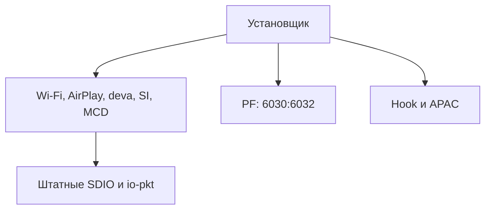

# Финальный справочник патчей штатных компонентов

Состояние решения: 2026-10-24. Исследования ускорения штатного сетевого стека завершены. В установку входит полный Wi-Fi-драйвер `47a370bc`; SDIO и io-pkt остаются штатными. PF сохраняет только необходимые портовые изменения. Новые QoS, приоритет по IP телефона и SDIO-coalescing исключены.

Это справочник выбранной конфигурации и воспроизводимых исходников. Он не означает, что все изменения текущей рабочей ветки уже выпущены или установлены на машине. Разработка wireless-протокола продолжается отдельно.

## 📦 Состав

| Компонент | Решение | Назначение и описание |
| --- | --- | --- |
| `devnp-mrvl_wlan-sdiorm.so` | Полный патч `47a370bc` | [RX reorder, таймеры, TX-пробуждения](devnp-mrvl_wlan-sdiorm.so.md) |
| `libairplay.so` | Две правки глубины очереди | [Декодер основного экрана и AltScreen](libairplay.so.md) |
| `deva-ctrl-qc.so` | Полный патч `e2216037` | [Шестиканальная геометрия PCM, DMA и CSD](deva-ctrl-qc.so.md) |
| `smartphone_integrator` | Исправление USB rearm | [Направление повторного взведения](smartphone_integrator.md) |
| `mcd` и `mcd.conf` | Ограничение повторных сканирований | [Период ожидания и приоритет](mcd.md) |
| `io-sdiorm-mib2-qc` | Сток `ec30174b` | [Роль SDIO и причины отказа от патча](REJECTED_CONCEPTS.md) |
| `io-pkt-v6-hc` | Сток | [Границы сетевых изменений](REJECTED_CONCEPTS.md) |
| PF | Только открытие портов | [Порты, установка и библиотеки проекта](CONFIGURATION_AND_HOOKS.md) |
| `libcarplay_hook.so`, `libcarplay_apac.so` | Собственные библиотеки | [Runtime-функции проекта](CONFIGURATION_AND_HOOKS.md) |

## 🧪 Подтверждённые результаты

[Измерения](PERFORMANCE.md) отделяют реальные тесты ГУ от моделей QEMU/Unicorn. Последняя выбранная конфигурация дала TCP Mac → ГУ **44,7–46,6 Мбит/с**, ГУ → Mac **34,9–35,6 Мбит/с**. В четырёх UDP-фазах на 30/45 Мбит/с потерь не было: **0 из 317879 пакетов**. PF QoS при этих тестах отсутствовал.

Это короткий тест одного стенда, а не гарантия любой радиосреды. Сравнение не доказывает отдельный прирост от Wi-Fi-патча относительно полностью штатного драйвера. CPU измеряется в процентах одного ядра: 100% = одно ядро, суммарно четыре ядра дают 400%.

## 🔧 Источники и воспроизведение

| Задача | Источник |
| --- | --- |
| Точные байты, SHA и смещения трёх небольших патчей и deva | [Каталог](evidence/binary-patches.json) |
| Wi-Fi: полный перечень точек, сборка, SHA | [Build receipt](../../deploy/wifi/runtime/build-receipt.json) |
| Wi-Fi: устанавливаемые файлы и допустимый io-pkt | [Manifest](../../deploy/wifi/runtime/manifest.json) |
| SI, AirPlay, MCD | [binpatch.py](../../deploy/binpatch/binpatch.py) |
| Установка и отказ от старых SDIO/PF-пакетов | [custom.sh](../../install_MoreIncredibleBash/mod/custom.sh) |
| Проверка состава сетевого пакета | [network_patcher.py](../../scripts/network_patcher.py) |

Каждый компонент ниже описывает механизм, границы поддержки и проверку. Сохранены исходники финального результата; старые реализации кандидатов удалены, их выводы сведены в [отклонённые концепции](REJECTED_CONCEPTS.md). Очистка не переписывает историю Git и не удаляет активные рабочие деревья.

## ✅ Проверка после консолидации

[Историческая локальная проверка](evidence/cleanup-validation.json) (сохранённый отчёт относится к тогдашним артефактам, включая прежний deva `398e7213`, а не к текущему `e2216037`): точное воспроизведение Wi-Fi и deva, TX 28/28, RX 12/12, установщик Wi-Fi 49 случаев, network patcher 10 тестов. Проверены сигнатурные патчи CPython/MicroPython и ссылки новых документов; обе Mermaid-диаграммы успешно отрисованы. Новых измерений ГУ при этой уборке не выполнялось.

Проверка воспроизводимости deva 2026-10-29: `deploy/deva-ctrl-qc/build_final.py` применён к `deva-ctrl-qc.so.stock`; результат побайтово совпал с `deva-ctrl-qc.so.patched`, SHA-256 `e2216037dcecf00040e69aaf84d7c9e3e390ac583849ab7b62f308eed2432b99`. Это локальная проверка каталога патчей; новых испытаний на ГУ она не заменяет.
