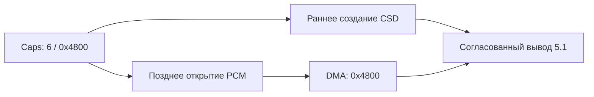

# deva-ctrl-qc.so: шестиканальный аудиотракт

## 📦 Выбранный патч

Файл ГУ: `/mnt/app/armle/lib/dll/deva-ctrl-qc.so`. Выбран полный результат `e2216037`: геометрия `mpl5_dio_ent` согласована между caps, активным DMA и CSD-сессией, а каналы CarPlay навигации (`ann3_dio_ann`), голоса/Siri (`ann4_dio_voice`) и телефонии (`tel2_dio_phone`) переведены со стоковых 16 kHz на 48 kHz и 24 kHz.

| Свойство | Значение |
| --- | --- |
| Размер stock и patched | 694904 байт |
| Отличающихся байтов | 140 |
| SHA stock | `58dddcabaa94c2fecf989855a6f810ec219926f49669a0ed9482ed629fdc64b9` |
| SHA patched | `e2216037dcecf00040e69aaf84d7c9e3e390ac583849ab7b62f308eed2432b99` |
| Поставляемый файл | [deva-ctrl-qc.so.patched](../../deploy/deva-ctrl-qc/deva-ctrl-qc.so.patched) |

## 🔧 Изменения

Caps record `mpl5_dio_ent`, индекс 4: file `0xa6e04`, stride 48. Таблица VA `0xa7d44`, file `0xa6d44`; для этой data-области VA = file + `0x1000`.

| Поле record | Stock | Full |
| --- | --- | --- |
| `+0x14 min_voices` | 2 | 6 |
| `+0x18 max_voices` | 2 | 6 |
| `+0x1c min_fragsize` | `0x1800` | `0x4800` |
| `+0x20 max_fragsize` | `0x1800` | `0x4800` |
| `+0x24 max_buffer` | `0xf000` | `0x2d000` |
| `+0x28 max_frags` | 10 | 10 |

Дополнительно в `caps_table` обновлены голосовые и навигационные каналы CarPlay (16 ms fragment geometry):

| Канал (`dev_id`, file offset) | Stock | Full | Эталон в `caps_table` |
| --- | --- | --- | --- |
| `ann3_dio_ann` (`9`, `0xa6ef4`) | `16000 Hz` (`0x0008`), `frag=0x200`, `buf=0x1400` | `48000 Hz` (`0x0080`), `frag=0x600`, `buf=0x3c00` | `ann9_mirror_lnk` (`15`, `0xa7014`, CSD `#14`) |
| `ann4_dio_voice` (`10`, `0xa6f24`) | `16000 Hz` (`0x0008`), `frag=0x200`, `buf=0x1400` | `24000 Hz` (`0x1000`), `frag=0x300`, `buf=0x1e00` | `ann2_int_sds` (`8`, `0xa6ec4`, CSD `#66`) |
| `tel2_dio_phone` (`19`, `0xa70d4`) | `16000 Hz` (`0x0008`), `frag=0x200`, `buf=0x1400` | `24000 Hz` (`0x1000`), `frag=0x300`, `buf=0x1e00` | `ann2_int_sds` (`8`, `0xa6ec4`, 24 kHz Wideband) |

В `deva_mib2_aquire` по `0x563c8` добавлен вызов helper `0x8f2c8`: для шести voices активный fragment становится `0x4800`. Иначе расширенные caps оставляли активный fragment `0x1800`, что давало втрое медленное воспроизведение.

В `deva_update_session_info_from_list` ветвь `0x54a14` ведёт к helper `0x8d090`. Он предпочитает live channel через timer `+0x11c`, voices `+0x10`, fragment `+0x94`, а при его отсутствии использует record. Helpers занимают хвосты диагностических строк, которые предварительно завершаются нулём. [Каталог](evidence/binary-patches.json) содержит каждый изменённый диапазон и точные байты.



## 🧪 Почему промежуточные варианты не подошли

В сохранённом slog CSD-route attach происходил в `00:00:38`, а PCM 6ch открывался лишь в `00:00:52`. Live-channel helper при раннем attach закономерно выбирал stereo fallback. CSD копировал `0x1800` из `0x4800` каждые 16 мс: 256 из 768 frames, с артефактом 62,5 Гц при правильном sample clock.

Финальный record повторяет рабочую геометрию `mpl1_int_ent` уже на attach. Старое утверждение «повышать minima нельзя, stereo перестанет работать» опровергнуто: QSA вставляет конверсию каналов. В историческом тесте ГУ от 2026-09-02 подтверждены и дискретный 5.1 при `AUDIO_SPATIAL=1`, и stereo при `AUDIO_SPATIAL=0`. Это сохранённый результат, а не новый тест после очистки документов.

## 📦 Воспроизведение и применение

```sh
python3 deploy/deva-ctrl-qc/build_final.py   deploy/deva-ctrl-qc/deva-ctrl-qc.so.stock /tmp/deva-ctrl-qc.so.patched
```

Единый builder использует [точные диапазоны](evidence/binary-patches.json), проверяет полный входной и выходной SHA, запрещает перезапись входа. Он воспроизводит выбранные байты без потерянного промежуточного `build/cave.bin`. Геометрия и helpers сохранены; новая логика бинарника при этой консолидации не добавляется.

Установка: staged copy, `chmod 755`, rename; библиотека уже отображена в `io-audio`, поэтому применяется после его нового запуска/перезагрузки ГУ. `gate_audio()` проверяет усилитель: внешнее EEPROM `0xFC02` разрешает spatial; внутренний/непрочитанный выключает `AUDIO_SPATIAL` и `AUDIO_ATMOS`. Это ограничение функций hook, а не условие копирования deva. Откат — штатная библиотека, затем перезагрузка владельцем.
