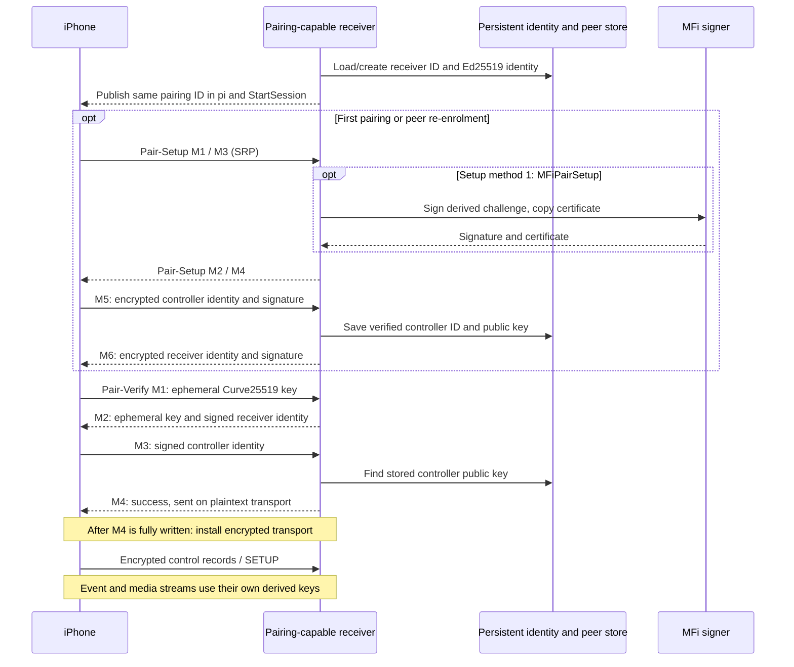

# AirPlay 280.33.8 pairing: source recipe for the stock-210 extension

_MHI2Q wireless CarPlay — technical reference, integrated 2026-09-29._

---

[Wireless overview](README.md) · [Current stock210 lifecycle](STOCK210_RECEIVER_LIFECYCLE.md)

Maintained technical reference. The evidence below distinguishes static analysis, local QNX tests and observations from the unit.

Implementation and local diagnostic paths in this record refer to the [original source directory](../../wireless/). Run `wireless/...` commands from the repository root; moving this note does not move binaries or logs.

Offline static analysis, 2026-09-28. The source supplied by the owner is
`<workspace>/Refferences/Carplay`; its
`Sources/AirPlayVersion.h:60` declares **280.33.8**. This document explains
normal authenticated pairing, including where the real MFi signer is used.
No HU connection, binary patch, deployment, restart, or new runtime test was
performed for this analysis.

The result is a protocol and integration recipe, not a completed wireless
receiver. Stock MU1316 AirPlay 210.81 can remain the back end, but its extension
must implement pairing, encrypted control, and event/media security. Merely
adding two HTTP routes cannot supply the latter.

Implementation follow-up (2026-09-29): Setup/Verify and encrypted control
are implemented inside [`hook/wireless`](../../hook/wireless/README.md),
with private SDK symbols and stock-210 HTTP adapters. The daemon `pi` contract
is corrected. Event/media integration remains a separate outstanding step;
the source recipe below should not be read as a runtime validation report.

<a id="evidence-and-version-boundaries"></a>

## 🧪 Evidence and version boundaries

Source paths below are relative to the owner's `Refferences/Carplay`:

| Source | Relevant code |
|---|---|
| `Sources/AirPlayReceiverServer.c:916` | Copy/create persistent receiver pairing identity. |
| `Sources/AirPlayReceiverServer.c:3289` | Pair-Setup handler, fixed no-PIN code, session ownership. |
| `Sources/AirPlayReceiverServer.c:3372` | Post-response encryption installation. |
| `Sources/AirPlayReceiverServer.c:3416` | Pair-Verify handler and completion callback. |
| `Sources/AirPlayReceiverServer.c:3887` | Pass verified context into media SETUP. |
| `AccessorySDK/Support/PairingUtils.c:1343` | Server Pair-Setup state machine. |
| `AccessorySDK/Support/PairingUtils.c:1940` | Server Pair-Verify state machine. |
| `AccessorySDK/Support/PairingUtils.c:682` | Derive traffic keys from completed Verify. |
| `AccessorySDK/Support/PairingUtils.h:131` | Identity/peer persistence callbacks. |
| `AccessorySDK/Support/NetTransportChaCha20Poly1305.c:146` | Encrypted transport and record framing. |
| `Sources/AirPlayReceiverSession.c:2078` | Event-channel encryption. |
| `Sources/AirPlayReceiverSession.c:4731` | Screen security selection. |
| `Sources/AirPlayReceiverSession.c:5170` | Per-stream key derivation. |

SHA-256 fingerprints of the reference sources:

```text
AirPlayReceiverServer.c e69d07ffb8d33876d12d102077bef3ed15f4f133653e00f6c68812ef9d25a17c
AirPlayReceiverSession.c c18584f027d20d5f2cc2aea1b513b1bcfb1f8f7ea293ae126e963c71734b2582
PairingUtils.c          836d5c936062d92fe360bccf9798e91883fed71ddb5b74c134e424073c98f42d
```

The local staged QNX build is
`receiver_bridge/out/airplay280_qemu/libairplay.qemu.so`, SHA-256
`336e6f548949c120a0d514834b7023c91d5472b24a70fd9d0aa41b19122a900a`.
Its `PairingUtils.c` is byte-identical to the reference. Its receiver source
has QEMU/platform adaptations, restored pairing publication/routes, and MIME
fixes; it is not an untouched factory image. The factory MH2p library inspected
in this workspace reports **320.17.1**, so its addresses are not 280 addresses.

The decisive receiver handlers and HTTP completion ordering were also
decompiled from this exact local 280 build. Excerpts:
[output/airplay280_pairing](../../wireless/output/airplay280_pairing).
For the iOS endpoint requirement, see
[ios_wireless_session_gates.md](IOS_WIRELESS_SESSION_GATES.md).

<a id="connection-sequence"></a>

## 📋 Connection sequence

Bluetooth pairing, iAP2 MFi authentication, and AirPlay pairing are distinct
exchanges. The first two establish the bootstrap transport and allow Wi-Fi /
StartSession delivery. The following exchange happens on the receiver's IP
control connection.



An already paired peer can use Verify without repeating Setup. A failed
verification must not silently become an authenticated connection. Peer-store
loss requires pairing recovery; it is not fixed by accepting an unknown key.

<a id="pair-setup-establish-persistent-trust"></a>

## 🔐 Pair-Setup: establish persistent trust

Both 280 route wrappers require a successfully parsed integer
`X-Apple-HKP` header. **`X-Apple-HKP: 0` selects the supported path too**:
the test is whether parsing succeeded, not whether the integer is nonzero.
An absent/unparseable header produces HTTP 403 in this source.

The server creates one `kPairingSessionType_SetupServer` (numeric type 2)
per HTTP connection, sets the AirPlay keychain namespace and suggested
identifier, then calls `PairingSessionExchange` for each request body. The
configured code is **`3939`**. This is corroborated on the phone side:

- iOS 26.1 `AirPlaySender_11.mm:6788` onward calls its internal setup routine
  with `@"3939"` in the no-PIN branch.
- iOS 27 `_coreUtilsPairing_PerformSetup`, VA `0x25104E40C`, passes the same
  string at `0x25104E4D8` when `requirePIN` is false. CFString
  `0x275B009A0` resolves to `"3939"` at `0x2511BAE5D` in the extracted cache.
  See [ios27_pair_setup.c](../../wireless/output/airplay280_pairing/ios27_pair_setup.c).

This identifies the no-PIN protocol mode, not a Bluetooth PIN, a chip secret,
or evidence that every AirPlay pairing mode uses that code.

| Message | Direction | Payload and action |
|---|---|---|
| M1 | Phone → HU | State 1, Method 0 (PairSetup) or 1 (MFiPairSetup). |
| M2 | HU → phone | State 2, random 16-byte salt, SRP-3072/SHA-512 public key (384 bytes). Username is `Pair-Setup`. |
| M3 | Phone → HU | State 3, client SRP public key and proof; server must validate proof. |
| M4 | HU → phone | State 4, server SRP proof; method 1 also carries encrypted MFi signature/certificate. |
| M5 | Phone → HU | State 5, encrypted controller identifier, Ed25519 public key (32), signature (64). Verify signature, then persist the peer. |
| M6 | HU → phone | State 6, encrypted receiver identifier, Ed25519 public key (32), signature (64). Setup completes. |

TLV8 types used here: Method `00`, Identifier `01`, Salt `02`, PublicKey `03`,
Proof `04`, EncryptedData `05`, State `06`, Error `07`, RetryDelay `08`,
Certificate `09`, Signature `0A`. Long values use the SDK's coalesced TLV8
encoding; a 384-byte SRP key is not a single one-byte-length TLV.

The setup encryption key is 32 bytes from HKDF-SHA-512 over the SRP shared
secret, salt `Pair-Setup-Encrypt-Salt`, info `Pair-Setup-Encrypt-Info`.
ChaCha20-Poly1305 uses the respective 8-byte nonces `PS-Msg04`, `PS-Msg05`,
`PS-Msg06`. For M5 the signed data is:

```text
HKDF(SRP-secret, Pair-Setup-Controller-Sign-Salt,
     Pair-Setup-Controller-Sign-Info, 32) || controllerID || controllerEdPK
```

M6 substitutes `Accessory` for `Controller` and signs the receiver identity.
The source calls `PairingSessionSavePeer` after validating M5 and before
successful M6. Failure to store the peer is an exchange failure. Completing
Setup releases its temporary context; it does **not** set `pairingVerified`.

For **method 1**, M4 requires the real MFi implementation:

```text
challenge32 = HKDF-SHA-512(SRP-secret,
                         MFi-Pair-Setup-Salt, MFi-Pair-Setup-Info, 32)
digest20 = SHA-1(challenge32)
signature = MFiPlatform_CreateSignature(digest20)
certificate = MFiPlatform_CopyCertificate()
```

The certificate and signature are encrypted inside M4. This is separate from
legacy `/auth-setup` / MFi-SAP and from iAP2 authentication; prior iAP2 success
does not justify returning an invented M4 signature. Which setup method the
phone requests must be observed/handled; this static audit does not assert
that every CarPlay attempt selects method 1. Our QEMU software-MFi stub has
dummy certificate/signature data and cannot establish real MFi interoperability.

The unmodified reference responds with binary-plist MIME for Setup and generic
binary MIME for Verify despite TLV8 bodies. Our staging script already corrects
both to `application/pairing+tlv8`; preserve that correction in the extension.
HTTP 200 alone is not a success predicate: Exchange can return a TLV Error
inside a successful HTTP response. Check TLV state/error and `done`.

<a id="identity-contract-pi-is-not-pk"></a>

## 📋 Identity contract: pi is not pk

`AirPlayCopyHomeKitPairingIdentity` creates a type-0 temporary pairing object,
sets the AirPlay store namespace, then obtains identifier and Ed25519 public
key. It does not first set a MAC identifier. On an empty store the identity
creator can generate a UUID; with an existing store it returns the existing
identity. The MAC passed later by the HTTP handlers does not replace it.

Use the **actual returned identifier** consistently. Keep three concepts
separate:

| Value | Meaning |
|---|---|
| `deviceid` / StartSession `deviceIdentifier` | Receiver device identity used for discovery. |
| `pi` / public CU AirPlay pairing identity | Persistent pairing identifier string used to select the peer. |
| `pk` / Ed25519 public key | Public half of the long-term signing key. |

The iOS 26.1 APTransport export at `APTransport.mm:5016` assigns
`host.publicKey` to **`publicCUAirPlayPairingIdentity`**. Its
`APTransport_02.mm:3483–3503` serializes that property as **`pi`**, whereas a
separate `publicKey` property serializes as **`pk`**. These files are under
`Refferences/iPhone18-3_26.1_23B85_Restore/System/Library/PrivateFrameworks/`
`CoreAccessories.framework/System/Library/PrivateFrameworks/APTransport.framework/APTransport/`.
The iOS 27 direct StartSession path corroborates the host-property assignment
at `0x24F343A84`; its pairing-peer CU identifier getter is `0x25109C0F4`.

**Integration defect corrected 2026-09-29:** the vendored codec still calls
StartSession field 4 `public_key`, but [daemon/src/control.rs](../../wireless/daemon/src/control.rs)
now binds it to the active receiver's pairing identifier over IPC operation 5.
The obsolete `MHI2Q_CP_PUBLIC_KEY` setting is rejected; optional
`MHI2Q_CP_PAIRING_ID` pins the expected identifier. The old requirement for
64 hexadecimal characters was incorrect. Any published `pk` remains a separate
value. A 64-hex identifier is not inherently invalid if it really is the stored
pairing identifier; hex length is not the validation contract.

Store receiver ID, Ed25519 secret/public keys, and `peerID → peerEdPK` on
persistent HU storage. `/tmp` is RAM and disappears at reboot. The intended
`/mnt/persist/mhi2q-carplay/pairing` location still needs actual mount/owner
validation before deployment. Load/create the identity **before** publishing
Bonjour and acknowledging wireless readiness, so the daemon can obtain the
same ID via IPC. Do not regenerate it for each process/connection.

<a id="pair-verify-authenticate-this-connection"></a>

## 🔐 Pair-Verify: authenticate this connection

The server creates a separate `kPairingSessionType_VerifyServer` (type 4).
`CopyIdentity(allowCreate=false)` must find the existing receiver identity.

| Message | Action |
|---|---|
| M1 | Phone sends fresh Curve25519 ephemeral public key. |
| M2 | HU generates its ephemeral key and DH shared secret. Send HU ephemeral public key plus encrypted receiver ID/signature over `HU-ephemeralPK || HU-ID || phone-ephemeralPK`. |
| M3 | Decrypt controller ID/signature; find its saved Ed25519 key; verify signature over `phone-ephemeralPK || phone-ID || HU-ephemeralPK`. |
| M4 | State 4 success; authentication is complete. Queue the response on the plaintext transport. |

M2/M3 encryption key:
`HKDF-SHA-512(DH-secret, Pair-Verify-Encrypt-Salt, Pair-Verify-Encrypt-Info, 32)`.
Nonces are `PV-Msg02` and `PV-Msg03`. Unknown peer, invalid signature, or
invalid authentication tag must fail. A supplied public key alone is not proof.

`PairingSessionDeriveKey` permits a completed Verify client/server object
(types 3/4, internal done state 5). It derives from the **32-byte Verify DH
secret**, not the Setup SRP secret or legacy MFi-SAP AES key. Keep the verified
context alive for control and media derivation. `X-Apple-PD` is recorded by the
handler; its presence does not bypass Verify.

<a id="exact-transition-to-encrypted-control"></a>

## 📋 Exact transition to encrypted control

The Verify handler retains the HTTP connection and registers
`_HandlePairVerifyHomeKitCompletion` on the response. `HTTPServer.c:961–967`
writes the complete response, handles partial writes/EWOULDBLOCK, and only
then invokes completion. That callback derives keys, installs the transport
delegate, marks `pairingVerified`, and releases its retained connection.

Use HKDF-SHA-512 with salt `Control-Salt` and 32-byte outputs:

| Traffic direction | HKDF info | Receiver operation |
|---|---|---|
| Phone → HU | `Control-Write-Encryption-Key` | Decrypt/read |
| HU → phone | `Control-Read-Encryption-Key` | Encrypt/write |

This reversal relative to the variable names is deliberate: the 280 server
passes **`writeKey, NULL, readKey, NULL`** to Configure's read/write arguments.
Do not encrypt M4 itself and do not reset counters at an HTTP message boundary.

Control record format is `[length:u16LE][ciphertext:length][tag:16]`, with the
two length bytes as authenticated additional data. Independent read/write
8-byte little-endian nonces start at zero and increment per record. The SDK
uses its **64x64 ChaCha20-Poly1305 variant**; match its nonce/counter convention
when selecting another crypto API. This implementation writes chunks up to
1024 bytes and accepts read records up to 16 KiB. Preserve partial input,
pending encrypted output, and counters across EAGAIN; do not reseal a pending
record with a new nonce. HTTP messages and crypto records have different
boundaries.

<a id="why-control-pairing-alone-does-not-complete-the-210-hook"></a>

## 🔐 Why control pairing alone does not complete the 210 hook

In 280, SETUP retains the verified context with
`AirPlayReceiverSessionSetHomeKitSecurityContext`. The legacy `et/ekey/eiv`
branch is used when that context is absent. A 280 `PairingSessionRef` cannot
be passed into stock 210 as though the API/object ABI existed there.

- Events use `Events-Salt` and `Events-Read-Encryption-Key` /
  `Events-Write-Encryption-Key`. `_ControlStart` configures **readKey then
  writeKey**, unlike the control HTTP server; preserve the role-specific
  direction instead of globally swapping all keys.
- Stream keys use salt `DataStream-Salt` followed immediately by the decimal
  `streamConnectionID`, with `DataStream-Input-Encryption-Key` and
  `DataStream-Output-Encryption-Key` as info labels.
- Screen setup selects a 32-byte ChaCha key when a Verify context exists;
  the other path uses the legacy AES security context. Audio setup also
  derives stream security with a nonzero connection ID.

These source branches establish integration obligations. They do not yet
provide a complete packet-format/ABI map for translating every modern stream
into stock 210. That remains implementation and validation work.

<a id="implementation-boundary-and-minimal-recipe"></a>

## 📋 Implementation boundary and minimal recipe

Use a **private C pairing/crypto module** derived from the 280 sources, with
an opaque C ABI. The existing Rust daemon can continue handling iAP2, Wi-Fi,
and receiver lifecycle. C++ is optional for the hook; it provides no protocol
advantage here. Rewriting the complete proven state machine in Rust is not
necessary to integrate with the Rust daemon.

1. Give the module callbacks for identity lookup/create, peer lookup/save,
   randomness, and the real MFi signer/certificate provider. The 280
   `PairingDelegate` already supplies `copyIdentity_f`, `findPeer_f`, and
   `savePeer_f`, allowing a private store without exposing KeychainLite.
   Match its allocation and optional-output contracts when adapting callbacks.
2. On receiver startup, load/create one identity; return its ID separately
   from its public key to the daemon. Correct StartSession field 4 / `pi`
   agreement before advertising readiness.
3. Maintain separate Setup and Verify handles per incoming connection.
   Setup: create type 2, configure identity/store and code, Exchange on each
   TLV body, return output, release on completed Setup or teardown.
   Verify: create type 4, Exchange, schedule a post-write transition on success.
4. On that transition derive the directional keys and install the record
   transport. Retain the verified key holder for event/media derivation;
   release all contexts on disconnect. Failed transitions must not expose
   an authenticated plaintext connection.
5. Integrate event and stream encryption explicitly with the stock receiver,
   or terminate/translate those transports in a front end. A plaintext RTSP
   proxy alone is incomplete. Preserve the existing wired/SI ownership policy.

Keep 280 CF/CFLite objects and internal symbols private to the companion.
Pass bytes, lengths and opaque handles across its ABI; do not mix 210 and 280
CF objects, server delegates, or connection structures. The observed 210
`HTTPServerDelegate` copies **11 words**, while the 280 source layout has 14.
The validated 210 delegate hook reaches request dispatch; a safe transport
installation/teardown seam on 210 still needs mapping.

<a id="address-ledger-exact-local-280-build-only"></a>

## 📦 Address ledger: exact local 280 build only

These are ELF-relative ARM VAs in the fingerprinted QEMU build above, not
MU1316 hook addresses. Handler bodies/completion ordering were decompiled;
the lower-level state-machine entry points are symbol mappings backed by the
reference source, not a claim of complete line-by-line binary validation.

| Function | VA |
|---|---|
| `AirPlayCopyHomeKitPairingIdentity` | `0x23A508` |
| `_requestProcessPairSetupHomeKit` | `0x243BF0` |
| `_requestProcessPairSetup` | `0x2441C4` |
| `_HandlePairVerifyHomeKitCompletion` | `0x244284` |
| `_requestProcessPairVerifyHomeKit` | `0x244788` |
| `PairingSessionDeriveKey` | `0x1884B4` |
| Server Pair-Setup exchange | `0x18CDB4` |
| Server Pair-Verify exchange | `0x192590` |
| `PairingSessionCopyIdentity` | `0x194AB0` |
| `PairingSessionFindPeer` / `PairingSessionSavePeer` | `0x1964CC` / `0x196854` |
| `NetTransportChaCha20Poly1305Configure` | `0x172404` |
| `HTTPConnectionSetTransportDelegate` | `0x124C44` |
| HTTP connection state machine | `0x124E7C` |
| SETUP plist processing | `0x246244` |
| `AirPlayReceiverSessionSetHomeKitSecurityContext` | `0x2493F0` |
| `_ControlStart` / `_ScreenSetup` | `0x24EBA4` / `0x25E8E8` |
| `_GetStreamSecurityKeys` | `0x26215C` |

Useful checked sites: Setup code at `0x243CEC`; Verify completion assignment
at `0x244A88`; read/write key derivation at `0x244358` / `0x2443F0`;
Configure at `0x244478`; transport installation at `0x244574`; verified byte
at `0x244580`. The HTTP state machine calls WriteMessage at `0x125090` and
response completion at `0x125108`.

Observed receiver-connection fields in this build: HTTP connection pointer
`+0x04`, Setup context `+0xD8`, Verify context `+0xDC`, verified byte `+0xE0`,
pairing count `+0xE4`, pairDerive integer `+0xE8`. These are evidence for 280
ownership, **not layouts to copy into stock 210**.

Stock 210 export candidates, from its own ELF symbol table:
`APSMFiPlatform_CopyCertificate=0x72DDC`,
`APSMFiPlatform_CreateSignature=0x730B4`,
`APSMFiPlatform_Initialize=0x72F58`,
`APSMFiPlatform_Finalize=0x72C34`.
Their exact signatures, buffer ownership, and chip-access serialization need
validation before wrapping them. They are not proven drop-in 280 APIs. No
additional Blue SDK / btstack call is introduced by this pairing analysis.

<a id="validation-limits-and-next-implementation-work"></a>

## 🧪 Validation limits and next implementation work

This step verified source control flow, the local build's receiver handlers,
and selected iOS call sites. It did not test a real iPhone, MFi chip, HU
persistence, or full encrypted media. Existing QEMU reports refer to their
own artifact hashes. In the currently present
`receiver_bridge/out/qemu_independent_srp_airplay280.log`, successful SRP /
Setup / Verify messages coexist with an SDK encrypted-info result `-35`;
that log is not fresh proof of complete encrypted HTTP success for this
fingerprinted build. The software-MFi stub cannot validate method-1 signing.

Next concrete work is to correct the daemon/receiver pairing-ID contract,
extract the private C pairing module, and independently exercise Setup,
reconnect Verify, post-M4 encryption, bad signatures/tags, persistent restart,
and fragmented I/O. Mapping 210 transport and stream hooks follows before
claiming wireless CarPlay. The stock210 architecture and USB ownership remain
as documented in [stock210_hook_architecture.md](STOCK210_ARCHITECTURE.md).
