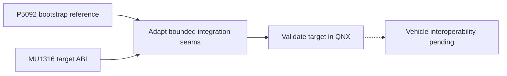

# P5092 bootstrap reference versus the MU1316/P5087 wireless mod

_MHI2Q wireless CarPlay — technical reference, integrated 2026-09-29._

---

[Wireless overview](README.md) · [Current stock210 lifecycle](STOCK210_RECEIVER_LIFECYCLE.md)

Maintained technical reference. The evidence below distinguishes static analysis, local QNX tests and observations from the unit.

Implementation and local diagnostic paths in this record refer to the [original source directory](../../wireless/). Run `wireless/...` commands from the repository root; moving this note does not move binaries or logs.

## 📊 Component flow

## 📋 Implementation and evidence

Compared offline on 2026-09-28 with
`<workspace>/Refferences/btstack-bootstrap-2026-09-28`.
`scripts/verify_package.py` in that export passed: 139 files, hashes and the
bootstrap-only source boundary. The owner reports that, with **manual
injection**, the reference already completed Bluetooth authentication,
Wi-Fi parameter transfer, iPhone network attachment, pairing and a protected
control session on its target. There is no working automatic setup. This
comparison did not rerun those hardware steps and is not a runtime test on
the MU1316 head unit.

| Area | P5092 reference | Current P5087 mod | Consequence |
|---|---|---|---|
| Target | MHI2Q P5092; exact `btstack_fingerprint.h` and private config are absent from the export | SHA-256-pinned MU1316 P5087 `btstack` (`154c1782…`) | P5092 SDK offsets, struct layouts, and guards cannot be imported as P5087 evidence. |
| Entry into `btstack` | Exported source includes a one-shot `LD_PRELOAD` launcher, token check and deferred SDK worker. **The owner's working hardware run used manual injection; automatic setup is not working.** | Offline ELF copy appends code/state, branches from two pinned stock instructions; initialization runs in the existing SDK path. | These are alternative integration mechanisms. The reference's worker/readiness checks are useful review patterns, but the launcher source is not proof of working automatic setup or a drop-in replacement for the graft. |
| Bluetooth session direction | `bt_sdp.c` searches a single ready remote for phone-side UUID ending `…decacafe`; `bt_rfcomm.c` opens an **outbound** DLC from the result. | Graft registers an **inbound** RFCOMM server and publishes the donor iAP service UUID ending `…decacaff` in SDP plus CarPlay EIR/SDP. | Do not substitute the reference's query/open path for server registration without a separate P5087 trace and phone behavior check. The two paths may be complementary, but that is not established. |
| RFCOMM callback | Drives the iAP2 link in the `btstack` process, with stock SDK mutex, bounded trace/credits and persistent packets. | Copies bounded events to a queue; worker forwards generation-tagged frames over local TCP to the Rust iAP2 daemon. | The reference's ownership/timeout checks are worth auditing against our queue/worker. Its direct callback-side iAP2 code changes the fault domain and cannot simply be copied. |
| MFi | Child helper validates its `libairplay.so` by size/CRC, then calls `APSMFiPlatform_CopyCertificate` and `APSMFiPlatform_CreateSignature`; separate SAP helper. | QNX Rust daemon uses the stock MU1316 `/dev/i2c8` register protocol through a QNX I²C shim; QEMU mocks the coprocessor. | The MU1316 stock library **matches the reference's size and CRC**. Both exports completed a synthetic I²C QEMU probe. That uncovered the stock combined `SENDRECV` command and corrected our shim; physical-chip and concurrent-process behavior remain untested. |
| Network/receiver | Standalone C receiver serves mDNS, pairing, encrypted control/event and no media; stream SETUP returns 461. | AirPlay 280 receiver with stock `dio_manager` bridge, media probes, owner/supervisor handoff and guarded review installer. | Reference ends at protected control session; it cannot replace the media half of the mod or establish full wireless CarPlay. |
| Validation | Owner reports the above bootstrap steps working after manual injection on the reference target. Export also documents host ASan/UBSan and loopback plus synthetic QNX compile; no P5092 fingerprint/production image is included. | P5087 static fingerprints and QNX/QEMU synthetic integration through media; no physical phone/MFi/radio proof. | The working bootstrap is valuable behavioral evidence, but the P5092 private SDK mapping and manual setup do not transfer automatically to P5087. |

The MU1316 `advanced/MU1316-appimg/eso/lib/libairplay.so` is 763,420 bytes,
CRC32 `0x697ab927`, SHA-256
`01c116b1674215daa0602d556a6d9b2eb48c2113ca294ea1f5d58787e3f656f2`.
The reference's `mfi_backend.c` pins that same size/CRC pair, and `readelf -Ws`
shows both MFi symbols in the MU1316 library. This is strong evidence for
compatibility of the **library ABI**. An isolated QEMU probe called both exact
stock exports with synthetic I²C and verified their outputs. Comparing stock
disassembly exposed a real mismatch: its read helper uses
`DCMD_I2C_SENDRECV` (`0xC0140507`), while our initial shim used separate
SEND and RECV. The corrected shim passed QEMU daemon and combined receiver
fixtures. This does not prove a physical MFi operation or safe simultaneous
use with stock processes. The stock helper remains a possible fallback,
not part of the current daemon path.

The other actionable reference ideas are the one-shot fail-closed launcher,
runtime SDK fingerprint/readiness check before calling private SDK functions,
and bounded RFCOMM packet lifetime/credits.
Before adopting any of them, compare against the current P5087 graft's
already pinned call sites and QEMU behavior. In particular, the reference's
outbound SDP request requires a new P5087 static mapping and separate tests;
its addresses must not be added to the existing inbound server graft by
analogy.

The current mod also had an active-media shutdown issue: QEMU runs that
forced `QUIESCE` during encrypted screen/audio reported `CFLRelease`
assertions. The receiver now serializes idle-only stop and SETUP admission on
its HTTP queue; three active-media QEMU repeats passed BUSY→client TEARDOWN→
QUIESCE. Three QEMU runs of an abrupt control-socket RST during screen/audio
also ended cleanly. An added active-session QUIESCE/RST fixture exposed an
AirPlay timing UDP error loop; the staged receiver now backs it off, and
three repeat runs passed BUSY→RST→QUIESCE. Reconnects remain untested.
The P5092 bootstrap export has no media or `dio_manager` handoff and therefore does
not cover this lifecycle. No head-unit operation was performed.
