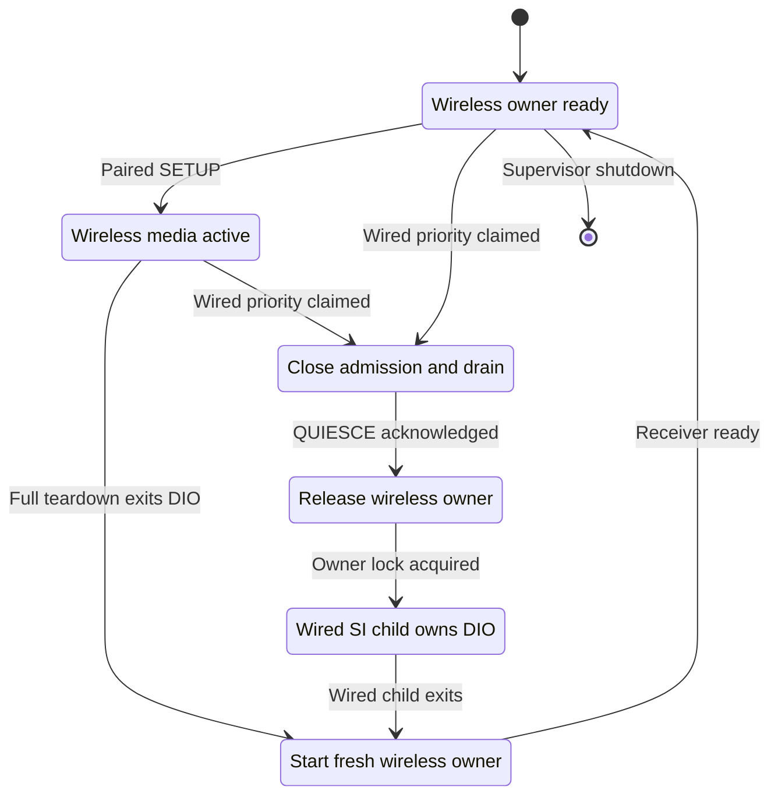

# Smartphone Integrator ownership for wireless startup

_MHI2Q wireless CarPlay — technical reference, integrated 2026-09-29._

---

[Wireless overview](README.md) · [Current stock210 lifecycle](STOCK210_RECEIVER_LIFECYCLE.md)

Maintained technical reference. The evidence below distinguishes static analysis, local QNX tests and observations from the unit.

Implementation and local diagnostic paths in this record refer to the [original source directory](../../wireless/integration/). Run `wireless/...` commands from the repository root; moving this note does not move binaries or logs.

## 📊 Component flow

Offline/static assessment for the exact MU1316 P5087 image, 2026-09-28.
No process on the head unit was started, stopped, or modified.

## 📋 Verified process boundary

The stock `MU1316-system/etc/eso/production/smartphone_integrator.json`
declares `children.carplay.exec = dio_manager`. The repository's wired mod's
`deploy/smartphone_integrator/carplay_child.json` substitutes
`carplay_startup.sh` for that child. The wrapper publishes its generation PID,
forks the renderer monitor, loads `libcarplay_hook.so`, and `exec`s
`dio_manager`; SI thus watches the actual dio PID. The offline wireless
wrapper candidate adds the receiver bridge and the owner trampoline, with
wireless-specific NCM and monitor handling. It does not create a
wireless-only SI child activation.

The adjacent `../wifi_fix/rc.local` is the machine's persistent autostart entry and
offers a `respawn` helper. It can launch a standalone wireless protocol
daemon. It cannot by itself give an independently launched `dio_manager`
SI child ownership. A second dio would race SI's wired child for AirPlay
listeners, Bonjour registrations, and receiver state. In particular, the
wrapper's `/tmp/carplay_supervisor.owner` tracks renderer-monitor generations;
it is **not** an exclusion lock for dio instances.

The current QEMU integration explicitly launches dio. Its successful
co-preload, iAP2, CarPlay Control, and STOP/START tests establish library and
protocol compatibility only after a process exists. They do not establish
any boot-to-wireless startup edge.

## 📋 SI request paths traced so far

The factory `dsi.smartphoneintegration.ems_table.json` exposes
`DSISmartphoneIntegration.connectDevice(deviceID, connectionMethod)` and
`disconnectDevice(deviceID)`. The exact SI ELF (SHA-256
`a25dc981e5591cb3c6b09f00fd95de23803dd3daa0f562e7e8d60b6d0e1b0d02`)
contains the DSI implementation vtable at VA `0x1C15E0`.
Its `connectDevice` handler at `0x183020` logs `deviceID` and method,
maps the method through `0x170C68`, then calls `0x165390` at `0x1830C8`.
`0x165390` dispatches to the current controller's virtual slot `+0x1C`.
The handler itself does not create a discovered-device record or start
`children.carplay`. The selected `CSIStateRunning` virtual slot at
`0x188070` is `onJob_connect`: it first calls `0x168F28` to require that
the device ID is already in the controller's discovered-device list. It
then checks coding, FEC, and the device's supported connection-method bits
(`0x16925C`, `0x169498`, `0x168F8C`). Its successful path calls
`MediaConnectorHandler_prepare` at `0x1800B0`, whose connector-type-2
CarPlay branch enqueues the USB switch-port job. In the Initialized state,
the same virtual slot (`0x184CBC`) reports `onJob_connect` as not
implemented. DSI `connectDevice` therefore cannot bootstrap an unknown
wireless device in the existing SI state machine.

The literal `activatecarplay` is a **MediaConnector command**, not a generic
SI activation request. `MediaConnectionService_OnJobSwitchPort` calls
`MediaConnectorCtrl_ActivateCarPlayTransaction` at `0x194774`.
That function (`0x19B594`) formats the command with its target device,
direction flag, and device name, then sends it with `write/read` via
`MediaConnectorCtrl_Transaction` (`0x19B1BC`). Its result updates the
controller's per-device activation flag. This path depends on the physical
MediaConnector controller.

The internal `CControllerInternalJob_FakeConnectDevice` is real, but its
producer is not a normal wireless discovery interface. The job constructor
at `0x129394` and enqueue helper `0x1286C8` store a device ID and mapped
connection method. Its dispatch at `0x128DBC` forwards those arguments to
the controller virtual slot `+0x18`. One enqueue site, `0x18D358`, is
command case 4 of `CTraceCallback` (`0x18D13C`; vtable `0x1C1AE8`), which
parses two integer arguments. The other, `0x1871D4`, is within
`CSIStateRunning_OnEventAppState` after an existing session's state event.
The job listener slot `+0x18` resolves to the thunk at `0x1653C0`, which
loads the stored method and tail-calls **the same** controller dispatcher
`0x165390`. Thus `FakeConnectDevice` does not insert a fake device: it
also reaches the discovered-device gate at `0x168F28`. It is not a
boot-to-wireless trigger, even if its trace command is reachable.

An SI-owned wireless path would require a new device-discovery insertion
and a non-USB connection handler inside SI, plus its existing wired
transitions. That is a larger SI graft. The current integration path is
explicit single-owner handoff between
an on-demand wireless dio and SI's wired child. Do not use the trace
callback as the production trigger.

## 📋 Offline owner handoff candidate

### Expected in-car behavior and USB transition

The proposed boot launch starts a supervised wireless `dio_manager` and iAP2
daemon independently of SI. After the btstack graft advertises the iAP2 SDP
record and accepts RFCOMM, a nearby paired iPhone can run the iAP2/MFi
exchange, receive the AP credentials, join `uap0`, and announce CarPlay
availability. Only then does the daemon request receiver `START` and send
`CarPlayStartSession`. This is the intended automatic discovery sequence; it
has been exercised with synthetic peers in QEMU, not with a real iPhone or
installed on the head unit. The earlier bootstrap reference used manual
injection and does not establish automatic startup.

When USB causes SI to launch its wired CarPlay child, the candidate wired
wrapper claims the priority lock and requests bridge `QUIESCE` before
terminating the wireless `dio_manager`. Once the bridge confirms that its
AirPlay listener and property callbacks are drained, the wired child takes
the owner lock and proceeds through SI's existing USB/Cinemo path. The
wireless supervisor keeps the daemon and Wi-Fi IE tied to its owner process;
after wired release it can launch a fresh wireless generation. Idle handoff
and retry after a synthetic BUSY response passed host and QEMU fixtures.

An active screen/audio session makes `QUIESCE` return BUSY. The wired helper
now requests `WIRED_DRAIN` once for that lock holder, using the receiver's
own `sessionDied` command to close its media connections. It retries guarded
`QUIESCE` and signals the wireless owner only after OK. A real AirPlay 280
QEMU session with encrypted video and 80 PCM packets passed the sequence
BUSY → DRAIN OK → QUIESCE OK → stock manager release without a captured
crash (`../receiver_bridge/out/qemu_active_wired_drain.log`). Host process
testing verified request order and no TERM before QUIESCE OK; a guarded QNX
supervisor fixture passed with a synthetic bridge. These tests do **not**
prove a seamless USB switch on the real unit, since SI, the iPhone, and the
physical USB transition have not been exercised together. If DRAIN or
QUIESCE fails, the seven-second wired attempt still leaves the wireless
owner running. The writable `/mnt/persist` lock behavior on the unit remains
unverified.

The integrated fixture now runs the exact guarded owner helper with the
generated wrapper, stock `dio_manager`, the QEMU receiver, and an independent
encrypted screen/PCM client in one QNX instance
(`../receiver_bridge/out/qemu_active_owner_wired.log`). It checks that an
unowned DRAIN returns NOT_READY, then the wired helper holds the priority
lock, receives BUSY, drains the session, receives QUIESCE OK and reaches its
wired child. The stock manager exits with status 0. Three earlier repeats of
the same helper/media path also completed. `sessionDied` itself causes stock
manager cleanup before the final QUIESCE response; the helper still sends
no termination signal before OK. QEMU prints a DispatchLite `EINTR`
assertion during that clean exit, so on-unit timing and receiver teardown
still need scrutiny. The fixture uses a QEMU bridge with `lo0` and a QNX4
test filesystem, not the physical AP or `/mnt/persist`.

An extended integrated fixture held the wired priority lock for three
seconds, then released it while the native wireless supervisor stayed
running. The supervisor waited for the new owner PID to hold the owner lock
as well as open the bridge port, preventing a stale listener from counting
as readiness. The restarted stock `dio_manager` mapped the staged AirPlay
receiver, accepted a fresh receiver `START`, and then shut down after
confirmed `QUIESCE`. Both generations removed their Device IE on stop
(`../receiver_bridge/out/qemu_active_owner_supervisor.log`). This models USB
release with a QEMU-only wired child and synthetic receiver request; actual
SI USB events, an iPhone changing transport, and the real QNX6 persist
filesystem remain untested. Cable insertion during active media tears down
that session and starts a new wired one; seamless media transfer has not
been demonstrated. The newer staged AirPlay 280 retries an interrupted
DispatchLite `select()`; the integrated QEMU repeat passed without the
earlier `EINTR` assertion.

`dio_owner_exec.c` provides two `fcntl` process locks. The wireless launcher
claims the dio-owner lock, checks that no wired-priority lock exists, then
`exec`s the normal wrapper. The SI wrapper first `exec`s the same helper in
wired mode. It claims wired priority, asks `F_GETLK` for the current wireless
owner PID, sends TERM and, after two seconds if the **same lock holder**
remains, KILL. It waits at most seven seconds for the owner lock, leaving
time under SI's ten-second startup deadline. It then `exec`s the wrapper;
the wrapper's normal final `exec dio_manager` preserves the SI PID and both
locks. If SI's child exits, the kernel releases its locks; the supervisor
can start wireless again. No stale PID file is used for signalling. If the
supervisor itself crashes, its wireless dio child still holds the lock, so
a restarted supervisor cannot create a duplicate.

The separate guarded property-handoff archive compiles a `QUIESCE`
acknowledgement requirement into both helper and supervisor. Before signalling
the wireless owner, it asks the localhost receiver bridge to drain an active
copy-property callback and close AirPlay. An active-media BUSY triggers one
`WIRED_DRAIN` request for that owner, then QUIESCE is retried within the wired
takeover deadline; without an OK reply the owner is left running.
The QNX/QEMU supervisor fixture returned BUSY once and then OK for both wired
takeover and shutdown, and checked that each owner stopped only after its OK
(`out/qemu_wireless_supervisor_quiesce.log`). The ordinary archive does not
change its owner handshake. The real persist filesystem and on-unit timing
have not been tested.

`build_wrapper_candidate.py` inserts this trampoline before generation-file
publication and monitor fork, and retains both the existing wired hook and
new bridge preload. The owner helper atomically publishes the generation
when requested; the wireless wrapper skips USB/NCM generation work and
leaves renderer-monitor launch to its native supervisor after bridge
readiness. The SI wired path retains its original NCM and monitor behavior.
`wireless_dio_supervisor.sh` is a candidate for the
existing `rc.local` respawn entry. It reads a mandatory per-unit
`wireless_carplay.env` and execs the native `wireless_dio_supervisor_bin`.
`build_launch_candidate.py` produces a SHA-pinned copy of the existing local
`rc.local` with one additional respawn line, plus an empty configuration
example. Neither is installed. The native supervisor starts the wireless
owner, waits for its bridge listener, then starts the iAP2 daemon. It watches
both children, stops the survivor on either exit, and invokes the daemon's
ownership-checked `--clear-ie` operation after stopping it. A host process
test (`test_wireless_supervisor.py`) passed wired takeover, IE cleanup, and
wireless restart. `qemu_wireless_supervisor.py` repeated that lifecycle in
QNX 6.5 QEMU with disposable receiver/monitor/daemon peers, including cleanup
after supervisor termination. The bridge skips its wireless listener,
receiver prestart, and server retain when `MHI2Q_DIO_OWNER_MODE=wired`,
leaving USB/Cinemo in control of a wired session.

Host process tests (`test_dio_owner_exec.py`) passed normal handoff, wired
priority, release/restart, the actual generated wrapper, and a wireless
child that ignores TERM. The QNX 6.5 QEMU test
(`qemu_owner_handoff.py`, log `out/qemu_owner_handoff.log`) passed handoff
and wired priority on a disposable mounted QNX4 filesystem. The first QEMU
attempt proved that `/tmp` backed by `/dev/shmem` returns `ENOSYS` for
`F_SETLK`. The unit's mounted-filesystem record lists `/mnt/app` as
read-only and `/mnt/persist` as writable QNX6, so the helper defaults to
lock files directly under `/mnt/persist`.
The owner-generation marker, wrapper log and NCM handoff markers remain in
`/tmp`; the user confirms that this is writable RAM on the head unit and
resets at reboot. They are disposable runtime state, not exclusion locks.
The two `fcntl` exclusion locks stay on `/mnt/persist`, and the AirPlay
pairing keychain also stays there because it must survive a reboot. QNX6
lock behavior on the unit still needs validation before installation.
The installer now invokes `dio_owner_exec --check-locks` on private files next
to both real lock paths before backing up or replacing anything. It requires
cross-process exclusion, unlock, and reacquisition. This makes unsupported
lock behavior an install-time failure; it does not establish the on-unit result
while the head unit is offline.

A separate stock-dio QEMU test
(`qemu_capture.py --mesh --owner-exec-qemu`, log
`../receiver_bridge/out/qemu_capture_mesh_owner_exec.log`) launched the
stock binary through the owner helper and a minimal final-exec wrapper. Its
published `DIOManagerApp` PID matched the PID holding the owner lock after
`exec`, while the normal manager capture points still ran. This verifies
process-lock inheritance into stock dio on QNX 6.5 with a writable QNX4
disk. QNX6 persist-filesystem lock support and the final `rc.local`/SI
installation have not yet been validated. The candidate is not installed.

The exact generated wireless wrapper also reached stock `dio_manager` in
`qemu_capture.py --mesh --owner-wrapper-qemu`: its generation PID matched
the process holding the owner lock and stock `DIOManagerApp`, while the
production receiver bridge opened localhost port 57343. The IFS contains
the same stock `libairplay.so` in both `/proc/boot` and
`/mnt/app/eso/lib`; a direct `DCMD_PROC_MAPINFO`/`MAPDEBUG` read of the
running dio process reported `mnt/app/eso/lib/libairplay.so`. This proves
the wrapper's explicit `LD_LIBRARY_PATH` selects the installer's path in
QNX 6.5/QEMU. The fixture uses the unprotected wired hook, a QNX4 RAM disk,
and an inert renderer monitor; it does not exercise the full daemon or
renderer session.

The combined QEMU fixture (`qemu_capture.py --owner-wrapper-qemu
--owner-supervisor-qemu` with the bridge/phone flags, log
`../receiver_bridge/out/qemu_owner_supervisor.log`) runs the exact generated
wrapper and stock dio under the native supervisor, with the ordinary Rust
daemon and a synthetic phone. The phone completed iAP2, mock MFi,
CarPlay Control and stock receiver STOP; supervisor shutdown terminated the
daemon and cleared the owned Wi-Fi IE. This fixture uses a QEMU-only bridge
variant for `lo0` and synthetic MAC plus the writable QNX4 RAM disk; the
production bridge binary was exercised in the separate wrapper run. Both
copies of `libairplay.so` in this combined IFS are the same feature37 variant;
the process map again shows `/mnt/app/eso/lib/libairplay.so` was selected.

`qemu_owner_handoff.py --qnx6` additionally creates a fresh, uninitialized
RAM block device, formats it with the QNX 6.5 `mkqnx6fs`, and attempts the
same handoff on `fs-qnx6.so`. Formatting exits successfully, but the SDK
filesystem module refuses a read-write mount (`Read-only file system`). A
read-only mount succeeds and then cannot create the lock files. This leaves
the writable QNX6 lock behavior unproven; the QNX4 result cannot stand in
for it. A second QEMU variant (`--qnx6-loopback`) formats a QNX6 image on a
loopback device backed by the writable QNX4 RAM disk; the SDK driver again
refuses a read-write QNX6 mount. Increasing that backing image from 2 to
16 MiB did not change the failure. The diagnostic
`--qnx6-loopback --qnx6-factory-module` variant stages the MU1316 factory
`fs-qnx6.so`, `io-blk.so`, `cam-disk.so`, `libcam.so`, and `devb-loopback`
on the disposable QNX4 backing disk. An isolated factory `fs-qnx6.so`
with the SDK storage stack fails with `Program version wrong`; the full
factory stack loads and `mkqnx6fs` exits successfully, but its explicit
read-write mount still returns `Read-only file system` (log:
`out/qemu_owner_handoff_qnx6_factory.log`). This QEMU result does not
establish the lock behavior of the unit's existing writable `/mnt/persist`.
No firmware binary was modified.
