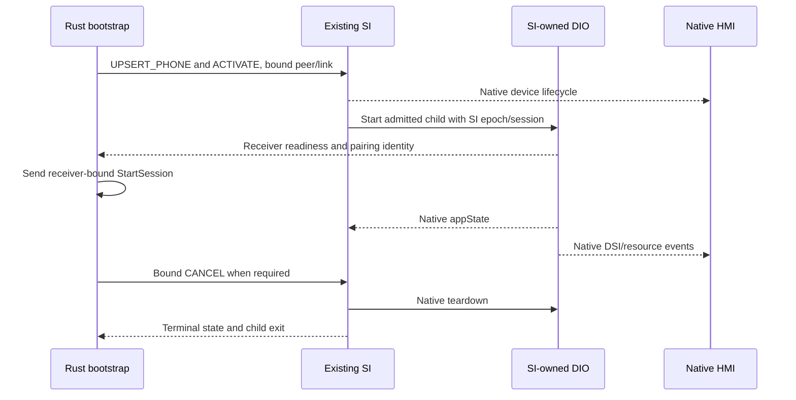

# Smartphone Integrator ownership for wireless startup

The existing SI is the single CarPlay-child owner. Rust requests native discovery and admission through SIW2; SI starts the original DIO with a generation-bound wireless environment. The runtime keeps bootstrap and mDNS available outside the child lifetime.

[Wireless overview](README.md) · [SI implementation and ABI](SI_STAGE2_OFFLINE.md) · [Acceptance ledger](../carplay-lab/WIRELESS_COMPLETION_PLAN.md)

## Component responsibilities

| Component | Responsibility |
| --- | --- |
| Existing SI/controller queue | Native stored/present device records, admission, connect/disconnect, child launch and appState |
| Rust bootstrap daemon | RFCOMM/iAP2/MFi/Wi-Fi, authenticated peer identity, SI activation requests and bounded media recovery |
| SI child wrapper | Per-generation transport selection and preload chain; exec the DIO owned by SI |
| Stock DIO and receiver bridge/hook | Receiver readiness, pairing identity, authenticated media, native ASI/DSI lifecycle and resource negotiation |
| Java/HMI | Native device presentation, user decisions and resource handling |
| Runtime | Bootstrap and mDNS service lifetime; no competing standalone wireless DIO spawn in SI mode |



This describes source ownership; the [ledger](../carplay-lab/WIRELESS_COMPLETION_PLAN.md#remaining-gates) records which complete HMI/physical paths still require acceptance.

## Admission and teardown rules

- Discovery is not activation. Native coding, FEC, capability, method and single-session checks still apply.
- The controller queue executes native mutations. Socket parsing and bounded waits run outside it; jobs revalidate their generation on dispatch.
- Explicit child environment binds mode, SI epoch/session, link and parent PID. Unknown/stale WLAN work cannot fall through into stock USB preparation or be relabelled wired.
- Receiver readiness includes the actual advertised pairing identity. A sent iAP2 StartSession or an RFCOMM connection is not proof of started media.
- Re-admission waits for native terminal state and child exit. Socket failure, idle appState with a live child and a PID file do not authorize a second DIO.
- Kernel owner/priority locks govern wired takeover. Receiver drain runs on the retained HTTP queue; no arbitrary process kill substitutes for ownership.
- A retained authenticated RFCOMM link can carry another media generation. Loss of RFCOMM is a different bootstrap path.

See [SIW2/CPRX lifetime](SI_STAGE2_OFFLINE.md#protocol-and-session-lifetime), [receiver queue contract](STOCK210_RECEIVER_LIFECYCLE.md#queue-and-owner-lifecycle) and [recovery](SI_STAGE2_OFFLINE.md#-automatic-media-recovery-with-unchanged-bluetooth).

## Implementation and reproduction

The implementation lives in [wireless/si](../../wireless/si/), [si_control.rs](../../wireless/daemon/src/si_control.rs), [si_transport.c](../../wireless/receiver_bridge/si_transport.c) and [wireless_si_runtime.sh](../../wireless/integration/wireless_si_runtime.sh).

```sh
python3 wireless/si/build_si_review.py --full-cycle
```

The matched review builder is the current entry point. The [archived ownership investigation](../archive/internal-reference-2026-10-29/wireless-carplay/DIO_OWNERSHIP.md) retains stock request addresses, standalone-supervisor experiments and owner-handoff fixtures. Those commands do not implement the SI-owned lifecycle above.
