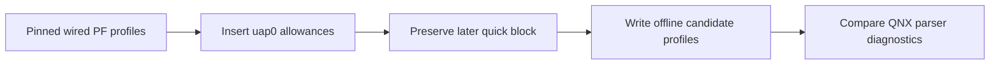

# Wireless CarPlay PF profiles, offline

_MHI2Q wireless CarPlay — technical reference, integrated 2026-09-29._

---

[Wireless overview](README.md) · [Current stock210 lifecycle](STOCK210_RECEIVER_LIFECYCLE.md)

Maintained technical reference. The evidence below distinguishes static analysis, local QNX tests and observations from the unit.

Implementation and local diagnostic paths in this record refer to the [original source directory](../../wireless/firewall/). Run `wireless/...` commands from the repository root; moving this note does not move binaries or logs.

## 📊 Component flow

## 📋 Implementation and evidence

`python3 wireless/firewall/build_offline.py` produces four separate PF profiles
from the repository's already-patched wired CarPlay profiles. It verifies the
SHA-256 of each input and inserts exactly four `uap0` inbound rules immediately
before the stock `block in quick on $wlan_if … to ($wlan_if)` rule. The
existing wired `carplay0` port `6030:6032` change is preserved. The source
profiles and firmware files are untouched.

## 🧪 Rule provenance and parser evidence

The rules follow the factory MH2p wireless CarPlay PF profile
(`MH2p_US_AUG35_P2873/extracted/swup/etc/pf.mlan0.conf`, lines 170–181):
IPv4/IPv6 mDNS multicast, plus the AirPlay/CarPlay TCP and UDP ports. The
MHI2Q profile uses `$wlan_if = "uap0"`; its quick block otherwise prevents an
iPhone on the access point from reaching the receiver. The output remains an
offline artifact. `python3 wireless/firewall/qemu_pfctl.py` runs the pinned
MU1316 `pfctl` in disposable QNX/QEMU with the factory services, protocols,
fingerprints, and network stack. It parses the exact candidate `pf.conf`
with exit status 0. The other three profiles cannot pass as-is in this
single-interface VM: aliasing their several queue interfaces to `lo0` gives
duplicate ALTQ priorities. Each candidate produces exactly the same parser
diagnostics as its pinned wired baseline, with no added rule error
(`out/qemu_pfctl.log`). This proves the inserted rules parse in the default
profile and detects a parser regression in the others; it does not validate
the real interface layout or an active ruleset. No rules were installed on
the head unit.

## 📋 DNS-SD interface selection

`MDNS_DIRECTLINK_IFACE=carplay0` in the stock `dio_manager.json` does not by
itself exclude `uap0`. In the MHI2Q `mdnsd`, `SetupOneInterface` compares that
environment value to the interface name, sets a direct-link flag, and then
still calls `mDNS_RegisterInterface` (`0x133CCC–0x133D10`). The daemon's
`DNSServiceBrowse` uses `uap0`'s interface index explicitly. Whether stock
`mdnsd` is alive at the needed time must still be verified in a full run.
