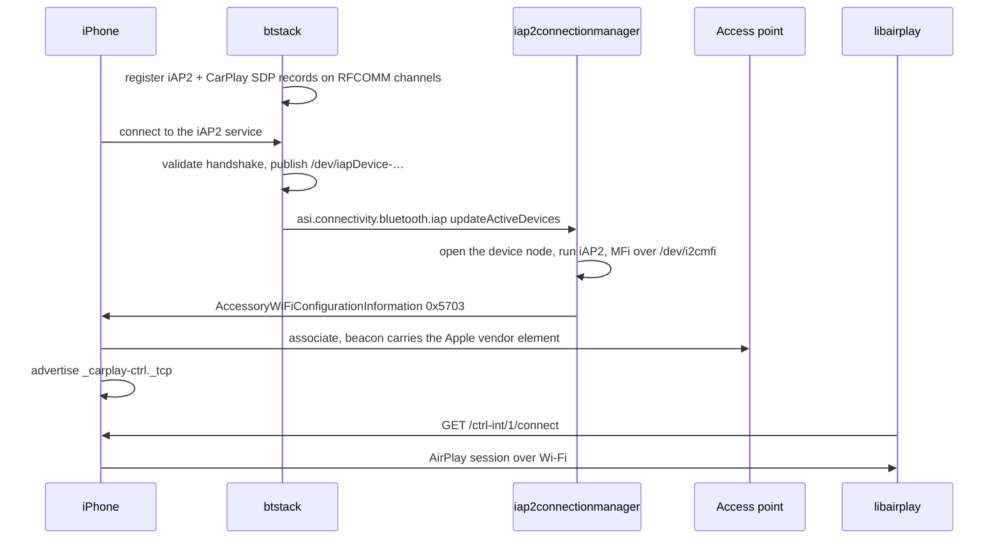
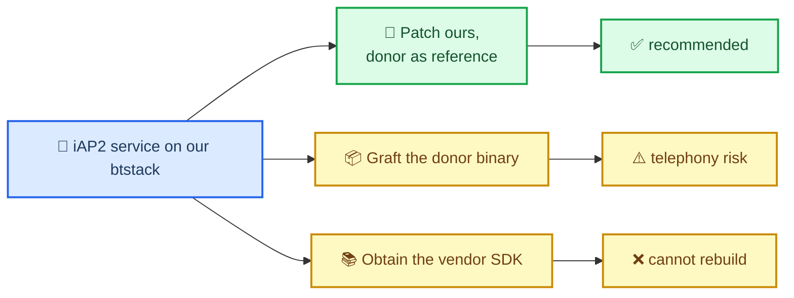

# Wireless CarPlay on the Head Unit

_MHI2Q wireless CarPlay — technical reference, integrated 2026-09-29._

---

[Wireless overview](README.md) · [Current stock210 lifecycle](STOCK210_RECEIVER_LIFECYCLE.md)

Maintained technical reference. The evidence below distinguishes static analysis, local QNX tests and observations from the unit.

Implementation and local diagnostic paths in this record refer to the [original source directory](../connect-and-usb/). Run `wireless/...` commands from the repository root; moving this note does not move binaries or logs.

*Factory Bluetooth donors and the missing wireless path on MHI2Q. The current mod preserves AirPlay210 and adds pairing/security in the hook.*

---

## 📋 Summary

**Updated 2026-09-29:** the original "only btstack is missing" assessment was incomplete. In addition to Bluetooth/iAP2 discovery and transport, stock AirPlay210 needs CU pairing and modern encrypted control/events/media for the inspected iOS wireless path. Those adapters now live in `hook/wireless`; a Rust daemon and receiver bridge integrate startup and ownership. The combined QNX/QEMU lifecycle passes, while real iPhone/MFi/media/USB behavior remains unverified. See the [current implementation and next steps](README.md) and [receiver lifecycle evidence](STOCK210_RECEIVER_LIFECYCLE.md). The donor analysis below records the earlier static investigation; it is not a claim of an already working vehicle installation.

Three firmwares settle it. MH2p ships wireless CarPlay from the factory, MHI2 MU1439 ships the iAP half of it on **our exact Bluetooth chip and our exact build line**, and no MHI2Q build ships either. **[decompile]**

| Question | Answer |
|---|---|
| Is the architecture exotic? | No. The factory flow matches Apple's specification and two independent open implementations step for step. **[decompile]** / **[spec]** |
| What is missing from stock? | The `btstack` iAP service, wireless iAP2/control consumer, and CU pairing/modern security around AirPlay210. **[decompile]** |
| Is it a newer-firmware problem? | No. MU1329, a newer MHI2Q train, is as empty as ours. **[decompile]** |
| Can it be patched in from outside `btstack`? | No. The stack is statically linked, stripped, and owns the radio. **[decompile]** |
| Is there a donor? | Yes. MU1439's `btstack` has the module, same Marvell 8787 over SDIO, same build line, identical Blue SDK core. **[decompile]** |
| What remains now? | The offline implementation exists; deployment integration and physical MFi/iPhone/media/USB validation remain. **[code]** |

## 🧩 What the factory implementation looks like

Read out of `Firmwares/HU/MH2p_US_AUG35_P2873`. MH2p is MIB2P on Tegra with a Marvell 8897 over UART, so it is not a drop-in source, but it is a complete and readable blueprint. Its `btstack` even carries the source path `connectivity/btstack/btstack/iap/src/IapServices.cxx`. **[decompile]**



The parts that make it work, with the strings that prove each one:

| Piece | Evidence in MH2p |
|---|---|
| Bluetooth services | `btstack::IapServices` with `IapConnection`, `IapListener`, `updateConnections`; `btstack::WirelessCarPlayServices`; `CarPlaySdpAttributes` |
| The UUIDs | `UUID_IAP2_HOST`, `UUID_WIRELESS_CARPLAY_APPLE_DEVICE_REVERSE` |
| Runtime behaviour | `Registered iAP-SDP-Record. RfComm Channel: %d`, `Incoming iAP service connection from %s`, `Checking iAP2 capability for 0X%012llX`, `Received correct iAP2 handshake`, `… is not iAP2 compatible. Handshake-Answer`, `Wireless Carplay supported`, trace channel `CON_BTSTACK_WIRELESS_CARPLAY` |
| Link handover | the node `/dev/iapDevice-…`, announced over `asi.connectivity.bluetooth.iap` |
| iAP2 owner | the app `iap2connectionmanager`, MFi via `/dev/i2cmfi`, event `CIAP2ConnectionEvent_Iap2WirelessCarPlayUpdate` |
| Session trigger | `libairplay` 232.5.15 with `carplay-ctrl` and `ctrl-int` |
| Beacon | `hostapd` v2.5, which supports `vendor_elements` |

## 🔍 What our firmware actually has

Every one of those pieces is absent from MU1316, and the absence is structural rather than accidental. **[decompile]**

The decisive measurement is a byte scan for Apple's Bluetooth UUIDs, taken from `LIVI/native/livi-helperd/crates/livi-iapd/src/sdp.rs`: iAP `00000000-decafade-decadeaf-decacaff`, its client twin ending `cafe`, and CarPlay `ec884348-cd41-40a2-9727-575d50bf1fd3`.

| Firmware | Files scanned | Where the UUIDs appear |
|---|---|---|
| MH2p AUG35 | 13,657 | `eso/bin/apps/btstack` only |
| MHI2Q MU1316, ours | 11,374 | nowhere |
| MHI2Q MU1329, raw 1,019,215,872 B image | whole image | nowhere |

The MU1329 scan matters: it is a newer MHI2Q train, and it returns `btstack` as a name 343 times, `IapDeviceServices` 10 times and `libairplay` 4 times, while `IapServices`, `iapDevice`, `CIapBTChannel`, `carplay-ctrl` and both UUIDs return zero. Those 10 hits are the interface furniture, not an implementation.

What the furniture consists of, and why it misleads:

- `asi.connectivity.bluetooth.iap.ems_table.json` ships on our unit, declaring `IapDeviceServices` with `requestReconnectDevice`, `updateActiveDevice`, `updateActiveDevices [{devPath, address, inUse}]`, `updateLocalBtAddress`, `updateLocalFriendlyName` and `stringRequest` / `stringResponse`. Its only implementers are the two generated stub and proxy libraries `lib_1fee63c9-bc2a-44f9-b7a7-919910c2e682.so` and `lib_59b50458-c282-42bd-bb46-16770019a762.so`. Nothing serves it.
- `SERVICETYPE_IAP2` exists in `eso/bin/apps/bluetooth`, but `sub_18A890` is a pure enum-to-string mapper and the string's only reference. The value is `0x40000000`.
- `dsi.bluetooth` offers a generic `requestConnectService(btDeviceAddress, btServiceType[, deviceRole])` plus `requestGetServices`, `requestAcceptIncomingServiceRequest`, `updateIncomingServiceRequest`, `abortConnectService` and `serviceRejectNoSupport`. The service type is a plain integer, so `0x40000000` is nominally addressable, but an accessory must **advertise** the service and no interface registers records. `asi.connectivity.bluetooth` has only HFP and PBAP connect.
- Cinemo owns iAP2 on our unit, and `libNmeTransport.so` names exactly two transports, `ffs` and `usb`. The API models more (`CINEMO_OPTION_IAP_ENABLE_IAP1` / `_IAP2`, `CINEMO_METANAME_IAP_TRANSPORT_TYPE`, `CINEMO_METANAME_IAP_BT_MAC_ADDRESS`) but no Bluetooth backend is compiled. MH2p's Cinemo is the same in this respect, which is why MH2p has a separate iAP2 app.
- `btstack` cannot be interposed. It links only generic infrastructure, the whole Bluetooth stack is compiled in, and it is stripped: no SDP or RFCOMM symbol is defined or imported. The LD_PRELOAD trick we use against `libairplay` has nothing to grab.
- `btstack::BluetoothServices::inject_hci_command` exists as an internal method, and no ems table exposes any HCI or extended-inquiry write. So the CarPlay UUID cannot be pushed into the beacon's inquiry response from another process either.

One earlier claim needs correcting. Our `hostapd` is v0.6.4 and has no `vendor_elements`, but the access point on this unit is driven by the Marvell tool, and that tool can carry an arbitrary element:

```sh
uaputl sys_cfg_custom_ie [INDEX] [MASK] [IEBuffer]     # mask 0x12A = association/reassociation response + probe response + beacon
uaputl sys_cfg_channel_ext [CHANNEL] [BAND] [MODE]     # the band is a parameter
```

So the Apple vendor element **is** injectable on our hardware, and the band is not nailed shut by tooling. **[code]**

## 🧬 The donor: MU1439

MH2p is the blueprint, but MHI2 MU1439 is the transplant candidate, because it matches us where it counts. **[decompile]**

```mermaid
flowchart TB
  accTitle: Three firmwares by layer
  accDescr: Comparison of our MHI2Q build, the MU1439 donor and the MH2p factory build across the Bluetooth core, the iAP service layer, the CarPlay record, the iAP2 owner and the session trigger.
  subgraph ours ["🖥️ MHI2Q MU1316 — ours"]
    target_blue_sdk["✅ Blue SDK core, 31 modules"]
    target_iap_service["❌ no iAP service layer"]
    target_carplay_record["❌ no CarPlay record"]
    target_usb_iap2["⚠️ iAP2 only inside Cinemo, USB"]
    target_receiver["❌ libairplay 210.81, no Control client"]
  end
  subgraph donor ["📦 MHI2 MU1439 — donor"]
    donor_blue_sdk["✅ same Blue SDK core, same 31"]
    donor_iap_service["✅ IapServices + IapListener"]
    donor_carplay_record["❌ no CarPlay record"]
    donor_iap_app["✅ iap app, CIapBTChannel"]
    donor_receiver["❌ no Control client"]
  end
  subgraph factory ["🚀 MH2p — factory wireless"]
    factory_blue_sdk["✅ Blue SDK core, other build line"]
    factory_iap_service["✅ IapServices"]
    factory_carplay_service["✅ WirelessCarPlayServices"]
    factory_iap2_manager["✅ iap2connectionmanager"]
    factory_receiver["✅ libairplay 232, Control client"]
  end
  target_blue_sdk -.->|"identical"| donor_blue_sdk
  donor_iap_service -.->|"what we need"| target_iap_service
  factory_carplay_service -.->|"reference only"| donor_carplay_record
  classDef primary fill:#dbeafe,stroke:#2563eb,stroke-width:2px,color:#1e3a5f
  classDef success fill:#dcfce7,stroke:#16a34a,stroke-width:2px,color:#14532d
  classDef warning fill:#fef9c3,stroke:#ca8a04,stroke-width:2px,color:#713f12
  class target_blue_sdk,donor_blue_sdk,factory_blue_sdk primary
  class donor_iap_service,donor_iap_app,factory_iap_service,factory_carplay_service,factory_iap2_manager,factory_receiver success
  class target_iap_service,target_carplay_record,target_usb_iap2,target_receiver,donor_carplay_record,donor_receiver warning
```



| Property | MU1439 donor | MU1316 ours | MH2p factory |
|---|---|---|---|
| `btstack` size | 1,912,417 B | 1,852,334 B | 2,071,484 B |
| iAP UUID | present | absent | present |
| CarPlay UUID | absent | absent | present |
| Bluetooth chip | Marvell 8787, `mv8787_sdio` | Marvell 8787, same blob | Marvell 8897 |
| HCI transport | `/dev/sdio0` | `/dev/sdio0` | UART `/dev/ser1` |
| Build line | `PM_build_swdl` | `PM_build_swdl` | `MIB2_MIB2P/Buildsystem` |
| Blue SDK core modules | 31 | 31 | 31 |
| iAP consumer app | `eso/bin/apps/iap` | none | `iap2connectionmanager` |

Two details make the donor valuable beyond the table. The Blue SDK core is **identical**: both binaries reference exactly the same 31 `bluesdk/*.c` source paths with zero delta on either side, so the code around the missing module is the same code. And MU1439 ships the consumer too, `eso/bin/apps/iap`, with `iap::CIapBTChannel` (`openiAPDevice`, `readiAPDevice`, `writeiAPDevice`, `closeiAPDevice`, `connectToiAPDevice`, `updateiAPDevice`) and `iap::CIapConnectorMachine` (`isiAP2supported`, `checkForiAPSupport`, `stateTransition`), written against the same `IapDeviceServicesProxy` whose stub already sits unused on our unit.

## 🧷 The graft points

The donor makes the patch route concrete, because the Blue SDK functions the iAP module calls are present in our binary too and can be identified by anchor rather than by guesswork. Two profiles that exist in both builds supply the anchors: the Device ID record registration (`bluesdk/profiles/did/did.c`, the string `DevIdAddServiceRecord: DID SDP record succeeded`) and a server-binding path (`Fatal Error: Unable to bind the server to the protocol stack`). Both anchor functions decompile line for line the same in the two binaries, so the callee at the same position is the same function. **[decompile]**


| Blue SDK entry point | Donor MU1439 | Ours MU1316 | Shape |
|---|---|---|---|
| Add an SDP record | `0x20BE50` | **`0x2073C4`** | `int f(record*)`, returns 18 when SDP is not ready |
| Remove an SDP record | `0x20BDD0` | **`0x207344`** | `int f(record*)` |
| Register an RFCOMM server channel | `0x24257C` | **`0x277B98`** | `int f(chan*, u8* chanOut, u16 prio)`, MTU range check 23 to 5035 |
| Deregister an RFCOMM server channel | `0x242518` | **`0x277B34`** | `int f(chan*, u8* chan)` |
| Record list head | `dword_4A0BE8` | **`dword_490288`** | intrusive list |
| Record handle counter | `dword_4A0BF0` | **`dword_490290`** | post-incremented into record+20 |
| Stack lock and unlock | `0x2888D4` / `0x288848` | **`0x27A2AC` / `0x27A220`** | taken around both operations |

The caller to imitate is `IapServices::registerService` at donor `0x2379A4`, which the binary self-documents through an `snprintf` of its own class and method name, at `IapServices.cxx` lines 796 and 808. It registers the RFCOMM channel first, then patches the granted channel number into the record and adds the record.

The record itself is small enough to restate exactly. A Blue SDK record holds an attribute count at offset 8 and a pointer to an array of 12-byte attribute entries at offset 12; the iAP record uses two attributes. **[decompile]**

| Attribute | Id | Length | Value bytes |
|---|---|---|---|
| ServiceClassIDList | `0x0001` | 19 | `35 11 1C 00000000 decafade decadeaf decacaff` |
| ProtocolDescriptorList | `0x0004` | 14 | `35 0C 35 03 19 01 00 35 05 19 00 03 08 <channel>` |

Read as data elements: a sequence holding a 128-bit UUID for the first, and a sequence of two sequences for the second, L2CAP as UUID `0x0100` and RFCOMM as UUID `0x0003` followed by a one-byte channel. That last byte is the one the donor patches at runtime once RFCOMM grants a channel, so a graft must do the same rather than hardcode it.

### Two UUIDs, two directions

Wireless iAP is symmetric, and both halves show up in the donor. **[decompile]**

| UUID ends in | Who advertises | Used for |
|---|---|---|
| `…decacaff` | the accessory, us | the record above, so the phone can open a link inward |
| `…decacafe` | the phone | a capability probe, so the accessory can tell an iAP2-capable device from any other |

The probe is `IapServices::queryAttributes` at donor `0x237D90`, which runs an SDP search against the phone with this pattern and asks for attributes `0x0004` and `0x0009`:

```text
35 17 1C 00000000 decafade decadeaf decacafe   sequence: UUID128 ending cafe
      19 01 00                                  L2CAP
      19 00 03                                  RFCOMM
00 64                                           max 100 bytes of response
35 06 09 00 04 09 00 09                         attributes: ProtocolDescriptorList, ProfileDescriptorList
```

That is what produces the donor's `Checking iAP2 capability for 0X%012llX` and `iAP2 supported` lines. A graft can skip it at first and simply accept whatever connects.

### What a graft does not have to do

The donor's `IapServices::init` at `0x23B8A0` is not radio work at all: it publishes the `IapDeviceServices` ASI interface, service UUID `59B50458-C282-42BD-BB46-167700 19A762`, which is exactly the stub library already sitting unused on our unit. That exists so a separate consumer process can be handed the device path. We control both ends, so a graft can skip ASI entirely and hand the RFCOMM payload to our own daemon over a socket, which `btstack` can already open.

The RFCOMM channel layout and receive callback are mapped in [rfcomm_channel_layout.md](RFCOMM_CHANNEL_LAYOUT.md): `registerService` passes the embedded object at `instance+16`, the callback lives at channel offset 8, and the MTU at offset 12 must be 23 to 5035. **[verified, static RE]**

### Confirmed on the unit

Read-only checks over SSH, 2026-09-27, so the analysis above is known to describe the running system rather than a firmware image. **[car]**

| Check | Result |
|---|---|
| Platform | `QNX mmx 6.5.0 … APQ8064_65536_MMX2 armle` |
| Running stack | one `btstack` instance, `/eso/bin/apps/btstack`, 1,852,334 B, dated Feb 26 2018 — the same bytes the graft points were derived from |
| iAP device node | no `/dev/iap*` of any kind |
| ICU runtime | `libicuuc.so.58` only, so the donor's `.53` requirement is a real blocker for the graft route |
| MFi bus | `/dev/i2c8` present among `i2c2`, `i2c4`, `i2c8`, `i2c9`, matching dio's `i2c:///dev/i2c8:17` |

## 🛠️ The three routes



| Route | What it means | Verdict |
|---|---|---|
| Patch our `btstack` | Add an SDP record and an RFCOMM listener through the entry points already identified in [The graft points](#-the-graft-points). | **Recommended.** Smallest target, the reference pair could not be better, and the four functions plus the record bytes are now known. |
| Graft MU1439's `btstack` | Replace the binary outright. | Risky. MU1439 needs `libicuuc.so.53` where we ship `.58`, it is a non-Q train so its ASI interface set must be compared first, and `btstack` owns hands-free telephony for the whole car. |
| Find the vendor SDK | Blue SDK is commercial OpenSynergy code. | Weakest. Even with sources, `btstack` cannot be rebuilt: the proprietary framework and the Audi application layer sit on top. The donor binary is worth more than the SDK. |

Whichever route, the layers above are already covered:

| Needed | Where it comes from |
|---|---|
| iAP2 wire format over the link | LIVI's `iap2-csm` message set and the specification. Wi-Fi handover is `RequestWiFiInformation` 0x5700, `WiFiInformation` 0x5701, `RequestAccessoryWiFiConfigurationInformation` 0x5702, `AccessoryWiFiConfigurationInformation` 0x5703 with ssid, passphrase, security type and channel, plus `WirelessCarPlayUpdate` 0x4E0D |
| CarPlay Control client | The Rust daemon browses `_carplay-ctrl._tcp`, resolves the phone and sends `GET /ctrl-int/1/connect`. The current hook publishes feature bits37/38 and pi only after guarded readiness; QEMU validates encrypted `/info` and StartSession identity. The one-byte experiment in `wireless/airplay_feature_patch` is historical and insufficient on its own. Real phone validation remains open. |
| Apple vendor element | `uaputl sys_cfg_custom_ie`, with the flag bits for CarPlay over wireless plus the band claim |
| WLAN firewall | Stock PF quickly blocks incoming traffic to `uap0`. [The offline PF builder](../../wireless/firewall/build_offline.py) prepares four separate profiles with factory-style mDNS and CarPlay port rules before that block; syntax and active-ruleset checks on the unit remain outstanding. |
| MFi identity | The unit's own coprocessor, already configured for dio as `i2c:///dev/i2c8:17` |
| The AirPlay session itself | Original MU1316 AirPlay210 uses TCP5000, not the experimental280 receiver's7000. The stock210 bridge now starts the receiver without the USB iAP2 path; the hook supplies pairing/security. See [receiver lifecycle](STOCK210_RECEIVER_LIFECYCLE.md) for the offline proof and remaining hardware checks. |

## 🚧 Open questions before anyone starts

- ~~Which Blue SDK functions register a record and open an RFCOMM server channel, and where they sit in our binary.~~ **Answered**, see [The graft points](#-the-graft-points). What remains is where to put the new code and how to reach an init path that runs after SDP and RFCOMM are up. **[open]**
- Whether MU1439's ASI interface set is close enough to ours for the graft route to be worth testing at all. Also answerable offline. **[open]**
- Whether the CarPlay UUID must appear in the extended inquiry response as well as in a record. The specification says the phone decides wireless support from the inquiry response, so probably yes, and MH2p is the only reference for that half. **[spec]**
- The band is settled in practice: the radio sees no 5 GHz on the unit, so a native attempt would be a 2.4 GHz accessory, which is legal but may then negotiate no Bluetooth profile except iAP2 ([Wireless CarPlay and Wi-Fi](WIFI_AND_DISCOVERY.md)). Whether a region-code change would unlock the A band is **[open]**. **[car]**
- How MFi arbitration behaves if an iAP2-over-Bluetooth owner and `dio_manager` both want the coprocessor. **[open]**

## 💡 Truth levels

Claims are tagged **[car]** confirmed on the unit, **[decompile]** from reverse engineering, **[code]** read from the repo or firmware, **[open]** hypothesis, and **[spec]** quoted from the MFi Accessory Interface Specification r29.

- Every component claim here is **[decompile]**, from string, symbol and byte-level reads of the four firmware trees named above.
- The UUID scans are exhaustive within those trees: 11,374 files for ours, 13,657 for MH2p, and the whole MU1329 application image.
- The identical Blue SDK core is a **[decompile]** measurement, not an inference: 31 source paths on each side, zero delta.
- The five rows under [Confirmed on the unit](#confirmed-on-the-unit) are **[car]**, read-only over SSH. Nothing was written, restarted or rebooted, and no wireless path was exercised, because there is none to exercise.
- The routes and their verdicts are engineering judgement, not measurement. Treat the table as a starting position, not a plan of record.

Related: [Wireless CarPlay and Wi-Fi](WIFI_AND_DISCOVERY.md) · [USB and NCM Connect](../connect-and-usb/USB_AND_NCM_CONNECT.md) · [Session Lifecycle](../connect-and-usb/SESSION_LIFECYCLE.md) · [MHI2 MU1439 Port](../reference/MHI2_MU1439_PORT.md) · sibling project `cp-wireless-to-usb-proxy`
