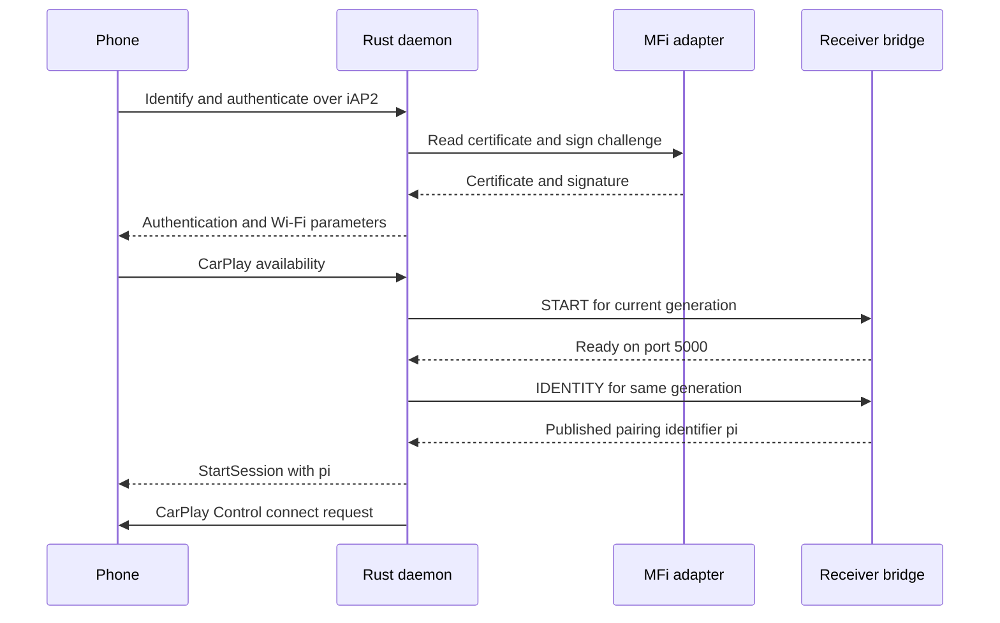
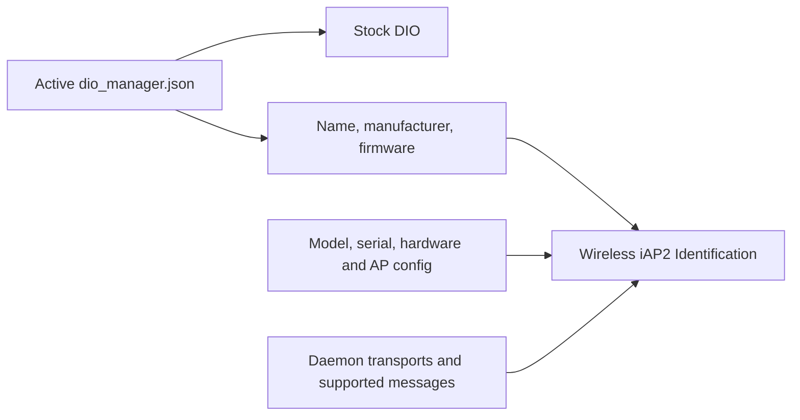

# Offline iAP2 bridge daemon prototype

_MHI2Q wireless CarPlay — technical reference, integrated 2026-09-29._

---

[Wireless overview](README.md) · [Current stock210 lifecycle](STOCK210_RECEIVER_LIFECYCLE.md)

Maintained technical reference. The evidence below distinguishes static analysis, local QNX tests and observations from the unit.

The current SI-owned daemon also advertises RGI component 16 and vehicle/location services, forwards authenticated 5201/5202/5204 and status/location subscriptions, and handles artwork Start/Data/Success/Cancel on the negotiated file session. The bounded semantic worker uses CPRX v3 operations 9/10 with exact input replay and retained output ACKs. See [wireless production channels](WIRELESS_PRODUCTION_CHANNELS.md) for limits, native GPS routing, test commands and physical acceptance gaps. Earlier bootstrap-only descriptions below are historical.

Implementation and local diagnostic paths in this record refer to the [original source directory](../../wireless/daemon/). Run `wireless/...` commands from the repository root; moving this note does not move binaries or logs.

## 📊 Component flow



## 📋 Implementation and evidence

`cargo test --offline --workspace --manifest-path wireless/daemon/Cargo.toml`
runs the daemon and vendored iAP2 crate tests. The daemon listens at
`127.0.0.1:57342`, the address used by the
btstack graft. It parses the graft's eight-byte, generation-tagged frames,
resets iAP2 state for each RFCOMM connection, feeds payload bytes to the
LIVI iAP2 link engine, and returns link-layer output to the graft in frames
up to 5035 bytes. The graft splits each frame at the connected peer's actual
RFCOMM payload limit and waits for SDK completion before reusing its packet.

The control machine reassembles CSM frames, builds an
`IdentificationInformation` with a wireless CarPlay transport component,
handles MFi certificate/challenge requests through an `AuthProvider`
interface, and answers Wi-Fi configuration and CarPlay availability after
authentication. Tests cover fragmented bridge and CSM frames, generation
changes, a synthetic iAP2 handshake, a phone Identify request carried through
the bridge, and the control sequence with a synthetic MFi signer.

The SI-owned build now also advertises `0x5000/0x5001` Now Playing support. After an admitted receiver starts, Rust subscribes to track/playback attributes. Updates are accepted only after identification and MFi authentication; both metadata queues are bounded at 16 frames, with a 4096-byte frame limit. The receiver worker rechecks native SI ownership and forwards CPRX v3 operation 8 outside the iAP2 timer thread. Reset/start clears pending updates. Native DIO merges track fields, and omitted playback fields retain their previous values. Two integrated QNX cycles verify Cyrillic titles, partial updates, app/state and elapsed DSI publications; [details and evidence limits](SI_STAGE2_OFFLINE.md#native-now-playing-and-hid).

The [native Bluetooth API test on October 18](../archive/internal-reference-2026-10-29/carplay-lab/VPHONE_LAB.md#native-bluetooth-bootstrap-checkpoint-2026-10-18)
found that iOS 26.6.2 rejects declaring the Identification exchange itself as
capabilities: `1D01` in MessagesSentByAccessory and `1D00/1D02/1D03` in
MessagesReceivedFromAccessory. These four declarations were removed; their
protocol handlers remain unchanged. The matching test profile then received
native `AA05`, `1D02` and Wi-Fi request `5702`. The subsequent
[real QNX/native session](../carplay-lab/NATIVE_WIRELESS_QNX.md) exercises the
ARM Rust daemon itself, answers `5702` and delivers `4301` after receiver
readiness and identity IPC. The opt-in VM association adapter now enables
native wireless PairSetup/PairVerify and media: independently decoded
800×480 H.264 shows Maps. This uses virtual Ethernet and establishes no
physical radio result. Its explicit
`native-api-lab` build uses a public-fixture host signer and `ecm0` discovery;
the default QNX build retains hardware MFi and `uap0`.

### Factory identity and wireless capabilities

The daemon reads the active stock DIO configuration at startup, including
`--check-config`. It selects `IPL_CONFIG_DIR_DIO_MANAGER/dio_manager.json`,
falls back to `IPL_CONFIG_DIR/dio_manager.json` when the DIO-specific variable
is absent, and otherwise uses `/etc/eso/production/dio_manager.json`.
An explicitly empty directory is an error. The factory `#`/`##` comments are
supported; hashes and escaped quotes inside strings are preserved.

| Identification field | Source |
|---|---|
| Name | `iap2.accessoryIdentification.displayName` |
| Manufacturer | `iap2.accessoryIdentification.manufacturer` |
| Firmware version | `iap2.accessoryIdentification.firmwareVersion` |
| Model, serial, hardware version | Required `MHI2Q_CP_MODEL`, `MHI2Q_CP_SERIAL`, `MHI2Q_CP_HARDWARE`; these fields are absent from the reviewed MU1316 JSON |
| Bluetooth transport and MAC | Daemon implementation and explicit `MHI2Q_CP_BT_MAC` |
| Wireless transport and AP settings | Daemon implementation and verified per-unit AP configuration |
| Message capability lists | Only messages supported by this daemon; the stock DIO lists are not copied |

Legacy `MHI2Q_CP_NAME`, `MHI2Q_CP_MANUFACTURER` and `MHI2Q_CP_FIRMWARE`
are ignored, including in older per-unit environment files. They cannot
override the shared factory identity. There are no fallback identity strings
when the file is missing, malformed or incomplete. Required JSON fields must
be nonblank strings of at most 255 UTF-8 bytes without control characters;
the file is limited to 1 MiB. Changes take effect on the next daemon launch.
The stock JSON is read only and is never rewritten by the daemon.



The file-loader/CSM regression checks conflicting legacy overrides, malformed
and missing files, UTF-8, the size limit, and isolation from stock-only message
lists. The minimal QNX phone fixture checks the three JSON values in the
daemon's actual Identification response; this remains a synthetic phone test.
The JSON parser is vendored for offline builds; see
[vendor provenance](IAP2_VENDOR_PROVENANCE.md#-factory-configuration-parser).

### Software MFi provider checks

The opt-in host-only [software MFi tests](TEST_SOFTWARE_MFI.md) now generate
synthetic RSA/SHA-1 and P-256/SHA-256 identities and verify the actual control
responses cryptographically. They exercise both identification/authentication
orders and rejection paths. The production host daemon still uses
`UnavailableAuth`; QNX retains its hardware signer.

The same provider now prepares public RSA vectors for the opt-in
`--software-mfi-qemu` fixtures. The ordinary QNX daemon traverses its real I2C
register, bridge and iAP2 code; the QNX synthetic phone verifies actual AA03
responses using factory libcrypto before sending AA05. This also runs in the
combined stock210 lifecycle fixture. The host private key stays outside QEMU.
See [QNX/QEMU software MFi integration](TEST_SOFTWARE_MFI.md#-qnx-and-qemu-integration)
for the repeat/retry/timeout/corruption matrix and the precomputed-fixture boundary.

<a id="qnx-build-and-synthetic-phone-checks"></a>

## 📦 QNX build and synthetic phone checks

The QNX 6.5 ARM build succeeds with the local
`Tools/qnx-65-sdp-docker` toolchain:

```sh
docker run --rm --platform=linux/amd64 \
  -v <workspace>:/src \
  -w /src/Patches/mhi2-carplay \
  qnx65-armv7-toolchain:latest \
  /opt/rust/qnx-cargo build \
  --manifest-path /src/Patches/mhi2-carplay/wireless/daemon/Cargo.toml
```

The resulting 32-bit ARM EABI5 QNX executable starts under the toolchain's
QEMU harness. With a synthetic environment and a disposable `uaputl`,
`probes/qemu_daemon_bridge.py` boots the ordinary daemon in QNX/ARM QEMU,
starts its loopback listener, and sends a bridge CONNECTED frame plus an
iAP2 marker from a separate QNX process. The client receives the daemon's
marker and iAP2 SYN in generation-tagged DATA frames (log:
`out/qemu_daemon_bridge.log`). This exercises the native QNX process shim,
Wi-Fi IE startup, TCP bridge, and initial iAP2 link path together. The fake
client does not emulate a phone, MFi coprocessor, or the physical RFCOMM
channel. The toolchain supports both full-`std` Rust and C++17
on QNX 6.5. The current split is C for the btstack graft and Rust for the
daemon; C++ remains available for native component integration where useful.

`python3 wireless/daemon/probes/qemu_daemon_bridge.py --phone-probe` exercises
the ordinary QNX daemon further with a synthetic QNX iAP2 phone, a
QEMU-only I²C preload returning a fixed test certificate/signature, and a
QEMU-only receiver-control listener. The phone verifies Identification,
MFi request/response flow, Wi-Fi configuration, and `CarPlayStartSession`
after START acknowledgement; it then disconnects and observes STOP.
`--phone-probe --reject-once` makes the listener reject its first START. The
daemon keeps the iAP2 link alive, and a repeated availability request then
succeeds. Logs are `out/qemu_daemon_phone.log` and
`out/qemu_daemon_phone_retry.log`. These tests exercise the production
daemon binary and its QNX I²C call sites, but the certificate, signature,
phone, and receiver are synthetic. They do not validate actual MFi
authentication or an AirPlay session.
`--phone-probe --control-probe` also supplies a QEMU-only DNS-SD service and
phone HTTP listener. The ordinary daemon traverses Browse, Resolve and
GetAddrInfo, then sends `/ctrl-int/1/connect`; the phone checks the receiver
device ID and returns HTTP 200 (`out/qemu_daemon_phone_control.log`). The
test-only preload redirects DNS-SD loading in the daemon process only.

<a id="mfi-adapter-and-bus-fault-handling"></a>

## 🔐 MFi adapter and bus fault handling

This is an **offline prototype**, not a complete CarPlay daemon. The actual
QNX MFi adapter now uses `/dev/i2c8`, seven-bit address `0x11`, and QNX I²C
`devctlv` calls. It locks the bus while reading certificate blocks or signing a
challenge. `MHI2Q_CP_MFI_PATH` and `MHI2Q_CP_MFI_ADDR` override the defaults.
The register sequence has a mock-bus test and the QNX binary links the I²C
and native process shims, but **no actual coprocessor transaction has been
tested**. The sequence was checked against the exact MU1316 stock
`libairplay.so` functions at `0x72ddc` (certificate) and `0x730b4`
(signature). Both use `/dev/i2c8`, address `0x11`, I²C lock/unlock, a
20-byte digest, 128-byte certificate chunks and two-second transfer
deadlines. The stock read helper at `0x72c78` uses a **single**
`DCMD_I2C_SENDRECV` (`0xC0140507`) with a 20-byte header, one-byte register
send and data receive. The prior shim used separate SEND and RECV commands;
its mock made that mistake look valid. The shim and QEMU mock now use the
stock combined command. Both stock exports returned a synthetic certificate
and signature in isolated QEMU (`receiver_bridge/out/qemu_stock_mfi_probe.log`).
The ordinary daemon and combined receiver QEMU fixtures passed with the
corrected shim. No physical MFi operation has been tested. Host builds still use
`UnavailableAuth`.
The fault-injection QEMU run (`qemu_daemon_bridge.py --phone-probe --control-probe --mfi-retry-qemu`) makes the first combined read
return a transient NACK and a later read report a zero transfer count. The
ordinary daemon retried both, completed MFi authentication and reached
`CarPlayStartSession` (`out/qemu_daemon_phone_mfi_retry.log`). The mock now
rejects unlocked I²C transfers and nested locks. A normal run without injected
faults passed afterward. A separate persistent-NACK fixture held certificate
register `0x30` in NACK state for the first phone: the daemon timed out in
2000 ms, unlocked the bus and closed that link. The next phone connected to
the **same daemon** and completed MFi, `CarPlayStartSession`, CarPlay Control
HTTP and STOP (`out/qemu_daemon_phone_mfi_timeout_recovery.log`). This checks
the timeout and recovery path against a synthetic chip, not physical hardware.
`qemu_daemon_bridge.py --phone-probe --control-probe --repeat-phone-qemu`
ran two complete synthetic phone sessions against one continuously running
daemon. Each reached iAP2 normal state, MFi certificate/signature, Wi-Fi
configuration, `CarPlayStartSession`, CarPlay Control HTTP and receiver STOP
(`out/qemu_daemon_phone_repeat.log`). The QNX IFS test uses a second copy of
the phone probe binary under another name because re-executing the same
`/proc/boot` path failed with `ENOENT` in the emulator; the daemon itself was
not restarted. This does not exercise a real iPhone or radio reconnect.
The review-bundle builder additionally compiles
`probes/qnx_i2c_abi_check.c` against the local QNX BSP's `hw/i2c.h`.
This checks the hand-written shim's command values, address format, header
sizes and field offsets, including the stock binary's exact combined command.
The Docker SDK omits that header, so the production
shim stays self-contained; the check is compile-only and does not touch an
I²C device. It passed for the current bundle and does not replace a real
coprocessor transaction.

<a id="receiver-identity-and-configuration"></a>

## 📋 Receiver identity and configuration

Configuration must be provided through the `MHI2Q_CP_*` environment variables
in `control.rs`; no test SSID or hardware identity is used by default.
The exact MU1316 stock `libairplay.so` reports `sourceVersion=210.81` in
QEMU `/info`. The current default profile is `stock210`: sourceVersion
`210.81`, port5000. `experimental280` explicitly selects `280.33.8`/7000.
Both version and port must match the selected profile. This applies to the
production daemon, not only probe builds; see
[configuration parsing](../../wireless/daemon/src/control.rs).
`MHI2Q_CP_DEVICE_ID` is the stock receiver's Bonjour `deviceid` and `/info`
`deviceID`, used consistently in the Device IE, `CarPlayStartSession` and
CarPlay Control request. It is not assumed to be the AP interface MAC.
The QEMU capture and the separate pairing gap are documented in
[Receiver Identity](history/RECEIVER_IDENTITY.md).
StartSession field 4 (the vendor codec calls it `public_key`) carries the
receiver pairing **identifier `pi`**, not its Ed25519 `pk`. After START, the
daemon obtains this identifier from the active receiver through IPC operation
5 before sending StartSession. Missing/invalid identity releases the receiver
generation and withholds StartSession. Optional `MHI2Q_CP_PAIRING_ID` is a pin
checked against that response; obsolete `MHI2Q_CP_PUBLIC_KEY` is rejected.
The stock210 pairing module lives in `hook/wireless`; its media adapters and
readiness contract now pass the [combined lifecycle test](STOCK210_RECEIVER_LIFECYCLE.md).
The offline launcher reads a per-unit `wireless_carplay.env`; its bundled
example leaves per-unit identity/network values empty, while selecting
stock210, port5000 and the explicit pairing/media flags. Startup rejects empty
fields, malformed Bluetooth MAC/IP/port, US channel outside 1–11, and
invalid WPA2 SSID/passphrase lengths before installing a Wi-Fi IE.

<a id="wi-fi-advertisement-lifetime"></a>

## 🔄 Wi-Fi advertisement lifetime

At startup the daemon reserves its loopback bridge port and validates the MFi
adapter configuration. It installs the Wi-Fi IE only after the btstack graft
connects to that listener. The IE monitor belongs to that connection: after
EOF or a socket error the daemon stops the monitor, then removes only its own
IE before accepting another graft connection. This prevents an idle daemon
from advertising CarPlay before the graft is present and removes the IE after
btstack exits. The supervisor separately runs `--clear-ie` if the daemon
itself exits. The loopback peer is not authenticated; this is a readiness
gate for the local graft, not proof against another local process connecting.
The QNX marker/SYN fixture and the `--ie-lifecycle` variant check the ordering
with a fake `uaputl`.
`wifi_ie.rs` builds the Apple Device IE with AirPlay, Wireless CarPlay and
2.4 GHz flags, Bluetooth MAC and stable Device ID. Its `uaputl` argument
builder uses mask `0x12A` for association/reassociation response, probe
response and beacon. The earlier `0x101` value was wrong according to this
firmware's own `uaputl` help. Once the graft connects, the daemon installs the IE on
`uap0` through `/mnt/app/armle/sbin/uaputl`; `MHI2Q_CP_IE_INDEX` must name a
verified free slot in the documented 0–3 range. It retries for 10 seconds if
the AP is not yet ready. Before writing, it queries the driver's custom IE
list: an empty slot is set, the same IE and mask are left alone, and a slot
containing another IE is rejected. The set is checked by readback. A QNX
monitor repeats this check every five seconds while the graft is connected, so a cleared slot is restored
after an AP restart. QNX/ARM QEMU exercised the installer, readback, and
restoration through a disposable fake `uaputl` (`probes/qemu_wifi_ie.py`):
two writes, seven queries, and a simulated AP reset completed. A second QNX
run returned `AP unavailable` for the first three queries, then installed,
restored after an AP reset, and removed the IE (ten queries total;
`out/qemu_wifi_ie_delayed_ap.log`). The same
probe now exercises `remove_on_qnx`: it clears the configured slot only if
the readback bytes match this mod's Device IE, then verifies an empty slot.
The production daemon exposes that operation as `--clear-ie` for the native
wireless supervisor after a wired takeover or daemon exit. The QNX
runner uses the native `spawn`/fd-map capture shim because its minimal image
did not run the original Rust `Command` path. Actual beacon capture and an AP
restart on the HU remain outstanding. The parser follows the `Index`,
`Management Subtype Mask`, and `IE Buffer: len` output in this firmware's
`uaputl` at `0x119DD4..0x119E9C`.

<a id="carplay-control-discovery"></a>

## 🌐 CarPlay Control discovery

After sending `CarPlayStartSession`, a separate
worker browses `_carplay-ctrl._tcp` on `uap0` through the firmware's
`libdns_sd.so.1`, resolves the phone's IPv4 address, and sends
`GET /ctrl-int/1/connect` with the receiver device ID. The HTTP exchange has a
local fake-phone test and a QNX/ARM QEMU test through a synthetic DNS-SD
service. The callback results use `RefCell` so the polling loop observes
the values written during `DNSServiceProcessResult`. The real firmware
DNS-SD service and a phone advertisement remain untested. The binary is
built for the host by default. The `iap2-link` and `iap2-csm` sources are
included under `vendor/` with the upstream license, commit provenance, and
original tests. The build no longer requires the sibling LIVI checkout. No
live head-unit test has been produced.

<a id="earlier-receiver-integration-experiments"></a>

## 📋 Earlier receiver integration experiments

The historical replacement280 bundle used port7000, feature bits37/38 and
Bonjour pairing identity. Its configuration must explicitly select
`experimental280`. The stock210 candidate instead uses port5000. The following
feature-only and early receiver results are preserved as earlier QEMU evidence;
the current end-to-end result is in [receiver lifecycle](STOCK210_RECEIVER_LIFECYCLE.md).

The stock 210.81 AirPlay receiver has no built-in CarPlay Control client.
`wireless/airplay_feature_patch` builds a separate stock-library variant that
adds only feature bit 37 to `AirPlayGetFeatures`; the daemon provides the
corresponding client. The modified library has static byte/disassembly checks,
and its feature arithmetic passed an offline QNX/ARM QEMU comparison against
the stock library. The QEMU probe bypasses the platform property lookup in
temporary test copies because there is no initialized AirPlay server. A later
offline mesh test did initialize the stock AirPlay server through a captured
real `CDIOManager`: the patched TCP 5000 `/info` response included feature
bit 37. This is QEMU evidence, not a phone or head-unit runtime result. The
stock Bonjour registration also uses port 5000 in QEMU; see
[Bonjour Readiness](history/BONJOUR_READINESS.md).

<a id="generation-control-protocol"></a>

## 📋 Generation control protocol

The daemon now requires a local receiver-ready acknowledgement before it sends
`CarPlayStartSession` in response to the phone's `CarPlayAvailability`. It
connects to `127.0.0.1:57343` and sends a fixed 16-byte request:
`"CPRX"`, version `2`, operation `1` START or `2` STOP, two zero bytes,
the RFCOMM generation as little-endian `u32`, the advertised AirPlay port as
little-endian `u16`, and two zero bytes. The response is eight bytes:
`"CPRA"`, version `2`, status (`0` means accepted), and two zero bytes.
START status 0 must mean the stock receiver is actually ready on the port
configured by `MHI2Q_CP_AIRPLAY_PORT`. The bridge rejects a mismatched port;
the accepted port must match the Bonjour registration and
`CarPlayStartSession` field. The daemon requests START only when the phone's
decoded `CarPlayAvailability` explicitly sets `wireless.available = true`.
The current stock210 profile uses5000, as verified against the original
receiver in QEMU; a physical phone session has not yet validated the complete path. If the bridge is absent or
rejects START, no `CarPlayStartSession` is sent and
the CarPlay Control worker is not started. A rejection now leaves the iAP2
connection up so a later availability request can retry START. A successful generation is stopped
on RFCOMM disconnect, replacement, or stream exit. Host tests exercise the
wire format and generation ownership; the QNX Rust binary cross-compiles.
The bridge can return STOP status `3` (`BUSY`) while an `/info` callback is
still active. The daemon maps this status to `WouldBlock`, retries STOP up to
six times, and retains the old generation if STOP never succeeds. It refuses
to START a new generation while that old one remains active. Host tests cover
both the transient-BUSY and persistent-BUSY cases. A QEMU stress fixture
confirmed BUSY during a concurrent `/info`; after the client drained, retry
returned `0` and manager teardown completed. That early daemon test did not close the supervisor shutdown race. The
current stock210 owner build requires bridge QUIESCE before termination;
[ownership and drain](STOCK210_RECEIVER_LIFECYCLE.md#queue-and-owner-lifecycle)
cover the later implementation and combined test.

<a id="combined-receiver-test-record"></a>

## 🧪 Combined receiver test record

The C receiver bridge now implements this gate and passes two generations in
QEMU; it is not yet validated on the HU. A second QEMU test runs the actual
QNX/Rust `LoopbackReceiverControl` against that bridge inside stock
`dio_manager`; two START/STOP generations and the receiver's readiness checks
pass (`wireless/receiver_bridge/out/qemu_receiver_control.log`). This tests
the control seam directly, not the daemon's complete iAP2/MFi path.
The combined QEMU run now takes the ordinary daemon through a synthetic
iAP2/MFi/availability exchange while that same stock `dio_manager` receiver
provides the START acknowledgement; see
`wireless/receiver_bridge/out/qemu_daemon_stock_receiver.log`. It also checks
that STOP closes TCP 5000 on disconnect. The phone, MFi device and radio
remain simulated.
The `--daemon-control-qemu` variant also exercises the daemon's DNS-SD
client and `GET /ctrl-int/1/connect` against a synthetic phone after that
stock receiver START; see
`wireless/receiver_bridge/out/qemu_daemon_stock_receiver_control.log`.
[Receiver Start](RECEIVER_START.md) maps the stock
`dio_manager` start/stop path and the limits of the existing QEMU force-spawn
proof. The bridge must return status 0 only after that path is verified with a
real manager configuration in QEMU; an acknowledgement from a stub would not
prove AirPlay can accept the phone. START now runs in a receiver-control worker
with an eight-second deadline, while the iAP2 loop continues handling link
traffic and timers. `CarPlayStartSession` is sent only after the worker reports
a successful START for the current RFCOMM generation. A generation reset
queues STOP behind any in-flight START; late results for old generations are
ignored. Host tests cover a delayed START/reset and a rejected START. This
worker path has not yet run with a real phone or receiver bridge on the HU.

The daemon's AirPlay endpoint also needs inbound WLAN firewall access. The
separate offline profiles in `wireless/firewall` add the factory-style CarPlay
TCP/UDP and mDNS rules ahead of the stock `uap0` quick block. They are not
installed or syntax-checked on the head unit.
