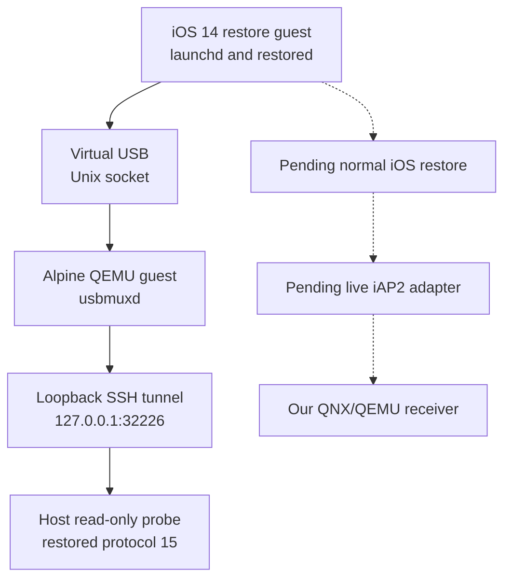

# iOS virtual machine laboratory

_Local bring-up evidence · 2026-10-09 · Partial integration._

[Wireless overview](README.md) · [Software MFi tests](TEST_SOFTWARE_MFI.md)

## 📋 Verified state

A native Apple Silicon build of ChefKiss Inferno boots Apple's iOS 14.0 beta 5
research kernel and restore ramdisk for iPhone 11 (`n104ap`). The guest starts
`launchd` and `restored_external`. A separate Alpine Linux QEMU guest enumerates
an Apple iPhone with USB VID/PID `05ac:12a8` and synthetic identifier
`00008030-1122334455667788`.

The Linux usbmuxd service is accessible through a loopback SSH tunnel. A host
read-only libimobiledevice probe receives `com.apple.mobile.restored`, protocol
15, ChipID 32816, BoardID 4 and serial `INFERNO_1122` from the actual iOS guest.
These are runtime guest responses, not replies from our synthetic phone fixture.

| Stage | Evidence |
|---|---|
| Native emulator build | Inferno commit `cc4302a99167abec69b714cfd00c38caece7e7de` |
| iOS kernel and userspace | `build/ios-vm-lab/ios-serial-first-boot.log` |
| Virtual USB enumeration | `build/ios-vm-lab/companion-usb.log` |
| Read-only restore protocol | `build/ios-vm-lab/restore-query.log` |
| Normal iOS boot | Pending filesystem restore |
| Actual iOS iAP2 / CarPlay | Not established |
| Connection to our QNX guest | Not established |

## 🔄 Current transport



The emulator implements a custom USB transport. A Linux companion is the
documented host for that virtual USB bus.[^1] usbmuxd management connectivity
does not establish an iAP2 or CarPlay session. The recovery guest lacks the
normal `lockdownd` service; its failed handshake is expected in this stage.

## 📦 Local setup

Generated firmware, clones, binaries, disposable disks, SSH material and logs
are local under `build/ios-vm-lab/`; none are committed or packaged for the HU.
The existing iOS 26.6/27 IPSWs and original HU firmware remain untouched.
Only compatible components were initially extracted from Apple CDN using HTTP
ranges; the complete 5,507,405,643-byte IPSW was later downloaded for restore.

The laboratory uses iOS `18A5351d` and Alpine virt `3.24.2`, whose ISO SHA-256
was checked against the distribution's published checksum. Apple's firmware URL
and member hashes are recorded in `firmware/components.json`.

The isolated Inferno checkout disables `ENABLE_DATA_ENCRYPTION` to use its
built-in simulated SEP for the first recovery boot. This is a modified research
guest. It is not evidence of normal device security behavior or Apple services.
Optional FUSE block export was disabled because the host macFUSE API did not
match the emulator's build expectations. No host security settings were changed.

The local restore-tool fork retains its AP-ticket option and has two source
compatibility edits: libplist's fourth `plist_from_memory` argument and removal
of the obsolete `irecv_init` call. It has compiled; no filesystem restore has
been started. The upstream setup describes firmware, ticket and restore steps.[^2]

## 🧪 Commands

Run from the repository root. The Linux companion and its SSH tunnel must be
running before starting the iOS guest. Their exact current commands and the
guest launch record are local laboratory artifacts.

```sh
python3 wireless/ios_vm_lab/lab.py status
python3 wireless/ios_vm_lab/lab.py start
python3 wireless/ios_vm_lab/lab.py query
python3 wireless/ios_vm_lab/lab.py stop
python3 wireless/ios_vm_lab/lab.py restore-preflight
```

The read-only [probe](../../wireless/ios_vm_lab/query_restore.c) targets only the
synthetic identifier above and refuses to run without an explicit loopback
`USBMUXD_SOCKET_ADDRESS`. Compile it against the installed host libraries:

```sh
clang -std=c11 -Wall -Wextra -Werror \
  $(pkg-config --cflags libimobiledevice-1.0 libplist-2.0) \
  wireless/ios_vm_lab/query_restore.c -o build/ios-vm-lab/query-restore \
  $(pkg-config --libs libimobiledevice-1.0 libplist-2.0)
```

The [controller](../../wireless/ios_vm_lab/lab.py) checks the recorded process
against the laboratory emulator path before stopping it. The iOS recovery
service shuts down after an idle restore timeout; restart the guest before
querying it again. The controller does not launch the companion or perform a
restore.

## 🎯 Remaining work and storage constraint

The restore program extracts a roughly 5.15 GB filesystem image before writing
the guest's system partition, whose manifest minimum is 7,340 MB. The preflight
requires 15 GiB free after the IPSW download to leave room for these writes and
host operation. Available space has fluctuated below that threshold. No user
files are removed to make room; an alternative laboratory location or freed
storage is needed before the full restore can start.

After normal iOS boots, test actual USB role switching and iAP2 before adding
an adapter to our daemon's eight-byte bridge framing. The current software-MFi
QEMU fixture supports precomputed challenges. An actual iOS sender needs a live
signing path and a separately verified way to accept our synthetic test
identity. The standard MFi flow verifies Apple's accessory certificate.[^3]
Full CarPlay video, audio, input and radio behavior remain unverified.

[^1]: ChefKiss Inferno, [Companion VM setup](https://github.com/ChefKissInc/Inferno/wiki/3.-Companion-VM-Setup).
[^2]: ChefKiss Inferno, [Emulator file setup](https://github.com/ChefKissInc/Inferno/wiki/2.-Emulator-File-Setup) and [Running and restoring](https://github.com/ChefKissInc/Inferno/wiki/4.-Running-&-Restoring).
[^3]: Apple Platform Security, [Verifying accessories](https://support.apple.com/guide/security/verifying-accessories-sec70a4f377d/web).
