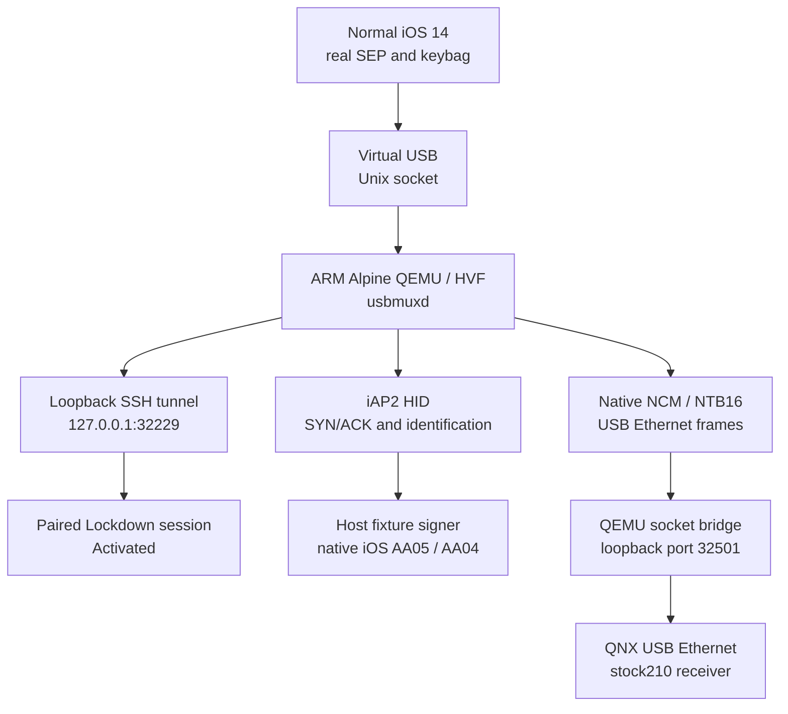

# iOS virtual machine laboratory

_Local bring-up evidence · 2026-10-11 · Native iAP2/MFi, MFi-SAP and QNX control verified; real CarPlay video independently decoded through the VM software surface adapter._

---

[Wireless overview](README.md) · [Software MFi tests](TEST_SOFTWARE_MFI.md)

## 📋 Verified state

A native Apple Silicon build of ChefKiss Inferno boots Apple's iOS 14.0 beta 5
research kernel and restore ramdisk for iPhone 11 (`n104ap`). The guest starts
`launchd` and `restored_external`. A separate Alpine Linux QEMU guest enumerates
an Apple iPhone with USB VID/PID `05ac:12a8` and synthetic identifier
`00008030-1122334455667788`.

The current companion runs `aarch64` Alpine with HVF acceleration; the earlier
`x86_64` TCG guest is retained locally. Its usbmuxd service is accessible through
a loopback SSH tunnel on port `32229` (`32226` for the old companion). A host
read-only libimobiledevice probe receives `com.apple.mobile.restored`, protocol
15, ChipID 32816, BoardID 4 and serial `INFERNO_1122` from the actual iOS guest.
These are runtime guest responses, not replies from our synthetic phone fixture.

| Stage | Evidence |
|---|---|
| Native emulator build | Inferno commit `cc4302a99167abec69b714cfd00c38caece7e7de` |
| iOS kernel and userspace | `build/ios-vm-lab/ios-serial-first-boot.log` |
| Virtual USB enumeration | `build/ios-vm-lab/companion-usb.log` |
| Read-only restore protocol | `build/ios-vm-lab/restore-query.log` |
| Diagnostic normal userspace | iOS `14.0` / `18A5351d` returned by `lockdownd`; pairing failed and screen stayed black |
| Real SEP runtime | Recovery and normal boot reached `SEP/OS is alive` without diagnostic keybag bypass |
| ASR finalization | Inversion, full verification and filesystem check passed after restoring headless display interrupts |
| Complete restore | `Restore Finished / DONE`, exit `0`; fresh headless run with the stock ramdisk |
| Normal iOS / Data / keybag | Real SEP, Data mount and keybag initialization succeeded; diagnostic bypass disabled |
| USB pairing and restart | Pairing and validation succeeded; normal reboot and ARM companion cold boot verified |
| Activation / UI | `Activated`; Setup wizard completed through native UI; Home unlocked and computer trust accepted |
| Native CarPlay render tree | Real 800×480 UI captured through QuartzCore and visually verified |
| USB accessory interfaces | HID/NCM selection verified; virtual dock profile receives actual iAP2 detect echo |
| Actual iOS iAP2 | SYN/ACK and control session `10` negotiated; iOS requested certificate/challenge |
| Software MFi against iOS | Live 32-byte challenge / 64-byte P-256 response; `AA05` accepted, corrupted signature rejected with `AA04` |
| Native identification | `1D02` accepted; `4300` reports wired CarPlay available |
| Combined USB | USBMUX, iAP2 HID and NCM share configuration `1`; separate cloned disks |
| NCM IP link | Actual iOS Ethernet frames and IPv6 ping; three replies, no loss, 3.8–9.5 ms in one local run |
| CarPlay approval | Native alert accepted; saved vehicle policy changed to `enabled state 1` |
| Native Pair Setup / Verify | iOS completed both exchanges and switched to encrypted control |
| Native MFi-SAP | Live P-256 response accepted; `Endpoint_AuthenticationSucceeded` and authorization confirmed |
| Codec properties | Opt-in conditional workaround: native `ftvc`, `avc1`, `ftvh` probes return `0` / 51 properties; unpatched control fails |
| CarPlay session / media | Native control and encrypted video; 31-frame baseline plus 519-frame longer run; PCAP 10.84 access units/s over 47.78 host seconds; sustained 30 FPS not proved |
| QNX receiver endpoint | Native QNX `ecm0`, source `210.81`; direct Ethernet bridge, native pairing and iOS TCP sessions verified |
| QEMU paired AltScreen | Separate opt-in hook negotiated 1440×542 CarInstruments / stream 111 on port 6031; only state/telemetry received, cluster video and crypto interoperability unproved |
| Native framebuffer 2 | Opt-in separate producer, validated 1440×542 NV12 pool and three submissions after session teardown; active stream-111 video remains unproved |

## 🔄 Current transport



The emulator implements a custom USB transport. A Linux companion is the
documented host for that virtual USB bus.[^1] usbmuxd management connectivity
does not establish an iAP2 or CarPlay session. Recovery uses `restored`; normal
iOS uses `lockdownd`. The earlier diagnostic normal
profile returned actual device information, but pairing failed with
`LOCKDOWN_E_MISSING_VALUE` (`-12`). No SpringBoard UI was verified.

## 📦 Local setup

This is a bring-up record and a repeatable test procedure for an already
prepared laboratory, not a complete clean-machine build recipe. `lab.py` uses
local launch JSON and images; it does not download firmware, construct the
initial disks, build Inferno or perform the full restore. The commands below
reproduce the native control experiment once those prerequisites exist.

| Component | Reproducible here | Prerequisite / unresolved boundary |
|---|---|---|
| Inferno | Pinned revision and source patch; sanitizer tests | Build dependencies, Apple firmware and initial launch records must be prepared separately |
| Restored iOS | Cloned-image provisioning and controlled normal boot | Initial restore/SEP preparation remains recorded local work, not one versioned automation command |
| QNX receiver | Versioned IFS builder, pairing/media flags and virtual networking | Pinned stock firmware, existing mesh harness, hook binary, custom QEMU and local QNX toolchain required |
| Native CarPlay | Live authentication, 519 independently decoded frames in the longer test and PCAP intervals through the software surface adapter | Maps/Metal, audio, AltScreen pixels, sustained 30 FPS and real radio behavior remain unverified |

Generated firmware, clones, emulator binaries, disposable disks, SSH material and logs
are local under `build/ios-vm-lab/`; these are not committed or packaged for the HU.
After the 2026-10-10 cleanup, two operational disk sets remain:
`combined-usb/disks/` for the current native CarPlay experiment and
`sep-real/fresh-headless-disks/` for the normal/recovery launch profiles and
clone provisioning. Older offline experiments and restore checkpoints were
deleted. The original `ios14.ipsw`, SEP firmware, toolchain/source artifacts and
latest native-session logs, packet capture and crash report remain local.
The public upstream SHSH sample and its derived AP ticket are versioned as
[emulator ticket fixtures](../../wireless/ios_vm_lab/fixtures/README.md), with
source revision and hashes. They contain no locally generated SSH private key
or MFi private identity.
The existing iOS 26.6/27 IPSWs and original HU firmware remain untouched.
Only compatible components were initially extracted from Apple CDN using HTTP
ranges; the complete 5,507,405,643-byte IPSW was later downloaded for restore.

The 2026-10-11 cleanup removed obsolete structured log archives and their TAR
duplicates, raw PPM screenshots with retained PNG equivalents, and regenerable
compiler outputs from earlier validation iterations. It freed approximately
3.4 GiB. Plain reports, crash files and fuzz corpora remain, together with the
verified native CarPlay H.264/PNG/PCAP/JSON evidence. Both disk sets, original
IPSW, firmware, patched cache and symbol map, current emulator/toolchain and
QNX build inputs were preserved. The exact local removal manifest is
`build/cleanup-result-20261011.json`. The old x86 companion and its tunnel were
stopped; the current ARM companion remains available. Main iOS/QNX guests were
stopped after the native mode guard confirmed preference restoration.

The laboratory uses iOS `18A5351d` and Alpine virt `3.24.2`, whose ISO SHA-256
was checked against the distribution's published checksum. Apple's firmware URL
and member hashes are recorded in `firmware/components.json`.

### Boot profiles and SEP

The first recovery profile disabled `ENABLE_DATA_ENCRYPTION` and used Inferno's
simulated SEP. The current real-SEP recovery build restores the upstream
encryption flag and boots Cebu B1 ROM plus a repackaged SEP firmware container.
The exact private emulator changes and build logs are retained locally in
`inferno-local.patch` and `sep-real/`. Optional FUSE block export remains disabled
because the host macFUSE API did not match the build expectations.

Two restore tools were built locally: the older AP-ticket fork and current
libimobiledevice `idevicerestore` revision
`4b3e847e1d9a1210049a9e3f1d1caa38650c6617`. Both earlier simulated-SEP attempts
sent the filesystem to 100%, then stalled before ASR finalization. The intact
source OS cache was verified inside the intermediate `apfs_invert_asr_img`.
Those attempts did not complete a restore.

A separate offline System/Data image was prepared from the same IPSW, including
Preboot, Hardware, Update and xART volumes, the upstream filesystem cache
patches, and the stock 6 MiB preallocated gigalocker file. Normal userspace
reached `lockdownd` only with the emulator's explicit diagnostic boot property,
which skips keybag initialization. This proves partial userspace and USB
connectivity; it does not prove ordinary keybag, pairing or CarPlay behavior.

Direct normal boot with a fresh real SEP initially failed with ROM error `0xe5`.
A GDB probe attached to the separate SEP process (`vAttach;3`) localized the
failure to the normal firmware validation path. Selecting RSEP diagnostically
allowed SEP/OS to start. A subsequent fresh recovery boot and restore reached
`SEP OS is booted`, successful xART communication and filesystem transfer
without a debugger. A clean restore subsequently initialized storage and
the system keybag, allowing a normal boot with the real SEP. Firmware setup follows the
upstream ticket and container procedure.[^2]

### Headless display fix

The apparent ASR stall was a display wait. The ASR child had already exited
with status zero and the 7,695,577,088-byte written APFS image matched the
source bit-for-bit. The restore worker's actual user stack was blocked in
`IOMobileFramebufferSwapWaitWithTimeout`. A 60-frame screen refresh sequence
advanced queued restore and verification progress; continuous refresh then
completed ASR inversion and filesystem verification.

Inferno's displaypipe V4 emits `OUTPUT_READY` interrupts from `gfx_update`.
A headless frontend does not continuously poll that callback.[^4] The local
[emulator patch](../../wireless/ios_vm_lab/patches/inferno-lab.patch) adds an
opt-in 60 Hz virtual-clock interrupt source, independent of a host display
listener. The controller sets `MHI2_IOS_VM_HEADLESS_DISPLAY=1` for a launch
record containing `-display none`, and explicitly clears it for other displays.
The patch also contains the diagnostic boot opt-in and bounded SEP boot tracing;
it targets Inferno revision `cc4302a99167abec69b714cfd00c38caece7e7de`.
The patch retains the upstream AGPL-3.0-or-later source terms.

The stock restore ramdisk then passed ASR, gigalocker initialization and NOR
firmware transfer. One run using previously reused SEP storage later hit a
SARS panic `[iqlgk]`; its partial installation lacked the Data volume attribute.
That failure is retained as historical evidence, not the current state.

A fresh run on `sep-real/fresh-headless-disks/`, with new SEP storage and the
patched emulator, completed the entire restore with exit zero. Chunk checksums
and whole-image verification stayed enabled. Normal boot passed the real SEP,
Data mount, FIPS, keybag initialization and later launchd boot tasks without the
diagnostic property. `DevicePublicKey` was available, pairing and subsequent
pairing validation succeeded, and paired Lockdown returned `Activated`.

The complete restore was initially saved before filesystem cache patching in
`sep-real/disks-after-complete-restore/`; that historical backup was removed
during the 2026-10-10 cleanup. The two operational disk sets above remain.
Normal iOS and the companion were restarted; pairing still validated afterward.
Runtime evidence is in
`sep-real/restore-exit.json`, `normal-device-info.json`,
`normal-reboot-validation.json`, and `normal-serial.log`.
An early normal framebuffer showed the Apple logo and boot progress;
`SpringBoard`, `Setup`, `backboardd`, `accessoryd` and `carkitd` appear in both
a kernel process probe and the normal guest's diagnostic PID list. Running
processes alone did not establish interactive UI. Later QMP interaction completed
the Setup wizard and reached Home; see the current setup evidence below.

ROM, firmware, images and pairing material remain local; the versioned emulator
patch contains source changes only.

### USB accessory transport investigation

The source launchd configuration assigns `com.apple.carkit.service` to
`carkitd`'s **MachServices** dictionary. It does not demonstrate a Lockdown TCP
service with that name. The running `accessoryd` owns the iAP2 XPC services;
the disabled standalone `iap2d` job does not require enabling.

The research kernel's
`IOUSBDeviceController::findConfigurationForFunction` at
`0xfffffff00899053c` rejects selectors above `3`. The DiPlay request's selector
`4` therefore cannot work on this firmware.[^5] Supported selector `2`
exposed Valeria; selector `3` subsequently exposed NCM as configuration `6`.
Configuration numbers depend on which functions are unlocked. The returned
byte was `00`; use re-enumerated descriptors to verify interface availability,
rather than treating that byte as the selected configuration.

| Probe | Actual guest result |
|---|---|
| `0xc0 / 0x52 / index 4` | `EPIPE`; rejected by kernel selector range check |
| `0xc0 / 0x52 / index 3` | NCM Control/Data interfaces appeared after re-enumeration |
| Configuration `2`, interface `2`, HID report descriptor | All `208` bytes read |
| iAP2 detect Output report | `0e00ff550200ee100000`; SET_REPORT transferred `10` bytes |
| Interrupt IN `0x83`, baseline profile | Timed out after five seconds; no detect echo |
| Interrupt IN with virtual dock + native USB test mode | `0200ff550200ee100000`; actual detect echo |
| iAP2 synchronization | Peer SYN/ACK acknowledged our SYN and negotiated session `10` |
| Restore USBMUX configuration after probe | Configuration restored, usbmuxd restarted, pairing validated |

The HID envelope is report ID, link-control byte, iAP2 marker and zero padding;
the transport implementation used as a protocol reference is pinned below.[^7]
Accepting a USB write does not establish an iAP2 link. The virtual dock profile
now passes the receive-side detect and synchronization checks as well.

The guest's unified log records a more specific blocker: `accessoryd` discovers
USB port `2`, but its `_primaryPortNumber` and `_upstreamManager service` are
both `0`. It reports that it cannot find the upstream accessory manager and
deallocates the port transport. Inferno removes `function-dock_parent` from
the device tree.[^6] In the original tree this property points to phandle
`0xf3`, the `dock,9pin` node. The `tristar,cbtl1612` controller is also absent
from Inferno's compatible whitelist. These observations identify a missing
virtual accessory-controller relationship; they do not prove that one
property alone can fix it.

Two opt-in source experiments were built and booted locally. Preserving the
original dock-parent property did not restore USB enumeration. Redirecting
it to the existing inductive `dock-0pin` manager logged transport type `0`,
connect type `-1`, and likewise did not enumerate USB. Both experiments were
reverted before adding the register-level model.

The [emulator patch](../../wireless/ios_vm_lab/patches/inferno-lab.patch) now adds
an opt-in Tristar I²C register fixture at address `0x1a` on `smc-i2c1`. It retains
the Tristar node and original dock-parent relationship, and removes the
Tristar-only `function-ldcm_bypass_en` reference to the pruned audio codec.
Runtime IORegistry inspection confirmed `AppleHydraBuiltIn`, `Port-Lightning`
and its `AppleCBTL1612` child; actual I²C reads/writes followed. The model
implements a bounded register bank and the system-ID marker checked by
`AppleCBTL1610::readSystemID`, not a complete hardware controller.

The fixture supplies SMC `VBUS`, port-1 detection/debounce keys and `VQ0u` at
5 V using the SMC `ioft` fixed-point format.[^8] iOS reported both VBUS and
physical connection present. Native cable data classification remained absent,
so the profile adds the kernel's existing `force-usb-test-mode=1` boot argument.
The stock driver then enters USB device mode while retaining the working
accessory-manager relationship. This combination receives the actual iAP2
detect echo and SYN/ACK; it does not validate physical Lightning cable behavior.

The controller enables these changes only with `start --boot normal --virtual-dock`,
records that choice, and clears the emulator flags for ordinary starts. Changing
the profile requires stopping the VM. The base launch JSON remains unchanged;
real SEP/keybag initialization stays enabled.

### Live software MFi verification

The host [MFi probe](../../wireless/ios_vm_lab/mfi_probe.py) uses the existing
[public DiPlay fixture](../../wireless/fixtures/diplay_mfi/README.md). It checks
the pinned key/certificate hashes and that their public keys match. Only the
public certificate and probe source are uploaded to the companion. A bounded
signer exchange over the pinned SSH connection keeps the private key on the
host and signs the phone's 32-byte prehashed challenge with P-256/SHA-256.

The actual guest exchanged `AA00` → certificate → `AA02` → 64-byte signature →
`AA05`. Repeating the exchange with one signature bit changed returned `AA04`.
Changing the accessory certificate's signature also produced `AA04` before
any challenge. Positive and negative response checks passed after restarting
the guest with the controller's explicit virtual dock profile.
The probes restored the previous USBMUX configuration and restarted usbmuxd;
pairing validated afterward. No challenge was precomputed and no reply came
from the synthetic-phone fixture. This verifies accessory authentication on
the emulated iOS build, not acceptance by physical iPhones or a CarPlay media
session.

Local records are `tristar/live-mfi-authentication.json`,
`live-mfi-corrupt-signature.json`, `usb-iap2-handshake.json`, the I²C trace and
IORegistry snapshots. The production daemon and QNX preloader do not load this
identity or use the host signer.

### Identification and combined USB

Native iOS accepts the minimal application declarations: messages sent contain
only `4301`, and messages received contain only `4300`. Advertising implicit
authentication/identification messages caused `1D03` rejection of parameters
`6` and `7` in this guest. The current laboratory identification receives
`1D02`, followed by actual wired availability. This finding is specific to
the pinned firmware; the test builder does not rewrite the production daemon.

The optional [native USB helper](../../wireless/ios_vm_lab/usb_fixture.c) copies
the stock device description and uses `IOUSBDeviceController`'s existing
`SetDeviceDescription` command. Its entitlement is
`com.apple.private.usbdevice.setdescription`. Only this helper's code hash is
added to the cloned guest's trustcache; MFi validation remains native.
The helper requires the exact synthetic UDID and supplies one default
configuration containing `AppleUSBMux`, `IapOverUsbHid`,
`AppleUSBNCMControlDirect` and `AppleUSBNCMDataAux`. The initial ordinary
Control/Data pair established IP traffic but was classified as generic USB
Ethernet. The Direct/Aux experiment uses native driver personalities; its
CarPlay classification succeeds with the explicit native `ncm-no-hide=1`
diagnostic (`lab.py --ncm-visible`). This visibility experiment affects only
the cloned VM profile. Destroying the old description and waiting for its HID
port to release avoids a native port reservation race.

| Interface | Transport | Endpoints |
|---|---|---|
| `0` | USBMUX | Bulk OUT `02`, IN `81` |
| `1` | iAP2 HID | Interrupt IN `83` |
| `2` | NCM control | Interrupt IN `85` |
| `3`, alternate setting `1` | NCM data | Bulk OUT `04`, IN `86` |

The [provisioner](../../wireless/ios_vm_lab/prepare_combined_usb.py) can initialize
all normal-profile disks as one stopped APFS clone snapshot. The source disks
and base launch JSON stay unchanged. macOS mounting needs a temporary 512-byte
GPT view of the native 4096-byte disk. The provisioner restores only GPT bytes
outside the filesystem, after detaching: restoring an entire saved 1 MiB prefix
would overwrite APFS changes. Header/entry CRCs and non-overlap are checked.
Existing clone updates were verified live; `--init` cloning/profile rewriting
is covered by the static suite.

### NCM and QNX networking

The ARM companion lacks a kernel `cdc_ncm` driver. The bounded
[NCM/TAP adapter](../../wireless/ios_vm_lab/ncm_link.py) instead uses the native
Linux IP stack through `/dev/net/tun`. It negotiates NTB16, honors peer alignment
and input size, activates the data alternate setting, sets the packet filter
and reads network/speed notifications before opening the link.[^9]
The first experiment timed out on bulk OUT; this ordering and notification
handling produced bidirectional native traffic. Repeated runs exchanged
IPv6 discovery, DHCP and mDNS frames. Three IPv6 echo requests received three
replies with no loss. The adapter never switches USB configurations.

The [QNX network controller](../../wireless/ios_vm_lab/qnx_network.py) builds an
isolated stock210 receiver around the existing mesh harness. Native `io-usb`,
OHCI and `devnp-ecmplus` bring up `ecm0` at `10.0.2.15`. USB enumeration must
finish before loading the Ethernet driver. Drivers precede the large factory
block in the IFS; late executables fail with `ENOEXEC` on this bootstrap.
`ifconfig` uses `data=copy` because the default `data=uip` makes it run only once.

Two modes are available. `--transport user` exposes receiver port `5000` only
on host loopback `32500`; `/info` returns source `210.81` and device ID
`02:00:00:00:00:01`. `--transport socket` instead accepts raw Ethernet on
loopback `32501`. The companion's `ncm_link.py --qnx-socket` forwards native
USB Ethernet frames directly to the QNX IP stack, including dynamic media
ports. This mode exchanged IPv6 discovery, DHCP and mDNS bidirectionally.
Its QNX link-local address is `fe80::4254:ff:fe12:3456`.

`qnx_network.py build --pairing` loads the existing stock210 pairing hook and
a disposable QNX RAM filesystem. An opt-in diagnostic reads its actual public
Ed25519 identity through `carplay_wireless_copy_pairing_identity`; socket-mode
`qnx_network.py info` returns it as `pk`. Supply that current key to
`mfi_probe.py --receiver-public-key`. A QNX restart regenerates this volatile
identity. `/info` itself does not advertise `pk` in this baseline.

The native APTransport helper filters USB interfaces using a transport bit
`0x10`. CoreUtils maps `IFEF_DIRECTLINK=0x20000000` to that bit.[^10]
The original `en*` interface returned type `0x8`. The native Direct/Aux
profile with `--ncm-visible` returned `en0`, extended flags `0x21000080` and
type `0x10`. The private NCM subclass can use `anpi*`; the read-only helper
checks both prefixes. No kernel patch to force classification is retained.
The native phone then initiated TCP, Pair Setup and Pair Verify over this link.

Local evidence is in `combined-usb/ncm-second.log`, `ncm-second.pcap`,
`ncm-ping.log`, `identify-with-ncm.json`, `carplay-native-qnx-first.json`,
and `qnx-network/serial.log`, `info.bplist`, `build-record.json`.

### Live MFi-SAP on the QNX stand

The native phone requests `/auth-setup` after Pair Verify, over encrypted
control. The production stock210 MFi adapter remains SHA-1/RSA and expects the
chip; the public fixture is P-256. The opt-in `--software-mfi` QEMU build
therefore uses a separate test responder, with the same MFi-SAP v1 layout and
SHA-256/raw P-256 signature profile as the pinned DiPlay implementation.[^11]

[Host responder](../../wireless/ios_vm_lab/mfi_sap.py) creates a fresh X25519
ephemeral key, signs the concatenated public-key digest with the pinned fixture,
and returns the certificate plus AES-CTR encrypted signature. Only the 33-byte
request and 711-byte response cross the bounded RPC; the private key stays on
the host. A second virtual QNX Ethernet interface `ecm1` at `10.0.3.15` reaches
the loopback-only host service `32502` through QEMU user networking. The phone
continues to use the direct `ecm0` Ethernet path.

The QEMU-only capture adapter wraps the copied stock210 request delegate after
the ordinary hook has performed its ABI checks. Preload order is capture, hook,
probe for this experiment. Wrapping the incoming delegate first prevented the
hook's fingerprint check and was corrected. Production hook/library files are
unchanged. Independent host tests derive the shared secret as the peer, decrypt
the response, verify its certificate and signature, and reject malformed keys.

The native phone accepted the response and logged authentication/authorization
success. QNX logged `session started: From=iPhone`, a screen setup of 800×480 at
30 FPS, and session teardown after about 20 seconds. This establishes native
CarPlay control and media negotiation, not successful encoded/decoded frames.

### Interactive guest setup

The native `carkitd` received `4301` and attempted to display the CarPlay approval
alert. SpringBoard rejected it with `Alert cannot show while we're in Setup`;
the vehicle policy stayed at `enabled state 0` and no TCP request followed.
The initial 90-second held iAP2 session confirms this is beyond MFi and
identification, rather than a short-lived probe disconnect.

An explicit `prepare_combined_usb.py --complete-setup` option installs a state
fixture in the clone: the helper first verifies the synthetic identity as root,
then drops to mobile UID/GID `501`, writes native `SetupDone` and
`SetupFinishedAllSteps` preferences, and publishes setup state `3`. This is
test setup state, not proof that the UI wizard completed. The option does not
modify activation, SEP/keybag or certificate verification. Its launch job and
preferences persist in this clone.

`lab.py start --input-control` adds a local Unix QMP socket. The bounded
[input helper](../../wireless/ios_vm_lab/input_control.py) sends absolute touch
events to Inferno's native multitouch model. Swiping the actual Hello screen
and navigating the Setup panes is verified. Screenshot capture polls scanout
twice because a headless frontend can otherwise show its previous frame.
The actual Setup wizard subsequently completed through touch interaction.
After reboot, Home unlocked and the computer trust alert was accepted. The
native CarPlay approval alert was then accepted; `carkitd` logged
`approval alert accepted`, a keychain update and `enabled state 1`.
Evidence includes `combined-usb/home-trusted.png`,
`carplay-unlocked-prompt-two.png` and `approved-airplay-messages.txt`.
The earlier DirectLink/MFi-SAP run established native control and screen
sockets without decoded media. The later software-surface run in
[NATIVE_SCREEN_TEST.md](NATIVE_SCREEN_TEST.md) verifies actual UI video.

Touch velocity had been rounded to zero by dividing displacement by nanoseconds
before scaling. The opt-in input model now scales first, with bounded saturation.
Swipes hold their starting position before movement so the native model samples
the initial touch. The helper defaults to a 600 ms initial dwell and 50 ms
movement steps (1000 ms over 20 steps), which unlocked Home reliably after a
loaded boot. Taps default to a 200 ms contact to avoid opening a long-press menu.
`--hold-ms` and `--duration-ms` allow bounded timing adjustments. Power key `f5`
toggles the screen; send it only when the recorded backlight state is off.
Explicit wake waits for resume and refreshes headless scanout before the
gesture. This ordering was verified with a live sleep/wake/unlock cycle;
without the refresh the headless screen could remain at its previous frame.

QMP coordinates follow the screenshot: `(0, 0)` is the top-left corner and Y
increases downward. The raw range is `0..32767` on each axis. Inferno converts Y
internally for the touch sensor; do not invert it in the caller. The earlier
failed unlock attempts inverted Y and sent downward gestures. On 2026-10-11 an
upward gesture unlocked Home, a short tap opened Settings, and an in-app swipe
scrolled the list despite the existing `AIDReporter` diagnostics.

```sh
# Send an upward unlock gesture; add --wake only when the display is off.
python3 wireless/ios_vm_lab/input_control.py unlock

# Use the actual screenshot dimensions for pixel coordinates.
python3 wireless/ios_vm_lab/input_control.py tap 510 1055 --screen-size 828 1792
python3 wireless/ios_vm_lab/input_control.py swipe 414 1400 414 650 --screen-size 828 1792
```

`unlock` sends a gesture and does not verify lock state or bypass a passcode.
Check a fresh screenshot before sending the next action. Gestures release their
contact at the final position. After a movement error, the helper attempts to
release at the last acknowledged position. Regression tests cover
screen-coordinate boundaries and 10,000 random conversions, upward unlock,
explicit wake, short taps, invalid CLI input, and release after a QMP failure:

```sh
python3 -m unittest discover -s wireless/ios_vm_lab -p 'test_input_control.py'
```

Local evidence is in `sep-real/accessory-transport-findings.json`,
`normal-accessory-archive.txt`, `normal-pidlist.txt`,
`versioned-usb-iap2-detect.json`, and `probes/accessory/`.
These record the kernel hash, DT data and targeted disassembly.

### Codec-property recursion experiment

The original `mediaserverd` crash repeats VideoProcessing's supported-property
getter through one `dispatch_once` initializer. The initializer selects another
encoder and asks it for a property dictionary; with a software fallback that
query can return to the same getter while the initializer is in progress.
Targeted disassembly and the original crash stack identify the two indirect
query sites at `0x1a9fec8d8` and `0x1a9fec91c`.

The opt-in [codec patch](../../wireless/ios_vm_lab/codec_patch.py) replaces those
calls with a small thunk in verified RX segment padding. It compares the
authenticated, stripped callback with `0x1a9fec5d8`: a self query returns
`-12782`; a different callback receives its original authenticated tail call.
`dispatch_once`, codec creation and frame encoding are unchanged. This is an
experimental VM compatibility workaround, not a production firmware patch.

| Guard / validation | Evidence |
|---|---|
| Input cache | Size `2052489216`, SHA-256 `af1001abe5b075afd337bf110562746c3e006e9d93951e163fc5daae062aeab8` |
| Patched cache | SHA-256 `86f1dd01fc9331e7fcc3c3ce8a91a85be37ca1060146ef746f60b04ea98032b6` |
| Changes | Two 4-byte calls and 28 bytes of unused RX padding at `0x1aa1e53b8` |
| Apply/revert | Exact bytes and full hashes checked; failure restores the original byte ranges |
| Native probe, patched | `ftvc`, `avc1`, `ftvh`: status `0`, 51 properties each; repeated after reverting and reapplying |
| Native control, unpatched | First `ftvc` query returned `-12912`; subsequent query did not finish in the bounded probe |
| Actual video | Not proved by the property probe; status traffic alone is insufficient |

Run only with the owned guest stopped:

```sh
python3 wireless/ios_vm_lab/lab.py stop
python3 wireless/ios_vm_lab/prepare_combined_usb.py --codec-properties-experiment --codec-info
python3 wireless/ios_vm_lab/lab.py start --boot normal --virtual-dock --combined-usb --input-control --ncm-visible
```

`--codec-info` installs a read-only native VideoToolbox probe with a 30-second
process alarm. It prints start/result markers to the UART and releases returned
CF objects. The helper still checks the synthetic USB identity. For exact
rollback, stop the guest and run `prepare_combined_usb.py --revert-codec-properties`.
The two retained disk sets are not copied again for this experiment.

The later transport capture contained 96 screen packets of opcode `5`, totaling
30,899 TCP payload bytes, over about 94.5 host seconds. Their binary plist
telemetry reported `sentFramesAvg=0`. These are status packets, not H.264 access
units. The capture does not establish decoded output or a frame-pacing result.

`qnx_network.py build --pairing --media --software-mfi --request-ui` additionally
enables an isolated HMI action: after a successful native `RECORD`, it retains
the actual receiver session, releases the test HU's screen ownership and calls
stock `AirPlayReceiverSessionRequestUI`. The bounded worker logs both queueing
and the phone's completion status; both commands completed with status `0`.
Later native logs confirm `ModeChange:iOSHasScreen`, virtual framebuffer resume
and `ftvc` encoder property configuration while `mediaserverd` stays alive.
Maps repeatedly terminates; collected reports show `EXC_BAD_ACCESS` in VectorKit
at address `0x88`. This is a new application/rendering failure, distinct from
the original property-query recursion. No H.264 access units or decoded output
have been proved. Evidence includes `codec-current-media-findings.txt`,
`codec-single-live-syslog.txt`, `codec-final-screen-summary.json`, and
`render-crashes/Maps-2026-10-10-191509.ips`.

A later bounded session held `UnifiedEncoderMode=0` through native CarPlay.
Authentication, NCM transport and both UI callbacks succeeded; iOS selected
`ftvc` with `EncoderUsage=38`, and the guard restored the prior setting after
300 guest seconds. The screen socket carried 110 iPhone-to-QNX status packets
(35,407 bytes over 107.3 seconds), all reporting `sentFramesAvg=0`; there were
no screen access units. See the [native screen runbook](NATIVE_SCREEN_TEST.md)
for the measured result and next trace points.

A follow-up requested `music://`. The local CarPlay SDK declares and
implements `AirPlayReceiverSessionRequestUI` with a `CFStringRef` URL, matching
the probe. The first filtered syslog logged `scene:(null)` and omitted the
CarPlay process; it did not establish whether the scene activated. The
193.8-second capture recorded 198 status packets with zero sent/queued frames
despite a reported 30 FPS encoder rate. Later full syslogs confirm successful
Music CarPlay scene activation, and a QuartzCore/IOSurface probe captured the
real 800×480 UI, retrieved it through AFC and verified it visually. Native
framebuffer submission now passes through the VM-only NV12 adapter: 15
successful submissions feed the stock encoder, and the QNX receiver's decrypted
AVC input independently decodes into 31 frames with 26 distinct image hashes.
The last decoded image shows the native Dashboard; its map area remains blank.
See the
[alternate UI result](NATIVE_SCREEN_TEST.md#-alternate-native-ui-probe).

This does not inject video or change production HMI behavior. Restart the QNX
guest before each new NCM socket run: reconnect alone produced 76 RX / 0 TX
frames in one trial; a fresh QNX boot restored native bidirectional traffic.

Evidence remains local under `combined-usb/`: `codec-properties-experiment.json`,
`codec-probe-patched-positive.log`, `codec-probe-unpatched-control.log`,
`codec-conditional-complete.pcap`, `codec-screen-stream.bin`, and the codec
disassembly artifacts. QNX build/serial logs record the native UI callbacks.

### Native rendering and pixel encode probes

The Maps fault is now resolved to `ggl::MetalResourceManager::newTexture`,
static address `0x1910229c4`. Its `x20` resource-manager argument is null;
the failing instruction reads `[x20 + 0x88]` before sending
`newTextureWithDescriptor:` to the Metal device. The native
[pixel probe](../../wireless/ios_vm_lab/video_probe.c) independently returned
`metal_device=0`. The pinned VectorKit symbol inventory exposes a Metal device
backend; no software backend was found in that inventory. Returning a dummy
texture or ignoring the null dereference would not establish rendered output.

The probe feeds three CPU-generated 800×480 NV12 frames to VideoToolbox outside
CarPlay. It checks asynchronous callback status and writes bounded Annex-B
outputs under the synthetic guest's Media directory. Its native results are
separate from a CarPlay stream or a frame-pacing measurement.

| Probe configuration | Native result | Interpretation |
|---|---|---|
| No `EncoderUsage`, software requested | Session and preparation succeed; first frame returns `-12912`; `mediaserverd` reaches its stack guard | The encode callback at `0x1a9feca44` delegates recursively at `0x1a9fecb7c`; this control does not match CarPlay configuration |
| `EncoderUsage=38`, software requested | Properties and preparation return `0`; all three callbacks return `-108`; zero output bytes | CarPlay's legacy `ftvc` path is selected, but it still tries to create an internal hardware encoder |
| `EncoderUsage=38`, default selection | Same three callback failures, zero output bytes; `mediaserverd` remains PID `33` | Successful synchronous `EncodeFrame` return alone is insufficient |
| `EncoderUsage=38`, `UnifiedEncoderMode=0`, both selections | Three successful callbacks per session, 4602 bytes each; independent decoding yields three 800×480 frames | Native software H.264 works for the isolated CPU-pixel probe |

The native log identifies the allocation failure precisely:
`Failed to allocate libCmpPtr->cmpPtr->hwEncoder`, followed by
`JVTLibCompNew failed` and `H.264: failed to init video encoder, err = -108`.
This evidence does not establish a shortage of guest RAM. The source pixels
were allocated and filled successfully. Evidence is retained in
`video-probe-native.txt`, `video-probe-usage38-native.txt`,
`video-usage38-encoder-log.txt`, and
`video-crashes/mediaserverd-2026-10-10-200555.ips` under the ignored lab directory.

Targeted disassembly also found the existing CFPreferences override
`UnifiedEncoderMode` in domain `com.apple.VideoProcessing`. Its accepted values
are `0..3`; the mode-0 branch clears the flags set by mode 3. The opt-in
`--video-info-software` probe temporarily sets the all-user preference to zero,
checks its readback, and runs a fresh bounded child process. The parent restores
the previous value after normal exit, a child alarm or a crash. Terminating the
entire VM during this experiment can interrupt restoration; retain the UART
`software-mode restored=1` marker as part of validation. The native run logged
`synced=1 present=1 value=0`, six successful frame callbacks and
`child-status=0x0`; restoration also succeeded. Both fetched files have SHA-256
`7f42985b4e2a90e124f36dc472f48c06a1789a1f5c10580f28d97bffb6af662b`.
FFprobe found H.264, 800×480, yuv420p and exactly three frames in each. FFmpeg's
decoded luma means were `32.0`, `96.0006667`, `160.0`, matching the changing
source pixels. This confirms the native encoder without supplying a CarPlay
video stream. It does not establish real-time performance or frame pacing.
Evidence: `video-probe-software-native.txt` and `video-software-validation.json`.

```sh
python3 wireless/ios_vm_lab/lab.py stop
python3 wireless/ios_vm_lab/prepare_combined_usb.py --video-info-software
python3 wireless/ios_vm_lab/lab.py start --boot normal --virtual-dock --combined-usb --input-control --ncm-visible

clang -O2 -Wall -Wextra -Werror $(pkg-config --cflags libimobiledevice-1.0) \
  wireless/ios_vm_lab/fetch_video_probe.c $(pkg-config --libs libimobiledevice-1.0) \
  -o build/ios-vm-lab/combined-usb/fetch-video-probe
USBMUXD_SOCKET_ADDRESS=127.0.0.1:32229 build/ios-vm-lab/combined-usb/fetch-video-probe
```

The [fetcher](../../wireless/ios_vm_lab/fetch_video_probe.c) reads only the two
probe files, requires the loopback tunnel and targets the synthetic UDID.
Successful transfer of an empty file is not successful encoding. Accept output
only after an independent decoder finds exactly three 800×480 frames with
changing luma. The AVCC conversion has positive/negative checks and 20,000
deterministic fuzz inputs under AddressSanitizer and UndefinedBehaviorSanitizer:

```sh
clang -O1 -g -Wall -Wextra -Werror -ffunction-sections -fdata-sections \
  -fsanitize=address,undefined -Wl,-dead_strip wireless/ios_vm_lab/test_video_probe.c \
  -o build/ios-vm-lab/combined-usb/test-video-probe
build/ios-vm-lab/combined-usb/test-video-probe
```

The next integration check is to keep the same native preference active for a
bounded actual CarPlay session, verify virtual-display source frames, then
capture screen opcodes `0` and `1` and decode their output independently. The
existing QNX fake screen/decoder buffers do not prove hardware MMI rendering.
Wireless 2.4 GHz behavior also remains outside this USB/Ethernet emulation.
The dedicated [native screen runbook](NATIVE_SCREEN_TEST.md) records this
sequence. `prepare_combined_usb.py --software-encoder-session` installs a
300-second native preference hold with restoration by the parent process;
this branch does not generate or inject probe pixels.

### ARM companion

The native companion booted Alpine `aarch64`, enumerated the synthetic iPhone
and returned actual restore protocol 15 / hardware information. SSH is forwarded
to `127.0.0.1:32228`, and usbmuxd to `127.0.0.1:32229`; its virtual USB socket is
`/tmp/mhi2-ios-vm-usb-arm.sock`. Exact commands, ISO checksum and query evidence
are in `build/ios-vm-lab/companion-arm/`.

The diskless guest's package/service configuration is archived in
`companion-arm/config-reboot.iso`. The bootstrap initramfs includes the public
Alpine CA bundle so APK can verify HTTPS repositories before the normal root
is installed. A cold boot restored all 76 packages, SSH, usbmuxd, socat and the
synthetic device's pairing records; validation succeeded after restarting iOS.
The archive includes generated SSH host keys and pairing material and is
ignored by Git. The current guest and tunnel are retained for tests.

## 🧪 Commands

Run from the repository root. The Linux companion and its SSH tunnel must be
running before starting the iOS guest. Their exact current commands and the
guest launch record are local laboratory artifacts.

```sh
python3 wireless/ios_vm_lab/lab.py status
python3 wireless/ios_vm_lab/lab.py start --boot recovery
python3 wireless/ios_vm_lab/lab.py query --usbmux-port 32229
python3 wireless/ios_vm_lab/lab.py stop
python3 wireless/ios_vm_lab/lab.py restore-preflight
python3 -m unittest discover -s wireless/ios_vm_lab -p 'test_*.py'
```

For the current paired normal guest:

```sh
python3 wireless/ios_vm_lab/lab.py start --boot normal --virtual-dock
USBMUXD_SOCKET_ADDRESS=127.0.0.1:32229 \
  ideviceinfo -u 00008030-1122334455667788 -k ProductVersion
USBMUXD_SOCKET_ADDRESS=127.0.0.1:32229 \
  idevicepair -u 00008030-1122334455667788 validate
```

The [USB probe](../../wireless/ios_vm_lab/usb_probe.py) runs **inside the ARM
companion** and checks its QEMU device tree plus the exact synthetic USB serial.
It offers `descriptor`, `detect`, and `ncm` actions. HID probing temporarily
stops guest usbmuxd, selects configuration `2`, then restores the previous
USBMUX configuration and restarts usbmuxd. `detect` exits nonzero when no iAP2
echo arrives. `handshake` also negotiates the link and records the first control
request. `ncm` can re-enumerate the virtual USB device; it only tests the
selection request, not an IP or CarPlay session.

```sh
ssh -o BatchMode=yes -o IdentitiesOnly=yes \
  -o UserKnownHostsFile=build/ios-vm-lab/companion-arm/known-hosts \
  -i build/ios-vm-lab/guest-access -p 32228 root@127.0.0.1 \
  python3 - detect < wireless/ios_vm_lab/usb_probe.py
```

For native iAP2/software MFi testing, use the opt-in normal profile and a host
Python with `cryptography` installed:

```sh
python3 wireless/ios_vm_lab/lab.py stop
python3 wireless/ios_vm_lab/lab.py start --boot normal --virtual-dock
# Wait for the synthetic device to finish USB enumeration.
python3 wireless/ios_vm_lab/mfi_probe.py
python3 wireless/ios_vm_lab/mfi_probe.py --corrupt-signature
python3 wireless/ios_vm_lab/mfi_probe.py --corrupt-certificate
```

For combined USB and direct QNX Ethernet, provision only the stopped clone.
Use `--init` once when no cloned disks exist; omit it for updates.

```sh
python3 wireless/ios_vm_lab/lab.py stop
python3 wireless/ios_vm_lab/prepare_combined_usb.py --init --network-info
python3 wireless/ios_vm_lab/lab.py start --boot normal --virtual-dock --combined-usb --input-control --ncm-visible
python3 wireless/ios_vm_lab/qnx_network.py build --pairing --media --software-mfi
python3 wireless/ios_vm_lab/qnx_network.py start --transport socket
python3 wireless/ios_vm_lab/qnx_network.py info
scp -o BatchMode=yes -o IdentitiesOnly=yes \
  -o UserKnownHostsFile=build/ios-vm-lab/companion-arm/known-hosts \
  -i build/ios-vm-lab/guest-access -P 32228 \
  wireless/ios_vm_lab/ncm_link.py wireless/ios_vm_lab/usb_probe.py \
  root@127.0.0.1:/tmp/
ssh -o BatchMode=yes -o IdentitiesOnly=yes \
  -o UserKnownHostsFile=build/ios-vm-lab/companion-arm/known-hosts \
  -i build/ios-vm-lab/guest-access -p 32228 root@127.0.0.1 \
  python3 /tmp/ncm_link.py --seconds 300 --qnx-socket
```

While that bridge runs, start the host MFi-SAP service in another terminal:

```sh
python3 wireless/ios_vm_lab/mfi_sap.py --seconds 300
```

Then start the held iAP2 session. Replace
the key below with the current `pk` from `qnx_network.py info`.

```sh
python3 wireless/ios_vm_lab/mfi_probe.py --start-carplay --hold-seconds 120 \
  --receiver-ipv6 fe80::4254:ff:fe12:3456 \
  --receiver-public-key CURRENT_64_HEX_PUBLIC_KEY
```

Combined-profile MFi probes claim HID only and leave usbmuxd running. Never
start two probes that claim the same HID or NCM interface. The bridge's
`ncm_ready` output confirms USB setup, not native CarPlay acceptance.

The negative probe exits successfully only when the phone rejects the changed
signature after a live signing request. The underlying guest probe reports
authentication failure in that case. The certificate negative control changes
the certificate signature after checking the original fixture hash and expects
rejection before any signing request. Each invocation ends its short-lived iAP2
session; it is not a persistent CarPlay transport.

The laboratory suite passes `54` tests: controller/profile guards, actual HID
descriptor parsing, link/control checksums and lengths, fragmentation, cleanup
after USB errors and fixture signing/mutation rejection. Fuzzing covers
`25,000` descriptor inputs, `25,000` link/control inputs and `1,000` structured
frame/HID round trips. NCM adds `20,000` parser inputs and `1,000` aligned NTB
round trips. Provisioning tests verify disk cloning, source-profile preservation,
bounded IM4P decoding, trustcache entries and GPT filesystem boundaries.
The model's C harnesses passed `100,000` register transactions and `100,000`
touch-velocity cases under ASan/UBSan, including frame-scale timing and
saturation boundaries. After applying the emulator patch:

```sh
clang -std=c11 -Wall -Wextra -Werror -fsanitize=address,undefined \
  -I build/ios-vm-lab/inferno/hw/misc/apple-silicon \
  wireless/ios_vm_lab/test_tristar_regs.c -o build/ios-vm-lab/test-tristar-regs
build/ios-vm-lab/test-tristar-regs
clang -std=c11 -Wall -Wextra -Werror -fsanitize=address,undefined \
  -I build/ios-vm-lab/inferno/hw/arm/apple-silicon \
  wireless/ios_vm_lab/test_touch_motion.c -o build/ios-vm-lab/test-touch-motion
build/ios-vm-lab/test-touch-motion
```

The read-only [probe](../../wireless/ios_vm_lab/query_restore.c) targets only the
synthetic identifier above and refuses to run without an explicit loopback
`USBMUXD_SOCKET_ADDRESS`. `--usbmux-port` chooses that loopback tunnel for the
controller's query action; it does not change the synthetic target identity. Compile it against the installed host libraries:

```sh
clang -std=c11 -Wall -Wextra -Werror \
  $(pkg-config --cflags libimobiledevice-1.0 libplist-2.0) \
  wireless/ios_vm_lab/query_restore.c -o build/ios-vm-lab/query-restore \
  $(pkg-config --libs libimobiledevice-1.0 libplist-2.0)
```

The [controller](../../wireless/ios_vm_lab/lab.py) checks the recorded process
against the laboratory emulator path before stopping it and waits for exit.
A stalled disposable VM can be stopped with `stop --force`, which permits
SIGKILL after the normal stop timeout. It also rejects guest disks outside the
laboratory and images still attached to macOS, preventing simultaneous access
by QEMU and `hdiutil`. The iOS recovery
service shuts down after an idle restore timeout; restart the guest before
querying it again. `start --boot normal` selects the local
`ios-normal-command.json` launch record, which omits the restore ramdisk.
The controller records the selected boot mode and rejects a mode change while
the guest is running. This mode describes the launch command; normal userspace
must still be verified from runtime evidence. The controller does not launch
the companion or perform a restore.

`--diagnostic-keybag` explicitly enables the local emulator's
`product/boot-ios-diagnostics` experiment. The controller records this choice,
rejects changing it while the VM runs, and resets the environment flag when
the option is omitted. It requires a compatible modified emulator build and
prepared normal profile; selecting a launch mode does not itself prove a boot.
The saved early diagnostic profile used simulated SEP with encryption disabled.
The current recovery and normal profiles both use the real SEP build.

## 🎯 Remaining work

The restore program extracts a roughly 5.15 GB filesystem image before writing
the guest's system partition, whose manifest minimum is 7,340 MB. The preflight
requires 15 GiB free after the IPSW download to leave room for these writes and
host operation. The storage blocker was cleared on 2026-10-09: the preflight
reported approximately 92 GiB available before restore. No user files were
removed by the laboratory tools to make room.

Normal iOS, interactive Home, live iAP2 MFi, native identification, approval,
DirectLink, Pair Setup/Verify, live MFi-SAP and a real QNX CarPlay session are
verified. The native phone opened control `5000`, event `5001` and screen `6030`
TCP sockets. No screen payload appeared in the captured stream.

The original unpatched iOS crash report identified the first blocker: `mediaserverd` exited
with `EXC_BREAKPOINT`, `BUG IN CLIENT OF LIBDISPATCH: trying to lock recursively`
on `com.apple.coremedia.vdprocessor.workq`, while initializing the `ftvc` encoder
at 800×480. Its stack repeats VideoProcessing through a dispatch-once path.
QNX simultaneously reports unavailable fake screen buffers. These are separate
media-stage limitations; neither invalidates the earlier authentication proof.
The conditional workaround above improves the native codec-property probes.
Older screen captures reported zero sent frames. Screen ownership and
resume are confirmed. The Maps fault reaches a null Metal resource manager;
the isolated pixel probe finds an internal hardware-encoder allocation failure
under the default mode. The native mode-0 override now passes isolated encoding
and independent decoding. Bounded CarPlay sessions now confirm Music scene
activation, and a native render-tree capture shows the actual CarPlay UI.
The NV12 surface adapter now connects those pixels to the stock framebuffer;
31 real 800×480 H.264 frames were received by QNX and independently decoded.
The later 60 guest-second test decoded 519 frames and measured PCAP intervals:
10.84 access units/s over 47.78 host seconds. QNX's clock spans 247.23 seconds
for the same picture count; do not infer latency by subtracting guest clocks.
See [the longer native-video run](NATIVE_SCREEN_TEST.md#longer-native-video-measurement)
for evidence and the separate legacy AltScreen profile. Next verify longer
wall-clock stability, audio, accessory input and additional-display pixels.
Do not skip the recursive-lock check or claim
decoded video from `Decoder started successfully` alone.

Evidence: `combined-usb/native-sap-session.pcap`, `mfi-sap-live.log`,
`native-sap-airplay-messages.txt`,
`crashes/mediaserverd-2026-10-10-151413.ips`, and `qnx-network/serial.log`.

The existing QNX software-MFi fixture still uses precomputed challenges. The
new host probe demonstrates live P-256 signing and acceptance of the public
fixture by this emulated iOS build; it is not yet the QNX daemon's live backend.
The standard MFi flow checks Apple's accessory certificate.[^3]
Bounded main-display video and measured packet intervals are verified through
independent decode and PCAP. Sustained 30 FPS, audio, accessory input,
AltScreen pixels and real radio behavior remain unverified.
The QEMU-only paired-111 experiment did complete two-display negotiation:
iOS created the native CarInstruments scene, and QNX accepted stream 111 on
port 6031. PCAP contains 238 opcode-5 telemetry records and 153 opcode-1
state records, but no opcode-0 video. The production wireless guard remains
in place; see [the paired AltScreen experiment](NATIVE_SCREEN_TEST.md#qemu-only-paired-altscreen).

[^1]: ChefKiss Inferno, [Companion VM setup](https://github.com/ChefKissInc/Inferno/wiki/3.-Companion-VM-Setup).
[^2]: ChefKiss Inferno, [Emulator file setup](https://github.com/ChefKissInc/Inferno/wiki/2.-Emulator-File-Setup) and [Running and restoring](https://github.com/ChefKissInc/Inferno/wiki/4.-Running-&-Restoring).
[^3]: Apple Platform Security, [Verifying accessories](https://support.apple.com/guide/security/verifying-accessories-sec70a4f377d/web).

[^4]: Inferno pinned source, [displaypipe V4](https://github.com/ChefKissInc/Inferno/blob/cc4302a99167abec69b714cfd00c38caece7e7de/hw/display/apple_displaypipe_v4.c).

[^5]: DiPlay pinned source, [iPhone USB host transport](https://github.com/shihabal3amri/DiPlay/blob/9e244d958afe6b8fd79ade49769ce25a944f397b/shared/src/main/java/com/shilapi/xcertplay/transport/IphoneUsbHost.kt).

[^6]: Inferno pinned source, [device-tree filtering and boot setup](https://github.com/ChefKissInc/Inferno/blob/cc4302a99167abec69b714cfd00c38caece7e7de/hw/arm/apple-silicon/boot.c).

[^7]: wiomoc/iap2 pinned source, [USB Device Mode HID transport](https://github.com/wiomoc/iap2/blob/032135e9b5f1276cffdf8a820baeaf10f5cf6b10/iap2/transport/usb_device.py).

[^8]: Linux SMC implementation, [SMC `ioft` sensor decoding](https://github.com/torvalds/linux/blob/master/drivers/hwmon/macsmc-hwmon.c). The iOS charger disassembly independently shows `VQ0u` reads and the fixed-point VBUS threshold.

[^9]: Linux USB CDC definitions, [NCM control requests and NTB16 structures](https://github.com/torvalds/linux/blob/master/include/uapi/linux/usb/cdc.h).

[^10]: Apple XNU 7195.60.75, [extended interface flags](https://github.com/apple-oss-distributions/xnu/blob/xnu-7195.60.75/bsd/net/if.h). The transport mapping and APTransport filter were independently checked in the local iOS 18A5351d binaries.

[^11]: DiPlay pinned source, [MFi-SAP responder](https://github.com/shihabal3amri/DiPlay/blob/9e244d958afe6b8fd79ade49769ce25a944f397b/shared/src/main/java/com/shilapi/xcertplay/airplay/MfiSapAuthSetup.kt).
