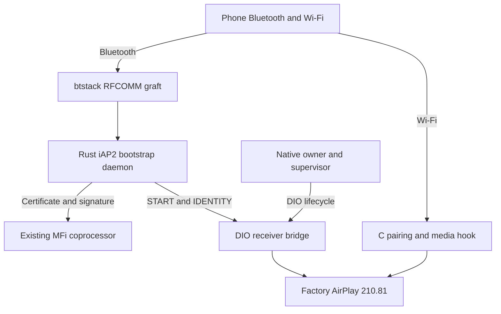

# Wireless CarPlay on MHI2Q

_Stock210 mod architecture, implementation evidence and offline validation — 2026-09-29._

---

[Documentation home](../README.md) · [Connect and USB](../connect-and-usb/README.md) · [Source tree](../../wireless/)

## 📋 Current status

The active iOS laboratory is migrating to [vphone](VPHONE_LAB.md) on branch
`feat/vphone-carplay-lab`: pinned iOS 26.6.2, paravirtual graphics and the shared
stock-210 QNX receiver. Launchpad, Research Guests, Developer Tools, the signed
helper and Core Bundle now pass host checks. The dedicated iOS 26.6.2 guest has
been created, boots and renders native UI and Maps. Its original NCM link reaches
QNX and receives native `/info` over IPv6. A guest vendor bulk adapter now preserves
USB enumeration; native accessory-manager discovery, CarPlay/MFi and stream-111
video remain unverified. The Inferno results below are retained
historical evidence.

The MU1316 / P5087 candidate retains factory AirPlay **210.81** on QNX 6.5 ARM.
The C wireless hook supplies pairing and modern control/event/media security;
the Rust daemon handles iAP2, MFi and Wi-Fi bootstrap. The private280 SDK code
inside the hook supplies protocol and crypto primitives. It does not replace
the factory receiver. [Architecture](STOCK210_ARCHITECTURE.md) and
[lifecycle evidence](STOCK210_RECEIVER_LIFECYCLE.md) describe the current path.

Combined QNX/QEMU validation passed three DIO owner generations and two media
sessions, including wired-priority drain and wireless resume. Physical iPhone,
MFi chip, radio, USB and on-unit media rendering remain unverified.
The separate [iOS/QEMU laboratory](IOS_VM_LAB.md) has now negotiated actual
iAP2 with emulated iOS 14 and verified live software MFi authentication:
valid signatures receive `AA05`, while corrupted response/certificate
signatures receive `AA04`. Native identification and CarPlay approval passed;
a direct Ethernet bridge connects to the QNX receiver. Native Pair Setup/Verify
and the QEMU-only live MFi-SAP responder established a real CarPlay session.
Screen negotiation reached 800×480 / 30 FPS. An opt-in codec-property workaround
passes native A/B probes and lets `mediaserverd` reach encoder configuration.
The earlier screen payload was status telemetry with zero sent frames; Maps crashes
in VectorKit with no native Metal device. A separate CPU-pixel probe selects
CarPlay's encoder usage; the default mode fails to allocate its internal
hardware encoder. The native `UnifiedEncoderMode=0` override produced three
800×480 H.264 frames per probe, verified by independent decoding. The VM-only
software surface adapter now sends actual native UI through the stock encoder
and receiver: 31 real 800×480 frames independently decoded, with 26 distinct
image hashes and a visible Dashboard. A longer 60 guest-second run now
independently decodes 519 frames; PCAP measures 10.84 access units/s over
47.78 host seconds. Guest clocks differ, so the runbook reports each stage
separately. Maps, audio, actual AltScreen pixels and a physical radio link
remain separate checks. The QEMU-only paired AltScreen profile now negotiates
stream 111 and creates the native 1440×542 CarInstruments display, while the
ordinary hook keeps its paired-session guard. Port 6031 carries state and
telemetry only: no cluster video frames have been observed. The separate
legacy attempt stopped during control setup.
The opt-in native framebuffer-2 producer now selects its own advertised
1440×542 mode and validated NV12 surfaces. Pool access is confirmed; live
stream-111 video has not yet been independently decoded.
The [native screen test](NATIVE_SCREEN_TEST.md) describes the bounded software
mode hold, native surface adapter, live session sequence and independent decode.
The subsequent [iOS/stock210 code review and corrections](IOS210_CODE_REVIEW.md)
fixed authentication-first iAP2 handling, unsupported stream 111 negotiation
and wired SETUP with inherited wireless flags. The combined QEMU rerun covers
both authentication orders; production wireless offers the main display only.
The opt-in QEMU paired-111 experiment is documented separately in the native
screen runbook and is not a deployment profile.
All work remains **offline only**; no HU connection, process restart, reboot or
original firmware-file change is part of this milestone.

The optional [software MFi QNX/QEMU tests](TEST_SOFTWARE_MFI.md#-qnx-and-qemu-integration)
replace fixed mock signature bytes with freshly generated RSA test vectors.
The QNX phone cryptographically verifies actual iAP2 responses in both the
bootstrap matrix and the combined stock210 lifecycle. The host private key
stays outside QEMU; these synthetic identities do not establish Apple trust.

<a id="components-and-ownership"></a>

## ⚙️ Architecture and ownership



| Component | Responsibility | Implementation |
|---|---|---|
| [btstack graft](BTSTACK_GRAFT.md) | Discovery, RFCOMM and bounded byte bridge | [C graft](../../wireless/graft/graft.c) |
| [iAP2 daemon](IAP2_DAEMON.md) | MFi, Wi-Fi handover, CarPlay Control | [Rust daemon](../../wireless/daemon/src/) |
| [Receiver bridge](RECEIVER_BRIDGE.md) | Real stock manager, readiness and identity | [C bridge](../../wireless/receiver_bridge/bridge.c) |
| [Wireless hook](STOCK210_HTTP_PAIRING_ABI.md) | Pairing, encrypted transport and media | [C module](../../hook/wireless/) |
| [Owner integration](DIO_OWNERSHIP.md) | One DIO owner, wired priority, restart | [Native supervisor](../../wireless/integration/wireless_dio_supervisor.c) |

Bonjour, `/info`, signed PairSetup and iAP2 StartSession share one persistent
pairing identifier `pi`. It is separate from the Ed25519 public key. Pairing
keys, owner locks and the advisory generation marker use `/mnt/persist`;
`/tmp` is transient RAM. Pairing initialization and the media SETUP guard are
scoped to wireless owner mode. See [review corrections](IOS210_CODE_REVIEW.md#-corrections-and-regression-coverage) and
[receiver lifecycle](STOCK210_RECEIVER_LIFECYCLE.md#queue-and-owner-lifecycle).

## 📚 Reading paths

| Topic | Notes |
|---|---|
| Current code review | [iOS and stock210 findings, reproductions and fixes required](IOS210_CODE_REVIEW.md) |
| Current receiver | [Architecture](STOCK210_ARCHITECTURE.md) · [Startup](RECEIVER_START.md) · [Bridge](RECEIVER_BRIDGE.md) · [Readiness and restart](STOCK210_RECEIVER_LIFECYCLE.md) |
| Bluetooth transport | [Graft](BTSTACK_GRAFT.md) · [Channel layout](RFCOMM_CHANNEL_LAYOUT.md) · [Duplex ABI](RFCOMM_DUPLEX.md) · [Discovery](BLUETOOTH_DISCOVERY.md) |
| Graft construction | [Insertion plan](GRAFT_INSERTION_PLAN.md) · [Factory launcher experiments](GRAFT_LAUNCHER_LIFECYCLE.md) |
| Pairing and media | [HTTP ABI](STOCK210_HTTP_PAIRING_ABI.md) · [Media crypto ABI](STOCK210_MEDIA_CRYPTO_ABI.md) · [280 source recipe](AIRPLAY280_PAIRING_RECIPE.md) |
| Bootstrap and ownership | [iAP2 daemon](IAP2_DAEMON.md) · [Software MFi tests](TEST_SOFTWARE_MFI.md) · [iOS VM laboratory](IOS_VM_LAB.md) · [DIO ownership](DIO_OWNERSHIP.md) · [Vendor provenance](IAP2_VENDOR_PROVENANCE.md) |
| Network and hardware | [Wi-Fi discovery](WIFI_AND_DISCOVERY.md) · [Firewall](FIREWALL.md) · [Hardware and donors](HARDWARE_AND_DONORS.md) |
| iOS and references | [Authentication selection](IOS_AUTH_SELECTION.md) · [Wireless session gates](IOS_WIRELESS_SESSION_GATES.md) · [Bootstrap comparison](BOOTSTRAP_COMPARISON.md) |
| Evidence and history | [Pairing/media milestones](STOCK210_VALIDATION.md) · [Historical experiments](history/README.md) · [Migration map](MIGRATION.md) |

The history section preserves the earlier feature-bit probe, replacement280
receiver, installer experiment and failure traces. These are evidence records,
not the current deployment recipe. In particular, the historical280 installer
must not install the stock210 hook candidate.

<a id="build-and-reproduce"></a>

## 📦 Build and reproduce

Run from the repository root. Prerequisites are the local
`qnx65-armv7-toolchain:latest` Docker image, pinned firmware inputs under
`Firmwares/HU`, and owner-provided SDK sources under `Refferences/Carplay`.
Those external inputs are not committed here.

```sh
bash scripts/build_hook_wireless.sh
python3 wireless/receiver_bridge/qemu_capture.py --wireless-hook-qemu \
  --wireless-media-qemu --wireless-lifecycle-qemu --mesh --start-experiment \
  --seed-display --skip-hid-qemu --mdnsd --mock-mac-qemu --interface-lo0-qemu
python3 wireless/daemon/probes/qemu_daemon_bridge.py --phone-probe --control-probe
python3 wireless/integration/build_stock210_review.py
```

The review builder writes `wireless/out/mhi2q-stock210-hook-review.tar` and an
adjacent `.sha256`. Its manifest records the exact packaged files. It contains
no installer or replacement libairplay; the existing btstack graft, AP/firewall
and wired-mod files remain integration prerequisites. Generated binaries,
archives, logs and raw analysis output remain local and ignored by Git.

The pre-migration archive had 16 hashed payload files and SHA-256
`8780e8bc8050bd70dfed2cbb0702a3d8291ed2846802e120eaa425b7f960436c`.
That digest identifies the earlier documentation snapshot; a rebuild after this
migration has a different manifest and archive digest. The tested runtime
artifact hashes are preserved in [the lifecycle report](STOCK210_RECEIVER_LIFECYCLE.md#validation-completed-2026-09-29).

<a id="verified-offline"></a>

## 🧪 What the evidence establishes

| Check | Recorded result | Boundary |
|---|---|---|
| Combined QNX lifecycle | Three owners, two media sessions, stable pi | Synthetic peripherals and wired child |
| Pairing and control | Setup/Verify, reconnect, invalid signature/tag rejection | Independent protocol client, shared primitive helpers |
| Media adapters | Two AVC inputs, 160 PCM packets, events and microphone checks | Input-only OMX; no decoded output |
| Host protocol/ownership | 27 daemon tests, C callback suites under ASan/UBSan and native ownership checks | CF/key/pointer fixtures; no physical radio or SI session |
| Build and ABI guards | Wireless41 / wired26 exports, graft8/8 | Pinned local firmware images |

The [validation ledger](STOCK210_VALIDATION.md) preserves earlier hashes and
individual tests. The [lifecycle report](STOCK210_RECEIVER_LIFECYCLE.md) records
the latest combined run and separates runtime evidence from hardware questions.
Local log links require running the corresponding fixtures; logs are not in Git.

<a id="next-steps-and-constraints"></a>

## 🎯 Remaining work

1. Review deployment integration for the stock210 hook, btstack graft, per-unit
   configuration, AP/firewall and wired wrapper dependencies.
2. After hardware work is separately authorized, validate real MFi Method1,
   current iPhone pairing/discovery, radio traffic and persistent storage.
3. Validate decoded video, audio/microphone, disconnect/reconnect and physical
   SI/USB takeover. The QEMU wired child verifies ownership logic only.
4. Implement paired crypto for stream 111 before enabling a wireless second
   display. The current wired altScreen path uses legacy AES.

Original offsets, byte layouts, hashes and negative results remain in the
technical notes. [The migration map](MIGRATION.md) accounts for every document
moved from `wireless/`; source-directory READMEs now point here.
