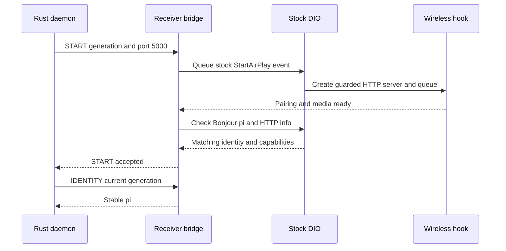

# dio receiver bridge: offline QNX build and QEMU verification

_MHI2Q wireless CarPlay — technical reference, integrated 2026-09-29._

---

[Wireless overview](README.md) · [Current stock210 lifecycle](STOCK210_RECEIVER_LIFECYCLE.md)

Maintained technical reference. The evidence below distinguishes static analysis, local QNX tests and observations from the unit.

Implementation and local diagnostic paths in this record refer to the [original source directory](../../wireless/receiver_bridge/). Run `wireless/...` commands from the repository root; moving this note does not move binaries or logs.

## 📊 Component flow



## 📋 Implementation and evidence

Current stock210 candidate: build with `build_offline.py --receiver stock210
--property-handoff`. It keeps factory 210.81 on port5000 and requires the
wireless hook's guarded readiness and matching published identity. The combined
daemon/owner/media/wired-priority QEMU test passes; see
[stock210 receiver lifecycle](STOCK210_RECEIVER_LIFECYCLE.md).
The 280/7000 descriptions below document the historical replacement build.

<a id="identity-protocol"></a>

## 📋 Identity protocol

2026-09-29: IPC version 2 adds operation 5 (IDENTITY). Its successful 8-byte
response is followed by u16LE length and 1..252 UTF-8 identifier bytes.
The generation must be active. With `hook/wireless`, the hook identity must
match the published Bonjour `pi`; otherwise the bridge returns NOT_READY.
Legacy 280 reads `pi` from its actual successful DNS-SD registration. This
does not by itself establish media readiness; the stock210 build also checks
the hook's pairing/media availability and its stock listener.

<a id="capturing-the-real-stock-manager"></a>

## 📋 Capturing the real stock manager

`capture_probe.c` is a QNX ARM `LD_PRELOAD` probe for the exact MU1316
`dio_manager` image documented in [Receiver Start](RECEIVER_START.md). Alone it never
acknowledges the Rust daemon's START request. Linked with `bridge.c`, it
provides the real `CDIOManager*` at the point where stock
`CDIOController` finishes creating it, without manufacturing a C++ object.
The in-process shim is C against the existing QNX/ARM ABI; the wireless
control daemon remains Rust and uses `protocol.h` over localhost. The linked
GCC 8 C++ runtime is not the stock GCC 4.4 runtime, so no C++ object is
constructed across that boundary.

The `CDIOController` init method is `0x171C10`. A first QEMU experiment
replaced its vtable slot at `0x1A5350`, but the normal startup called this
method **directly**, so the slot hook never ran. The current probe instead
interposes QNX's nothrow `operator new`. It recognizes the `0x2F0`-byte
manager allocation returning to `0x171C48`, then the next `0x70`-byte
allocation returning to `0x171C6C` on the **same thread**. The manager
constructor and `controller+0x38` store happen between those two calls.
At the second return the probe checks the manager's primary vptr against
`0x1A4848` and records the pointer. Other allocation calls pass through
unchanged. It does not modify a vtable, stock text or stock data.

The probe constructor checks QNX libc's `__progname` (exactly `dio_manager`),
the init prologue, the two call sites, the `CDIOManager` constructor call,
and the manager vtable destructor entry before enabling capture. The source
dio ELF has SHA-256
`e9862680d76ca2e6bb2eed067658f2ca8fa9b71b5446322384b76c9735c0e794`.
Four read-only exports report the pointer, capture count, release count and
guard error. An `operator delete` interposer clears the captured pointer
before freeing it on the ordinary deleting-destructor path.
The ELF constructor performs no allocation, socket or thread work.

<a id="listener-and-owner-contract"></a>

## 📋 Listener and owner contract

The linked C bridge listens on `127.0.0.1:57343` using `protocol.h`. For a
first START it takes display dimensions from the stock `dio_manager` table
through `0x1675A4` when the manager has none, then queues the stock
StartAirPlay event. Mode 0 is 800×480; the same table has mode 1 960×540 and
mode 2 1024×480. The selected mode can be changed at compile time with
`MHI2Q_BRIDGE_DISPLAY_MODE` or `build_offline.py --display-mode`.
The offline build waits for `uap0` to exist and prestarts the receiver after
manager initialization, so a subsequent single phone availability request
can succeed within the daemon's deadline. When the owner helper marks a
process `MHI2Q_DIO_OWNER_MODE=wired`, the same preload chain bypasses its
wireless listener, prestart, and receiver retain; the SI-owned wired session
keeps its stock USB/Cinemo lifecycle. The bridge also checks the
interface before any first-start event triggered by a request; if the AP is
absent, it leaves the one-shot stock thread untouched and returns NOT_READY.
For later generations it calls `stopServer` and
`startServer` on a retained stock receiver object; it never calls the unsafe
stock thread-stop method for an ordinary bridge STOP/START. Full media
teardown may still exit DIO; the supervisor then replaces its owner generation.
The stock210 build uses port5000, feature bits37/38, matching published pi and
the hook's explicit readiness. The historical experimental280 build uses7000.
The bridge serializes requests and rejects a different generation while one
is active. Protocol version2 includes the advertised port in each request;
a value that differs from the selected receiver build is rejected.

<a id="building-receiver-profiles"></a>

## 📦 Building receiver profiles

Build the current **offline artifact**, with no QEMU display/network bypasses:

```sh
python3 wireless/receiver_bridge/build_offline.py --receiver stock210 --property-handoff
```

This invokes the QNX 6.5 ARM Docker toolchain, checks the exact firmware
image, and writes `wireless/receiver_bridge/out/libdio_receiver_bridge.stock210.offline.so`. The library is
ELF32 ARM EABI, needs `libsocket.so.3`, and passes `qnx-check-so`. It is **not
ready for on-unit loading**: the correct stock display mode and other DSI
configuration words are not yet verified for this HU, the ownership race
during manager destruction is not fully validated, and multicast/phone session
callbacks have not been exercised. The build script never connects to the HU.

Build offline with `/Users/luka/Desktop/AUDI_2/Tools/qnx-65-sdp-docker`:

```sh
docker run --rm --platform=linux/amd64 \
  -v /Users/luka/Desktop/AUDI_2:/src \
  -w /src/Patches/mhi2-carplay \
  qnx65-armv7-toolchain:latest \
  arm-unknown-nto-qnx6.5.0eabi-gcc -std=c11 -fPIC -shared -Os \
  -Wall -Wextra -Werror \
  -o wireless/receiver_bridge/out/libdio_capture_probe.so \
  wireless/receiver_bridge/capture_probe.c
```

The source-image guard is also checked offline with
`python3 wireless/receiver_bridge/verify_capture_point.py`. The build has
succeeded and produced an ELF32 ARM EABI5 shared object. The diagnostic build
(`-DMHI2Q_CAPTURE_DIAGNOSTIC`) runs in a local QEMU image with stock MU1316
`dio_manager` using:

```sh
python3 tests/carplay_lab/qnx/qemu_capture.py
```

Its serial log showed:

```text
[dio-capture] image guard passed
[dio-capture] manager allocation observed
[dio-capture] manager captured
[dio-capture] manager released
Process 12295 (dio_manager) exited status=1.
```

<a id="historical-startup-evidence"></a>

## 🧪 Historical startup evidence

The QEMU image was rebuilt from the existing `dio_trackF_stock_real.bin`
filesystem, with the old synthetic AirPlay force-spawn preloads removed and
only this capture probe added. The extracted `dio_manager` has the same
runtime text and vtable bytes as the firmware original; `mkifs` expands its
ELF layout, so its extracted file hash differs. This run proves the
allocation/capture path and one ordinary release in stock code. It does
**not** prove every manager lifetime path, restart, AirPlay server readiness
or a successful `dio_manager` startup:
the established QEMU DSI wall still ends this process with status 1.
The linked bridge retains the server object and invalidates it when the
manager's ordinary delete is observed. The manager destructor can begin
before that delete hook; this race still needs a stronger ownership boundary
before installation. The on-unit binaries and processes remain untouched.

`protocol.h` defines the daemon↔bridge wire format consumed by `bridge.c`.

<a id="stock-receiver-mesh-experiments"></a>

## 📋 Stock receiver mesh experiments

The broker/servicemgr mesh image keeps stock `dio_manager` alive; run it with
`python3 tests/carplay_lab/qnx/qemu_capture.py --mesh`. The same exact-image
probe captured a manager that remained alive through the observation window.
The QEMU-only `--start-experiment` posts the stock StartAirPlay event on that
manager eight seconds later. Its optional `--seed-display` writes 800×480 to
the four DSI-populated display words, and `--skip-hid-qemu` clears the two
branch-selector arrays after `sscanf`. These are diagnostic A/B changes in
the temporary emulator image; the normal probe build has neither behavior.

Without the HID bypass, the stock AirPlay thread enters
`HIDDeviceCreateVirtual` and does not return in this QEMU mesh. With the bypass,
it completes screen creation and registration, creates the AirPlay receiver,
sets its properties and delegate, and calls `AirPlayReceiverServerControl`.
Adding `/dev/urandom` and `/dev/random` to the temporary mesh IFS resolved a
second stall inside server startup: the control call now returns status 0 and
the library logs “Servers successfully started.” Its observed `bind` is TCP
5000, with no observed bind on 7000. The QEMU probe connects to 5000 and
receives HTTP 200 for `GET /info`; TCP 7000 returns `ECONNREFUSED`, and Bonjour
retries with `kNotFoundErr`. This proves a stock HTTP listener can run through
the real manager in QEMU, but does not prove phone compatibility, multicast
discovery or session handling. The startup contract
therefore remains unacknowledged. Logs are under ignored `out/qemu_start_*.log`.

With `--feature37`, the harness stages the one-byte offline `libairplay`
variant and reads the complete binary plist from the same `/info` path. QEMU
confirmed `features=0x0000002144440B80`, including bit 37. This is a
runtime check of the feature declaration; phone compatibility and multicast
discovery remain open.

[Bonjour Readiness](history/BONJOUR_READINESS.md) maps the stock `carplay0` property setter and the precise
`if_nametoindex` rejection in `libairplay`. A QEMU-only run with factory
`mdnsd`, a synthetic MAC and a `lo0` property substitution passed
`DNSServiceRegister` for `_airplay._tcp.` on port 5000. The emulator still
lacks a real multicast-capable network interface. The optional
`MHI2Q_CAPTURE_INTERFACE_NAME` macro builds a guarded property substitution
for a later bridge; its `uap0` variant compiles but has not been deployed.
The QEMU experiment now also records the successful `_airplay._tcp.`
registration port in read-only exports, so a later bridge can compare that
port to its HTTP readiness probe. A successful local `DNSServiceRegister`
return does not establish that multicast packets left the QNX emulator.
An offline A/B image also tried QEMU `virt` with a PCI e1000 NIC and the
SDK's QNX driver. Its PCI server exited without creating `/dev/pci`, so
`io-pkt-v6-hc` could not attach the NIC; `mdnsd` still sent via `lo0` and
reported error 249 (`Can't assign requested address`) for 224.0.0.251.
This rules out that particular emulator setup as a multicast proof, not
the observed HU's `uap0` path. The disposable diagnostic image and log are
under ignored `out/`; the working QEMU harness has no e1000 change.

<a id="stop-and-restart-experiments"></a>

## 🔄 Stop and restart experiments

The `--stop-only-qemu` and `--restart-qemu` diagnostics showed that calling
the stock **thread** stop method (`0x154AD8`) makes the stock `dio_manager`
shut down after the receiver stops. The latter also leaves the manager's
thread pointer set, so another queued StartAirPlay cannot provide a normal
restart. These flags are QEMU-only and are never present in the default
capture build.

`--soft-restart-qemu` instead controls the existing stock receiver object
with CoreFoundation `stopServer` and `startServer` commands. QEMU confirmed
stop/start status 0, TCP 5000 closed and reopened, two successful Bonjour
registrations, a fresh `/info` response with CarPlay feature bit 37, and a
live original manager. This established the lifecycle seam used by `bridge.c`;
the later stock210 lifecycle fixture covers its ownership integration,
while on-unit behavior remains unverified. The test log is `out/qemu_soft_restart.log`.

<a id="earlier-combined-test-recipes"></a>

## 🧪 Earlier combined test recipes

The integrated test is:

```sh
python3 tests/carplay_lab/qnx/qemu_capture.py --mesh \
  --start-experiment --skip-hid-qemu --feature37 \
  --mdnsd --mock-mac-qemu --interface-lo0-qemu \
  --bridge-qemu --bridge-first-start-qemu
```

The QEMU-only self-client sent two generations through the real localhost
listener. Both START and STOP responses were 0. The first START queued the
stock event ahead of the request after obtaining 800×480 from the stock
table, with **no QEMU display seed**; the first request succeeded on its
first attempt. The second reused the same receiver. Each START checked
feature bit 37 in `/info`; the direct STOP/START cycle caused two successful
Bonjour registrations. Log: `out/qemu_bridge_first_start.log`. The QEMU-only
HID bypass, synthetic MAC, `lo0` substitution and
mdnsd shim are not in the offline bridge artifact.

The same receiver fixture can be driven by the actual QNX/Rust
`LoopbackReceiverControl` implementation instead of the C self-client:

```sh
python3 tests/carplay_lab/qnx/qemu_capture.py --mesh \
  --start-experiment --skip-hid-qemu --feature37 \
  --mdnsd --mock-mac-qemu --interface-lo0-qemu \
  --bridge-qemu --bridge-first-start-qemu --receiver-control-probe
```

The Rust probe starts early in the image and retries until stock
`dio_manager` publishes the bridge. It sends two START/STOP generations to
the in-process bridge over QNX TCP. In the observed run, its first START
posted the stock StartAirPlay event before the bridge's prestart worker did.
The bridge checks TCP 5000 `/info` and Bonjour registration before each
successful START. The passing trace is `out/qemu_receiver_control.log`.
This verifies the QNX/Rust-to-stock-receiver control seam, but the probe
calls `LoopbackReceiverControl` directly; it does not run a phone's iAP2/MFi
exchange through the normal daemon.

The combined offline run uses the ordinary QNX daemon, a QEMU-only
synthetic iAP2 phone and MFi I²C preload, and stock `dio_manager` in the
**same** IFS:

```sh
python3 tests/carplay_lab/qnx/qemu_capture.py --mesh \
  --start-experiment --skip-hid-qemu --feature37 \
  --mdnsd --mock-mac-qemu --interface-lo0-qemu \
  --bridge-qemu --bridge-first-start-qemu --daemon-phone-qemu
```

`out/qemu_daemon_stock_receiver.log` shows Identification, fixed test MFi
certificate/signature, Wi-Fi configuration, `CarPlayAvailability`, the
bridge's feature-37 `/info` readiness check and successful Bonjour
registration, `CarPlayStartSession`, and TCP 5000 closing after iAP2
disconnect. The phone probe exited successfully. The daemon is the ordinary
production build; stock `dio_manager`/AirPlay runs with the offline bridge,
feature patch and QEMU-only HID/interface shims. The MFi device, phone and
Wi-Fi driver remain simulated. No on-unit or real-phone behavior follows
from this test.

Add `--daemon-control-qemu` to the combined command to exercise the
daemon's CarPlay Control DNS-SD and HTTP path in the same stock-receiver
run. The QEMU-only preload redirects DNS-SD calls in the daemon to a
pollable synthetic `_carplay-ctrl._tcp` service; stock `dio_manager` keeps
using its factory `libdns_sd.so.1`. The synthetic phone validates
`GET /ctrl-int/1/connect` and the receiver device ID, then returns HTTP
200 before disconnecting. The passing trace is
`out/qemu_daemon_stock_receiver_control.log`. Multicast discovery on `uap0`
and a real iPhone's Control response are still unverified.

`--bridge-teardown-qemu` adds a QEMU-only final stock thread teardown after
the two generations. The ordinary manager delete hook released the bridge's
retained server reference and the stock process exited normally; see
`out/qemu_bridge_teardown.log`. This validates that teardown ordering, but
does not establish safety if a real manager begins destruction concurrently
with an in-flight localhost request.

`--existing-hook-qemu` co-loads the exact unprotected wired-CarPlay
`libcarplay_hook.so` before the diagnostic receiver bridge in the stock dio
process. The QEMU-only constructor checks with `dladdr` that the hook owns
`AirPlayCopyServerInfo`; the two libraries have no overlapping defined
dynamic symbols. The two-generation bridge fixture passed with both loaded
(`out/qemu_bridge_first_start_existing_hook.log`). The ordinary daemon plus
synthetic phone also passed Identification, mock MFi, CarPlayStartSession,
Control HTTP, and stock receiver STOP in the same process image
(`out/qemu_daemon_stock_receiver_control_existing_hook.log`). These runs
validate co-loading in the reduced emulator, not startup ownership by the
existing `carplay_startup.sh` wrapper or a real phone session.
