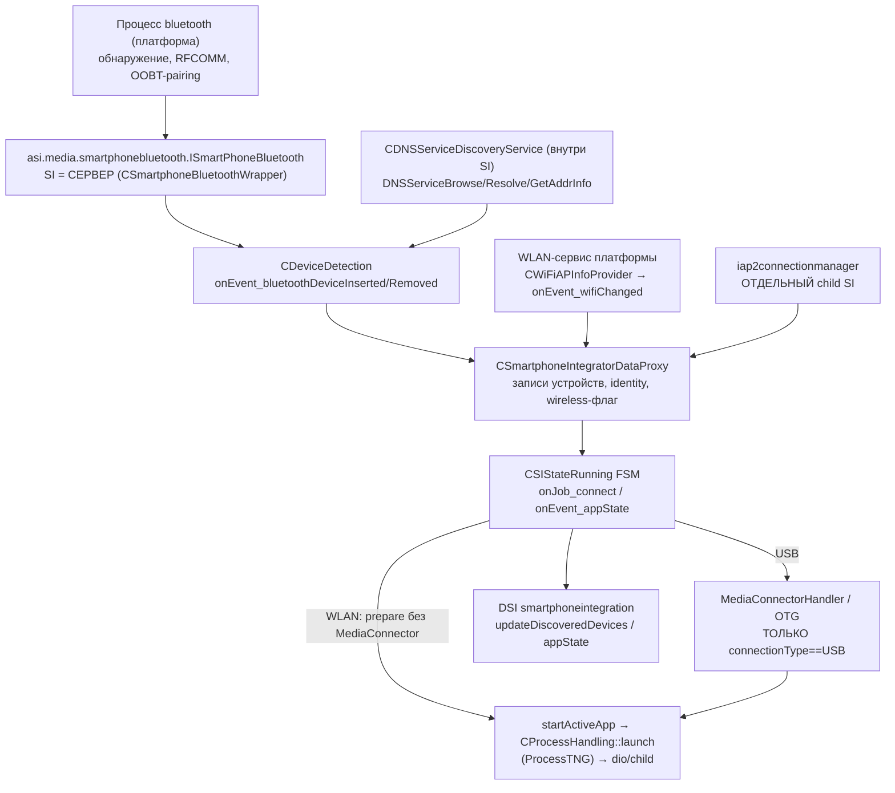
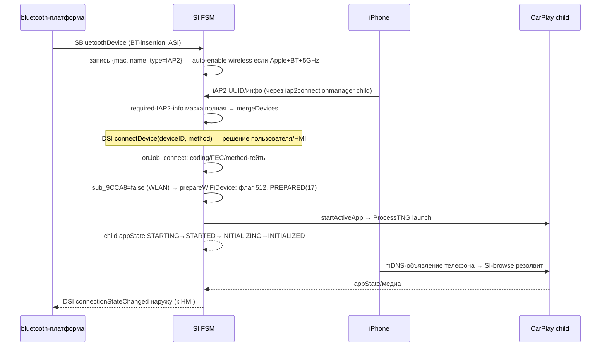

# Сравнительный RE Smartphone Integrator: MH2p → MHI2Q

_Сравнительный RE 2026-10-18; дополнен физической проверкой stage 1 на HU 2026-10-20. Исторические RE-секции ниже описывают состояние на момент исследования; текущий протокол — [SI stage 1 HU test](SI_STAGE1_HU_TEST.md)._

---

[Wireless overview](README.md) · [SI wireless extension plan](SI_WIRELESS_EXTENSION_PLAN.md) · [Ownership decision](DIO_OWNERSHIP.md) · [SI stack and replug race](../connect-and-usb/SI_STACK_AND_REPLUG_RACE.md)

## 🎯 Рекомендация: вариант A (расширить наш MHI2Q SI)

**Перенести поведение донора в наш SI — не код донора, а его семантику.** Решение опирается на четыре факта, восстановленных до уровня декомпиляции:

1. **В стоковом MHI2Q SI уже есть почти весь словарь wireless-пути.** Enum `connectionType` с `2=WLAN` существует в двух строковых мапперах стокового бинарника (`0x173148`, `0x1805CC`, база `0x100000`); enum `AppState` `0x172D5C` содержит **0–20 включительно, идентично донору**, включая `17=PREPARED`, `19=CLEANUP_DONE`, `20=START_RETRY` — те самые состояния, через которые донор проводит wireless-подключение; DSI-payload `updateDiscoveredDevices` имеет поле `connectionType` и формируется функцией `0x183678`. В MHI2Q не хватает не типов, а **веток FSM**: prepare-WLAN-без-MediaConnector, вставки WLAN-записи в discovered-список и teardown-байпаса USB.
2. **В доноре wireless — это тонкая ветка поверх той же архитектуры, а не отдельная подсистема.** Всё отличие wired/wireless — один предикат `sub_9CCA8` («connectionType == USB»), за которым стоят вызовы MediaConnector/OTG. Ветка `prepareWiFiDevice` (`0xBCFD4`) не трогает USB вовсе: ставит флаг, публикует `PREPARED(17)` и идёт в обычный `startActiveApp` → `CProcessHandling::launch` (ProcessTNG). Воспроизвести эту ветку в MHI2Q — задача guarded-грaft'а из 4–6 швов, а не портирование подсистемы.
3. **Вариант B блокирован рантаймом, а не адаптерами.** Донор требует `libcpp-ne.so.5` (на MU1316 только `.so.4`; 19 C++-символов донора не покрываются ничем: `std::UUID`, `std::ErrorStorage/Output/GlobalErrorHandler`, `locale::_Init`…), собран как **PIE (ET_DYN, base 0)** при **нуле PIE-процессов среди 271 исполняемого файла устройства** (все ET_EXEC@0x100000), и имеет ~12 расхождений сигнатур (`std::string/vector` против `ipl::basic_string/vector`: `ProcessTNG::setExecutable`, `tracing::Channel`, `servmngt::startApp`, `dsi::ServiceProviderBase::isNotified`…). Сверх того донору нужны **отсутствующие на MHI2Q платформенные сервисы**: клиент ASI `asi.media.smartphonebluetooth` (поставщик `SBluetoothDevice` — на MH2p это процесс `bluetooth`), `CWiFiAPInfoProvider` (WLAN-сервис), и второй донорский бинарник `iap2connectionmanager` с тем же набором проблем рантайма. «SI + маленький адаптер» не получится: получится «два прошивочных компонента 6.6 + два новых ASI-сервиса + перебазирование ELF».
4. **В MHI2Q уже есть канал в controller-queue**, эквивалентный DSI `connectDevice`: трейс-команда `si_connectDevice` (case 4 диспетчера `0x18D13C`, registered в ctor `0x18C6FC` через `tracing::client_helper`) кладёт `FakeConnectDevice`-job (`0x1286C8`) в ту же очередь. Для ACTIVATE поверх существующей записи его можно использовать без единого нового шва.

Ограничение рекомендации: B остаётся **одноразовым QNX-экспериментом** только если stage A.2 покажет, что discovered-хранилище MHI2Q жёстче, чем ожидается (см. гипотезы). Проверка стоит немного (запуск донора в disposable QNX упадёт на загрузчике из-за `libcpp-ne.so.5` — уже это почти закрывает вопрос).

### Какие факты ещё нужны (блокеры stage 1, не выбора A)

- точный адрес/механизм вставки записи в discovered-список MHI2Q (`CDSISmartphoneIntegrationImpl`, список `+440/+448`; IDB-дыра анализа `0x182F00–0x183100`, где живёт DSI `connectDevice 0x183020`);
- точка spawn child'а в MHI2Q FSM (аналог донорского `startActiveApp`/`CProcessHandling::launch`) — кто вызывает ProcessTNG и где влепить per-child режим;
- живая проверка, что Java/HMI MHI2Q отображает устройство с `connectionType=2` (тип в DSI есть, поведение UI не проверялось — статикой не доказуемо).

---

## 📏 Границы доказательств

| Бинарник | Роль | SHA-256 | Проверка |
|---|---|---|---|
| `deploy/smartphone_integrator/smartphone_integrator` | наш SI (USB re-arm) | `606236a8…2af3` | совпал |
| `deploy/experimental/usb_replug_recovery/bundle_mu1316_p5087/stock/…` | stock MHI2Q | `a25dc981…0d02` | совпал |
| `Firmwares/HU/MH2p_US_LB636_P2712/…/apps/smartphone_integrator` | **основной донор** | `e7d9480f…cdc7` | совпал |
| `Firmwares/HU/MH2p_US_AUG35_P2873/…` | cross-check | `1d3c35d1…56c72` | совпал |
| `Firmwares/HU/MH2p_ER_PO416_P9830_EUROPE/…` | cross-check | `65fb1507…19f30b2` | совпал |

Re-arm подтверждён по смещению **file offset `0x7FDB4` / VA `0x17FDB4`** (`00 30 A0 E3` → `2E 33 09 E0`), согласуется с `patch_si_rearm.py`; прежний отчёт с `0x7FD34` — ошибка, здесь не воспроизводится.

Адресация: **донор** — IDB `Firmwares/HU/MH2p_US_LB636_P2712/…/smartphone_integrator.i64`, Thumb/PIE, imagebase 0 (VA = адрес в IDB). **MHI2Q** — IDB `Firmwares/HU/MHI2Q_US_AUG22_P5087_MU1316/…/smartphone_integrator.i64`, ARM, base `0x100000` (VA в IDB включает базу). Уровни доказательности: **[код]** (декомпиляция/дизасм, проверено), **[исполнение]** (нужно живое наблюдение), **[гипотеза]** (вывод, требует проверки).

Изменённые IDA-базы (сохранены `idb_save`, только имена функций, байты не менялись): обе перечисленные выше `.i64`. Сырые артефакты: `build/si-mh2p-re-20261018/` — `donor_p2712_core_findings.md`, `donor_p2712_fsm.md`, `donor_p2712_teardown.md`, `mhi2q_extension_points.md`, `compat_verdict.md` + исходные rabin2-JSON из `build/si-integration-plan-20261018/`.

Особенность донора: PIE + `LDR/ADD PC`-геттеры имён событий — часть xref-сети (vtable-слоты) в IDB обнулена релокациями; там, где слот не читается, это помечено. Все ключевые утверждения ниже опираются на прямые декомпиляции функций, а не на строки.

---

## 🏗 Архитектура донора MH2p (P2712)

SI — набор ActiveObject'ов, сообщения маршрутизируются **строковыми именами** job/event через `CMediaActiveObjectMediator` (логи `enqueueJob/enqueueEvent broadcast`, `0xE2A60–0xE2F5C`) **[код]**. Родство с MHI2Q прямое: тот же медиатор, те же классы, тот же `AppState`-словарь.



Ключевые точки **[код]** (декомпилировано в этой сессии):

| Тема | Функция (VA донора) | Что установлено |
|---|---|---|
| BT-insertion | `0xB0EC0` `CDeviceDetection::onEvent_bluetoothDeviceInserted` | Полный поток: поиск/создание записи, авто-enable wireless, ожидание `connectDevice()` |
| BT-removal | `0xB07A0` `…onEvent_bluetoothDeviceRemoved` | Удаление presence только если нет активного SmartphoneApp |
| wireless-обновление | `0x97D38` `DataProxy::iap2WirelessCarPlayUpdate` | Гейт 5GHz, BT-предусловие, состояние `+272` (1=disabled/2=enabled) |
| 5GHz | `0x8DBBC` `Controller::onEvent_wifiChanged` | Конфиг-флаг 134 (`enable5GHzCountryAdaption`); при выключенном — "Ignored for Wireless CarPlay" |
| дедуп identity | `0x97684` `DataProxy::mergeDevices` | Канонизация по unique-info, второй ID переносится |
| FSM connect | `0xBEC4C` `StateRunning::onJob_connect` | Гейты: present → powerState → coding → FEC → method → type |
| wireless prepare | `0xBCFD4` `prepareWiFiDevice` | Флаг 512, `PREPARED(17)`, без MediaConnector |
| spawn | `0xBC2E0` → `0xC2C94` | `startActiveApp` → `CProcessHandling::launch` (ProcessTNG) |
| FSM appState | `0xBF828` `onEvent_appState` | 20 case; retry/timeout/cleanup-машина |
| wifi-teardown | `0x8F288` `Controller::onJob_carPlayWifiDeviceDisconnected` | Диспетч в слот состояния `vtable+32` с force=1 |
| публикация DSI | `0xBD690` `Controller::updateDiscoveredDevices` | Сборка списка `sub_9704C`, proxy `s_pInstance+3644` |

### Identity и регистрация (вопрос 1)

**Структура `SBluetoothDevice`** (ASI-событие от платформенного BT) **[код]** (`0xB0EC0`):

| Смещение | Поле |
|---|---|
| +144 (u64) | `macAddress` |
| +152 | `friendlyName` (UnicodeString8) |
| +192 | `rfcommDeviceName` |
| +272 (enum) | `deviceType`: 0=UNKNOWN, 1=AVRCP, 2=IAP2 (`0x4A108`) |
| +280 (u64) | `deviceFlags` |

**Поток регистрации [код]**: `sub_9124C(proxy, btdev)` ищет существующий deviceID → если нет, `sub_99B08(proxy, kind=2, info)` аллоцирует новый → `sub_96E9C` (create) или `sub_94FA0` (update) present-записи → notify контроллера (`s_pInstance+3864`, `sub_AC590/AC93C`). Далее switch по состоянию записи (`sub_9CDCC`): случай «свежая» → состояние=1 и notify (`s_pInstance+4856`); случай «IAP2-сессия уже идёт» → *"Waiting for required IAP2 information"*; случай активной → *"Waiting for (dis)connectDevice() to decide whether the device shall be used for media playback or CarPlay"* — т.е. **wireless-устройство после insertion НЕ подключается само: оно ждёт DSI `connectDevice`** (от пользователя/HMI) либо авто-enable wireless.

**Стабильный ключ**: identity-тьюпл лога `0xED648` — `connectionType, macAddress, rfcommDeviceName, usbDeviceNumber, productID, vendorID, serialNumber`; `CSmartphoneAppWrapper` пишет `usbSerialNumber=%s, bluetoothMacAddress=%s` (`0xF14AC`) — **одна запись несёт оба транспорта**, а `mergeDevices` (`0x97684`) при повторном обнаружении находит запись с тем же unique-info и канонизирует ID (*"deviceID=%i is now known as deviceID=%i"*). Персистентность: `prepareUniqueIDsPersistentMap` (строка `0xEE874`, потребитель `0x96D00`).

**Предикаты записи [код]**:

| Функция | Условие | Смысл |
|---|---|---|
| `sub_9D970` | `*(u16*)(rec+52)==0x05AC ‖ rec+168==2` | Apple-устройство (VID) или BT-тип |
| `sub_9D9B0` | `(rec+408 & 2) && rec+168≠0` | есть BT-identity и capability-бит |
| `sub_9DA90` | `9D970 && 9D9B0 && rec+272==2` | wireless CarPlay полностью разрешён |
| `sub_9D0B0` | `sub_9CE94(rec,{2},{2})` | wireless-фича в состоянии enabled |
| `sub_9F7CC` / `sub_9D010` | — | enable / disable wireless на записи |

**stored vs present**: два контейнера DataProxy — `present` `[104]/[105]` и второй список `[236]/[237]` (активные приложения); запись `{deviceID, …, info@+8}`; флаги-пропуски при merge — маска `0x10000` (`sub_90BA8`).

**Связь с iAP2**: идентичность телефона входит через `iap2DeviceUUIDUpdate` (`0xDD010`) и битовую маску «required IAP2 information» (`sub_9CDD0` полученные vs `sub_9D8A4(rec+232)` требуемые); когда маска полная — *"Received all required IAP2 information for UUID=%s"* — только тогда mergeDevices запускается из `0x97D38`. **HU deviceID и phone identity не смешиваются**: deviceID — внутренний счётчик SI, UUID/мак — поля записи.

### Момент запуска receiver и FSM (вопросы 2, 3)

**Кто запускает CarPlay-child [код]**: в доноре child (включая wireless) запускает **сам SI** — `startActiveApp` (`0xBC2E0`) → `CProcessHandling::launch` (`0xC2C94`: `ProcessTNG::setExecutable 0xC35A0`, `start 0xC3618`, pid → `s_sPidPath 0x10E580`). Никакой компонент снаружи DIO не запускает. `iap2connectionmanager` — такой же child SI (конфиг `CHILDREN_IAP2CONNECTIONMANAGER_*`).

**Порядок wireless-connect [код]**:



Холодное подключение **без заранее запущенного DIO работает** — DIO стартует SI'ем в момент `startActiveApp`; цикла «телефон ждёт receiver, SI ждёт телефон» в доноре нет, потому что mDNS-браузер receiver'а живёт **в самом SI** (`CDNSServiceDiscoveryService`, импорты `DNSServiceBrowse/Resolve/GetAddrInfo/ProcessResult`) и до запуска child'а оперирует списком `m_presentCarPlayDNSServices` **[код по импортам и статическим объектам `0x10E788`/`0x10E820`; живой порядок browse↔spawn — [гипотеза], уточняется stage 3]**.

**Wired-vs-wireless условие [код]**: `sub_9CCA8(ctx){ return *(int*)(ctx+8)==1; }` — `EConnectionType` (маппер `sub_9DEE8`): **0=UNKNOWN, 1=USB, 2=WLAN**. Вызовы MediaConnector-обработчиков (`0xB4554` Prepare, `0xB5238` Cleanup, restart-stack `sub_5CAEC`, USB-стек `sub_AFE10`, `SI_VerifyPortResetForAppState 0xBCEE8`) стоят **только** за этим предикатом в `0xBEEA/0xC0130/0xC0176/0xC04B6`.

### Ошибки и teardown (вопрос 4)

| Триггер | Донорское поведение | USB затрагивается? |
|---|---|---|
| Отказ до spawn (гейты `0xBEC4C`) | отказ в connect, retry-очереди `+1662..1667`, auth-chip очередь (`"Queuing connect request… Authentication chip in use"`) | нет |
| Startup timeout | appState 14 → case 9 (`0xBF828`): WLAN → `cleanupWiFiDevice 0xBD1B0`; USB → `Cleanup+portReset` | WLAN: нет; USB: да |
| ERROR_RUNTIME + retry | `prepareWiFiDevice`: если есть MAC (`запись+120`) → **IAP2-reset** ("wake up device from Low Power Mode", `sub_9CBE8`, `BLUETOOTH_IAP2RESETTIMEOUT`), иначе `START_RETRY(20)` | нет |
| Исчерпание retries | `downTime`-очередь (`+1920`, restart-delay `s_pInstance+2432`) | WLAN: нет |
| Wi-Fi loss | DNS-removal → `CControllerInternalJob_CarPlayWifiDeviceDisconnected` → `0x8F288` → слот состояния `vtable+32` с force=1 → teardown сессии | нет |
| BT-обрыв при живой медиа | `0xB07A0`: если активный SmartphoneApp — **presence сохраняется** (*"Device not removed… active SmartphoneApp"*, `removedFlag`: 0=NONE/1=ACTIVE/2=IGNORE) | нет |
| iAP2-ошибка/reject | `Iap2ConnectionError/IdentificationRejected` broadcast (`0x58C30`) + iAP2-reset по таймауту | нет |

Ключевой принцип донора: **три независимых канала потери** (BT-bootstrap / Wi-Fi-DNS / iAP2-протокол) обрабатываются раздельно; USB-recovery ни в одном wireless-пути не вызывается **[код]**.

### 5 GHz (вопрос 8)

Условие строки `"5GHz access point is not available…"` — `sub_97D38`: запрос enable (`a4=1`) при `DataProxy+1520 == 0` → отказ (`grant=0`). Флаг `+1520` ставит `onEvent_wifiChanged` (`0x8DBBC`), который **целиком выключен конфигом** `CHILDREN_CARPLAY_WIRELESS_ENABLE5GHZCOUNTRYADAPTION` (проверка `sub_63184(134)`; выключено → *"Ignored for Wireless CarPlay. 5GHz country adaption is disabled."*). Источник события — платформенный `CWiFiAPInfoProvider` (`WLANDeviceUpdated`, AP-структура `ssid/bssid/channel/crypto/password`, строка AP `"Audi_MMI_2121 5GHz"`). Есть debug-job `FakeWifi5GHzOnOff`.

Разбор по типам: это **платформенная политика MH2p** (доступность 5GHz-AP от WLAN-сервиса + страна-адаптация), а не требование протокола CarPlay: в доноре это admission-условие SI, а не iAP2/MFi-ограничение. Конфиг-выключаемо. Для нашего 2.4 GHz-теста: **адаптация SI не нужна, если гейт в порту не переносить** (флаг доступности константно true в нашем graft'е). Доказательства совместимости физического iPhone с 2.4 GHz-AP это не даёт — остаётся hardware-тест (vphone-протокол это уже показал, радио — нет).

---

## 🔍 Целевой MHI2Q: что уже есть и чего нет (вопросы 1, 5, 10)

| Механизм | MHI2Q сегодня | Донор | Доказательство |
|---|---|---|---|
| connectionType enum {0,1=USB,2=WLAN} | **есть** (2 маппера) | идентично | MHI2Q `0x173148`, `0x1805CC`; донор `sub_9DEE8` |
| connectionMethod-маска | **есть**: `0x01=MIRRORLINK, 0x02=CARPLAY, 0x04=GAL, 0x08=CARLIFE` (`0x180EDC`); DSI-маска→internal `0x170C68`: `1→2, 2→0, 4→0, 8→1, 32→3` | {CARPLAY=2, GAL=4, MIRRORLINK=1, CARLIFE=8, ALIBOX=0x20} | оба [код]; слоты GAL/CARLIFE в `0x170C68` — сверить живьём |
| AppState enum 0–20 (PREPARED/START_RETRY…) | **есть, идентичен донору** | идентичен | MHI2Q `0x172D5C` — полный switch 0..20 |
| Записи устройств | discovered-список в `CDSISmartphoneIntegrationImpl` (встроен в `CSIStateRunning+232`): count `+440`, массив `+448`; record: `+0` deviceID, `+16` u16 vendorID (гейт `0x16925C` case3 сравнивает **0x05AC**), `+28` connectionType, `+32` бит-маска методов (`0x168F8C`: internal 2→bit0, 0→bit1, 1→bit2, 3→bit3), `+44` deviceFlags (`0x168D4C` set / `0x168DFC` clear), `+200` state | та же модель | агентский RE, [код] |
| Источник записей | **только QNX usbd**: `CUSBConnection::usbConnect 0x15EDCC` → колбэки `0x15D76C/0x15D758/0x15D780` → `sendEvent 0x15D660` → `CDeviceDetectionEvent_DeviceInserted/Removed/UpdateConnectionState` (vtables `0x1BEB10/0x1BEB30/0x1BEAF0`) | + BT + DNS источники | [код]; BT/DNS-версий строк и кода в MHI2Q **нет** |
| DSI | `connectDevice(deviceID, method)` слот `0x1C15FC→0x183020`; `updateDiscoveredDevices 0x183678` (payload 0x24Б `{deviceID, deviceName, connectionType, deviceAddress, connectionMethod}`, фильтр state∈{0,2}, requestType 1/2) | идентичная схема (ems_table подтверждена) | [код] + ems_table.json |
| ASI appState | SI — **клиент** `asi.media.smartphoneapp.ISmartPhoneApp` (proxy ctor `0x1679DC`, ikey `CD4FD849-…`, reply-reg `C2B7AEDC-…`); `OnEventAppState 0x186B00` (`+1240` appId, `+1244` oldState, `+1256` deviceID → гейт `0x168F28`, `+1260/1264` retries, `+1376` portReset, `+1378` teardownIndication, `+1380` restartMe) | та же цепочка DIO→ASI→SI | [код] |
| Controller-queue канал | **есть**: `CTraceCallback` (ctor `0x18C6FC`, диспетчер `0x18D13C`): `si_connectDevice` case4 → enqueue `FakeConnectDevice 0x1286C8`; также `si_disconnectDevice`, `si_factorySettings`, `si_fakeSWDL*`, `si_flush`, `si_stopApplication` | аналог через mediator | [код]; канал требует существующей записи |
| Wireless-подсистема | **отсутствует полностью**: 0 строк/импортов `dns_sd`, BT-сервисов, 5GHz; `WIRELESS*` строки — USB class-code enum, не CarPlay | полная | grep + импорты [код] |
| USB re-arm | наш патч `0x17FDB4` (AND R3,R9,LR,LSR #6) — сохранить | донорский аналог не требуется | [код] |

**Следствия для регистрации [вывод, код]**: чтобы «телефон появился в штатном списке SI», достаточно (а) вставить запись в discovered-список с `connectionType=2`, vendorID=0x05AC, нужной маской методов и валидным `state` (∉{0,2} для публикации), (б) дёрнуть `updateDiscoveredDevices 0x183678`. Оба действия не требуют новых объектов: список и функция существуют. Прямая запись в Java-модели 4239/4552 не нужна и не рассматривается.

**appState-корреляция (вопрос 5)**: MHI2Q `0x186B00` связывает appState с устройством по `+1256 deviceID` и `+1240 appId`; sender/instance identity в payload отсутствует — план уже требует барьер/дренаж между поколениями child'ов; RE это подтверждает: запоздавшее событие старого DIO с тем же deviceID неотличимо без внешнего барьера. Что останавливает startup-таймер и что значит STARTED: в доноре HMI-отчёт задерживается до `INITIALIZED` (case 5, поле `+1928`, `HmiReportDelayExpired`); таймер arm'ится при spawn (точная функция не найдена ни в доноре, ни в MHI2Q — [гипотеза]: monitor-поток `CProcessHandling`; для порта важно, что бюджет `startupTimeout 10000` в `carplay_child.json` уже измерен нашими нагрузками).

---

## 🗺 Таблица соответствий MH2p → MHI2Q (вопрос 12 сжата до переносимых сущностей)

| Донор P2712 (VA) | Роль | MHI2Q-эквивалент | Способ адаптации (вариант A) |
|---|---|---|---|
| `SBluetoothDevice` ASI-событие (`0xB0EC0`) | источник identity | **нет** — Rust-демон | graft: `UPSERT_PHONE` → вставка записи в список `+440/+448` (поля `+0/+16=0x05AC/+28=2/+32/+44/+116/+36`), затем вызов `0x183678` |
| `sub_9124C/99B08/96E9C/94FA0` | поиск/создание записи | accessor-семейство `0x168F28/0x168D4C/0x168DFC`; точная вставка не закреплена | stage 1: закрепить адрес вставки (кандидат кластер `0x16EEF4`); trampoline переиспользует accessor'ы |
| `iap2WirelessCarPlayUpdate` (`0x97D38`), флаги `+272/+408/+1520` | wireless-состояние записи | нет | side-table рядом со записью (не менять layout) ИЛИ биты в `+44` deviceFlags (есть свободные константы DEVICE_FLAG_*) |
| `mergeDevices` (`0x97684`) | дедуп двух транспортов | нет | graft: сопоставление по mac/serial при UPSERT (у нас identity authoritative из Rust — дедуп упрощается до «найти по ключу») |
| `onJob_connect` гейты (`0xBEC4C`) + `sub_9CCA8` | разделение USB/WLAN | MHI2Q `0x188070` → `0x1800B0` всегда USB | **главный шов**: trampoline в ветке prepare: если record `+28==2` → wireless-prepare (флаг, `PREPARED(17)`) вместо `MediaConnectorHandler_prepare 0x1800B0` |
| `prepareWiFiDevice` (`0xBCFD4`) / `cleanupWiFiDevice` (`0xBD1B0`) | WLAN prepare/teardown | нет | порт логики в graft-код (десятки строк, не подсистема) |
| `startActiveApp`/`CProcessHandling::launch` (`0xBC2E0/0xC2C94`) | spawn child | есть (ProcessTNG в libosal; точка вызова не закреплена) | stage 1: найти точку spawn; per-child режим — параметр/окружение spawn-спецификации |
| retry/timeout case 9 (`0xBF828`) | ошибки | `0x186B00` (та же структура, задокументирована в SI_STACK) | graft: для WLAN-записей route в soft-cleanup (не `SwitchPort/RestartDeviceStack/stopncm`) |
| `onJob_carPlayWifiDeviceDisconnected` (`0x8F288`) | wifi-loss teardown | нет | graft: наш источник события (Rust/mDNS) → тот же слот состояния `vtable+32` (или напрямую cleanup-функцию) |
| `CWiFiAPInfoProvider` + флаг 5GHz `+1520` | admission | нет | не переносить; константа available=true в graft |
| `CDNSServiceDiscoveryService` (в SI) | mDNS-браузер телефона | **нет; mDNS сегодня в Rust/bridge** | НЕ переносить в SI (владение mDNS остаётся у Rust-инфраструктуры); SI не становится вторым браузером |
| `iap2connectionmanager` (child) | iAP2-стек | **нет; iAP2 сегодня в Rust** | не переносить; донорский bootstrap отключается целиком (см. ниже) |
| `CSmartphoneBluetoothWrapper` (сервер ASI BT) | приём BT-событий | нет | не переносить; события идут от Rust через наш контролируемый вход (trace-канал/локальный endpoint) |
| DSI `connectDevice(method)` / `si_connectDevice` case4 | ACTIVATE | оба есть | использовать как есть: ACTIVATE = `FakeConnectDevice` enqueue (`0x1286C8`) или DSI |
| DSI-payload appState/updateDiscoveredDevices | наружу к HMI | идентичен | ничего |

**Границы владения bootstrap (вопрос 7)**: донорский iAP2/MFi/SDP целиком живёт в `iap2connectionmanager` + платформенном BT-процессе. В варианте A донорский bootstrap **не активируется вообще** — в MHI2Q нет ни кода, ни сервиса; Rust остаётся единственным владельцем RFCOMM/iAP2/MFi. Событийный минимум, который SI ждёт от «трансорта», в порту заменяется двумя нашими входами: UPSERT_PHONE (identity) и ACTIVATE (trace-case 4). Двойного владельца iAP2-транспорта не возникает **[код: в MHI2Q SI нет iAP2-стека вовсе]**.

---

## 📊 Сводные enum и структуры (доказательства)

### EAppState (идентичен в обоих; MHI2Q `0x172D5C`, донор `sub_9DC9C`) [код]

`0 UNKNOWN, 1 STARTING, 2 STARTED, 3 SERVICE_STARTED, 4 INITIALIZING, 5 INITIALIZED, 6 DEINITIALIZING, 7 DEINITIALIZED, 8 STOPPING, 9 STOPPED, 10 SERVICE_STOPPED, 11 ERROR_SETUP, 12 ERROR_RUNTIME, 13 TIMEOUT_WATCHDOG, 14 TIMEOUT_STARTUP, 15 TIMEOUT_SHUTDOWN, 16 PREPARING, 17 PREPARED, 18 CLEANUP_RUNNING, 19 CLEANUP_DONE, 20 START_RETRY`

### EConnectionType [код] (MHI2Q `0x173148`; донор `sub_9DEE8`)

`0=UNKNOWN, 1=USB, 2=WLAN`

### EConnectionMethod-маска [код] (MHI2Q `0x180EDC`; донор `dword_EE93C`)

`0x01=MIRRORLINK, 0x02=CARPLAY, 0x04=GAL, 0x08=CARLIFE` (донор дополнительно `0x20=ALIBOX`). DSI `connectDevice(deviceID, method)` на MHI2Q ждёт эту маску; CarPlay = `0x02`.

### Record MHI2Q discovered-списка [код]

`+0` deviceID · `+8/+12` ключ поиска · `+16` vendorID u16 · `+28` connectionType · `+32` маска поддерживаемых типов · `+36` deviceAddress · `+44` deviceFlags · `+116` deviceName · `+200` state. Контейнер: count `+440`, vector `+448` (fallback `+232/+240`). Flags-константы в symbols.json: `CARPLAY_VERIFIED 0x1B2F74`, `CARPLAY_TEMPORARY_BLOCKED 0x1B2724`, `IAP1_LAUNCHED 0x1B2F90`, `DEACTIVATED 0x1B2F60`.

### Запись донора (wireless-поля) [код]

`+52` vendorID u16 · `+120` MAC (retry-путь) · `+162` vendorID (activeApp-контекст, `sub_9CD48`) · `+168` connectionType/identity · `+176` capability-биты (проверка `&4`) · `+232` required-IAP2-info маска · `+272` wireless state (1/2) · `+408` capability flags (bit1 = BT-identity).

---

## ⚙️ Минимальные точки вмешательства (вопрос 10, вариант A)

Все швы — в **re-arm SI** (`606236a8…`), guarded-грaft по образцу существующей практики (4-байтовый re-arm + `LD_PRELOAD`-хуки). Ничего из этого не трогает wired-путь при выключенной фиче.

| # | Шов | Механизм | Содержание |
|---|---|---|---|
| 1 | Вставка WLAN-записи | guarded call из адаптера после инициализации SI (не в loader-constructor) | создать record (reuse accessor'ов `0x168D4C/0x168DFC` + найденная в stage 1 вставка), поля из «Записи MHI2Q», `connectionType=2`; триггер `0x183678` |
| 2 | ACTIVATE | **без шва**: trace-канал `si_connectDevice` (case 4, `0x18D358` → `0x1286C8`) или DSI `connectDevice` | подаётся из Rust через существующий механизм; требует существующей записи (шов 1) |
| 3 | Wireless-prepare | trampoline **на входе `0x1800B0`** (все 3 места вызова накрываются одним слотом, см. Q4) | если record `+28==2`: флаг wireless, push `PREPARED(17)`-эквивалент, НЕ вызывать MediaConnector; иначе оригинал |
| 4 | Spawn-режим | **интерпозер `spawn` (libc) в si_adapter.so** — без байтов SI: envv для path carplay_startup.sh (Q1) | per-child `MHI2Q_DIO_OWNER_MODE=wireless` в envv конкретного spawn'а; не трогать глобальное окружение SI |
| 5 | Wireless-cleanup | trampoline **на входе `0x17FC48`** (12 мест вызова в 6 FSM-функциях накрываются одним слотом, см. Q4) | для WLAN-записей: минимальный cleanup (child stop/reap + освобождение записи) **без** `SwitchPort/RestartDeviceStack/stopncm/otg`; читается до сброса контекста; инварианты Q5 |
| 6 | Wifi-loss вход | локальный endpoint адаптера → задание в controller-queue | потребитель = донорская семантика `0x8F288` (слот состояния с force=1); сокетный worker только ставит задания |
| 7 | appState-барьер | вне SI (план stage 4) | дренаж очереди ASI между поколениями; RE подтвердил отсутствие sender-identity в payload |

Против-паттерны (из плана и Landmines, подтверждены RE): не менять layout нативных объектов (side-table вместо полей), не инициализировать graft в `.init_array`, не звать FSM из сокетного потока (только queue), не трогать глобальное окружение SI, сохранять байты `0x7FDB4`.

Для варианта B минимальный набор был бы (для протокола, не для плана): предоставить `libcpp-ne.so.5` или статизировать 19 символов, перебазировать PIE→ET_EXEC, 6 сигнатурных шимов, 2 недостающих метода libcomm, 4 мелких символа, и написать **два новых ASI-сервиса** (BT-провайдер `SBluetoothDevice` и WLAN-info) + перенести `iap2connectionmanager`. Это и есть численное обоснование выбора A.

---

## 🧪 План первых исполнимых проверок (disposable QNX, без HU)

1. **Native discovery без USB** (stage 2 плана): candidate SI с швами 1–2; через локальный endpoint подать UPSERT → наблюдать в slog `updateDiscoveredDevices`-payload (строка `\n\tdeviceID=%i, deviceName=%s, connectionType=%s…` на `0x1B56D4`) с `connectionType=WLAN`; негатив: дубликат, rename, remove, state-фильтр.
2. **SI-owned child**: швы 3–4; ACTIVATE по `si_connectDevice` → в логах FSM должен пойти путь prepare-без-MediaConnector и spawn wrapper'а с `MHI2Q_DIO_OWNER_MODE=wireless`; счётчики запрещённых операций (SwitchPort/`start_stack::`/`stopncm`) обязаны остаться нулями — fixture должна **фейлить** тест при их появлении (не «стаб-успех»).
3. **Wireless timeout без USB recovery**: не отвечающий vphone → `TIMEOUT_STARTUP` → cleanup по шву 5; assert: `carplay0` не тронут, `usb_ctrl1` без `start_stack`-записей, retry уходит в downtime-очередь.
4. **Reconnect**: повторный UPSERT+ACTIVATE того же ключа → тот же deviceID (дедуп), один новый child.
5. **USB priority**: втыкание USB-записи (через fixture MediaConnector) при активной wireless-сессии → корректный teardown WLAN-ветки и обычный wired-путь; обратный возврат по политике.
6. Только затем — Rust/vphone (донорский порядок «BT→identify→wifi→DNS→spawn→receiver→StartSession» переносится в асинхронный гейт демона, который уже ждёт receiver pi).

Каждый шаг фиксирует: SHA кандидата, diff-манифест швов, slog-строки с адресами, счётчики запрещённых операций.

---

## ⚠️ Гипотезы, риски, неизвестные

| # | Утверждение | Уровень | Как проверить |
|---|---|---|---|
| 1 | Java/HMI MHI2Q корректно отображает `connectionType=2` | гипотеза (тип есть в DSI/мапперах) | disposable QNX: fake DSI-клиент публикует WLAN-устройство → наблюдать j9/HMI-логи |
| 2 | Точка вставки в discovered-список = кластер `0x16EEF4` | гипотеза (IDB-дыра `0x182F00–0x183100`) | доопределить функции в IDB; host-fixture на оригинальных инструкциях |
| 3 | Слоты `0x170C68` для GAL(4)→0 и CARLIFE(8)→1 | сомнительно (CARPLAY 2→0 согласован) | живой прогон `si_connectDevice` с разными method |
| 4 | Startup-таймер arm'ится в spawn-механизме | гипотеза | трассировка на disposable QNX по факту нахождения точки spawn |
| 5 | Браузер донора стартует до spawn (иначе cold-start цикл) | гипотеза (порядок browse↔spawn) | stage 3 vphone: холодная попытка без предзапущенного DIO |
| 6 | Физический iPhone согласен на 2.4 GHz AP | вне статики | hardware-тест (план stage 7); vphone-протокол уже пройден |
| 7 | state-фильтр `∈{0,2}` не скроет нашу запись | код, но значения state при вставке подобрать | шаг 1 плана проверок |
| 8 | Запоздалое appState старого DIO | известный риск плана | барьер stage 4; RE подтвердил отсутствие sender-identity |
| 9 | PIE/libcpp-блокеры неустранимы «малой кровью» | код-факт | при желании — disposable QNX запуск донора (упадёт на загрузчике) |
| 10 | CarPlay-медиа не требует SI-браузера (наш Rust-mDNS эквивалентен донорскому) | обосновано архитектурно | vphone stage 6 уже частично доказал независимость discovery |

---

## 🔌 Гибридная схема: открытые вопросы, закрытые проверкой (2026-10-19, дополнение)

Гибрид «небольшое расширение SI + si_adapter.so с изменяемой логикой» принят как основной. Число трамплинов **не финализировано** — фиксируется после проверок ниже. Вопросы 1–4 и 7 закрыты статикой на уровне декомпиляции; 5–6 — контракты, обязательные для build_candidate.py.

### Q1. Per-child окружение — закрыто [код]

`ProcessTNG::start` (libosal `0x5244C`) только блокирует, проверяет «нет живого child'а» и зовёт `startChild`. Вся механика — в **`ProcessTNG::startChild` (libosal `0x518A8`, файл `osal/qnx/ProcessTNG.cxx`)**:

- `argv` строится из `this+24` (executable, ставится `setExecutable`) и вектора аргументов;
- **`envv` строится из собственного вектора ProcessTNG** (`this+40` счётчик, `this+44` массив, шаг 24 байта, склейка `name=value` + `strdup`) — это те самые `envs` из `carplay_child.json`;
- fd-мапа 0/1/2 (stdin/stdout/stderr, с `/dev/null`-подстановкой), `inheritance_t` с приоритетом и сигнальной маской;
- финал: **`spawn(path, 3, fd_map, inherit, argv, envv)`** — QNX-native spawn, окружение — **явный аргумент**, `environ` родителя не используется, `putenv` к child'ам отношения не имеет.

Следствие: per-child инъекция — **интерпозер `spawn` из libc** (вызов libosal идёт через GOT libosal; preload биндится раньше; DT_SYMBOLIC не мешает — `spawn` в libosal не определён). Интерпозер видит весь кортеж `(path, fd_count, fd_map, inherit, argv, envv)`, для совпавшего path (carplay_startup.sh) добавляет/заменяет записи envv и зовёт реальный `spawn`. Ноль байт SI, ноль утечки окружения к gal/mirrorlink/carlife (каждому spawn'у — свой envv). `setExecutable`/`start` остаются наблюдательными интерпозерами (ключ и лог).

### Q2. Точка старта адаптера — решена без нового шва [код]

- Тред-старт: первый вызов любого интерпозера из lifecycle-whitelist — в SI это гарантированно вызываемые на старте `servmngt::Application::reportAppRunMode` (PLT `0x1151FC`, вызов `0x154BBC`), `reportSystemRunMode` (`0x1156A0`, вызов `0x154BF4`), `setWatchdogPeriod` (`0x1151CC`, вызов `0x154DA4`) — все из `CServiceManagementApp` (регион `0x154B60–0x154E00`, в IDB дыра анализа, код читается). Конструктор остаётся инертным (Landmine `.init_array`).
- Готовность — не порядок инициализации, а **проверяемый предикат**: `Impl+144 == 2` (устанавливается `startClass 0x180944` при успешном «Startup triggered») **и** валидный инстанс контроллера. До выполнения предиката адаптер не публикует слоты и не принимает работу; смена run-mode повторяет lifecycle-вызовы — старт идемпотентен.
- Поллинг ведёт единственный worker адаптера; он же владеет сокетом и очередью в SI.

### Q3. Вход в очередь SI — механизм закреплён [код]

- Job: свежий heap-объект **0x28 байт**: `operator new(0x28)` + ctor `0x129394` (хелпер `0x1293D8`); поля `+0` vtable, `+8` AO-id цели, `+28` deviceID, `+32` method.
- Enqueue: `Mediator_enqueueJob 0x13F4F4(job, oob)` — валидирует AO-id (1..5), лог `[CMediaActiveObjectMediator] enqueueJob`, передаёт в очередь `sub_13F22C`. Продюсер-обёртка `FakeConnect_enqueue 0x1286C8(listener, deviceID, &method)` (вызовы: trace case 4 `0x18D358`, teardown case 19 `0x1871D4`).
- Диспетч: `Job_dispatch_toListener 0x128DBC` — резолвит listener по AO-id (`0x128978`) и зовёт **виртуальный слот listener'а `vtable+24(listener+4, job[7]=deviceID, job+32=&method)`** — поведение принадлежит listener'у контроллера, а не job'у.
- Владение: job аллоцируется на каждый запрос и передаётся медиатору по указателю; удаление — на стороне SI (место удаления — в цикле dispatch AO; закрепить в этапе 1).

Контракт очереди адаптера: job'ы адаптера — **стандартный 40-байтный layout**, аллокация через хелпер SI; дискриминатор — зарезервированное значение `method` (опкод адаптера); **трамплин на диспетчере listener'а** (путь `0x1653C0`/`0x165390`) направляет опкод адаптера в обработчик адаптера, всё остальное — в оригинал. Так все мутации SI выполняются на треде контроллера, последовательно с `onJob_connect`/appState, а владение/удаление полностью SI-шные. Тест «безопасная передача задания» = прогон no-op job'а через этот контур до любых мутаций.

### Q4. Cleanup/prepare — перепись мест вызова [код]

| Функция | Физические места вызова | Вывод |
|---|---|---|
| `MediaConnectorHandler_prepare 0x1800B0` | 3: `0x1877DC`, `0x187800` (оба в `0x186B00`), `0x18830C` (в `0x188070` onJob_connect) | патчить call-site'ы бессмысленно |
| `MediaConnectorHandler_cleanup 0x17FC48` | **12 в 6 функциях**: `0x18641C`(×2), `0x186B00`(×3: `0x187430/0x187484/0x187554`), `0x187DD0`, `0x188BE4`(×2), `0x189888`(×2), `0x18A3F8`(×2) | только вход центральной функции |

⇒ логический шов = **физический патч на входе** `0x1800B0` и `0x17FC48` (по одному слоту): покрывает timeout, retry, crash, watchdog, финальный cleanup и все состояния FSM одним местом каждое. Итоговое число трамплинов фиксирует этап 1 (ожидаемо ~4: prepare-вход, cleanup-вход, вставка записи, диспетчер-опкод; startup-шва нет — Q2).

### Q5. Контракт отказа адаптера и нулевого слота

- **Роутинг решает не адаптер, а трамплин**: он сам читает тип записи из нативного контекста (`connectionType`), известный до вызова слота. Для USB-записи слот может не вызываться вовсе (трамплин сразу в оригинал). Для wireless-записи **fall-through в оригинальный USB-путь запрещён конструкцией трамплина** независимо от ответа адаптера — адаптер выбирает только между вариантами wireless-обработки.
- Ответ «слот == 0» (нет адаптера) безопасен только в стоковом мире: wireless-запись не может существовать без создавшего её адаптера, поэтому «нет адаптера» ⇒ нет wireless-сессий ⇒ нулевой слот эквивалентен стоку. Проверка инварианта — в fixture.
- Живой адаптер, переставший отвечать: bounded-таймаут на ответ слота; по таймауту — «адаптер деградировал»: новые wireless-активации запрещаются (флаг адаптера + слот-заглушка), текущая сессия завершается **только** wireless-путём (шов cleanup), никогда не перенаправляется в USB. Счётчик деградаций — в статусе адаптера для Rust.

### Q6. Версонируемый контракт слотов

```c
/* одна опубликованная таблица; трамплины знают только корневой адрес */
struct si_adapter_table {
    uint32_t magic;        /* 'SIAx' */
    uint32_t abi_version;  /* несовместимое изменение => SI не привязывается */
    uint32_t table_size;   /* sizeof на момент сборки SI-патча */
    /* слоты по индексам, известным трамплинам */
    int32_t  (*prepare)(void *app_ctx, int retry, int *verdict);
    int32_t  (*cleanup)(void *app_ctx, int error, int port_reset, int *verdict);
    int32_t  (*job_opcode)(uint32_t device_id, uint32_t opcode);
    /* ... финальный набор фиксирует этап 1 ... */
};
```

- Публикация: адаптер готовит таблицу в своей памяти, затем **одна атомарная запись указателя** в зарезервированное слово SI (корневой слот) с memory barrier; трамплины читают корень на каждом вызове (кэшировать нельзя — не создаём устаревших указателей).
- Выгрузки нет: обновлённый `.so` на диске применяется **при перезапуске SI**; работающий адаптер не выгружается, слоты на лету не перепривязываются.
- Память под таблицу — адаптера; изменяемое слово — в SI (один указатель), его размещение покрыто ревизией байтов SI.

### Q7. DSI-наблюдение — где именно [код]

`updateDiscoveredDevices 0x183678` строит payload из записей и отправляет через `(*(sink_vtable + 24))(payload, requestType)` — виртуальный вызов объекта-sink'а SI; далее сериализация и IPC уходят в libcomm уже **сериализованными** байтами. Следствие: структурный payload на PLT-границе недоступен; перехват «готового payload» дал бы ещё один байтовый шов ради наблюдения — не делаем. Каналы наблюдения: (а) slog-строка `\n\tdeviceID=%i, deviceName=%s, connectionType=%s…` (`0x1B56D4`) — полный payload текстом; (б) собственные вставки адаптера (мы знаем, что внесли); (в) при необходимости — наблюдение на уровне comm позже. Для acceptance-теста достаточно (а).

---

## 📍 Следующий implementation milestone (ревизия после гибридных проверок)

**Этап 1 — доказать контур адаптера, без wireless-логики.** (1) si_adapter.so: инертный конструктор, старт worker'а с первого lifecycle-интерпозера, проверка предиката готовности (`Impl+144==2` + контроллер), публикация таблицы слотов, локальный endpoint; (2) интерпозер `spawn` с per-child envv-инъекцией для path carplay_startup.sh; (3) минимальный SI-патч слотов: диспетчер-опкод + входы `0x1800B0`/`0x17FC48` как pass-through, слот вставки записи — после доопределения IDB-дыры `0x182F00–0x183100`. Критерий выхода: в disposable QNX адаптер загружается и публикует таблицу; no-op job проходит `enqueue → dispatch → обработчик адаптера на треде контроллера → корректное удаление`; очередной wired-connect получает per-child переменную только у carplay-child (gal/mirrorlink — без изменений); байты `0x7FDB4` нетронуты; без адаптера поведение стоковое.

**Этап 2 — native discovery и wireless prepare/cleanup.** Слот вставки WLAN-записи (reuse accessor'ов `0x168D4C/0x168DFC` + закреплённая вставка), вызов `0x183678`, wireless-ветки на входах prepare/cleanup с инвариантами Q5. Затем — порядок из раздела «План первых исполнимых проверок» выше.

### Статус Этапа 1 (2026-10-19): построен; host-тесты 31/31; QEMU-прогон выполнен

Код в `wireless/si/` ([README](../../wireless/si/README.md)); артефакты — `build/si-wireless-stage1/` (`STAGE1_RESULTS.md`, манифест). Кандидат — **inplace-вариант** `bb07fcdf…`: phdr-таблица остаётся на месте (заменяется только запись 0 PT_QNX → хук-PT_LOAD R+X), кава RWX на `0x1C6000`, root-слово в хвосте страницы .bss `0x1C5E00` (mprotect не нужен).

QEMU (disposable QNX 6.5, изолированный IFS): **загрузчик принимает кандидата** — SI доходит до init-abort, идентичного оригиналу в той же среде (abort экологический: нет сервисного окружения; A/B подтверждён). Работают: интерпозеры адаптера, fail-safe guard кавы, **per-child envv-инъекция end-to-end** (`MHI2Q_DIO_OWNER_MODE=wireless` доходит до child'а только на matched-пути), стриппинг `MHI2Q_SI_HOOK*` из envv детей.

Платформенные факты, закрытые прогоном: appended PT_LOAD → **ENOEXEC** при любом размещении/флагах; **mkifs нормализует e_phoff** (IFS-тест валидируется только через копию в /tmp); **mprotect-on-text = EACCES** (рантайм-патчинг .text невозможен — выбор статического inplace-графта); хвост страницы .bss доступен на запись.

Не выполнено в QEMU: SI publish + ENQ NOOP (SI абортится до инициализации AO-медиатора — нужна среда с сервисами: HU fixture или расширенная эмуляция). Это остаток Этапа 1.

- **Кандидат SI** `5a2bcb2a…` (811 008 байт) из re-arm-входа `606236a8…`: три ARM-трамплина (`0x1800B0`, `0x17FC48`, `0x128DBC` → кава) + RWX-страница `0x1C6000` (sig/ver/**root**@`0x1C6008`) + phdr-таблица 7×32 в конце файла. Контент не смещался: дифф = 36 байт хуков + `e_phoff`/`e_phnum`. Трамплины сверены capstone инструкция-в-инструкцию.
- **si_adapter.so** `a6de3784…`: экспорты ровно `spawn/system/open/open64`, `.init_array`=4 (конструкторов нет — cfg через `pthread_once` из интерпозеров), emutls=0; `spawn`-интерпозер делает per-child envv-инъекцию только для `carplay_startup.sh` и защищающе снимает `MHI2Q_SI_HOOK*` у всех детей; worker публикует slot-таблицу в root после сигнатурной проверки; статус-сокет отдаёт счётчики и принимает `ENQ` (прогон job'а через SI-очередь: alloc `0x1293D8` → поля → enqueue `0x13F4F4`).
- **Тесты** `test_si_stage1.py`: 31/31 PASS (сборка, self-verify, отказ неверного хэша, лимит диффа, дизасм-контракт трамплинов, ELF/cave-контракт, нативный envv-набор).

Открытое до закрытия Этапа 1 (один disposable-QNX прогон, не выполнен): живая загрузка кандидата ldqnx.2; `STATUS→published=1`; `ENQ NOOP` → обработчик адаптера на треде контроллера и корректное удаление джоба SI; подтверждение `controller_ao_id`; per-child переменная только у carplay-child; USB-счётчики на wired-базлайне.


## ✅ Физическая проверка этапа 1 (2026-10-20)

[Протокол HU](SI_STAGE1_HU_TEST.md): исходный re-arm SHA совпал; кандидат запущен штатным servicemgr, адаптер опубликовал таблицу, native очередь обработала и удалила NOOP. Владелец подтвердил USB CarPlay, отключение и повторное подключение; SI сохранил PID. Это обновляет исторический статус предыдущих разделов. Wireless registration/prepare/cleanup пока отсутствуют.

## 🔧 Исправления после ревью этапа 1 (2026-10-19)

Root `0x1C5E00` теперь явно включён в zero-filled BSS расширением RW `p_memsz` до `root+4`; доступность неописанного page tail больше не является основанием для записи. Исходные file-backed данные и адреса не сдвигаются.

Текущее состояние реализации уточняется [README исходников](../../wireless/si/README.md). Предыдущие QEMU-прогоны и хэши выше относятся к историческим сборкам; они не подтверждают исправленный кандидат. В этом цикле QEMU/vphone/HU не запускались и не изменялись.

| Ошибка | Исправление | Проверка |
|---|---|---|
| Consumed-job: PUSH 6 регистров, POP 5 | Полное восстановление набора, затем `r0=0` | ARM: SP/LR/регистры и native-пролог как oracle |
| Root literal не приводил к чтению таблицы | Literal содержит VA root, отдельный LDR разыменовывает его | Фактический вызов каждого обработчика и проверка аргументов |
| Нулевое writable-слово считалось подписью кандидата | Generated guard сверяет ELF/PHDR, re-arm, entries, critical native bytes, весь RX hook page | Тот же C guard с изменёнными байтами и отказами чтения |
| Process-wide SIGSEGV/siglongjmp для probing | Безопасные `pread` через `/proc/<pid>/as`, без signal handlers | Ошибки чтения возвращают disabled |
| Публикация до готовности SI | Controller singleton + DSI Impl startup state + зарегистрированный listener; повторная проверка перед publish/ENQ | Положительные/отрицательные C readiness snapshots |
| Env namespace и дубли | Удаление `MHI2Q_SI_HOOK`/`MHI2Q_SI_HOOK_*`, замена всех дублей ключа, точный путь/basename | Native env-набор, 10000 мутаций, ASan/UBSan |

Старт worker теперь реализован через три lifecycle PLT-интерпозера; generic open/spawn/getenv не создают потоки. Production и diagnostic .so разделены: только diagnostic содержит BSP `slogf` shim. Обе сборки требуют compiler-only `.init_array=4`, отсутствие emutls и точный набор экспортов. Env-инъекция по умолчанию пуста: назначать wireless всем CarPlay-child по одному имени нельзя; для stage-1 fixture значение задаётся явно.

Готовность: controller `s_pInstance` по VA `0x1C5928`, Impl pointer `controller+0xCC4` (store `0x16637C`), startup complete `Impl+0x90==0` (callback `0x180724`), job-listener registry `0x1C3C90[AO=1]`, listener thunk `0x1653C0`. Исправлено и подтверждено на HU 2026-10-20: ранее ошибочно использовались pending-state `2` и другая mediator-таблица `0x1C5118`. `addUniqueID` относится к stored identity; само наличие этого примитива не закрывает present/discovered-регистрацию.

Host-набор: **192 исполнения ARM**, **30 сценариев C guard**, native env-тесты с **10000 мутаций seed=47426351**. Новые guards проверяют только pinned runtime ranges, а полный SHA-256 кандидата/адаптера и исходников записывается в manifest/build receipts. Prepare/cleanup ABI stage 1 пока notify-only: wireless routing не реализован, потребуется отдельный контракт с native контекстом.

Этап 1 остаётся незакрытым до actual SI publish → NOOP на native очереди → подтверждённое удаление job. Старый одинаковый ранний abort оригинала/кандидата не доказывает корректность неисполнявшихся швов. Причина последнего io-pkt crash не установлена; высокая host-нагрузка сама по себе не доказывает environmental flake.
