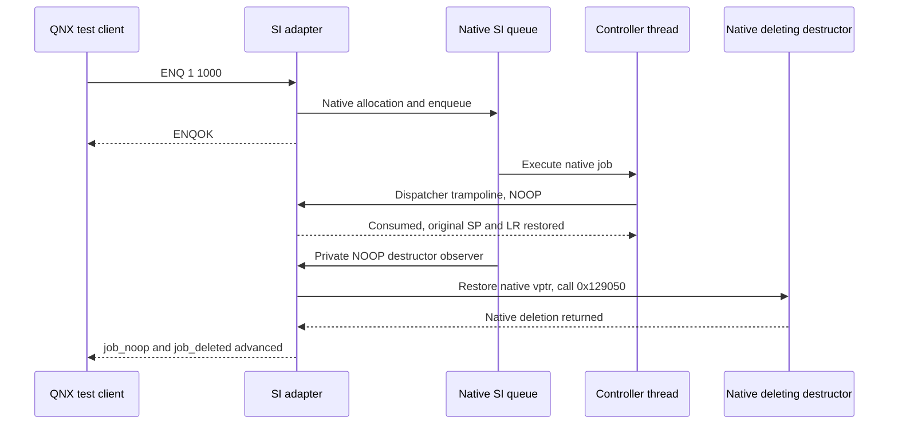

# SI stage 1: проверка на HU

_MHI2Q MU1316/P5087, 2026-10-20. Production adapter, native очередь SI и USB-регрессия на автомобиле._

---

[Исходники](../../wireless/si/README.md) · [План расширения](SI_WIRELESS_EXTENSION_PLAN.md) · [Сравнительный RE](SI_MH2P_COMPARATIVE_RE.md)

Обновление 2026-10-21: новый native launcher установлен на HU и проверен после двух ручных перезапусков владельцем. SI/adapter guard, свежий NOOP/deletion и первое USB-подключение проходят. Повторное USB-подключение в этой сессии не прошло: `io-otg-cinemo` не дождался включения iAP-интерфейса, затем SI зарегистрировал `TIMEOUT_STARTUP` DIO. После второго перезапуска первое подключение снова работает. Это открытая reconnect-регрессия; откат SI не выполнялся. Подробности — в последнем разделе.

## ✅ Подтверждённый результат

Кандидат SI запущен штатным servicemgr. Адаптер прошёл runtime-guard, опубликовал таблицу и обработал NOOP через родную очередь. Владелец подтвердил обычный USB CarPlay, закрытие после отключения кабеля и повторное подключение. На протяжении этого цикла SI сохранил PID `15487021`.

| Проверка | Наблюдение |
|---|---|
| Исходный SI | Копия с HU совпала с pinned re-arm SHA-256 |
| Доставка | Кандидат, production `.so` и ручной rollback считаны обратно и сравнены побайтно |
| Lifecycle binding | Worker стартовал из штатного service-management вызова |
| Публикация | `slot table published`; `published=1` |
| Native NOOP | `ENQOK`, `job_noop=5` к концу цикла |
| Native удаление | `job_deleted=5`, возврат original deleting destructor |
| USB-подключение | `prepare=1`, один DIO, `carplay0` UP; изображение подтверждено владельцем |
| USB-отключение | `cleanup=1`, DIO завершился; CarPlay закрылся |
| Повторный USB | `prepare=2`, новый единственный DIO; CarPlay снова работает |
| Per-child режим | На wired стартах `injected=0` |

Финальный STATUS: `published=1 spawn=3 injected=0 usb_scripts=0 mediacon=1 pps_usb=3 job_noop=5 job_pass=0 prepare=2 cleanup=1 job_deleted=5`. Третий spawn относится к cleanup shell. Открытия media connector/PPS ожидаемы в штатном USB-пути; эти счётчики не означают полноту трассировки всех USB-операций.

## 🔎 Уточнение активации SI, 2026-10-21

Владелец сообщил, что в текущих условиях SI перезапускается только вместе с машиной. Это требует проверки на следующей HU-сессии: замена executable или `.so` на диске сама по себе не обновляет работающий процесс, а USB disconnect/reconnect проверяет поколения DIO при живом SI.

Сохранённые свидетельства stage 1 позволяют установить, что тогда исполнялся кандидат:

| Свидетельство | Что установлено |
|---|---|
| `baseline.txt` | Исходный SI: PID `983129`, `-sm-restart 0` |
| `activation-first.log` | Путь кандидата, PID `13656109`, `-sm-restart 1`, публикация таблицы адаптера |
| `activation-observed.log` | Путь кандидата, PID `15487021`, `-sm-restart 2`, новый PID-сокет адаптера |
| `final-live-state.log` | У PID `15487021` root ненулевой, `immutable_candidate=1` |
| `native-delete-asserted.log` | Свежий ENQ увеличивает NOOP и deleting-destructor counters |
| `wired-connected.log`, `wired-disconnected.log`, `wired-reconnected.log` | Тот же SI обслуживает USB-цикл; `prepare/cleanup` и NOOP/deletion counters меняются во время проверки |

`immutable_candidate=1` означает совпадение guard-диапазонов памяти с кандидатом, а не SHA-256 всего процесса. В совокупности с новым PID, путём executable и ответами работающего адаптера это подтверждает атрибуцию stage-1 USB-цикла. Логи не устанавливают универсальный способ горячего перезапуска и не доказывают активацию после cold boot. Более поздние сборки или правки файлов не наследуют эту проверку.

Для следующей установки фиксируем отдельно: SHA-256 файлов после доставки; затем после согласованного перезапуска HU — текущие PID/аргументы SI, guard его памяти, опубликованную таблицу и ответ адаптера из этого процесса. Только после свежего NOOP с ростом обоих счётчиков начинаем USB/wireless-проверки. Один новый PID без проверки кода также недостаточен. Возврат исходного файла при откате требует такой же проверки работающего SI после перезапуска.

## 🔬 Что исправила живая проверка

| Ошибка контракта | Исправление и доказательство |
|---|---|
| Проверялась mediator registration array `0x1C5118` | Job lookup `0x128994` через GOT резолвит `CControllerInternalJobListener::s_listenerArray`, VA `0x1C3C90` |
| Готовностью считался `Impl+0x90==2` | `2` означает startup pending; completion callback `0x180724` пишет `0`. На рабочем штатном SI и кандидате состояние `0` |
| Native enqueue трактовался как 0=success | `0x13F2C8` задаёт accepted=1, `0x13F32C` возвращает boolean. Адаптер переводит его в свой 0=success |
| Guard новых RW-данных вычислял file offset как VA−base | Fingerprint vtable берётся через соответствующий PT_LOAD: VA `0x1BF248` → file offset `0xBE248` |

На исходном SI controller=`0x281020`, Impl=`0x2839C0`, listener=`0x2810F8` (`controller+0xD8`), listener vtable=`0x1C1220`, dispatch=`0x1653C0`. До исправления guard давал `ready=0`; после исправления — `ready=1`. Candidate guard на исходном SI штатно отклоняет изменённые hook/PHDR-байты. Read-only helper не останавливает SI и не пишет его память.

## 🔁 Проверенный путь NOOP



`MHI2Q_SI_HOOK_TRACK_JOBS=1` включает наблюдение только для NOOP, созданных адаптером. У каждого такого объекта временная private vtable с единственным заменённым deleting-destructor slot. Перед вызовом original `0x129050` native vptr восстанавливается; после возврата объект не читается. Обычные SI jobs не меняются. Это инструментированный native путь удаления, а не независимая трассировка немодифицированного объекта.

Клиент с явным PID-сокетом и `--require-delete` проверяет рост обоих счётчиков относительно исходного STATUS, с ограниченным ожиданием. Проверки выполнены до USB, во время сессии, после disconnect и после reconnect.

## 📦 Установленные артефакты

| Артефакт | SHA-256 |
|---|---|
| Исходный re-arm SI | `606236a81c7c4dafda6fdd08fe6eb27c43252796784da25d9760a7d552ee2af3` |
| Кандидат SI | `94355c2573745d4ae699fde8e3fa34d9f7958a57e4464b9ea0837cf41a0801cc` |
| Production adapter | `5a078582a686b28c6bfa3f1c084220fa1c70925be5ddbf8d2a4ed755e9558113` |

В `/mnt/app/eso/bin/apps/smartphone_integrator` временно установлен wrapper, передающий исходные аргументы и унаследованное окружение кандидату в `/mnt/app/root/si-stage1-20261020/`. Там же находятся `.so`, исходный SI и `rollback.sh`. Child-env инъекция wireless выключена. Production `.so` не экспортирует BSP `slogf` shim и не устанавливает SIGSEGV handler.

Ручной возврат исходного re-arm SI, если потребуется:

```sh
sh /mnt/app/root/si-stage1-20261020/rollback.sh
```

Скрипт восстанавливает исходный executable атомарным rename, возвращает `/mnt/app` в read-only и посылает SIGKILL только идентифицированному тестовому SI. Повторный запуск исходного SI через servicemgr был предположением: **скрипт в этой сессии не запускался**, сама процедура отката ещё не проверена исполнением. С учётом сообщения владельца нельзя рассчитывать на немедленный перезапуск; восстановление файла и запуск исходного кода проверяются раздельно, при необходимости после согласованного перезапуска HU. По указанию владельца никаких автоматических rollback-таймеров не установлено. Сборка оставлена на HU после успешного USB reconnect.

## 📋 Артефакты и границы проверки

Локальная запись: `build/si-wireless-stage1/hu-20261020/`. Основные файлы: `live-original-ready-fixed.log`, `native-delete-asserted.log`, `wired-connected.log`, `wired-disconnected.log`, `wired-reconnected.log`, `host-tests.log`, `production-build.log`, `active-receipt.json`. Полные runtime environment snapshots и firmware-копии остаются в build, вне исходников.

Host-набор прошёл, включая 192 исполнения ARM-трамплинов, 35 проверок того же C guard и 10000 детерминированных env-мутаций. Физический тест устанавливает работоспособность stage-1 контура и описанного USB-цикла. Он не проверяет cold boot, все варианты watchdog/error cleanup, звук/Siri/AltScreen по отдельности или SI-owned wireless.

Обновление 2026-10-21: [native QEMU stage 2](SI_STAGE2_OFFLINE.md) проверяет startup, очередь/удаление, present/stored-регистрацию, native DSI-публикацию и отказ Coding; отдельный профиль с явно тестовыми RCC grants проверяет SI-owned DIO receiver lifecycle. Старый `libcomm.so+0x9DDC4` вызван отсутствием обязательных `-sm-*` аргументов в стенде; проверены штатные broker и Service Manager, ELF доставляется через проверяемые сжатые данные на QNX4. Stage 2 на HU не устанавливался. На машине сначала требуется устранить сообщённый post-boot отказ wired, затем проверять wireless media/HMI. Эксперименты mkifs не опровергают байт-точную SSH-доставку, подтверждённую физической проверкой выше.

## 🛠️ Исправление запуска и открытая post-boot регрессия

Во время HU-теста штатный executable был заменён shell-wrapper, который экспортировал `LD_PRELOAD` для production SI adapter и выполнял `exec` кандидата с исходными аргументами. Включены verbose/NOOP-deletion counters, wireless-инъекция выключена. После проверки wrapper остался установленным. Оставлять этот запуск без проверки следующей загрузки HU было недостаточно для подтверждения boot integration.

Точный сохранённый wrapper (`b927faf3…`), кандидат (`94355c25…`) и адаптер (`5a078582…`) проверены через native QNX Service Manager в отдельной VM. Нормальный старт, публикация, NOOP/deletion и runtime guard проходят. Поэтому отказ на машине пока нельзя приписать самому факту shell-запуска или загрузке этих ELF.

Найден отдельный воспроизводимый дефект wrapper: redirection `>> /tmp/si-stage1.log` выполняется до `exec`. Ошибка открытия лога не допускает запуск SI. В QNX отрицательный контроль заменяет только путь лога на отсутствующий `/missing/si-stage1.log`; Service Manager повторяет безуспешные старты. Это явная fault injection, **не наблюдение состояния `/tmp` на HU**.

[Новый exec-launcher](../../wireless/si/si_startup.c) открывает диагностические файлы как необязательные, очищает унаследованный `MHI2Q_SI_HOOK` namespace, сохраняет заводское окружение и аргументы, затем выполняет `execve` того же кандидата. PID сохраняется. Отката, ожиданий, перезапуска USB и запуска запасного SI нет. Образы SI и адаптера в stage-1 repair payload остаются прежними.

| QNX-профиль | Результат и граница |
|---|---|
| Сохранённый HU wrapper, обычная загрузка | Native stage-1 acceptance PASS; USB-оборудование не моделируется |
| Сохранённый wrapper, путь лога недоступен | Ожидаемый отказ запуска SI воспроизведён |
| Native launcher, обычная загрузка | Stage-1 startup/queue/deletion/runtime image PASS |
| Native launcher, log/PID paths недоступны | Тот же SI загружается, native очередь/удаление и guard PASS; config fault injection помечена в receipt |
| Native launcher, stage 2 | Native startup, NOOP/deletion, SIW2 discovery и отказ Coding PASS; это не физический wired-тест |

Сборка review payload без установки:

```sh
python3 wireless/si/build_si_startup.py \
  --directory /mnt/app/root/si-stage1-20261020
python3 wireless/si/qemu_si_boot.py \
  --payload-dir build/si-boot-fix \
  --workdir build/si-boot-audit/native-normal
python3 wireless/si/qemu_si_boot.py \
  --payload-dir build/si-boot-fix \
  --workdir build/si-boot-audit/native-unavailable --missing-diagnostics
```

В `build/si-boot-fix/manifest.json` явно разделены launcher для штатного entry point и candidate executable в отдельном каталоге. Это review payload, установщика нет. Прогоны и receipts находятся в `build/si-boot-audit/`; исходные HU-логи не менялись. Старый stage-2 review archive не включает эту правку запуска.

Следующий HU-шаг — снять post-boot состояние [read-only скриптом](../../wireless/si/si_hu_diagnose.sh): SI/DIO arguments и mappings, USB nodes, `carplay0`, wrapper/adapter logs и native slog. Затем исправлять подтверждённую причину при сохранённом кандидате и повторять cold-start wired connect/disconnect/reconnect. Исправление запуска локально проверено; **причина и устранение наблюдаемого отказа на машине пока не подтверждены**.

## 🚗 Установка native launcher и повторный HU-тест

В сессии 2026-10-21 до изменений прочитаны обратно кандидат, production adapter, исходный re-arm SI и установленный wrapper. Их SHA-256 совпали с предыдущей физической проверкой. Уже после загрузки старый wrapper работал: SI PID `991320`, `-sm-restart 0`, adapter published; владелец подтвердил USB CarPlay. Следовательно, отказ открытия лога не был причиной этой конкретной загрузки.

На `/mnt/app/eso/bin/apps/smartphone_integrator` атомарно установлен native launcher, SHA-256 `e8eaac94495478d72d9238b20c63e93d6c940be0463e13e829a408bf7aca1df9`, 8712 байт. Установленный entry point считан обратно побайтно; `/mnt/app` возвращён в read-only. Кандидат `94355c25…` и adapter `5a078582…` не заменялись. Прежний wrapper сохранён в `/mnt/app/root/si-boot-fix-20261021/entry-before.sh`; там же установлен read-only диагностический скрипт. Автоматического отката, остановки SI/DIO или команды reboot агент не выполнял; оба перезапуска сделал владелец.

| Этап | Проверенный результат |
|---|---|
| До перезапуска | SI `991320`, свежий NOOP/deletion, USB работает; новый entry point только на диске |
| Первый ручной перезапуск | SI `979026`, `-sm-restart 0`, новая запись `si-startup: pid=979026 abi=1`, adapter published, memory guard и NOOP/deletion PASS |
| Первое USB-подключение | DIO `4690054`, `carplay0` RUNNING, `prepare=1`, `injected=0`; владелец видит CarPlay |
| Отключение | DIO завершился, `cleanup=1`, SI сохранил PID и обрабатывает NOOP/deletion |
| Повторное подключение | Владелец видит AltScreen preloader; DIO `6881414` и retry `7925894` получают `TIMEOUT_STARTUP`; USB-цикл FAIL |
| После ошибок | SI `979026` остаётся ready и совпадает с candidate guard; свежий NOOP/deletion PASS. Native app context после завершения: appId=-1, state=0, deviceId=0. При новой физической попытке владелец сообщает только зарядку |
| Второй ручной перезапуск | SI `983131`, `-sm-restart 0`, новая запись launcher; guard и NOOP/deletion PASS. DIO `4399240`, первое USB-подключение и CarPlay подтверждены владельцем |

Перед неудачным стартом DIO первый зарегистрированный отказ — `io-otg-cinemo ERROR: The interface was not enabled in time` через 8 секунд ожидания. Успешный старт после второго reboot содержит `AttachToPipes succeeded` и `g_otg.hostConfigured = true`. В штатных аварийных архивах reason — `TIMEOUT_STARTUP`. Наличие `.core` в этих архивах само по себе не доказывает независимый SIGSEGV: main/controller threads в snapshot находятся в ожидании, `why=0`, `what=0`. Непосредственная причина отсутствия USB interface-enable event ещё не установлена. Найденный дефект обязательного log redirection устранён, но он не объясняет этот reconnect.

Сохранены точные HU DIO (`e9862680…`), hook (`1d1fb166…`) и архивы `smartphone_integrator_error_546/547.tar.gz` с core/PPS/pidin/slog. Локальная директория: `build/si-boot-fix/hu-20261021/`; основные записи — `deploy-receipt.json`, `live-after-reboot.log`, `wired-after-reboot.log`, `live-wired-disconnected.log`, `reconnect-failure.log`, `crash-inputs.json`, `second-reboot.log`, `second-boot-wired-success.log`, `live-second-boot-connected.log`. Полные дампы с идентификаторами телефона/машины остаются вне исходников.

Физически подтверждён запуск нового entry point после ручного HU reboot и первое подключение; **полный USB reconnect acceptance не пройден**. Полное отключение питания машины/deep-sleep cycle отдельно не проверялось. На момент этого wired-цикла Stage 2/wireless ещё не был установлен. Позже по запросу владельца полный комплект установлен для отдельной wireless-проверки; после ручного перезапуска активирован Stage 2 и подтверждено wireless-видео, остальные функции требуют доработки. [Точный состав и граница проверки](../archive/internal-reference-2026-10-29/wireless-carplay/SI_STAGE2_OFFLINE.md#hu-installation-2026-10-21). Причина потери iAP interface-enable при повторном USB-подключении остаётся отдельной открытой задачей.
