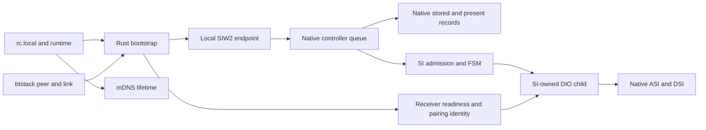
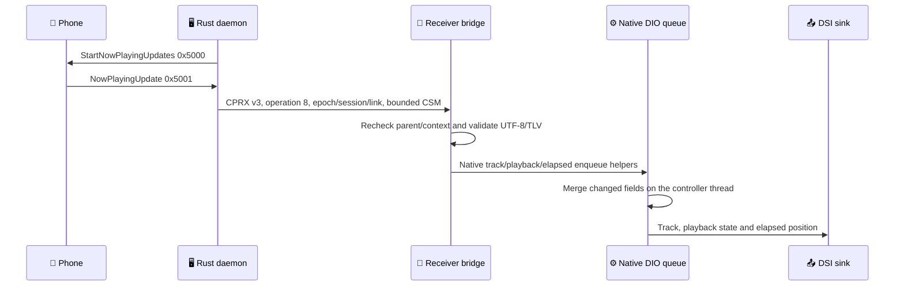

# SI-owned wireless implementation

The existing Smartphone Integrator registers the wireless device, admits its session and owns the DIO child. This page describes current source contracts. [The shared acceptance ledger](../carplay-lab/WIRELESS_COMPLETION_PLAN.md) distinguishes implementation from laboratory and vehicle acceptance.

[Wireless overview](README.md) · [Ownership](DIO_OWNERSHIP.md) · [Historical implementation and receipts](../archive/internal-reference-2026-10-29/wireless-carplay/SI_STAGE2_OFFLINE.md)

## Ownership and routing



Rust is not an SI child. In SI mode the runtime runs the daemon directly, without `wireless_dio_supervisor`. Wired ownership does not suspend bootstrap. An owned mDNS responder can be replaced without restarting bootstrap; external responders are preserved.

ABI 2 uses five hooks: central connect, prepare, cleanup, job dispatch and the native CarPlay transport predicate (`0x169518`, table offset 28). The last predicate otherwise requires a physical USB connector; only an already-admitted native WLAN record returns true through the adapter. All Coding/FEC/method checks remain native, and USB follows the original predicate. Root remains RW at `0x1C5E00`; the hook page remains R+X at `0x1C6000`. Default builds preserve stage 1. Candidate and adapter require explicit `--stage2`; `MHI2Q_SI_HOOK_WIRELESS=1` enables mutations.

Discovery alone does not admit media. Premature HMI connects for unadmitted WLAN records are consumed before creating an SI context. Bootstrap ACTIVATE retains native presence, capability, coding, FEC, method and single-session checks. Unknown WLAN attempts cannot fall through into stock USB prepare/cleanup.

## Verified native ABI

Base: USB re-arm SI SHA-256 `606236a81c7c4dafda6fdd08fe6eb27c43252796784da25d9760a7d552ee2af3`; its existing re-arm instruction is retained. IDA uses the matching stock image; its four-byte difference is outside these discovery helpers.

| Primitive | VA / layout | Contract |
|---|---|---|
| DataProxy | controller +264 | Embedded object, not the controller pointer |
| Present vector | DataProxy +440 count, +444 pool size, +448 pointers | 208-byte native records; DeviceInfo at record +8 |
| Stored identities | DataProxy +544 count, +552 pointers | Separate from present list |
| Constructor | `0x169850` | Four 40-byte UnicodeString8 fields |
| DeviceInfo copy | `0x1698D0` | Native string assignments |
| Stored upsert | `0x16EEF4` | Returns numeric deviceID, not a pointer; native uniqueID from vendor/product/address |
| Present insertion | `0x16EC90` | Copies into native owned/reused storage |
| Present removal | `0x169984` | Resets strings, retains object in unused pool |
| Discovery publication | `0x183678` | Native DSI serialization; states 0 and 2 included |
| Completion | `0x17F2B8` | Native PREPARED, START_RETRY, CLEANUP_DONE |
| Connect | `0x165390` | Current FSM listener vslot +28 |
| Disconnect | Current FSM vslot +32 | deviceID, removal=1; slot +48 is finalize |

WLAN uses connectionType 2 and CarPlay mask 2. The address is an opaque `bt:XX:...` peer key, copied from SDK remote-device +13 following native HfRfCallback. Presentation MAC byte order is not assumed. The authenticated phone name is published through IPC; `iPhone` is the fallback before a validated name arrives. A present identity is updated directly: calling stored upsert on an already-present identity would deliberately allocate a duplicate ID.

Legacy metadata readers index three USB configuration slots without checking transport. DeviceInfo +188 is bounded to zero; transport hooks bypass physical USB operations. Acceptance of native ASI/HMI interpretation belongs to the shared ledger.

## DIO transport adapter

Stock `CSIService::initService` (`0x165348`) stores SDeviceInfo and restarts mDNS; subsequent setup starts Cinemo USB iAP2. SI-side prepare alone cannot turn that into wireless. The stock210 bridge now includes `si_transport.c`: only a valid SI-bound wireless child replaces CSIService's init/setup slots and notification entries. Wired and standalone generations keep their previous paths. The guard verifies all 15 primary vtable entries and the secondary `this-44` notification thunk (`0x1A4E80`); absent/malformed context, wrong parent or mismatched layout cannot install it. ASan/UBSan tests cover these failures and idempotence.

Wireless init retains the native SharedPtr/reply client, then posts native AirPlay startup. Early CPRX START waits for native SI initialization; generic prestart is disabled for SI-owned children. The real AirPlay-running notification publishes native ASI SETUP_COMPLETED; actual media-start notifications remain owned by DIO. A late running event after cancellation cannot report setup completion. No fake SERVICE_STARTED is emitted merely because the receiver is listening.

Cold START previously held `bridge_lock` while server creation needed the same lock. Server retention now uses a separate lock, with release outside both locks; first-start publication is atomic. The mDNS kill interposer was accidentally nested under the experimental-start preprocessor flag: moving it into the stock210 build fixes external responder termination across native SI teardown/reconnect. Production builds now assert that the required `kill`/SI transport exports are present.

SI state **3 is SERVICE_STARTED**, while **5 is INITIALIZED**. Rust verifies that bridge STOP reports active media before DETACH, accepting both states to cover a queued native media notification. SI retains that admitted generation until native termination; receiver-ready alone does not prove media.

## Protocol and session lifetime

SIW2 is a fixed 192-byte little-endian frame on `/tmp/mhi2q_si_control.sock`, mode 0600. No network SI-control listener. A CLOEXEC kernel lock `/mnt/persist/.mhi2q_si_adapter.lock` prevents a second adapter from removing an active endpoint.

| Operation | Meaning |
|---|---|
| HELLO / SNAPSHOT | SI epoch and native context |
| UPSERT_PHONE | Native identity and presence, without activation |
| ACTIVATE | Admit the peer/link and call native connect |
| CANCEL | Native disconnect for this admitted attempt |
| REMOVE_PHONE | Deferred presence removal, stored identity retained |
| DETACH_PEER | Keep established IP media after bootstrap loss |

The bounded ledger holds 32 requests, eight phones and eight daemon epochs. Saturation returns BUSY; restarting SI resets these tables. Completed results can be evicted, but per-daemon high-water marks reject old replays. SI and daemon epochs are random; request IDs increase monotonically. Parser checks reserved bytes, UTF-8, termination and ranges.

Parsing and bounded waits run outside the controller. Native jobs validate again on dispatch. Lost acknowledgements/PENDING replay exactly the same request ID/payload; conflicting reuse is rejected. Native callbacks run without the ledger mutex, allowing prepare/spawn re-entry. A new Bluetooth link cannot steal an active IP session.

Explicit child envv carries mode, SI epoch/session, link and SI parent PID. Other SI children receive no hook namespace. The wireless wrapper sources per-unit configuration because ProcessTNG constructs a separate envv. Wired hook/APAC files are preserved; wireless uses separate libraries. SI-owned wireless retains the renderer monitor for the existing main/AltScreen path. Spawn transport is read from the native SI context independently of admission: a cancelled/stale WLAN spawn is rejected, never relabeled wired.

CPRX v3 binds START/STOP/IDENTITY to epoch/session/link and actual parent. Legacy v2 starts, stale context and replaced parent are rejected by an SI-owned receiver. v2 QUIESCE/WIRED_DRAIN remains available for guarded owner handoff, including orphan recovery by a wired owner. DRAIN independently checks the wired-priority kernel lock.

On Bluetooth loss the daemon asks the receiver to stop only if idle. Explicit receiver BUSY confirms active media, permitting DETACH; SI INITIALIZED (state 5) alone is insufficient. Unknown receiver state preserves the lease instead of force-closing media. Deferred presence removal follows native terminal state.

## 🔄 Automatic media recovery with unchanged Bluetooth

A media session has its own lifecycle within an authenticated RFCOMM generation. Duplicate `4300` messages cannot re-activate a streaming or draining receiver. When Wi-Fi returns, a cached original StartSession reply can be reused after an authenticated `4E0D available` update; no new Bluetooth pair, MFi exchange or `4300` is required within that retained link.

| Boundary | Implemented contract |
| --- | --- |
| Native observation | CPRX `STATUS=6` reads state without stopping admission. `HEALTH=7` samples liveness. Both require the exact SI epoch/session/link and active receiver generation. Flags are strict: `0/5` waiting, `7` started, `4` ended; unknown/reserved encodings fail. |
| Silent peer | After native session start, unchanged data, HTTP/screen activity **and validated timing-response** counters for 10 seconds authorize one `shutdown` of that authenticated control socket. Sampling runs on the retained native HTTP queue. Native finalization and ASI own teardown. |
| Static picture | No frame-rate deadline exists. Valid timing replies reset the liveness age even if video, audio and control traffic are otherwise unchanged. |
| Cleanup authority | Native SI must report `app=-1` **and retained child PID=0**. Socket errors, `INITIALIZED`, and an idle app with a still-live child cannot authorize a new DIO. Native-ended observation issues bound CANCEL and waits. |
| Same phone | DNS-SD resolves TXT `id=` against the authenticated RFCOMM peer, then makes a bounded TCP reachability probe before a new ACTIVATE. Foreign/missing/duplicate IDs fail. IPv4 and scoped IPv6 link-local addresses are supported. |
| Identity representation | Existing `bt:` keys retain raw SDK byte order. Stock btstack formatter `0x157A8C` prints bytes `[5]..[0]`; reverse only for comparison with conventional Bonjour MAC text. Changing SI keys would lose remembered identity/consent. |
| Task lifetime | Native Streaming/Draining/Ended/Blocked cancels obsolete discovery/connect work. Canceled tasks retire before successors start. Successful HTTP tasks release the connector slot. Generation checks reject stale results; an already transmitted GET cannot be retracted. |
| Availability and priority | A false `4E0D` cancels probes. Wired ownership blocks re-admission. No recovery uses WIRED_DRAIN to force wireless cleanup. Startup with no media is canceled only after a serialized idle STOP accepts it. |

The 10-second timer uses stock-210 session fields: data receive `+488`, activity `+496`, accepted timing responses `+564`, correlated high-RTT responses `+612`, native-started byte `+702`. RE is pinned to `libairplay.so` SHA-256 `01c116b1674215daa0602d556a6d9b2eb48c2113ca294ea1f5d58787e3f656f2`: `_TimingThread` at `0x24EC8` schedules probes every 2–3 seconds; the successful path of `0x24748` increments `+564` at `0x24C04`. The high-RTT path increments `+612` at `0x24C1C` only after header/type/length and saved request-origin validation; these responses also prove reachability even if clock adjustment is deferred. Sending a probe increments the different field `+560` and is not proof of peer liveness. No TCP sysctl or stock 30-second watchdog constant was changed.

Implementation: [`recovery.rs`](../../wireless/daemon/src/recovery.rs), [`si_control.rs`](../../wireless/daemon/src/si_control.rs), [`carplay_control.rs`](../../wireless/daemon/src/carplay_control.rs), [`qnx_dns_sd.rs`](../../wireless/daemon/src/carplay_control/qnx_dns_sd.rs), [`peer_health.h`](../../hook/wireless/peer_health.h), [`wireless_hook.c`](../../hook/wireless/wireless_hook.c), [`bridge.c`](../../wireless/receiver_bridge/bridge.c).

Reproduce the retained-link profile from the repository root:

```sh
python3 wireless/daemon/probes/qemu_daemon_bridge.py --phone-probe --control-probe --recovery-qemu
python3 wireless/si/qemu_stage1.py --stage2 --vehicle-providers --carplay-coded --rcc-fec-fixture --peer-health --timeout 180 --receiver-hook build/wireless/libcarplay_hook.so --workdir build/si-wireless-offline-re/qemu-native-peer-health
```

These profiles include synthetic providers and input-only fake OMX. They exercise protocol/lifetime, not physical decoding, radio or missing-RFCOMM recovery. Dated receipts are in the archived implementation record.

## 📱 Transport prefixes, phone name and remembered consent

The UI presents two transport entries, labelled `Wired - <phone name>` and `Wireless - <phone name>`. Display text never becomes the identity. The existing native USB record and the WLAN record keyed by `bt:…` remain separate; no MH2p-style transport merge is introduced. Unseen or disconnected USB hardware is not fabricated as present.

| Concern | Implemented behavior | Boundary |
| --- | --- | --- |
| Phone name | Advertise/parse iAP2 `DeviceInformationUpdate` (`4E09`, parameter 0). Publish only after identification and MFi authentication both complete. A new RFCOMM generation has a new name buffer. | `iPhone` remains a fallback until the phone supplies its name. Test names, including Cyrillic, are test vectors only. Phone emission on this HU is not yet observed. |
| Name validation | Strict TLV lengths, duplicate-field and UTF-8 checks; reject control characters; truncate on a UTF-8 boundary to SIW2's 95-byte limit. Optional final NUL is accepted. | The vendored iAP2 codec is unchanged. |
| Live rename | The ordered receiver worker sends UPSERT for the same SI epoch, BT key, link and session. Check the returned native device/session IDs; no ACTIVATE and no second child. | Display-name updates do not migrate identities or manufacture consent. |
| Transport label | A copied DSI payload is prefixed at the stock `PhysicalDevice` constructor. Device ID, address, method and transport are unchanged; other DSI consumers retain their original object. | The exact temporary USB placeholder `Apple Inc.-iPhone` is preserved so stock `TMDeviceControl` can retain a learned real name. Other projection types are untouched. |
| Repeated Yes | Stock `TMDeviceControl.DiscoveredState.enter` resets acceptance to INITIAL when `isStoreUserAcceptState()` is false. Stock `NewDeviceHMIHandler.storeAcceptSelection()` uses configuration or checkbox model `3200034`; `hideScreen` resets that checkbox to zero. | This is a proven repeat-prompt path, not proof that it is the only cause in the saved HU run. Native failure code 6 can also clear acceptance. |
| Remember default | Before a wireless-only popup or its disclaimer, preselect the native remember checkbox. Stock Yes/No handlers, persistence and automatic activator still run. | First explicit agreement is required. Unchecking remains effective; No does not activate. Wired and mixed-device popups retain the stock default. |

The SI identity path was rechecked in stock ELF: `addUniqueID` (`0x16EEF4`) hashes VID/PID and the ASCII address at info+68, independently of the name. A matching *present* record intentionally receives a randomized identity, so a live rename must use the existing-record branch. The publisher (`0x183678`) sends name from record+36 and address from record+116. Java `TMDeviceID` equality uses address and smartphone type. Prefixing/renaming therefore does not itself allocate another phone.

Implementation: [`device_name.rs`](../../wireless/daemon/src/device_name.rs), [`si_control.rs`](../../wireless/daemon/src/si_control.rs), [`TransportDevicePolicy.java`](../../java_patch/com/luka/carplay/core/TransportDevicePolicy.java), [`TransportDevicePatch.java`](../../tools/java/TransportDevicePatch.java). The Java build pins the exact US/EU/CN input class hashes and inserts three calls across two stock classes. A reverse-edit check proves canonical stock bytecode is unchanged outside these inserts and stack limits; output targets Java 1.4. Synthetic accessors and stock FSM bodies are retained.

The Java class handles presentation and initial checkbox state. It does not implement USB/Wireless/Auto policy, common phone identity or two-phone selection. See the shared ledger for those integration gates.

<a id="native-now-playing-and-hid"></a>

<a id="native-now-playing-and-hid"></a>

## 🎵 Native Now Playing and exact HID reports

The production Rust daemon advertises accessory-sent `0x5000` and accessory-received `0x5001`. After SI admission and receiver identity binding, it requests track/playback attributes. Only authenticated iAP2 updates enter a bounded backlog; a separate bounded receiver-worker queue keeps metadata IPC off the link/timer thread. Reset/start clears pending updates, and the SI controller identity is checked again before forwarding.



The bridge files are [`now_playing.c`](../../wireless/receiver_bridge/now_playing.c) and [`now_playing.h`](../../wireless/receiver_bridge/now_playing.h). CPRX operation 8 requires an active admitted generation, v3 epoch/session/link and the original SI parent. The bridge reads at most 4096 bytes before locking and rechecks authorization after reading the body. Malformed framing, duplicate known attributes, invalid UTF-8/control characters and oversized text are rejected before native enqueue. Host ASan/UBSan checks include an independent codec golden vector, every truncation and 20,000 deterministic mutations.

Native routing is pinned to the MU1316 DIO hash `e9862680…e794`. Manager constructor `0x15A064` registers `CIAP2ClientEventListener(manager+8)` through `0x12A334`; its event token resides at `manager+16/+20`. This is **not** the job-listener token at `manager+232+16/+20`. The bridge reads the existing event token and requires native resolver `0x12A254` to return that exact listener. It copies routing values only; it does not manufacture a registration, invoke USB connect or mutate manager state from its IPC thread. Native helpers `0x129C00`, `0x129BAC` and `0x129B7C` copy borrowed Unicode arguments and transfer allocated events to the mediator. The native manager performs track merging; the bridge retains playback fields omitted by partial updates.

Native input uses stock DSI rotary and SELECT press/release entrypoints. The independent phone fixture authenticates Events traffic and parses the `hidSendReport` plist, then checks the exact report sequence. This proves the exercised transport; physical controls have a separate acceptance boundary.

## Build and inspect

```sh
python3 wireless/si/build_si_review.py --full-cycle
```

Run from the repository root with the pinned inputs described in [Wireless overview](README.md#build-and-reproduce). The builder packages matched candidate payloads, manifests and native fault/stress receipts; QEMU-only peripheral models are excluded from delivery. Packaging is not vehicle acceptance.

SIW2 diagnostic syntax: `si_ctl_client op req epoch_hex daemon link session key name [socket]`. Use HELLO's SI epoch and increasing request IDs; reconcile a timeout before requesting another activation. Diagnostic operations and their enum values are defined in [si_protocol.h](../../wireless/si/si_protocol.h).
