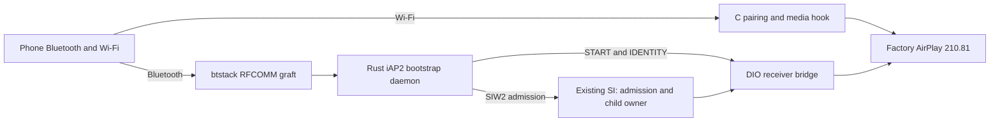

# Wireless CarPlay with MU1316 stock AirPlay 210.81

_Current stock210 component contracts; original ABI evidence remains version-pinned._

---

[Wireless overview](README.md) · [Current stock210 lifecycle](STOCK210_RECEIVER_LIFECYCLE.md)

Maintained technical reference. The evidence below distinguishes static analysis, local QNX tests and observations from the unit.

Implementation and local diagnostic paths in this record refer to the [original source directory](../../wireless/). Run `wireless/...` commands from the repository root; moving this note does not move binaries or logs.

## 📊 Component flow

The implementation keeps factory AirPlay and adds pairing/media adapters in the hook. [SI ownership](DIO_OWNERSHIP.md) defines process authority; the [shared ledger](../carplay-lab/WIRELESS_COMPLETION_PLAN.md) defines current acceptance. Original standalone-supervisor experiments are retained in the [architecture snapshot](../archive/internal-reference-2026-10-29/wireless-carplay/STOCK210_ARCHITECTURE.md).

**Wireless endpoint contract:** direct wireless stock 210 with
only feature bit 37 is insufficient. iOS 26.6/27 requires CU pairing and
encryption for non-USB CarPlay endpoints; iOS 27 StartSession also synthesizes
bit 38 locally. The original library can remain, but the wireless hook/front
end must supply the missing pairing and transport/stream security. Evidence:
[ios_wireless_session_gates.md](IOS_WIRELESS_SESSION_GATES.md).

The source-level implementation recipe is now in
[airplay280_pairing_recipe.md](AIRPLAY280_PAIRING_RECIPE.md), based on the
owner's `Refferences/Carplay` 280.33.8 source and checked receiver handlers.
The daemon contract now binds StartSession field 4 (named `public_key` in the
vendor codec) to the active receiver's CU pairing identifier (`pi`), obtained
with receiver-bridge operation 5. `MHI2Q_CP_PAIRING_ID` optionally pins it;
the old Ed25519 interpretation and `MHI2Q_CP_PUBLIC_KEY` setting are rejected.

Implementation is in [`hook/wireless`](../../hook/wireless/README.md), inside
`libcarplay_hook.so`, as requested. It uses private namespaced 280 pairing
primitives with the original 210 HTTP structures. See
[stock210_http_pairing_abi.md](STOCK210_HTTP_PAIRING_ABI.md) for verified
offsets and the plaintext Verify-M4 completion seam. Events and media adapters
now live in the same module; their stock offsets and protocol limits are in
[stock210_media_crypto_abi.md](STOCK210_MEDIA_CRYPTO_ABI.md). Media remains opt-in.
Capability/Bonjour publication and production stock210 startup now pass the
combined [receiver lifecycle fixture](STOCK210_RECEIVER_LIFECYCLE.md).

## 📋 Pinned 210.81 facts

The original `advanced/MU1316-appimg/eso/lib/libairplay.so` is an ARM32 EABI5
QNX shared object, SHA-256
`01c116b1674215daa0602d556a6d9b2eb48c2113ca294ea1f5d58787e3f656f2`.
Its `/info` and `_airplay._tcp.` TXT report `srcvers=210.81`. In QNX/QEMU,
stock `dio_manager` starts its receiver on TCP 5000. A pinned one-instruction
experiment ORs CarPlay Control bit 37 into `/info` and returns
`0x0000002144440B80`; it leaves bit 38 clear. This confirms capability
advertisement and stock listener startup, not wireless pairing.

The original rodata has `/info` at `0xA1724` and `/auth-setup` at `0xA172C`,
but no `/pair-setup` or `/pair-verify` strings. The receiver's local request
dispatcher is at `0x302E0`; the existing `FUNCTIONAL_PARITY.md` maps its
210 routes to `/auth-setup`, `/info`, `/command`, `/feedback`, SETUP, RECORD,
and TEARDOWN. The original exports `APSMFiSAP_Exchange` but no
`HTTPConnectionSetTransportDelegate`, `NetTransportChaCha20Poly1305Configure`,
or HomeKit pairing/session-security entry point. Absence of exports alone
would not prove absence of code; the route/string audit and request-dispatch
comparison are the stronger evidence.

There is a possible hook seam at `HTTPServerCreate` (stock VA `0x6C324`):
the original's PLT relocation is at `0xB91A0`, and
`AirTunesServer_EnsureCreated` calls it at `0x2EAF8`. A QEMU-only
`LD_PRELOAD` diagnostic in `capture_probe.c` observed that call while stock
`dio_manager` started. The original copies **11 words** from the delegate
pointer into the server (`0x6C37C..0x6C39C`). In QEMU the loaded library
base was `0x780A0000`; slot 9 held `0x780D02E0`, precisely the relocated
request dispatcher. A QEMU-only copy of that delegate replaced **only slot
9** with a wrapper that called the original. It logged `route-called` on the
real `/info` request, which still returned HTTP 200, and stock Bonjour
registered `_airplay._tcp.` on port 5000. Evidence:
`receiver_bridge/out/qemu_start_iface_lo0.log`. The 280 source header's
14-word `HTTPServerDelegate` must **not** be copied as a 210 layout. Other
210 callback slots and message lifetime were subsequently mapped for the
hook implementation; see the ABI document above. This original diagnostic
remains separate from the module.

The QEMU observation is reproducible with
`python3 tests/carplay_lab/qnx/qemu_capture.py --mesh --start-experiment
--seed-display --skip-hid-qemu --feature37 --http-delegate-qemu --mdnsd
--mock-mac-qemu --interface-lo0-qemu --dump-txt-qemu`. Its MAC/interface and
display seed are synthetic; the exact 210 library and `dio_manager` are not.

The existing `libcarplay_hook.so` already interposes
`AirPlayCopyServerInfo` and `AirPlayReceiverSessionSetup` for wired features;
the original has a PLT relocation for `AirPlayCopyServerInfo` at `0xB9910`.
The wireless module now uses the shared `AirPlayGetFeatures` seam for both
Bonjour and `/info`, publishing bits 37/38 only when its guarded pairing/media
implementation is ready. It adds persisted `pi` at the TXT construction seam
and final info callback without changing stock `libairplay.so`. `dio_manager` hardcodes
`interfaceName=carplay0`; the existing exact-callsite probe can substitute
`uap0` for wireless receiver startup. Vehicle observations and the required matched-kit radio checks are recorded in the shared ledger.

## 📋 Stock210 integration contract

| Boundary | Current owner/contract |
| --- | --- |
| Device admission and DIO creation | Existing SI, native controller queue and generation-bound child environment |
| Bootstrap | Rust daemon outside the media-child lifetime; graft provides the local RFCOMM byte channel |
| Authentication | Hardware MFi for production; private pairing primitives and guarded stock210 HTTP adaptation |
| Receiver identity | Persisted Bonjour `/info` pi matches receiver-bound StartSession; Ed25519 key is a separate value |
| Transport | Guarded wireless interface selection, actual listener readiness, encrypted control/events/media |
| Termination | Native SI terminal state and child exit; generation-scoped cleanup and kernel owner/priority locks |
| Persistence | Owner locks, advisory generation marker and pairing keys under `/mnt/persist` |

The daemon defaults to `stock210` (210.81/5000); `experimental280` is an explicit research profile. Bootstrap, receiver and graft remain separate failure domains. See [SI protocol](SI_STAGE2_OFFLINE.md), [receiver lifecycle](STOCK210_RECEIVER_LIFECYCLE.md) and [media contracts](../carplay-lab/WIRELESS_MEDIA_VALIDATION.md).

## 🔗 P5092 bootstrap reference and current iPhone clients

`<workspace>/Refferences/btstack-bootstrap-2026-09-28` is a
P5092 bootstrap source snapshot, not a working full CarPlay build. Its own
`docs/VALIDATION.md` reports synthetic host/loopback and compile-only QNX
checks, and explicitly leaves real iPhone and stock MFi operations unverified.
`src/hook_btstack/bt_rfcomm.c` opens an **outbound** DLC after a fresh remote
SDP result; it does not register the **inbound** iAP2 service needed by this
P5087 graft. The hard-coded SDK addresses/fingerprint therefore cannot be
copied to MU1316. Its bounded iAP2 codec, MFi helper isolation, authorization
gates, Pair-Setup/Verify, record encryption, and peer store are useful design
and test references after porting and independent validation.

The reference receiver is a separate diagnostic server on TCP 42100. It
advertises `srcvers=210.81` plus pairing identity and feature bit 38, then
serves `/pair-setup`, `/pair-verify`, encrypted control, and an optional
`/auth-setup` through stock `APSMFiSAP_*`. It rejects all media-stream SETUP
with 461 and does not load stock `dio_manager` or `libcarplay_hook.so`. It is
therefore not evidence that stock AirPlay 210.81 itself can accept modern
encrypted control or that a real phone will use legacy `/auth-setup` alone.
Integrating this fallback would require terminating pairing/encrypted records
in a front end and connecting the decrypted session to the stock 210 receiver
with correct key/session semantics; a TXT or feature-bit edit cannot do that.

The iOS 26.1, 26.6 and 27.0 `AirPlaySender` authentication-choice functions
all select type-8 MFi when receiver feature bit 26 is present. That bit is
already in MU1316 stock `/info`; adding bit 37 and leaving pairing bit 38 off
does not remove it. The matching iOS MFi client calls `MFiSAP_Create/Exchange`.
That selector does not itself impose a source-version floor, but the later
audit found the earlier non-USB CarPlay CU pairing/encryption requirement.
The old selector therefore does not establish a legacy-only wireless path.
The separate BLE StartSession parser's mandatory `publicKey` check is not
the classic iAP2 parser. Full evidence and the correction are in
[Ios Auth Selection](IOS_AUTH_SELECTION.md) and [Ios Wireless Session Gates](IOS_WIRELESS_SESSION_GATES.md).

## 🔐 Pairing and crypto required by the inspected wireless path

A feature-bit or TXT edit is insufficient. The 280 source's `/pair-verify`
handler derives read/write keys, installs ChaCha20-Poly1305 on the **HTTP
connection**, and passes its pairing session into media SETUP. That session
derives per-stream keys; screen setup selects a 32-byte ChaCha key instead of
210's legacy AES screen key, and event/audio streams also use derived keys.
The original 210 receiver has neither the HomeKit routes nor the observed
transport-delegate/session-security exports. A proxy that handles only
`/pair-setup` and `/pair-verify` then forwards plaintext RTSP to port 5000
would still fail on encrypted control or media unless it terminates and
translates those transports too.

The hook-based extension must therefore implement pairing and encrypted
control, event and media integration/translation around stock 210. The
inspected iOS wireless endpoint gate rules out the earlier legacy-only plan.
Any 280 SDK code used as a pairing/crypto helper can remain a separate
component; replacing the original `libairplay.so` is not implied. The
[280 recipe](AIRPLAY280_PAIRING_RECIPE.md) now maps connection/key ownership,
the post-M4 transition, and required event/stream derivation. The private module
now has independent protocol tests for pairing, encrypted control, events and
basic screen/PCM media; see [validation](STOCK210_VALIDATION.md).
Current SI-owned integration and its test boundaries are documented in the [receiver lifecycle](STOCK210_RECEIVER_LIFECYCLE.md) and [acceptance ledger](../carplay-lab/WIRELESS_COMPLETION_PLAN.md). Earlier supervisor fixtures remain dated evidence in the archive.
