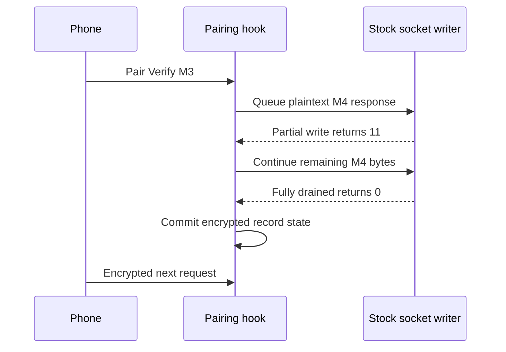

# Stock 210.81 HTTP boundary for hook/wireless

_MHI2Q wireless CarPlay — technical reference, integrated 2026-09-29._

---

[Wireless overview](README.md) · [Current stock210 lifecycle](STOCK210_RECEIVER_LIFECYCLE.md)

Maintained technical reference. The evidence below distinguishes static analysis, local QNX tests and observations from the unit.

Implementation and local diagnostic paths in this record refer to the [original source directory](../../wireless/). Run `wireless/...` commands from the repository root; moving this note does not move binaries or logs.

## 📊 Component flow

Offline IDA analysis, 2026-09-28/29. Target MU1316 P5087 `eso/lib/libairplay.so`,
SHA-256 `01c116b1674215daa0602d556a6d9b2eb48c2113ca294ea1f5d58787e3f656f2`.
Addresses below are ELF-relative ARM addresses. The original library is unchanged.

## 🔄 Delegates and connection lifetime

`HTTPServerCreate` at `0x6c324` copies 11 ARM32 delegate words to server+64.
AirTunes installs connection-initialize in slot 6 (`0x31620`), finalize in slot 7
(`0x2ebc4`) and request dispatch in slot 9 (`0x302e0`).
`HTTPConnectionCreate` copies the connection delegate to connection+20,
creates both messages, assigns the socket, then invokes initialize. Its CF
allocation is 200 extra bytes plus the 8-byte object header.

| Connection byte offset | Type | Meaning |
|---:|---|---|
| 8 | pointer | Stock AirTunes context; hook must preserve it |
| 40 | function pointer | Request dispatch callback |
| 56 | int32 | Socket descriptor, assigned before initialize |
| 192 | int32 | HTTP state: 0 read, 1 write |
| 196 | pointer | Request HTTPMessage |
| 200 | pointer | Response HTTPMessage |

The hook copies the server delegate rather than modifying its stack storage.
It invokes original initialize first; its per-connection state is external to
the stock object. Finalize releases that state and invokes original finalize.
This preserves stock MFiSAP/receiver session ownership.

## 📋 Stock HTTPMessage, not a 280 structure

Offsets verified by `HTTPMessageReadMessage` (`0x6a3cc`), Create (`0x6a534`),
Reset (`0x6a230`) and the HTTP state machine (`0x6b9a4`).

| Byte offset | Width | Meaning |
|---:|---|---|
| 16 | 8192-byte buffer | HTTP header storage / HTTPHeader base |
| 8208 | u32 | Header bytes used |
| 8212 / 8216 | pointer / u32 | Extra bytes already read after header/body |
| 8220 / 8224 | pointer / u32 | Method token and length |
| 8268 / 8272 | pointer / u32 | Path token and length |
| 8328 | u64 | Parsed Content-Length |
| 8336 | u8 | Keep-alive flag |
| 8344 | u8 | Header parsed |
| 8348 / 8352 | pointer / u32 | Body storage and length |
| 8356 / 8360 | u32 / u32 | Maximum body size / bytes read |
| 40384 / 40388 | pointer / int32 | Pending response iovec and count |

The encrypted reader invokes the **stock** `HTTPHeader_Parse` and
`HTTPMessageSetBodyLength`. It preserves partial headers, body offsets and
extra bytes. Private 280 CF objects never cross into stock 210.

## 📋 Exact plaintext-to-encrypted transition

`HTTPConnectionSendResponse` only prepares the response iovecs and sets state=1.
The state machine calls `SocketWriteData` (`0x7d208`) at `0x6b9e4`.
This function updates the iovec pointers after partial writes; return 11 means
wait for writable, and return 0 means the full response drained.

There is **no response-completion delegate** in this version. Therefore the
framework wraps `SocketWriteData`, sends Verify M4 through the original
function, and commits encryption only on return 0. The next iteration resets
messages and enters the encrypted reader. Errors close the connection; they
must never silently revert an encrypted socket to plaintext.

The module derives server read=`Control-Write-Encryption-Key` and server
write=`Control-Read-Encryption-Key`, both with `Control-Salt`, from the completed
Verify context. The SDK's 64x64 ChaCha/Poly1305 transport owns record framing and
nonces. Global libc read/write are not interposed.

## 🔐 Stock MFi seam

`APSMFiPlatform_CreateSignature` (`0x730b4`) accepts a 20-byte SHA-1 digest,
opens `/dev/i2c8`, locks the device, writes/signs/reads, then unlocks/closes.
`APSMFiPlatform_CopyCertificate` (`0x72ddc`) copies the cached certificate or
opens/locks/reads it when the cache is absent. Its output and signature output
use malloc ownership. Neither adapter needs to replace the stock chip driver.
These paths have not been exercised on the head unit by this change.

## 📋 Guards and limits

The first adapter pinned six 16-byte instruction prefixes: Create, request
dispatch, message read, socket write, state machine and original finalizer.
The current [fingerprint table](../../hook/wireless/stock210_fingerprint.h)
contains 23 prefixes after the media/readiness extensions.
`cp210_matches` also checks ARM32 and the Create/request relative addresses.
This is an ABI guard for the pinned image, not a whole-file integrity check.

Pairing is enabled only in wireless owner mode with an explicit module flag.
The first implementation covered Setup/Verify and encrypted control only.
Current [media adapters](STOCK210_MEDIA_CRYPTO_ABI.md) also require
`MHI2Q_CP_WIRELESS_MEDIA=1`; without that flag encrypted SETUP returns461.
Feature bits37/38 and pi are now published only after the guarded
[readiness contract](STOCK210_RECEIVER_LIFECYCLE.md) succeeds.
