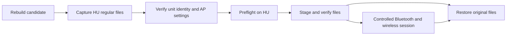
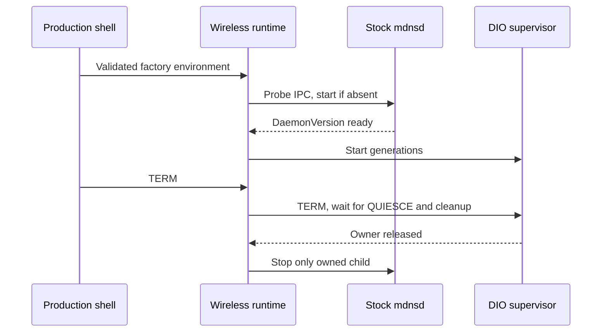

# Stock210 first physical wireless test

_Prepared 2026-10-17. Local and QNX checks are separate from physical HU results._

[Wireless index](README.md) · [Wi-Fi audit](../stock-patches/README.md) · [Receiver lifecycle](STOCK210_RECEIVER_LIFECYCLE.md)

## 📦 Candidate and boundaries

Build the current candidate with
[`build_stock210_hu_test.py`](../../wireless/integration/build_stock210_hu_test.py).
It rebuilds the production hook with audio, production btstack graft, PF,
stock210 bridge, owner/supervisor, wrapper and default-feature QNX daemon.
The archive is `wireless/out/mhi2q-stock210-hu-test.tar`, mode 0600, with a
SHA-256 sidecar. Its manifest records payload hashes, source commit, source
file hashes including uncommitted work, Docker image IDs and readiness flags.
The September review archive and historical280 installer are separate outputs.

The October 18 native Bluetooth API test also corrected the Rust daemon's
Identification capability lists: native iOS rejects declaring the implicit
`1D00..1D03` exchange as supported application messages. The corrected profile
reaches `AA05`, `1D02` and Wi-Fi configuration request `5702` in vphone; see
[native bootstrap evidence](../archive/internal-reference-2026-10-29/carplay-lab/VPHONE_LAB.md#native-bluetooth-bootstrap-checkpoint-2026-10-18).
That API test is not a full production daemon/native-phone wireless session.

| Installed component | Destination / policy |
|---|---|
| Production Bluetooth graft | Replace exact stock MU1316 `btstack`; no synthetic graft |
| Four wireless PF profiles | Replace exact reviewed wired profiles; no automatic PF reload |
| Owner-aware wrapper | Replace exact reviewed current wired wrapper; preserve its vehicle/audio policy |
| Wireless hook and APAC | New `libcarplay_wireless_stock210.so` and `libcarplay_wireless_apac.so` under hooks |
| Daemon, bridge and owner/supervisor | New files under `/mnt/app/root/hooks` |
| mDNS runtime and IPC probe | New `wireless_runtime` and `mhi2q_mdns_probe`; stock responder stays unchanged |
| Per-unit environment | New `wireless_carplay.env`, mode 0600 |
| Factory `libairplay.so` and `dio_manager` | Hash-checked dependencies; never replaced |
| Factory `mdnsd` and `libdns_sd.so.1` | Hash-checked dependencies; never replaced |
| Existing wired hook, optional APAC and monitor/helpers | Captured dependency hashes; wired mode uses its existing hook/APAC |
| Existing `rc.local`, AP and radio firmware | No replacement, tuning or persistent wireless autostart |

The first session enables main-screen **110** and PCM audio. Wireless paired
stream 111 remains disabled. Physical MFi defaults to `/dev/i2c8`, address
0x11; software-MFi fixtures do not establish trust with an ordinary iPhone.



## 🔧 Build and baseline

The C image is `qnx65-armv7-toolchain:latest`. Rust callers use the explicit
`qnx65-armv7-toolchain:8.5-rust` image, overridable by `QNX_RUST_IMAGE`; `latest`
may be C-only. To reproduce the Rust image in the sibling toolchain repository:

```sh
docker build --platform=linux/amd64 --target with-rust --build-arg BASE=base-8.5 \
  -t qnx65-armv7-toolchain:8.5-rust .
```

Without arguments the kit contains empty identity/AP fields and a pending
baseline. Installation deliberately refuses this incomplete kit:

```sh
python3 wireless/integration/build_stock210_hu_test.py
```

Capture live files into a private ignored directory mirroring absolute HU
paths, for example `build/hu-baseline/mnt/app/...`. Read regular files over
SSH; this step needs no `uaputl`, interface mutation or driver query.

| Required captured paths | Purpose |
|---|---|
| `/mnt/app/eso/bin/apps/btstack` | Exact graft input |
| `/mnt/app/eso/lib/libairplay.so`, `/mnt/app/eso/bin/apps/dio_manager` | Stock receiver guards |
| `/mnt/app/armle/usr/sbin/mdnsd`, `/mnt/app/armle/usr/lib/libdns_sd.so.1` | Stock mDNS responder and client guards |
| `/mnt/system/etc/pf.conf`, `pf.ecm0.conf`, `pf.mlan0.conf`, `pf.ppp0.conf` | Exact firewall inputs |
| `/mnt/app/root/hooks/carplay_startup.sh` | Exact wrapper input |
| `/mnt/app/root/hooks/libcarplay_hook.so`, `carplay_monitor.sh`, `carplay_processes.sh` | Wired dependency guards |
| `/mnt/app/root/hooks/libcarplay_apac.so`, when present | Additional wired dependency guard |

Also retain `rc.local` for recovery/activation review; the installer does not
write it. Do not collect pairing private keys. A captured source mismatch
requires reviewing and rebasing the relevant transform; changing a pin merely
to silence the guard is insufficient.

Use the generated `wireless/integration/out/wireless_carplay.stock210.env.example`
as the private per-unit config. Verify actual AP SSID/passphrase/channel/IP,
Bluetooth address, free IE slot and stable receiver Device ID. Do not guess
these values or print credentials. Store the config under ignored `build/`,
mode 0600. The kit appends the first-session monitor setting and separate
wireless library paths.

### Plaintext AP password on this MU1316

The generated `uaputl.cfg` contains a 64-hex WPA2 PSK, not the original
password accepted by the daemon's passphrase field. The live HU persistence
snapshot established the following records in
`/mnt/persist/var/fw/persistence.sqlite`:

| Logical partition name | Key | Observed value |
|---|---|---|
| `0x01b800e1` / decimal `28836065` | 39 | Plaintext AP password |
| Same | 62 | AP IPv4 address |
| Same | 37 | Subnet mask; not an SSID |

Join `persistence-data.partition` to `persistence-partitions.id`; the logical
partition identifier is the latter table's `name`, not its row ID. Observed
type-2 values have a zero byte, a big-endian 16-bit UTF-8 byte length and the
string. These mappings are verified on this unit, not asserted for every
firmware. The snapshot contains credentials and must remain private/ignored.

[`hu_ap_config.py`](../../wireless/integration/hu_ap_config.py) reads the
snapshot in SQLite read-only mode, validates framing, reads actual SSID and
channel from the generated AP config, and checks
`PBKDF2-HMAC-SHA1(password, SSID, 4096, 32)` against its PSK. It writes only a
new mode-0600 AP environment file and prints no credential values:

```sh
python3 wireless/integration/hu_ap_config.py \
  --baseline build/hu-baseline --output build/hu-ap.env
```

Use these four verified AP fields in the private unit config. The unit's
`deviceID` and Bluetooth ID were read from stock AirPlay `/info` over the SSH
TCP forwarding channel while ordinary wired CarPlay ran. The iAP2 serial in
the test config is a stable identifier derived from that Bluetooth address,
not a claim to have recovered a factory serial number.

Name, manufacturer and firmware now come directly from the active stock
`dio_manager.json` (`iap2.accessoryIdentification`). Leave those three values
out of the private environment; legacy `MHI2Q_CP_NAME`,
`MHI2Q_CP_MANUFACTURER` and `MHI2Q_CP_FIRMWARE` are ignored. Keep the explicit
model, serial and hardware fields because the reviewed factory JSON does not
contain them. Both installer `--check-config` and the launched daemon require
the file to be readable and valid. The launch environment selects it through
`IPL_CONFIG_DIR_DIO_MANAGER`, then `IPL_CONFIG_DIR`, with default
`/etc/eso/production`. Point both DIO and the daemon at the same active config.
See [identity sources and validation](IAP2_DAEMON.md#factory-identity-and-wireless-capabilities).

```sh
python3 wireless/integration/build_stock210_hu_test.py \
  --baseline build/hu-baseline --config build/hu-unit.env
```

## 🛠️ Staging and recovery

Verify the archive against its sidecar before extraction to a private staging
directory on a filesystem supporting directories and executable files. QNX
RAM `/tmp` is unsuitable for such a directory tree. The live HU has only
about 6.5 MiB free on `/mnt/persist`, insufficient for this archive plus its
extraction; reserve that small partition for pairing/locks. `/mnt/app` had
about 186 MiB free during the baseline capture. Remount it writable for a
private staging directory under `/mnt/app/root`, or use a verified external
filesystem with sufficient free space. The bundle may contain AP credentials
and must stay private.

On the HU, with `MHI2Q_STAGE` pointing to the extracted kit:

```sh
export MHI2Q_STAGE=/mnt/app/root/mhi2q-stock210-test
export MHI2Q_ENABLE_HU_INSTALL=1
sh "$MHI2Q_STAGE/integration/install_stock210_test.sh" preflight
sh "$MHI2Q_STAGE/integration/install_stock210_test.sh" install
```

Preflight validates bundle hashes, exact current files, dependency hashes,
first-session settings and daemon `--check-config` without radio/MFi access.
Installation tests persistent owner-lock behavior, backs up replacements as
`*.stock210-prev`, writes same-directory temporary files and verifies each
payload. Temporary basenames fit QNX4's 48-byte limit. A persistent installer
lock prevents concurrent mutations. Ordinary failures/signals attempt rollback;
power loss or SIGKILL require explicit recovery. Retain the exact extracted
kit until recovery and hardware validation finish.

```sh
sh "$MHI2Q_STAGE/integration/install_stock210_test.sh" rollback
```

Rollback checks all backups and owned files before changing any of them.
Manual edits are preserved by refusing the operation. It restores files only:
running processes and loaded PF rules still require controlled stop/restart.
After an interrupted installer, first establish that its process is gone and
inspect the lock/backups before clearing its stale installer lock. Never
remove an active owner's locks or reuse an incomplete installation.

No installer action starts/stops processes, reloads PF, restarts Bluetooth,
reboots, or adds autostart. Before activation, validate each PF profile in its
actual interface context, identify the factory Bluetooth launcher and preserve
its one-owner behavior. Activate the graft with a controlled factory restart
or clean reboot, then start the supervisor manually. Do not run a second
btstack or hotpatch a running Bluetooth process.

The first physical acceptance sequence is Bluetooth discovery → RFCOMM/iAP2 →
physical MFi → Wi-Fi association/Device IE → consistent Bonjour and PairSetup
`pi` → encrypted control → decoded screen 110 and audio. Release the iPhone's
wired session for the wireless test. Record the first failing stage, followed
by reconnect and USB takeover/release checks. A Bluetooth connection alone is
not evidence of working wireless media.

## ⏱️ Radio command deadlines

The production capture engine bounds pipe polling and child waiting to three
seconds, followed by bounded TERM/KILL cleanup. It drains excess output,
requires both EOF and child completion and never signals an already reaped
PID. Native QNX descriptor mapping remains separate from the POSIX host path.
Synchronous spawn and an operation already blocked inside a driver cannot be
made cancellable by this userspace deadline.

Every command first atomically creates `/tmp/mhi2q_wifi_control.pending`.
Only observed completion releases it. Timeout, interrupted parent or cleanup
failure leaves it in place: later daemon generations and IE cleanup refuse
new commands. There is no automatic marker deletion. Verify HU recovery
before removing a stale marker; absence alone does not prove driver health.

`MHI2Q_CP_IE_MONITOR_SECONDS=0` disables periodic IE GETs for the first session.
Initial install/readback and cleanup still use `sys_cfg_custom_ie`. The default
monitor remains five seconds; explicit supported values are zero or 5..3600.
This command is different from the malformed scan-channel GET involved in the
[freeze investigation](../stock-patches/README.md).
No custom-IE driver hang has been demonstrated.

## 🧪 Validation and current limits

### Live HU preparation, October 17

The baseline was captured over SSH on the unit. Factory `btstack`, AirPlay
210.81, `dio_manager` and all four PF inputs matched the reviewed sources.
The live wrapper hash `95a94cc9…` differs from the current repository wrapper
only in mask-worker comments; the builder explicitly accepts and preserves
that reviewed variant. Wired `/info` returned HTTP 200 with stock 210.81 and
matching Device ID/Bluetooth ID. The native QNX daemon's corrected unit config
passed `--check-config` without radio or MFi operations.

The private kit was uploaded to `/mnt/app/root/mhi2q-stock210-test` and its
archive digest verified. Live `pfctl -nf` accepted default, ECM and MLAN
profiles, both original and candidate. Both PPP profiles failed identically
with `SIOCGIFMTU: No such device or address`; that interface context remains
unverified. No rules were loaded.

Full preflight then refused a changed wired-hook dependency: the captured
`libcarplay_hook.so` was 1,238,287 bytes / `5464dccb…`, while a later read was
1,271,485 bytes / `6121e44f…`. This preparation did not write that file.
The follow-up read confirmed the latter hook hash and unchanged wrapper/APAC.
Current wired dependencies were recaptured into private
`build/wireless-hu-baseline-current`; the kit was resealed, uploaded with digest
verification and **full live preflight passed**. This refresh changes the
expected dependency snapshot and preserves the current wired binaries.

### First runtime attempt and offline checkpoint

After USB release the installer completed on the HU. An initial manual
supervisor launch failed before receiver startup: the SSH environment lacked
`IPL_CONFIG_DIR`, so the factory framework tried `./config/framework.json`.
The production SI path inherits `/etc/eso/production` from
`armle/scripts/env.sh` and supplies `IPL_CONFIG_DIR_DIO_MANAGER` and library
paths in `carplay_child.json`.

With those explicit factory settings, the physical HU ran one wireless DIO
owner and the ordinary daemon. The production bridge selected **800×480**
from the stock display table, created the stock receiver, installed property
handoff and exposed ports 5000/57343; the daemon listened on 57342. `/info`
returned HTTP 200, stock 210.81, a persistent pairing `pi`, wireless feature
bits and only audio types 100/101. This confirms receiver initialization and
advertisement data, not decoded video or a phone's wireless authentication.

The supervisor was stopped through its normal TERM path. The bridge reported
`quiesce idle result=0`, the generation stopped, no owned runtime remained,
and the complete installer rollback restored original files on the live HU.
This also exercised the actual recovery path, beyond the QNX4 fixture.

The launch script now supplies the factory config defaults and library paths,
preserves explicit overrides and refuses missing framework/DIO JSON before
exec. Its host environment regression passed. The revised kit was resealed,
uploaded with digest verification and **reinstalled successfully** before the
car went offline. The installed revised script has not yet been launched
without explicit environment overrides on the HU.

At the offline checkpoint the revised files and rollback backups are on the
HU. Existing wired hook/APAC and `rc.local` are preserved. No new production
`btstack` process was launched, no reboot was issued, and active PF rules were
not reloaded. The old running Bluetooth image had therefore remained active
until power-off. No test supervisor or DIO owner was deliberately left running.

The stock `mdnsd` binary exists, but no running responder/5353 listener was
observed during this attempt. It was not started on the HU. The offline mDNS
implementation below is newer than the installed environment-fix kit.

### Offline mDNS ownership, October 18

[`wireless_runtime.c`](../../wireless/integration/wireless_runtime.c) wraps the
native generation supervisor. It holds an exclusive persistent runtime lock,
checks the stock DNS-SD IPC endpoint and queries `DaemonVersion` through
[`mhi2q_mdns_probe`](../../wireless/integration/mdns_probe.c). The API must
return a nonzero 32-bit version; socket or process existence alone does not
mean ready. Each probe runs as a bounded child because the stock library can
retry or block. The DNS-SD property ABI is documented upstream.[^dns_sd]

An already responsive responder is adopted and never signalled. An absent
endpoint causes the runtime to launch stock `mdnsd -f` as its direct child and
wait for an IPC reply before starting the supervisor. An existing but
unresponsive endpoint fails closed. The runtime probes health periodically;
loss of IPC or exit of its responder stops the supervisor. It signals only
unreaped direct children, with bounded waits.



Normal stop waits for the supervisor's QUIESCE/daemon/IE cleanup before
stopping an owned responder. If the supervisor will not finish or the kernel
DIO lock remains held, the runtime returns failure and preserves mDNS for
recovery. It does not force-kill the supervisor or an active DIO owner.

The real shell fixture exposed another stock behavior: DIO stops an existing
`mdnsd` during media teardown even when it did not launch that process. The
stock210 bridge now delegates that stop to the runtime only in managed
wireless mode. The `kill` interposer requires the pinned CProcessHandler
return address `0x1472FC`, matching instruction bytes, TERM/KILL and a target
whose executable path matches the configured stock responder, verified through
QNX procfs. Other callers, other executables and the wired path retain stock
behavior. No factory ELF on disk is patched.

The ordinary wired hook keeps this factory behavior: an actual wired DIO can
stop the shared responder during its teardown. The outer runtime therefore
suspends its inner supervisor when the DIO owner and wired-priority kernel
locks identify the same PID. It retains the exclusive runtime lock, reaps its
own responder while waiting, and resumes only after wired priority and the
DIO owner lock are released. It then probes or restores discovery before
launching another wireless generation. A responder crash outside confirmed
wired ownership still fails closed.

| Setting | Default | Accepted range |
|---|---|---|
| `MHI2Q_CP_MDNS_READY_MS` | 8000 | 500..30000 ms |
| `MHI2Q_CP_MDNS_PROBE_MS` | 1000 | 100..3000 ms |
| `MHI2Q_CP_MDNS_HEALTH_MS` | 5000 | 200..30000 ms |
| `MHI2Q_CP_RUNTIME_STOP_MS` | 25000 | 1000..60000 ms |

The default lock is `/mnt/persist/.mhi2q_mdns_runtime.lock`; it is an advisory
kernel lock, not a PID file. `MHI2Q_CP_MDNS_PRELOAD` is used only by the QEMU
fixture for its io-pkt IP_PKTINFO shim; physical configuration leaves it unset.
The full TCG media fixture allows a 3000 ms probe deadline to accommodate
crypto scheduling; the production default remains 1000 ms. Native fault
cases use a separate 500 ms deadline without concurrent media.

The exact installed environment-fix archive is retained privately as
`wireless/out/installed-stock210-envfix-20261018.tar` with its SHA-256 sidecar.
The new offline output is `wireless/out/mhi2q-stock210-mdns-offline-test.tar`.
It has a pending baseline and no unit credentials, so installation is refused.
Build it without overwriting the installed checkpoint:

```sh
python3 wireless/integration/build_stock210_hu_test.py \
  --output wireless/out/mhi2q-stock210-mdns-offline-test.tar
```

After the next boot, inspect installed files/processes before changing them.
Collect the two additional mDNS dependency guards from the HU and rebuild a
private complete kit with the reviewed original baseline. Stop and roll back
the old installation with its exact kit before installing the new revision.
Then launch the production supervisor shell manually and verify Bonjour
identity before RFCOMM/MFi/Wi-Fi/media acceptance. These offline changes have
not been installed or run on the physical HU.

### Reproduction

Reproduce from the repository root:

```sh
cargo test --offline --manifest-path wireless/daemon/Cargo.toml
python3 wireless/daemon/probes/qemu_wifi_ie.py --delayed-ap-qemu
python3 wireless/daemon/probes/qemu_wifi_ie.py --timeout-qemu
python3 wireless/integration/test_dio_owner_exec.py
python3 wireless/integration/test_install_stock210_test.py
python3 wireless/integration/test_hu_ap_config.py
python3 wireless/integration/test_supervisor_env.py
python3 wireless/integration/test_wireless_runtime.py
python3 wireless/integration/qemu_install_wireless.py --stock210
```

The timeout fixture tests real QNX children: normal stdout/stderr, closed stdin,
exit failure, output overflow, EOF before exit, TERM-resistant hang, continuous
output, deadline/reap and marker persistence across two probe processes. The
same C engine also passes host ASan/UBSan. Installer tests exercise exact-input
refusal, partial-write rollback, integrity failure and wired-file preservation;
the native QNX installer fixture uses a disposable QNX4 RAM disk and real QNX
daemon/config/owner checks, with synthetic unit identity and AP settings.

The combined [stock210 lifecycle](../archive/internal-reference-2026-10-29/wireless-carplay/STOCK210_RECEIVER_LIFECYCLE.md#reproduction-and-deliverables)
was rerun successfully after the daemon changes: independent encrypted
control/media, two media generations, PCM/microphone, USB priority and wireless
resume. Fake MFi, Bluetooth/Wi-Fi peripherals and decoder input stubs remain
laboratory limits. Physical authentication, decoded output, radio behavior,
iPhone throughput and production frame pacing remain unverified.

The October 18 fixture executes the unmodified production supervisor shell,
generated wrapper, monitor and helper script under the stock QNX shell. It
first requires exit 78 for missing factory JSON, then removes inherited SI
config/library variables and runs the real launch path with factory defaults.
Repeated-exec files live on the disposable QNX4 disk. Only device/decoder,
loopback/IP_PKTINFO, phone, MFi and mesh dependencies are test substitutes.
The former C wrapper stand-in is no longer used by this lifecycle fixture.
The wired child now executes the generated wrapper, production owner helper,
ordinary wired hook and stock DIO. QNX procfs and the loaded ELF header identify
the wired image; kernel locks establish exclusive ownership. This is still
not USB enumeration or an actual wired phone. With no USB disconnect producer,
idle wired DIO exceeds the TERM deadline and the fixture explicitly kills only
that known child, modeling an SI watchdog. Discovery recovery after that
forced stop is covered; normal physical USB teardown remains unverified.
The guest log is
qemu_stock210_lifecycle.log (`wireless/receiver_bridge/out/qemu_stock210_lifecycle.log`; local generated artifact).

The native runtime fault driver uses the production runtime, factory `mdnsd`
and DNS-SD library with a controlled inner executable. It checks exclusive
runtime rejection, external responder adoption/preservation, hung external
IPC, owned responder crash and stale IPC refusal, owned IPC loss, inner stop
refusal and a held QNX owner lock. These controlled-inner cases are distinct
from the real encrypted-media refusal test below. SIGKILL leaves the factory
Unix endpoint behind: production refuses a new launch; only the disposable
fixture removes the captured stale inode after verifying responder exit.

The October 18 final combined run passed all three wireless generations, two
encrypted media sessions, stable `pi`, the real wired-wrapper takeover and
wireless resume, discovery restoration, three unrelated-process TERM checks,
ordered final stop and all seven native runtime fault cases. The wired
watchdog and synthetic peripheral limits above still apply.

Run the independent active-media stop case separately:

```sh
python3 tests/carplay_lab/qnx/qemu_capture.py --wireless-hook-qemu \
  --wireless-media-qemu --wireless-lifecycle-qemu --wireless-active-stop-qemu \
  --mesh --start-experiment --seed-display --skip-hid-qemu --mdnsd \
  --mock-mac-qemu --interface-lo0-qemu
```

This case passed: one real stock210 media owner receives encrypted screen/PCM;
QUIESCE returns BUSY; TERM makes the runtime return failure within its bound
while preserving the same DIO, daemon and mDNS. The independent phone then
performs TEARDOWN and the fixture explicitly stops the preserved processes,
clears its IE and stops its responder. A TERM-interrupted fake IE command can
leave a pending lease. The fixture may remove that exact recorded daemon's
lease only after all fake CLI processes have exited; no real driver ioctl is
involved. Production never automatically removes such a marker. A physical
HU requires actual driver recovery verification before clearing one.
The guest log is
qemu_stock210_active_stop.log (`wireless/receiver_bridge/out/qemu_stock210_active_stop.log`; local generated artifact).

Host ASan/UBSan runtime checks cover readiness ordering, exclusive ownership,
external adoption, IPC loss, responder crash, hung/failed probes, startup
deadline, interrupted startup, wired suspension/discovery recovery and
preservation with a held DIO lock. Host and
native QNX4 installer tests include the two new executables, unchanged mDNS
dependencies, injected partial failure and complete rollback. For the separate
offline archive, pass it explicitly to both installer tests:

```sh
python3 wireless/integration/test_install_stock210_test.py \
  --archive wireless/out/mhi2q-stock210-mdns-offline-test.tar
python3 wireless/integration/qemu_install_wireless.py --stock210 \
  --archive wireless/out/mhi2q-stock210-mdns-offline-test.tar
```

[^dns_sd]: Apple mDNSResponder, `DNSServiceGetProperty` declaration and property format. https://raw.githubusercontent.com/apple-oss-distributions/mDNSResponder/main/mDNSShared/dns_sd.h
