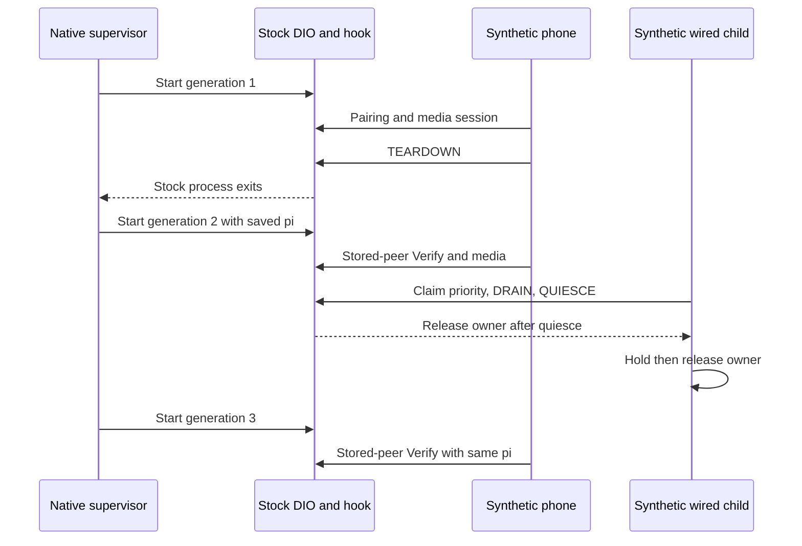

# Stock210 wireless readiness, restart and wired priority

_MHI2Q wireless CarPlay — technical reference, integrated 2026-09-29._

---

[Wireless overview](README.md) · [Pairing and media validation](STOCK210_VALIDATION.md)

Maintained technical reference. The evidence below distinguishes static analysis, local QNX tests and observations from the unit.

Implementation and local diagnostic paths in this record refer to the [original source directory](../../wireless/). Run `wireless/...` commands from the repository root; moving this note does not move binaries or logs.

## 📊 Component flow



2026-09-29, offline candidate. The receiver remains the original MU1316
`libairplay.so` 210.81, SHA-256
`01c116b1674215daa0602d556a6d9b2eb48c2113ca294ea1f5d58787e3f656f2`.
No original firmware ELF was changed. No HU connection, installation, process
restart or reboot was performed.

<a id="production-components"></a>

## 📋 Production components

`hook/wireless/advertisement.c` adds the persisted pairing identifier `pi` to
stock Bonjour TXT and `/info`. `AirPlayGetFeatures` is the shared stock call
used by both representations. In wireless owner mode, with pairing storage,
the exact-image HTTP adapter, media primitives and CF helpers available, it
adds bits 37/38. It removes AAC-LC bit 20 and unencrypted-audio bit 22, and
keeps the actual stock MFi-SAP capability. It preserves sourceVersion 210.81,
deviceID and stock display configuration.

The final `/info` callback restricts audioFormats to stream types 100/101 and
the supported PCM16 mask (bits 2..11, 14, 15). It removes extended and type103
advertisements from optional wired audio modules. Stream110 video is handled
by the stock screen path plus the existing wireless crypto adapter. Pairing
alone, media disabled, an ABI mismatch or unavailable identity cannot produce
wireless receiver readiness. The ordinary wired build omits these exports;
the wireless artifact also gates activation on owner mode `wireless`.

`bridge.c` has an explicit `MHI2Q_BRIDGE_STOCK210` build: port5000, both feature
bits, hook readiness, guarded manager callbacks, a successful Bonjour
registration containing pi, and a responsive `/info`. IDENTITY operation5
returns pi only for the active START generation and only when it matches the
hook store. The Rust daemon binds this value to iAP2 StartSession field4.
It now defaults to receiver profile `stock210` (210.81/5000); the old
`experimental280` profile requires an explicit selection (280.33.8/7000).
Mismatching configured source versions or ports are rejected.

Bonjour registration here means the DNS-SD API accepted the advertisement.
Actual multicast discovery on uap0 remains a hardware validation item.

<a id="verified-stock-seams"></a>

## 📋 Verified stock seams

Addresses below are in the target210 shared object unless marked dio_manager.

| Address | Verified behavior / use |
|---|---|
| `0x20D24` AirPlayGetFeatures | uint64 result in r0/r1, stock platform feature bits ORed with its base mask. |
| `0x21054`, `0x223F4` | Bonjour and `/info` consume that exported feature function. |
| `0x211C8` → LR `0x211CC` | TXTRecordSetValue(srcvers,6,"210.81"). The guarded interposer appends pi to the same TXT record. |
| `0x21214` | DNSServiceUpdateRecord consumes the rebuilt TXT. The injection also covers updates and embedded txtAirPlay data, not only initial registration. |
| `0x201E4` SetDelegate | Copies **15 words / 60 bytes** to receiver+16. The 280 bridge's seven-word temporary is insufficient. |
| `0x2E9AC` EnsureCreated | Creates an independent AirTunesServerQueue and the stock11-word HTTP delegate. |
| `0x2EB20`, `0x6C094` | Assign that queue through HTTPServerSetDispatchQueue. Hook captures/retains it after the guarded create. |
| `0x20218` GetDispatchQueue | Returns receiver+12, the main queue; this is **not** the HTTP queue used for admission/drain. |
| `0x31764` StopAllConnections → `0x31684` | Synchronously traverses HTTP connection list. Must execute on its HTTP queue. |
| `0x2EBC4` ConnectionFinalize | Receiver context is HTTP+8; live session at context+244. Tears down/releases session, then clears it. |
| `0x220D0` ServerControl / `0x204E0` StopServers | Stock stopServer path, preserved. |
| `0x2E8E8` EnsureDeleted | Schedules HTTP stop with CFObjectSetProperty flags8; releases server/queue and frees AirTunes state. |
| dio `0x154AD8` | signalStopAirPlayMainThread dispatches the thread's stop at vptr+16. |
| dio `0x158928`, call `0x158978` | Stop calls CFRunLoopStop(CFRunLoopGetMain()). No suppression is installed. |

Functions were read in IDA, annotated and relevant types/locals corrected.
New hook seams extend the pinned instruction fingerprint list. The bridge
separately checks the complete 15-word copy sequence and existing DIO manager
callsite/delegate/property synchronization guards. All 15 fields are copied;
only existing property/session callback slots3/5/6 are wrapped.

<a id="queue-and-owner-lifecycle"></a>

## 🔄 Queue and owner lifecycle

`carplay_wireless_receiver_control(server,operation)` accepts only the current
stock gAirPlayReceiverServer and a captured/retained HTTP queue:

1. Idle stop: on that queue, check all tracked contexts for a live receiver
   session. Return BUSY if any exists. Otherwise close admission before invoking
   stock stopServer. A SETUP queued behind this check receives503.
2. Resume: reopen admission on that queue before the bridge restarts the stock
   server. A recreated HTTP server replaces the retained queue reference.
3. Wired drain: close admission and invoke stock StopAllConnections on its own
   queue. Stock finalizers own media teardown. The bridge permits this only
   while a process holds the wired-priority filesystem lock.

Bridge QUIESCE drains its property callbacks and verifies that the receiver
listener closed before the wired helper may signal the wireless owner. It
uses the same configured AirPlay port as START, including5000 for stock210.
The helper still obtains the owner PID from the kernel lock, not a PID file.

The native supervisor binds daemon/IE lifetime to the DIO owner. Stock full
media teardown can release the manager and exit the process; a fresh owner
and daemon then start after cleanup. The wired SI child holds priority while
connected, and a subsequent wireless generation waits for its release. This
keeps stock process shutdown semantics instead of holding the runloop open.

`/tmp` is writable RAM, but it does not supply the filesystem lock/rename
semantics used by the native owner helper in this QNX fixture. The stock210
wrapper and configuration put the generation marker at
`/mnt/persist/.mhi2q_dio_generation`, alongside the existing persistent lock
files. Both wireless and wired wrappers export that path to their monitors.
The marker is advisory; the kernel locks determine ownership. Pairing private
keys stay under `/mnt/persist/mhi2q-carplay/pairing`.

<a id="reproduction-and-deliverables"></a>

## 📦 Reproduction and deliverables

```sh
bash scripts/build_hook_wireless.sh
python3 wireless/receiver_bridge/build_offline.py --receiver stock210 --property-handoff
python3 tests/carplay_lab/qnx/qemu_capture.py --wireless-hook-qemu \
  --wireless-media-qemu --wireless-lifecycle-qemu --mesh --start-experiment \
  --seed-display --skip-hid-qemu --mdnsd --mock-mac-qemu --interface-lo0-qemu
python3 wireless/integration/build_stock210_review.py
```

The lifecycle fixture ignores the historical seed-display switch and obtains
dimensions from the stock DIO table through the production bridge. Fake QSA,
input-only OMX, loopback interface/MAC, device resources, MFi challenge answers
and Wi-Fi IE command remain QEMU peripherals. The independent iAP2 peer enters
at the graft's local byte-bridge protocol; it does not emulate a physical
Bluetooth radio or test a real RFCOMM connection.

The independent phone checks StartSession pi against signed PairSetup identity
and retains it across DIO restarts. Media checks retain the existing independent
SRP, signatures, record encryption, events, video input, PCM jitter-buffer and
microphone assertions. The lifecycle extension exercises a normal media
TEARDOWN, another media session ended by wired drain, then wireless availability
and stored-peer Verify in a third owner process. Its explicit USB child is a
test stand-in for SI's final child, not physical USB enumeration or a real
wired phone session. The production owner helper and supervisor are used.

The separate review archive contains hook, bridge, daemon, ownership helpers,
wrapper and launch/config templates. It contains no libairplay replacement and
no installer. Existing btstack graft, AP/firewall configuration and wired mod
files remain prerequisites; the historical280 installer must not install it.

<a id="validation-completed-2026-09-29"></a>

## 🧪 Validation completed 2026-09-29

The final combined run passed in
[qemu_stock210_lifecycle.log](../../wireless/receiver_bridge/out/qemu_stock210_lifecycle.log).
Three distinct owner/daemon generations advertised one persisted pi. The
independent peer compared iAP2 StartSession with signed PairSetup identity;
four decrypted `/info` responses agreed on pi, 210.81, feature bits and PCM16
formats. Stored-peer Verify succeeded after each owner replacement.

Two authenticated AVC frames reached stock OMX input, and exactly 160 valid
PCM packets reached the jitter buffer over two media sessions. Corrupted tags
were rejected; events and microphone encryption checks passed in both sessions.
The first session ended with HTTP200 TEARDOWN. The second ended through the
native wired helper's DRAIN path: active QUIESCE returned BUSY, unowned DRAIN
was rejected, then the priority lock holder drained and acquired ownership.
After the synthetic wired child exited, wireless resumed in generation3.
All three supervisor generations cleaned up their daemon and Wi-Fi IE.

Additional checks passed: separate pairing/control QEMU regression, 23 Rust
host tests, native owner/supervisor host tests, port5000 QUIESCE protocol test,
QNX cross-builds and C `-Wall -Wextra -Werror` syntax checks. The wireless hook
has 41 exact exports; the ordinary wired build retains 26 and passes its ABI
checks. Original receiver and DIO hashes match the pinned input images. Rust
cross-linking still emits the existing EABI attribute34 warnings; the daemon
runs in the QNX fixtures.

The production daemon (compiled without the probe feature) also passes the
separate [QNX synthetic phone/control regression](../../wireless/daemon/out/qemu_daemon_phone_control.log)
with the stock210 profile. Static btstack graft checks still pass 8/8.

| Current artifact | Bytes | SHA-256 |
|---|---:|---|
| `build/wireless/libcarplay_hook.so` | 1534909 | `1eb3caeac10b52c5714873b5f564b561e0eb7892037f6f6c9b4316f6ddbe4fe1` |
| `build/wireless/libcarplay_apac.so` | 696491 | `1c25799f4dd47549335cbc22cc9a059efab030d4e489937fc4d8460e341e09ce` |
| `receiver_bridge/out/libdio_receiver_bridge.stock210.offline.so` | 39213 | `7f6e48bfebfc3918d201e2643445c930f484d0e8c0b836038bf349dfc546ee48` |
| Production QNX daemon (without probe feature) | 551849 | `09189aeea9d24d748ad94eb66bdc3abf7211ed9c68471b480764952f03341a5a` |
| Combined lifecycle log | 138672 | `108dcec4539766afdf1ec45aa643927d3ef3516dbd0a1a4d95da64439384a0e8` |

The archive's `manifest.json` hashes every packaged file. Archive path:
`wireless/out/mhi2q-stock210-hook-review.tar`; adjacent `.sha256` records its
digest. Build/check logs are under `build/stock210-*` and
`build/wireless-readiness-build.log`.

Physical MFi Method1, current iPhone behavior, real decoded video/audio,
multicast, QNX6 persistence and SI/USB handoff remain unverified offline.
No hardware actions are authorized by this report or performed by the builder.
