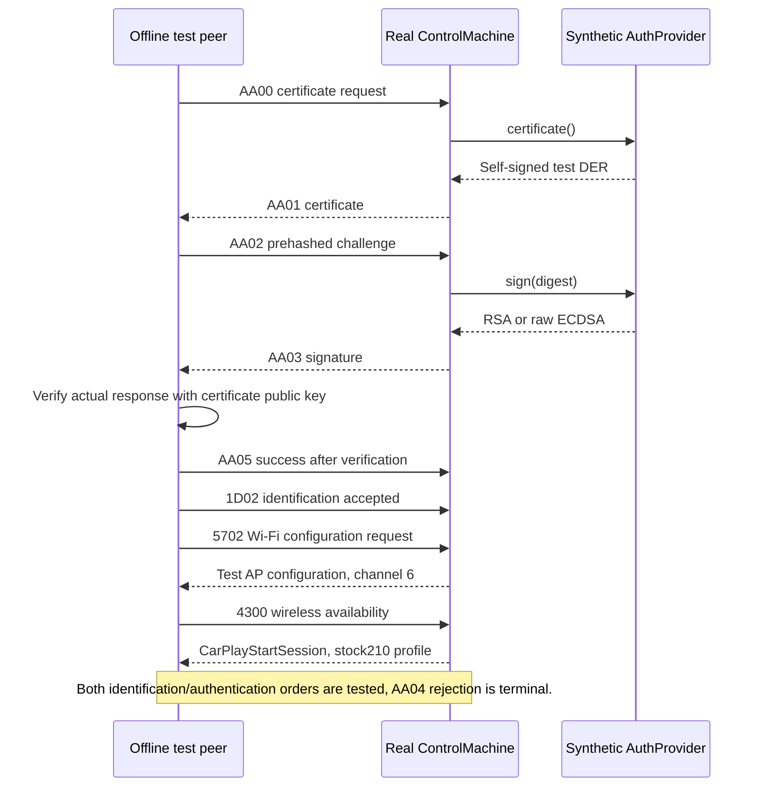
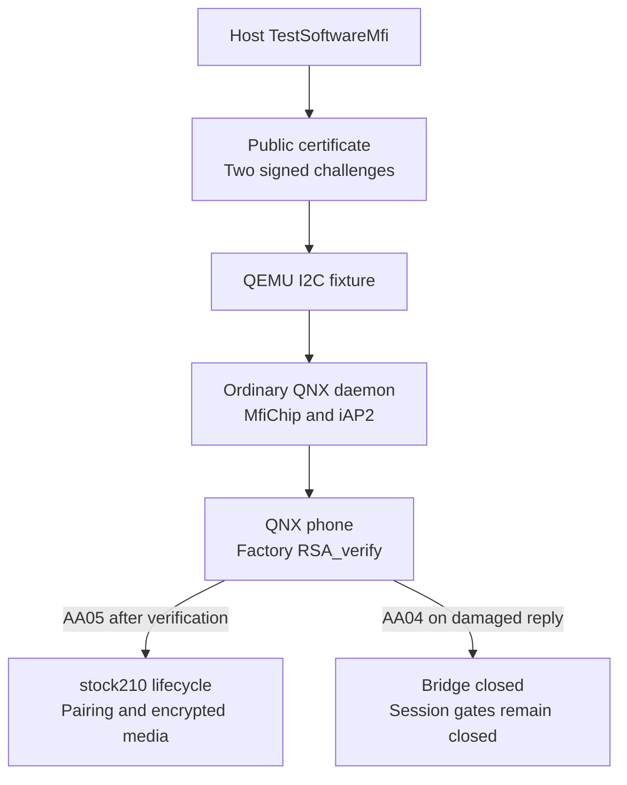

# Software MFi for offline tests

_Host crypto and iAP2 control validation · 2026-10-09._

---

[Wireless overview](README.md) · [iAP2 daemon](IAP2_DAEMON.md)

The active [vphone laboratory](VPHONE_LAB.md) uses the shared, integrity-checked
fixture and MFi-SAP service in `wireless/lab_common/`. Existing Inferno/iOS 14
authentication evidence below is historical; native iAP2 on vphone still needs
guest-specific transport validation.

## 🎯 Purpose and boundary

The optional `software-mfi-test` Cargo feature supplies `TestSoftwareMfi`, an
`AuthProvider` for the real Rust `ControlMachine`. Each instance generates a new
key and a self-signed certificate marked `NOT_A_REAL_MFI_IDENTITY`. This replaces
fixed dummy signature bytes in the new crypto tests with verifiable signatures.

The identity is **synthetic**: these tests do not establish Apple trust, real
iPhone acceptance, physical MFi operation, Bluetooth or 2.4 GHz radio behavior.
The certificate is test DER, not an Apple MFi certificate chain. The v3 profile
exercises a crypto format through iAP2 test messages; it does not implement
AirPlay MFi-SAP or add v3 support to the stock210 receiver.

Production retains `MfiChip` on QNX and `UnavailableAuth` on other targets.
There is no software-auth runtime selector or external credential loader. The
feature is disabled by default and its build script rejects QNX and non-Unix
targets. OpenSSL is invoked only by the host test provider.

A separate [DiPlay public-release identity fixture](../../wireless/fixtures/diplay_mfi/README.md)
records the P-256 private key and certificate extracted from the upstream 0.2.16
APK, with pinned provenance and hashes. Its key consistency was checked locally.
The provider and QNX daemon do not load this fixture; the automated tests
described here continue to use freshly generated synthetic identities.

The separate [iOS VM laboratory](IOS_VM_LAB.md) now uses that pinned public
fixture in an opt-in host signer. Emulated iOS `18A5351d` negotiated a native
iAP2 control session, issued a fresh 32-byte challenge, and accepted the 64-byte
P-256 response with `AA05`. Corrupted response and certificate signatures
produced `AA04`; the certificate rejection happened before a challenge.
Positive/negative response checks passed after restarting the guest. Native
identification returned `1D02`, wired availability returned `4300`, and the
actual UI accepted CarPlay approval. A direct NCM/QNX Ethernet link exchanges
native frames. Native Pair Setup/Verify and the lab-only live MFi-SAP responder
subsequently established a real CarPlay control session with QNX. Screen setup
reached 800×480 / 30 FPS. The lab-only codec-property workaround now passes
native A/B probes; the earlier screen traffic reported zero sent frames and Maps
crashes in VectorKit. A separate pixel probe finds an internal hardware-encoder
allocation failure under the default mode. Native `UnifiedEncoderMode=0` then
produced independently decoded 800×480 test frames. The VM-only native UI
surface adapter subsequently delivered actual CarPlay video to stock QNX;
independent decoding verified 31 frames and the Dashboard. The longer
60 guest-second run independently decoded 519 frames and measured screen
packet intervals in PCAP (10.84 access units/s over 47.78 host seconds).
This does not prove sustained 30 FPS, physical RF, audio or second-display
pixels. The QEMU-only paired AltScreen build negotiated a native 1440×542
CarInstruments display and stream 111, but no cluster video units arrived.
The legacy attempt stopped during control setup. The bounded native screen
result and recipe are
in the [native screen runbook](NATIVE_SCREEN_TEST.md). The software MFi results
do not add a live backend to the QNX preloader or production daemon,
and do not establish physical iPhone or CarPlay media behavior.

## 🔐 Test profiles

| Profile | Input to `sign` | Signature bytes | Independent prehash check |
|---|---|---|---|
| `LegacyRsaSha1` | Exactly 20 prehashed bytes | RSA-1024 PKCS#1 v1.5, 128 bytes | Recover SHA-1 DigestInfo and compare its digest with the original input |
| `V3P256Sha256` | Exactly 32 prehashed bytes | P-256 ECDSA, raw 64-byte `r || s` | Verify against the original message using a separate SHA-256 message-verification command |

RSA-1024 is a legacy test profile, not a key-strength recommendation. Signing
uses `pkeyutl` without `-rawin`; `-pkeyopt digest:sha1` or `digest:sha256`
selects digest encoding/length checks without hashing the digest again.[^1]
Strict DER/raw conversion rejects malformed, negative, zero, nonminimal,
truncated and trailing ECDSA values. Signature verification also rejects wrong
keys, changed digests and changed signatures.

## 🔄 Verified control exchange



The peer uses the public key extracted from its generated certificate. Tests
check that the certificate in the actual AA01 message matches that identity.
The protocol tests call the real `ControlMachine` directly, with encoded CSM
messages. They do not run an RFCOMM link, the daemon listener, receiver worker,
AirPlay session or hardware device.

## 🧪 Run and reproduce

Run from the repository root on a Unix host with Rust/Cargo, Clang and OpenSSL. No new
Rust dependencies are introduced; the vendored iAP2 crates remain local.

```sh
python3 scripts/test_software_mfi.py
```

The runner tests the default build, scans its binary for synthetic-provider
markers, runs the software-MFi and existing daemon tests, and verifies build
rejection for QNX and Windows. It also runs the actual I2C fixture decoder under
ASan/UBSan with 100,000 randomized inputs. It writes logs and a machine-readable result to
`build/software-mfi-validation/summary.json`. Success ends with `passed:` and
the summary path. A missing crypto tool or failed check produces `failed:` and
a nonzero exit status.

To also cross-compile the ordinary production daemon using the existing local
Docker toolchain image:

```sh
python3 scripts/test_software_mfi.py --qnx-cross
```

The image is `qnx65-armv7-toolchain:latest`. Its Rust standard-library build may
need network access to fill the container's crate cache; it does not connect to
the HU. The host Cargo tests run with `--offline`.

For just the feature tests:

```sh
cargo test --offline --manifest-path wireless/daemon/Cargo.toml \
  --features software-mfi-test
```

## 🔌 QNX and QEMU integration

The host-only `software-mfi-fixture` tool calls the same `TestSoftwareMfi`
provider to generate a fresh legacy RSA identity and two random 20-byte
challenges with their 128-byte signatures. Its private key is removed on host
drop. The QEMU image contains only the DER certificate and challenge/signature
records. This is a **precomputed, challenge-bound fixture**, not a live signing
service or a software credential installed on the HU.

The existing test I2C preload serves the certificate in 128-byte register blocks,
matches each actual written challenge with its fixture record, and rejects
unknown challenges. The ordinary default-feature QNX daemon still uses its
real `MfiChip`, QNX I2C shim, control machine and bridge/link framing.

The QNX phone verifies each actual AA03 response with `RSA_verify(NID_sha1)`
from the factory MU1316 `libcrypto.so.2`. It parses the entire actual certificate,
pins it to the generated test identity and checks a known-good signature before
accepting it. Changed digests and signatures must fail the same verifier.
Only after both different challenges pass does the phone send AA05. A damaged
reply triggers AA04 and must close the daemon bridge without opening Wi-Fi or
starting a CarPlay session. The verifier is compiled only for the QNX
`qemu-probe` feature; the host-only signer feature remains forbidden on QNX.



Run the complete offline matrix:

```sh
python3 scripts/test_software_mfi.py --qnx-qemu \
  --out build/software-mfi-qemu-validation
```

This additionally requires the existing QNX Docker image, local firmware/QEMU
inputs, `build/wireless/libcarplay_hook.so` and the pairing archive under
`build/wireless-sdk/`. The matrix includes the legacy dummy-mock regression,
two software-MFi sessions, transient NACK/short-read retries, persistent-NACK
timeout followed by a fresh successful session, actual signature corruption,
and the combined stock210 lifecycle with three owner generations. The combined
fixture separately validates CU pairing, encrypted media adapters, wired
takeover and wireless resume. It uses synthetic peripherals and input-only
fake OMX; this synthetic fixture does not prove decoded frames or physical
radio timing. Independent native-iOS video decoding is covered by the separate
[native screen test](NATIVE_SCREEN_TEST.md).

For a single bootstrap exchange:

```sh
python3 wireless/daemon/probes/qemu_daemon_bridge.py \
  --phone-probe --control-probe --software-mfi-qemu
```

Add `--software-mfi-tamper-qemu` to test AA04 rejection. A JSON beside each
software-MFi QEMU log records the public fixture hash, factory libcrypto hash,
verified challenge counts and session checks. The top-level summary records
source hashes and the complete matrix status. These artifacts remain local.

The verifier calls libcrypto directly. During bring-up, the factory `pkeyutl`
CLI printed successful verification while exiting with status 1, and an IFS
OpenSSL executable disappeared after its first execution. Neither CLI behavior
is used as authentication evidence by the final implementation.

## 📋 Validation coverage

| Check | Expected behavior |
|---|---|
| Both crypto profiles | Valid signatures verify with their certificate's public key |
| Independent prehash oracles | Signing hashes neither digest a second time |
| Tampering and wrong identity | Changed message, digest, signature or key fails verification |
| Control gates | Neither Wi-Fi nor CarPlay opens until both independent prerequisites complete |
| Invalid digest through CSM | Wrong sizes fail, gates remain closed, a subsequent valid challenge can succeed |
| Rejection and fresh session | AA04 remains terminal, a new control machine starts fresh |
| DER randomized checks | 100,000 arbitrary inputs and 100,000 raw-signature round trips, plus truncated/trailing variants |
| Host process errors | Missing executable/key, oversized output and a stalled tool fail closed |
| Temporary storage | Directory mode 0700, private key mode 0600, directory removed on normal drop |
| Production isolation | Default binary has no provider markers, unsupported target builds reject the feature |

Each tool invocation has a five-second process deadline and a 16 KiB captured
output bound. Use a trusted local OpenSSL executable. Error messages do not
dump key material or process stderr. Keys are generated in temporary private
directories and removed on normal drop, including construction failure; an
abrupt process kill can leave temporary files for the host to clean up.

## 🔗 Implementation

| Component | Source |
|---|---|
| Synthetic provider and DER checks | [software_mfi_test.rs](../../wireless/daemon/src/software_mfi_test.rs) |
| Crypto and actual CSM integration tests | [software_mfi.rs](../../wireless/daemon/tests/software_mfi.rs) |
| Repeatable validation runner | [test_software_mfi.py](../../scripts/test_software_mfi.py) |
| Host public fixture generator | [software_mfi_fixture_main.rs](../../wireless/daemon/probes/software_mfi_fixture_main.rs) |
| I2C test fixture | [mock_mfi_qemu.c](../../wireless/daemon/probes/mock_mfi_qemu.c) |
| QNX phone verification | [software_mfi_phone.rs](../../wireless/daemon/probes/software_mfi_phone.rs) · [software_mfi_verify_qemu.c](../../wireless/daemon/probes/software_mfi_verify_qemu.c) |
| Target restriction | [build.rs](../../wireless/daemon/build.rs) |
| Hardware signer | [mfi.rs](../../wireless/daemon/src/mfi.rs) |

[^1]: OpenSSL documentation, [openssl-pkeyutl](https://docs.openssl.org/3.5/man1/openssl-pkeyutl/), prehashed input and digest options.
