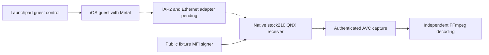

# vphone CarPlay laboratory

_Active guest platform · 2026-10-11 · Branch `feat/vphone-carplay-lab`._

[Wireless overview](README.md) · [Retained Inferno evidence](IOS_VM_LAB.md) · [Software MFi](TEST_SOFTWARE_MFI.md)

## 📋 Decision and measured state

The laboratory now targets **vphone** for the iOS guest and retains the native
stock-210 QNX receiver. The user requested this migration on a separate branch.
Inferno work is preserved in checkpoint `001fee47`; its captures are historical
evidence and are not acceptance evidence for vphone.

vphone uses Apple's Virtualization.framework/PCC platform and installs the
paravirtual Metal driver. Upstream measurements demonstrate GPU execution;
they do not demonstrate our CarPlay sender, encoder, MFi or AltScreen path.[^1]

| Component | Local state |
|---|---|
| Host | Apple M3 Max, macOS 26.5.1 |
| Launchpad | Notarized 2.9.2 installed; archive SHA-256 verified |
| Core Bundle | 2.9.2 downloaded and hash-verified; installation pending Host Setup |
| Research Guests | Enabled; verified after the owner's Recovery step |
| Developer Tools / helper | Access not granted; helper not installed |
| Dedicated guest | Not created; no vphone CarPlay frames observed |
| QNX receiver | Fresh build passed ABI checks; native `/info` verified in the new directory |
| Shared signer | Loopback runtime returned a bounded 711-byte MFi-SAP response; host crypto tests passed |
| iAP2 and Ethernet attachment | Integration and live acceptance pending a running vphone guest |

`scripts/carplay_lab.sh doctor` writes the actual host report to
`build/vphone-lab/doctor.json` and exits nonzero until its checks pass. No code
changes SIP, boot arguments, AMFI policy or Research Guests.

## 📦 Reproducible guest profile

[The tracked profile](../../wireless/vphone_lab/profile.json) pins both firmware
sources instead of following the newest catalog entry. Upstream records the
iPhone17,3 iOS 26.6.2 / cloudOS 26.4 beta pairing as tested.[^2]

| Setting | Value |
|---|---|
| Machine / library | `mhi2-carplay` / `~/.vphone/machines` |
| Launchpad and Core Bundle | `2.9.2` |
| iPhone | `iPhone17,3`, iOS `26.6.2`, build `23G90` |
| PCC components | cloudOS `26.4` beta, build `23E5207q` |
| CPU / memory / virtual disk | 6 cores / 6144 MB / 64 GB |
| Initial network | `nat` |
| Native services | `--slim off`; keep applications and services |
| Creation disk guard | At least 90 GiB free on the home volume |

Creation uses Launchpad's official client and owns one machine in one library.
It refuses an existing target, concurrent machine activity and incomplete host
setup. A successful create must leave the matching guest stopped; upstream
first-boot verification checks vphoned, not a CarPlay video stream.[^3]

The creation report and machine ledger live under `build/vphone-lab/`. Later
commands check the ledger, library, Core Bundle and recorded UDID before operating
the guest. They never select a physical phone or fall back to Inferno.

## 🔄 Target architecture and acceptance boundary



The initial NAT interface provides guest connectivity and diagnostics. It is
not a completed CarPlay transport. Upstream's `tunnel` mode drops IPv6, so it
cannot carry the existing IPv6 link-local recipe unchanged.[^4] The running
guest's actual USB interfaces, identity and network addresses must be inspected
before adapting iAP2 and the Ethernet link. The retained ARM-only, fixed-UDID
USB probe is not applied to vphone and its identity guard is not relaxed.

The shared QNX image retains pairing, native MFi-SAP, media authentication and
the explicit QEMU-only paired AltScreen gate. Hardware decoder output still
comes from mock OMX: exported AVC must be independently decoded on the host to
establish real picture evidence.

| Acceptance step | Required evidence |
|---|---|
| Guest startup | vphoned response, correct iOS identity, visible native UI |
| Graphics | Metal device and actual Maps rendering in this guest |
| Authentication | Native iAP2 acceptance and valid/invalid MFi controls |
| Transport | Actual guest/QNX packets; an open socket is insufficient |
| Primary screen | Authenticated AVC and independent 800×480 decode |
| AltScreen | Native stream 111 AVC and independent cluster decode |
| Frame pacing | AVC arrival/decode intervals in a stated clock domain |

A VM display's 60/120 Hz setting does not establish CarPlay's encoded frame rate.
No physical 2.4 GHz radio behavior is measured by this virtual stand.

## 🚀 Host setup and guest lifecycle

The verified release archives are cached locally. `bootstrap` can reproduce
their verification and install Launchpad without replacing an unrelated existing
installation:

```sh
scripts/carplay_lab.sh bootstrap
scripts/carplay_lab.sh plan
scripts/carplay_lab.sh doctor
```

The remaining host steps belong to the Mac's owner, as required by the upstream
skill.[^5] Research Guests has passed on this Mac. For a new host, enable it in
Recovery before continuing:

```sh
# In macOS Recovery, Terminal:
csrutil allow-research-guests enable
```

On this Mac, open `/Applications/vphone-launchpad.app` and complete
**Host Setup**: grant Developer Tools access and install its helper using the
administrator prompt. Then install the explicitly pinned Core Bundle through
the official client. The helper may request administrator authorization.[^5]

```sh
~/.local/bin/vphone-launchpad-cli bundle install-release 2.9.2
scripts/carplay_lab.sh doctor
scripts/carplay_lab.sh create
scripts/carplay_lab.sh start
scripts/carplay_lab.sh snapshot
scripts/carplay_lab.sh diagnose
scripts/carplay_lab.sh screenshot
scripts/carplay_lab.sh stop
```

`start` waits for vphoned. `diagnose` collects bounded native process and media
logs. A phone screenshot proves the phone UI only; it is not a CarPlay frame.
Creation stays owned by Launchpad if its waiting CLI is interrupted; inspect the
existing operation rather than starting another restore.[^5]

## 🧪 Shared receiver and evidence tools

Migration validation passed 15 guest/bootstrap ownership tests and the 88 retained
laboratory regression tests. A fresh QNX build, native `/info` and the shared
signer's loopback response were checked. These results establish the migrated
tools; they do not establish a vphone sender session.

```sh
scripts/carplay_lab.sh qnx-build
scripts/carplay_lab.sh qnx-start
scripts/carplay_lab.sh qnx-info
scripts/carplay_lab.sh mfi --seconds 300
scripts/carplay_lab.sh qnx-stop
```

The receiver uses `build/vphone-lab/qnx-network`, a local QEMU Ethernet socket
on port `32501`, and the bounded loopback MFi-SAP service on port `32502`.
`qnx-build` compiles the paired laboratory hook before building its image;
compile failure propagates instead of reporting a stale artifact as success.
The transport socket awaits the guest adapter described above.

After an actual native sender session supplies complete capture records:

```sh
scripts/carplay_lab.sh extract build/vphone-lab/qnx-network/serial.log \
  --output build/vphone-lab/main.h264
scripts/carplay_lab.sh extract --cluster build/vphone-lab/qnx-network/serial.log \
  --output build/vphone-lab/cluster.h264
scripts/carplay_lab.sh pacing build/vphone-lab/qnx-network/serial.log
```

The extractor rejects incomplete, reordered or malformed records. Main and
cluster captures remain separate. Timestamp domains are reported separately;
cross-guest clock subtraction is not a latency measurement.

## 🗂️ Source ownership and retained history

| Directory | Responsibility |
|---|---|
| `wireless/vphone_lab/` | Active guest profile, install verification, lifecycle and diagnostics |
| `wireless/lab_common/` | QNX receiver, checked MFi fixture, signer, AVC extraction and pacing |
| `wireless/ios_vm_lab/` | Retained Inferno implementation and compatible old entry points |
| `build/vphone-lab/` | Ignored private runtime reports and captured evidence |

Legacy entry points explicitly select the old artifact directory; they are not
automatic fallbacks for vphone. Historical iOS 14 address-pinned framebuffer and
codec helpers are not installed into the new guest.

[^1]: Lakr233/vphone-cli. (2026). "GPU acceleration in the guest." https://github.com/Lakr233/vphone-cli/blob/0da1bea0e58199a1888581135b94a69063d71779/Research/Guest/gpu_acceleration.md
[^2]: Lakr233/vphone-cli. (2026). "Firmware compatibility." https://github.com/Lakr233/vphone-cli/blob/0da1bea0e58199a1888581135b94a69063d71779/Documents/Guides/compatibility.md
[^3]: Lakr233/vphone-cli. (2026). "Create and run a VM." https://github.com/Lakr233/vphone-cli/blob/0da1bea0e58199a1888581135b94a69063d71779/Documents/Guides/create-and-run.md
[^4]: Lakr233/vphone-cli. (2026). "Networking." https://github.com/Lakr233/vphone-cli/blob/0da1bea0e58199a1888581135b94a69063d71779/Documents/Guides/networking.md
[^5]: Lakr233/vphone-cli. (2026). "vphone guest control skill." https://github.com/Lakr233/vphone-cli/blob/0da1bea0e58199a1888581135b94a69063d71779/Skills/vphone-guest-control/SKILL.md
