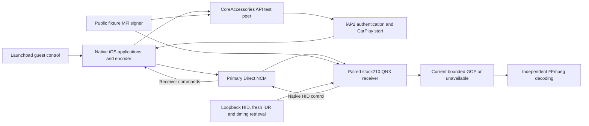
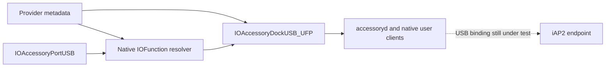

# vphone CarPlay laboratory

_Active guest platform · 2026-10-13 · Branch `feat/vphone-carplay-lab`._

[Wireless overview](README.md) · [Clock and queue measurements](VPHONE_TIMING.md) · [Retained Inferno evidence](IOS_VM_LAB.md) · [Software MFi](TEST_SOFTWARE_MFI.md)

## 📋 Decision and measured state

The laboratory now targets **vphone** for the iOS guest and retains the native
stock-210 QNX receiver. The user requested this migration on a separate branch.
Inferno work is preserved in checkpoint `001fee47`; its captures are historical
evidence and are not acceptance evidence for vphone.

vphone uses Apple's Virtualization.framework/PCC platform and installs the
paravirtual Metal driver. Upstream measurements demonstrate GPU execution;
they do not demonstrate our CarPlay sender, encoder, MFi or AltScreen path.[^1]

| Component | Local state |
|---|---|
| Host | Apple M3 Max, macOS 26.5.1 |
| Launchpad | Notarized 2.9.2 installed; archive SHA-256 verified |
| Core Bundle | 2.9.2 installed; SHA-256, policy and host preflight passed |
| Research Guests | Enabled; verified after the owner's Recovery step |
| Developer Tools / helper | Access allowed; signed helper `ready (16)` |
| Dedicated guest | `mhi2-carplay` created from template `17d93ffd69ab`, first boot passed, native UI and Maps render |
| QNX receiver | Corrected 62.5 MHz bootstrap clock; active-session rate about 1:1 with host; native `/info` and ABI checks passed |
| Shared signer | Loopback runtime returned a bounded 711-byte MFi-SAP response; host crypto tests passed |
| USB trust | Native pairing accepted by the dedicated guest |
| Ethernet attachment | Native Direct NCM primary interface carries the authenticated QNX session; `/info` returns 210.81 |
| iAP2 attachment | Native CoreAccessories API peer: AA05, identification 1D02, availability 4300 and start 4301; USB-port forwarding remains unverified |
| Primary video | Native Maps and CarPlay launcher; RAM capture independently decoded at 800×480 |
| AltScreen video | Native Maps tiles and location marker; independently decoded stream 111, 1440×542 |
| Siri | Enabled through native Settings after rebuilding stale MobileGestalt capabilities |

`scripts/carplay_lab.sh doctor` writes the actual host report to
`build/vphone-lab/doctor.json` and exits nonzero until its checks pass. Host Setup
now passes. At the user's explicit request, the agent used local sudo to enable
Developer Mode and install the exact signed helper; its client-signature and
administrator-authorization checks remain intact. No credential was saved in
files or Git. The installer does not change SIP, boot arguments or Research Guests.

## 📦 Reproducible guest profile

[The tracked profile](../../wireless/vphone_lab/profile.json) pins both firmware
sources instead of following the newest catalog entry. Upstream records the
iPhone17,3 iOS 26.6.2 / cloudOS 26.4 beta pairing as tested.[^2]

| Setting | Value |
|---|---|
| Machine / library | `mhi2-carplay` / `~/.vphone/machines` |
| Launchpad and Core Bundle | `2.9.2` |
| iPhone | `iPhone17,3`, iOS `26.6.2`, build `23G90` |
| PCC components | cloudOS `26.4` beta, build `23E5207q` |
| CPU / memory / virtual disk | 6 cores / 6144 MB / 64 GB |
| Initial network | `nat` |
| Native services | `--slim off`; keep applications and services |
| Creation disk guard | At least 90 GiB free on the home volume |

Creation uses Launchpad's official client and owns one machine in one library.
It refuses an existing target, concurrent machine activity and incomplete host
setup. Launchpad 2.9.2 leaves its verified first boot running; the standalone
CLI's stopped-at-return convention is different. The wrapper accepts a running
or stopped matching guest only after the creation report proves every step and
`firstBoot` passed. `recover-create` can finalize that saved report without
restoring again. First-boot verification checks vphoned, not CarPlay video.[^3]

The live guest reports iOS `26.6.2`, kernel `25.4.0`, six processors and about
6 GiB of memory. Its model is the research platform `iPhone99,11`; iPhone17,3
describes the source userland and board configuration. The frozen template
preserves all system apps and services (`slim off`), and the dedicated clone has
its own identity. Native Maps drew the globe and map tiles; this is phone UI
evidence, not a CarPlay screen stream.

The creation report and machine ledger live under `build/vphone-lab/`. Later
commands check the ledger, library, Core Bundle and recorded UDID before operating
the guest. They never select a physical phone or fall back to Inferno.

## 🔄 Target architecture and acceptance boundary



The initial NAT interface provides guest connectivity and diagnostics. It is
not a completed CarPlay transport. Upstream's `tunnel` mode drops IPv6, so it
cannot carry the existing IPv6 link-local recipe unchanged.[^4] The running
guest exposes USBMUX and two NCM pairs through `AppleVirtIOUSBDeviceController`.
Primary USB data interface 2 maps to guest `en2` in the measured run; auxiliary
data interface 4 carries `anpi0`. The Direct profile preserves both pairs. Host
names (`en22` / `en21` in the measured runs) are discovered below the owned USB serial and registry entries,
never hardcoded. The retained ARM-only, fixed-UDID USB probe is not applied to
vphone and its identity guard is not relaxed.

The original primary NCM link reached QNX at
`fe80::4254:ff:fe12:3456%en2:5000`. Packet evidence includes neighbor discovery,
TCP establishment, the guest's `GET /info`, and QNX's 775-byte `HTTP/1.1 200 OK`
response. Independent parsing of the captured binary plist returned
`sourceVersion=210.81` and `model=AirPlayGeneric1,1`. This establishes bidirectional
Ethernet and native receiver discovery; it does not establish CarPlay or MFi.

## 🔌 Retained USB adapter experiments

The original diagnostic, an AVP available-buffer log, was not the fatal cause.
Static arm64e analysis shows that handler logging and returning. Reordering the
guest's buffer posting and `DRIVER_OK` did not cure the stop and remains a failed
experiment, not the active adapter.

An attached debugger on the owned VZ service caught the actual crash: a
`Security Assertion Hit` in the configuration-descriptor validator. On this
macOS build, that validator accepts a specific set of USB interface classes and
bulk/control endpoints; native HID class 3 and interrupt endpoints are excluded.
The live buffer contained the new six-interface configuration descriptor. The
host executable, its checks and host security settings are unchanged.

The guest adapter retains the native `IOAccessoryPortUSB` protocol driver but
constructs its virtual wire interface as `FF/FF/FF` with a bulk input pipe. HID
report framing, native iAP handling and MFi checks are not replaced. This is a
virtual vendor bulk transport and does not establish physical USB HID behavior.

| Unslid research-kernel address | Original | Adapter |
|---|---|---|
| `0xfffffe000859148c` | Interface class 3 | Vendor class 255 |
| `0xfffffe0008591490` | Subclass 0 | Subclass 255 |
| `0xfffffe0008591494` | Protocol 0 | Protocol 255 |
| `0xfffffe000859151c` | Interrupt pipe type 3 | Bulk pipe type 2 |

The adapter verifies pristine kernel SHA-256
`86895a2eebeb7fcfb68bcd60f2d7e685687faea07ee31166fb58c872b38e0d92`,
the live PC against a unique reference-code location, ASLR and all original
instruction bytes. GDB access must belong to the VZ service holding this
machine's disk and listen only on `127.0.0.1:60321`. All guest CPUs are paused for
the small write; readback is checked before detaching. The patch is in guest RAM
and disappears at restart. Partially patched or changed code is rejected.

Measured enumeration has vendor interface 5, input endpoint `0x84`, bulk type 2,
64-byte packets. Its genuine 208-byte report descriptor was read and a 10-byte
control report was written. The VM stayed running; original USBMUX and both NCM
channels remained available. Native `/info` over NCM still returned HTTP 200.
These are USB and Ethernet results, not an iAP2 or MFi acceptance result.

A cold-start test of stock `DeviceModeCarplay2` also hit the descriptor validator.
It was reverted using the official disk/SEP/NVRAM snapshot
`usb-cold-before-20261012`; the guest's defaults file is original. The earlier
`DeviceDestroy` experiment partly tore down USB despite returning an error, so
it is not a working reset recipe.

### Native accessory manager checkpoint, 2026-10-13

The research platform initially published `IOAccessoryPortUSB` without an
accessory manager. The opt-in helper now starts the kernel's existing
`IOAccessoryDockUSB_UFP`, an `IOAccessoryManager` subclass, on the verified
`AppleVirtIOUSBDeviceController`. Its native `start()` requires the provider's
four-byte, little-endian `primary-port-id`. A scoped
`IOHIDProviderPropertyMerger` supplies port `2` before registering the manager;
placing `IOProviderMergeProperties` directly on the manager did not merge it.[^7]

Catalogue changes use a guest helper signed with
`com.apple.private.security.iocatalog-management`, with runtime entitlement and
service-ownership checks. An API return of zero alone is insufficient: XNU can
report success without applying a catalogue request when that entitlement is
absent.[^6] The helper verifies the actual manager class, category, parent
controller and primary port. Repeated application reuses the matching manager.
No Apple daemon job, authentication result or host security setting is changed.

The platform relationship is now established through the stock resolver. The
provider merger supplies these runtime values before starting the manager:

| Provider property | Data |
|---|---|
| `primary-port-id` | `02 00 00 00` |
| `AAPL,phandle` | `02 00 01 fe` (`0xFE010002`) |
| `function-dock_parent` | `02 00 01 fe 50 63 63 61` (phandle + `accP`) |

AppleARMPlatform registers the manager's empty-data marker
`IOFunctionParentFE010002` from `AAPL,phandle`. Its resolver creates an `IOFunction`
object for the eight-byte link. `IOAccessoryManager::callPlatformFunction()`
handles `accP` by returning the manager through its output argument. The helper
checks the actual marker, types and data before reporting a usable manager.
The reserved phandle is local to this guest's controller; no DeviceTree image,
Apple executable or authentication result is edited.

| Native observation after platform setup | Result |
|---|---|
| Manager class | `IOAccessoryDockUSB_UFP`, registered and active |
| Manager category / primary port | `MHI2ResearchAccessoryManager` / `2` |
| Native function-parent marker | Present, empty CFData |
| `IOAccessoryManagerGetUpstreamService()` on the USB port | Returns the native manager |
| Manager and USB port in `IOAccessory` plane | Both present |
| `accessoryd` clients | Genuine manager and USB-port user clients |
| Default `IOAccessoryPortGetStreamType()` | `0`; no stream metadata published |
| Native NCM `/info` | HTTP 200, 775 bytes after these changes |
| USB-port iAP2 / primary AVC / AltScreen AVC | Not reached through this port |

`iap-registry` uses matching, plane queries and child iteration. User clients
can be unregistered; matching only their class can miss an active client. The
RPC `device.ioreg` does not implement the attempted `class` filter. The helper
also reports the native stream-type getter and the platform-link data size.



The previous direct RAM write put a manager pointer into a field that actually
holds an `IOFunction` object. USB reconfiguration and RPC timed out; the VM
stopped during debugger recovery. This pointer shortcut is excluded. The stock
platform-function construction above replaces it and survived fresh starts.
Guest `Z0` software breakpoints were observed at native handlers; accepted `Z1`
requests did not yield the expected stop and were not used as negative evidence.

### Native iAP2 and MFi API tests

The owned research guest accepts a normal `ACCTransportClient` connection with
connection type `6` (`USB`), endpoint transport `0` (`USB Device Mode`) and
protocol `4` (`iAP2`). These names were read from CoreAccessories' exported
constant tables and checked against `accessoryd`'s native protocol dispatch.
This test path needs a normally running VM; the USB RAM adapter and a dock
manager are unnecessary for this API check.

```sh
scripts/carplay_lab.sh iap-smoke --experimental
scripts/carplay_lab.sh mfi-probe --experimental
scripts/carplay_lab.sh mfi-probe --experimental --negative signature
scripts/carplay_lab.sh mfi-probe --experimental --negative certificate
scripts/carplay_lab.sh mfi-probe --experimental --identify
```

The MFi command uses `build/vphone-lab/venv/bin/python`, including cryptography
and the wire-codec dependencies installed during lab bootstrap. It signs only
on the host with the integrity-checked public fixture. Packet records travel
through a nonce-scoped RPC file queue; the helper bounds input, runs for a bounded
60–180 seconds and destroys its own connection and endpoint. Both sides preserve
the ordinary native authentication checks. No authentication state is assigned.
Fixed Objective-C call prototypes are required on arm64; C varargs do not use
the method argument ABI.

| Native iOS 26.6.2 API observation | Result |
|---|---|
| Detect packet | `ff550200ee10` |
| SYN/ACK and ACK | Valid checksums; control session `10` negotiated |
| Certificate request | `0xAA00` |
| Valid fixture response | 32-byte challenge, 64-byte signature, `0xAA05` |
| Changed response signature | `0xAA04` |
| Changed certificate signature | `0xAA04` before any challenge |
| Identification | `0x1D00` request followed by `0x1D02` acceptance |
| CarPlay availability | Native `0x4300` received |

Reports are saved as `iap-smoke.json` and `mfi-api-{valid,signature,certificate,identify}.json`
under `build/vphone-lab/`. Offline tests check capture completeness, checksums,
session and sequence handling, malformed report fuzzing, queue bounds and nonce
ownership. The native test peer keeps the default production daemon unchanged.

This proves native iAP2/MFi and identification through the API test connection.
It does not prove forwarding through `IOAccessoryPortUSB`, a QNX CarPlay session,
primary AVC or AltScreen AVC. Those boundaries remain explicit in the reports.

### Native CarPlay session and Direct NCM

The original primary `en2` is CoreUtils type `0x8`; `airplayd` rejects it with
`USB transport type mismatch:8`. Selecting auxiliary interface 4 did not change
which interface the native USB transport selected. The active opt-in profile
instead uses the stock CarPlay control/data pairing from the guest's
`USBDeviceConfiguration.plist`, preserves USBMUX and retains the auxiliary pair:

| Interface | Native function |
|---|---|
| 0 | `AppleUSBMux` |
| 1 / 2 | `AppleUSBNCMControlDirect` / `AppleUSBNCMData` |
| 3 / 4 | `AppleUSBNCMControlAux` / `AppleUSBNCMDataAux` |

`usb ncm-direct --experimental` applies this ordinary USB description through
`IOUSBDeviceControllerSetDescription`. It saves the original description against
the owned UDID, requires only the USB-description entitlement, and uses no HID,
RAM adapter or accessory-manager personality. `usb network-classify` reads the
actual CoreUtils classification: measured `en2` has type `0x10` and extended flags
`0x200000c1`. Applying a description alone does not prove the interface is ready.
An earlier mixed Direct/Aux data pairing worked once but failed after restart;
it was replaced with the native control/data pair above.
The corrected profile was applied directly after a second cold start and again
reported type `0x10` with both NCM pairs present. QNX pairing, MFi-SAP and both
video streams repeated; FFmpeg decoded 31 primary and 8 cluster frames in that
bounded repeat.

Unlock the guest, configure Siri as described below, then prepare the link:

```sh
scripts/carplay_lab.sh unlock
scripts/carplay_lab.sh usb ncm-direct --experimental
scripts/carplay_lab.sh usb network-classify
scripts/carplay_lab.sh qnx-start
scripts/carplay_lab.sh qnx-info
```

Read the receiver public key from each run's `/info`; do not assume it changed
or remained the same after restart. In separate terminals, start the bridge and
signer before the native peer:

```sh
scripts/carplay_lab.sh ethernet --channel primary --seconds 65
PYTHONPATH=. build/vphone-lab/venv/bin/python -m wireless.lab_common.mfi_sap \
  --qnx-dir build/vphone-lab/qnx-network --seconds 65
scripts/carplay_lab.sh mfi-probe --experimental --start-carplay \
  --carplay-interface 2 --hold-seconds 30 --receiver-public-key CURRENT_64_HEX_KEY
```

For first pairing, click the genuine **Allow CarPlay while locked** prompt while
the peer remains connected, then repeat the session. Settings → General →
CarPlay lists **MHI2 QEMU Lab**, and `carkitd` confirms the stored pairing.
Launching `CarPlaySetupApp` directly creates a blank scene; it is not the pairing
flow. A stale direct-launched instance was terminated before the fresh native
prompt appeared. The identification-only probe now honors `--hold-seconds` to
keep its native connection open; it does not fabricate approval.

Receiver evidence confirms `/pair-setup`, `/pair-verify`, a live 711-byte signed
MFi-SAP response, encrypted control, screen SETUP, stream-111 SETUP and the main
screen's `INITIALIZING → READY` transition. The API probe's own
`qnx_session_verified` and `video_verified` stay false: it does not inspect the
receiver. Independent session evidence is recorded separately in the
[fixture manifest](../../wireless/fixtures/diplay_mfi/manifest.json).

### Siri capability cache and native setup

The live DeviceTree had `assistant=1`, `siri-gesture=1` and `dictation=1`, but the
first-boot MobileGestalt cache hid Siri in Settings. The native Siri services
were running. Backing up and removing that cache, then stopping and starting the
owned VM, restored the Siri row. Use the official guest RPC only when this stale
cache condition has been verified:

```sh
~/.local/bin/vphone-launchpad-cli guest rpc mhi2-carplay files.copy \
  '{"from":"/private/var/containers/Shared/SystemGroup/systemgroup.com.apple.mobilegestaltcache/Library/Caches/com.apple.MobileGestalt.plist","to":"/private/var/tmp/mhi2-vphone-lab/mobilegestalt-before-siri.plist"}'
~/.local/bin/vphone-launchpad-cli guest rpc mhi2-carplay files.remove \
  '{"path":"/private/var/containers/Shared/SystemGroup/systemgroup.com.apple.mobilegestaltcache/Library/Caches/com.apple.MobileGestalt.plist"}'
scripts/carplay_lab.sh stop
scripts/carplay_lab.sh start
scripts/carplay_lab.sh unlock
```

In Settings → Siri → Talk to Siri, enable **Press Side Button for Siri**, confirm
**Enable Siri**, choose a voice, and finish the native wizard. The measured
switch is `1`; voice-trigger listening remains Off. Before this setup, the
native primary video showed “CarPlay Not Available — enable Siri”. After it,
the decoded video shows the genuine CarPlay app launcher. No Siri eligibility
check, authentication state or source pixels were patched.

Guest input success is verified with a fresh UI tree or screenshot after settling.
The host socket takes screenshot pixels; guest AX uses points. Convert using
`device.screen.scale`, and activate the owned VM window before native host taps.
The measured scale is 3; process IDs and host interface names change after restart.

### Independent video and pacing evidence

The bounded QNX decoder-input capture exports authenticated Annex B bytes before
the stand's mock OMX decoder. FFmpeg provides the independent picture check:

| Capture after Siri setup | Complete records | Bytes | Decoded frames | Picture |
|---|---:|---:|---:|---|
| Primary H.264 | 32 | 370754 | 31, 800×480 | CarPlay app launcher |
| Stream 111 H.264 | 23 | 1470 | 22, 1440×542 | Black image |

Primary SHA-256: `5e367255a6b32ee0e69387eeb0b57461b6f7b3f408cb5efa7c379cc98a14e6d9`.
Cluster SHA-256: `e8d38de4f4a5697b1a6e91afb9ce4f3aca1602bc9cc183699258a74ab3c55c0a`.
Artifacts are ignored under `build/vphone-lab/`: `dashboard-primary.h264`,
`dashboard-primary-last.png`, `dashboard-cluster.h264` and the JSON pacing reports.

```sh
scripts/carplay_lab.sh extract build/vphone-lab/qnx-network/serial.log \
  --output build/vphone-lab/dashboard-primary.h264
scripts/carplay_lab.sh extract build/vphone-lab/qnx-network/serial.log --cluster \
  --output build/vphone-lab/dashboard-cluster.h264
ffprobe -v error -count_frames -show_entries stream=codec_name,width,height,nb_read_frames \
  -of json build/vphone-lab/dashboard-primary.h264
scripts/carplay_lab.sh pacing build/vphone-lab/qnx-network/serial.log \
  --output build/vphone-lab/dashboard-frame-pacing.json
scripts/carplay_lab.sh wire-pacing build/vphone-lab/ethernet.pcap \
  --output build/vphone-lab/dashboard-wire-pacing.json
scripts/carplay_lab.sh wire-pacing build/vphone-lab/ethernet.pcap --port 6031 \
  --output build/vphone-lab/dashboard-cluster-wire-pacing.json
```

The active wrapper scopes these outputs to `build/vphone-lab`; standalone shared
commands retain the Inferno default. Traversal and external symlinks are rejected.
PCAP clock validation is per measured screen TCP flow: buffered BPF receive
records can appear after newer unrelated transmit records without a regression
in that flow. A regression inside the measured flow is still rejected; records
are not sorted and their timestamps are not rewritten.

Before Siri setup, the main stream's 30-picture animation spanned 965.68 ms,
with 33.16 ms median and 35.32 ms p95 wire intervals (about 30.03 events/s).
After setup, the launcher capture had 44 wire access units over 5298.41 ms,
median 36.95 ms and p95 451.86 ms; its 31 UART-captured picture buffers spanned
34627.97 ms. UART hex capture adds substantial receiver overhead, and a static
screen need not keep emitting pictures. These short runs do not establish
sustained frame pacing, end-to-end latency, physical OMX output or 2.4 GHz RF
performance. Stream-111 decoding proves its video transport, not map content.

### Maps, native input and RAM capture

A subsequent native Maps run used simulated CoreLocation coordinates near Apple
Park and requested `maps://` through the stock receiver. A virtual primary-screen
HID device now makes the native CarPlay GO control accessible from the QNX lab.
The phone supplies every rendered/encoded pixel; no scene or encoder substitute
is installed into vphone.

| Measured evidence | Result |
|---|---|
| Primary RAM capture before GO | 364 independently decoded frames, 800×480; Maps route choices and GO |
| Cluster RAM capture before GO | 7 decoded frames, 1440×542; actual Apple Park map tiles and blue location dot |
| Native QNX HID tap | `(374,184)`, status 0; press followed by release |
| Cluster capture after GO | 3 decoded frames, 1440×542; blue dot changes to a navigation arrow |
| Native iAP2 held session | 90 seconds; valid MFi and identification, helper exit 0 |

The navigation marker change is the observed input effect. This does not yet
validate every roller/button gesture or an entire moving route. Input JSON
reports retain `visible_effect_verified=false` because the CLI itself does not
inspect decoded images.

`--input-control` registers a virtual HID against the actual first screen's UUID
and its 800×480 coordinate range. It is compiled only into the QNX fixture.
The native `HIDDeviceCreateVirtual` interposer now forwards both ABI arguments:
pinned stock210 address `0x69358` saves its properties argument from `r1`.
The control endpoint binds the separate guest MFi network's `10.0.3.15:32503`;
QEMU forwards it only to host `127.0.0.1:32503`. The host command checks the owned
iOS machine, exact running QNX process and explicit build flags before connecting.
The endpoint permits at most 256 requests, bounds each tap, times out incomplete
requests, and always posts release after a press attempt. It disappears when QNX
stops. The default build exposes no such endpoint.

The pacing profile redirects the retained socket probe's output to `/dev/null`
and caps its payload formatting at one byte (`PROBE_IO_CAP=1`; zero means full
payload in that probe). It disables UART AVC capture. `--capture-memory` instead
keeps at most 2 MiB per screen, beginning at an IDR with its configuration.
A new IDR resets that screen's GOP. Once the cap is reached, collection stops;
ordinary snapshots now return unavailable instead of that frozen GOP. Use
`input snapshot primary --fresh` or `input snapshot cluster --fresh` to request
an IDR over the authenticated native control channel and wait for a newer GOP.
Failure, timeout or overflow preserves the host's previous file and reports an
error. The retained primary snapshot after GO was capped, so its unchanged bytes
were not used as input evidence; the cluster's new GOP supplied that evidence.

Primary refresh calls stock `AirPlayReceiverSessionForceKeyFrame`, whose pinned
stock210 export is at `0x28a5c`. Cluster refresh sends the equivalent native
`AirPlayReceiverSessionSendCommand` dictionary with `params.uuid` equal to the
fixture's advertised `C1057E12-A0D1-4E20-B0C0-1057E12A0D10`. Stock210's convenience
function omits that UUID and targets the primary screen. Refresh is explicit;
this helper does not request periodic IDRs or change the sender's cadence.
Capture retains the authenticated session from successful RECORD, bounds RAM to
2 MiB per screen and unlocks the capture mutex before native command submission.
Parameters are currently observed as combined SPS/PPS records; arbitrary split
parameter-set changes have not been validated.
RAM copying, the remaining probe calls and diagnostic logs still add overhead.

```sh
scripts/carplay_lab.sh qnx-stop
scripts/carplay_lab.sh qnx-build --request-ui-maps --input-control \
  --capture-memory --pacing-only --clock-realtime --capture-only-altscreen
scripts/carplay_lab.sh qnx-start
scripts/carplay_lab.sh qnx-info
# In other terminals, start the primary bridge and signer, then the peer:
scripts/carplay_lab.sh ethernet --seconds 120
PYTHONPATH=. build/vphone-lab/venv/bin/python -m wireless.lab_common.mfi_sap \
  --qnx-dir build/vphone-lab/qnx-network --seconds 120
scripts/carplay_lab.sh mfi-probe --experimental --start-carplay \
  --carplay-interface 2 --hold-seconds 90 --receiver-public-key CURRENT_64_HEX_KEY
# While the native CarPlay scene is connected:
scripts/carplay_lab.sh input snapshot primary
scripts/carplay_lab.sh input snapshot cluster
scripts/carplay_lab.sh input tap 374 184
scripts/carplay_lab.sh input snapshot cluster --output build/vphone-lab/cluster-after-go.h264
```

Inspect the current scene before choosing coordinates: `(374,184)` was GO in the
measured route-selection image, not a universal navigation command. For this
run, official guest `location.set` used latitude `37.3349`, longitude `-122.0090`;
Maps opened `maps://?daddr=37.3229,-122.0322&dirflg=d`. This is simulated guest
location, not the Mac's or a physical phone's location.

### Longer pacing measurement without UART payloads

The 120-second companion PCAP includes these complete, independently reconstructed
screen access units. This describes delivery during native Maps rendering and
idle periods, without changing the phone's output cadence:

| Screen | Access units | Video span | Median | p95 | Maximum gap |
|---|---:|---:|---:|---:|---:|
| Main, port 6030 | 1483 | 63.789 s | 33.421 ms | 68.333 ms | 1057.821 ms |
| Cluster, port 6031 | 1446 | 103.995 s | 33.819 ms | 191.345 ms | 2828.865 ms |

Main has 12 gaps over 100 ms, cluster 217; their long-gap counts over one second
are 2 and 7. Reassembly reports no sequence gaps or unparsed contiguous bytes.
Repeated TCP payload bytes are 2430 and 7140, which do not establish RF packet
loss. Phone telemetry reports `encoderCurrentFPS=30`; the observed averages are
23.233 and 13.895 access units/s, including sparse/idle periods. The long tails
remain real observations; this result does not establish stable 30 fps or
attribute stalls to the encoder, guest GPU or receiver without more timing evidence.

Artifacts are `quiet-{main,cluster}-wire-pacing.json`, `quiet-primary-before.h264`,
`quiet-cluster-before.h264`, `quiet-cluster-after-go.h264` and their decoded PNGs
under ignored `build/vphone-lab/`. The last two cluster hashes are
`41da439bc79025da8bd696a30695b1103a3cec68d7767f5bc97a8cd564542ecd` and
`0725359231b7ae53d2391b99676b107929349a0edfa9e617c4a4d28bb9016617`.
Physical OMX presentation, end-to-end latency and a 2.4 GHz radio are still not
measured by this stand.

### Moving map, sender intervals and current snapshots

A complete repeated 120-second session verified 41 official `location.set`
updates over a 40-second measurement. The laboratory path runs from
`37.3349,-122.0090` to `37.3320,-122.0160` at about 17.45 m/s, course 242.48°;
it is a straight simulated path, not a road-matched route. Host location
synchronization must be disabled. The helper leaves the guest at its last
coordinate with speed zero, including after a partial failure.

Independent decoding shows the main map moving from the Apple Park ring to the
intersection near I-280 and Wolfe Road; stream 111 shows the corresponding map
position. Native Maps returned **Directions Not Available** during the earlier
navigation attempt. Moving map rendering is confirmed; turn-by-turn guidance
and a complete driving route remain unverified.

| Screen | Delivered AUs in motion window | Sender median / maximum | Delivery median / maximum |
|---|---:|---:|---:|
| Main 6030 | 166 | 166.667 / 1833.333 ms | 189.147 / 1808.183 ms |
| Cluster 6031 | 132 | 66.667 / 4133.333 ms | 132.775 / 4081.050 ms |

The window contains 39.864 / 39.529 seconds between the first and last delivered
AUs: 4.139 / 3.314 AUs/s. Sparse map updates do not establish sustained 30 fps.
Both reconstructed connections have no sequence gaps. The cluster capture ends
with an incomplete 18,564-byte access unit starting 31.830 seconds after the
motion window; that trailing unit is excluded from the timing table.
The analyzer now reads the screen header's `params[0]` NTP 32.32 timestamp and
pairs its relative intervals with complete TCP access-unit delivery intervals.
These are presentation targets, **not render or encoder completion times**.
For example, the main flow has a 1563.628 ms delivery gap with a 33.333 ms sender
target gap, followed shortly by a 1433.333 ms sender gap delivered in 97.950 ms.
This demonstrates batching relative to sender targets; encoder, iOS scheduling,
NCM and companion bridging remain possible contributors. Clock offsets and
absolute end-to-end latency have not been measured.

`input timing primary|cluster` exports the first 8192 picture-buffer input
stamps, excluding configuration records, without dumping AVC into UART.
These stamps use **QNX CLOCK_MONOTONIC**. In this run 790 main / 436 cluster input
buffers span 317.096 / 309.773 guest seconds while the session is measured in
host seconds. The accelerated QNX clock cannot be compared directly to host or
sender clocks; the records do not measure physical decoder output or display.
QNX still reports fake-OMX presentation errors and stream-111 forwarding recovery
requests, which can affect the test. Their specific contribution is unquantified.

The first timing-export attempt overflowed the QNX thread stack and terminated
`dio_manager`. Its artifacts are explicitly named `moving-aborted-*` and excluded
from the table. The export now uses a bounded heap buffer; the repeated full
motion run and a separate final fresh-capture session have no such crash.
A host C compile check rejects stack frames above 4096 bytes in this helper.

```bash
# With the owned Maps session, bridge and signer already active:
scripts/carplay_lab.sh moving-route --seconds 40
# Export timings before issuing fresh-capture requests.
scripts/carplay_lab.sh input timing primary
scripts/carplay_lab.sh input timing cluster
scripts/carplay_lab.sh input snapshot primary --fresh \
  --output build/vphone-lab/fresh-primary.h264
scripts/carplay_lab.sh input snapshot cluster --fresh \
  --output build/vphone-lab/fresh-cluster.h264
```

For a motion-only pacing report, pass `--window-start-ms` and `--window-end-ms`
from `moving-route.json`'s first `host_end_ns` and last `host_start_ns`, divided by
1e6. Both bounds are required; TCP reconstruction still uses the complete PCAP
including SYN. Opcode counts and telemetry still describe the whole connection;
only picture timing is filtered. Keep fresh-IDR requests outside that window.

Artifacts are `moving-fixed-ethernet.pcap`, `moving-fixed-route.json`,
`moving-fixed-{main,cluster}-pacing.json`, `moving-fixed-{primary,cluster}-timing.json`,
`moving-fixed-primary-{before,after}.h264` and decoded PNGs under ignored
`build/vphone-lab/`. Final native refresh verification independently decodes
`fresh-final-primary.h264` (SHA-256
`0ecab93150bc99ebe02a179c382b44c99512a0872563937a904b423f0f5e4c7f`) and
`fresh-final-cluster.h264` (SHA-256
`b8e5bb875a1bed36473f26763ca2a174fe85c6d715e5e05b381f7ddc95917a1d`).
Their native request-to-snapshot durations were 427 / 1086 host milliseconds,
which describe this diagnostic request, not normal video latency.

### Corrected clock and queue isolation

The current opt-in measurement profile adds `--clock-realtime` and
`--capture-only-altscreen`. QNX clock rate is now about 1:1 with the host during
an active session. The retained motion measurements above used the legacy
accelerated clock and remain historical evidence, not the corrected profile's
acceptance result. Capture-only stream111 has no hardware renderer or periodic
renderer recovery requests; it still validates and captures native video.

Immediate BPF capture is now the bridge default, with `TCP_NODELAY` and buffered
artifact writes. `ethernet --trace-queues` records bounded queue metadata;
`queue-report` analyzes BPF-to-read, socket-send and QNX ACK observation delays.
Main BPF-to-read median fell from about 28 ms to 0.036 ms in the final run.
Second-scale ACK observations and upstream sender-target/delivery differences
remain. See the [timing report](VPHONE_TIMING.md) for clock guards, exact results,
failed-run limits, the sequence diagram and the current reproduction recipe.

### Stream metadata and protocol experiments

The native port plugin selects its endpoint protocol using
`IOAccessoryPortStreamType`, not just `IOAccessoryTransportType`. The getter
returns zero when that property is absent. An explicit `port-prepare` experiment
uses a scoped native property merger on the already-owned USB port. It requires
an exact native upstream-manager match, refuses conflicting existing metadata,
and never assigns an authentication status. Choosing a type proves only that
metadata was published, not that iAP2 accepted it.

| Experimental stream type | Native endpoint protocol branch | Measured result |
|---|---|---|
| `1` | `10`, `ACCAuthProtocol` | No iAP2 detect echo |
| `4` | `15`, `SNTPTimeSync` | Genuine input report containing `01 30 23 ...` |
| `5` | `16`, `QiAuth` | Genuine input report `01 00 19 01 00 00` |

None of these branches selects iAP2. Protocol `4` dispatches to the native
`iap2_endpoint_create`; protocol `3` dispatches to the legacy `iapd` bridge.
The legacy daemon crash below therefore does not prevent the API endpoint from
completing native MFi authentication. Further stream-type guessing is not an
iAP2 bring-up recipe.

There is no default stream choice. Reboot between different values, recreate
the platform/USB setup, then use `port-prepare --stream-type 1|4|5 --experimental`.
The daemon caches this metadata when creating a port object; merely observing
an updated registry value is insufficient to prove it re-read the property.
A scoped `TERM` of the verified `accessoryd` process followed by native XPC
activation recreated its port objects during the experiments. `services.stop`
was refused by launchd with status 144; no system launchd plist was altered.

Vendor capability request `0x53` returned `01 00 00 00`. The matching `0x51`
role request returned a USB pipe error and is not part of a working recipe.
Both the original NCM link and the vendor bulk interface stayed usable.

Legacy `iapd` was tested through its own declared XPC service and exited with
`SIGABRT` on the Now Playing queue. A separate bounded diagnostic launch captured
`SQLITE_AUTH` (23) while Core Data accessed
`/var/mobile/Media/Radio/Radio.db`. Unlocking the guest and initializing the
native `RadioModel` as `mobile` did not repair that daemon. A diagnostic
`DYLD_INSERT_LIBRARIES` constructor was not observed in the signed program; its
job and guest dylib were removed. `iap-wake` therefore continues to activate
only `accessoryd` through `com.apple.iap2d.xpc` and does not repeatedly start a
crashing legacy service. This Radio database is Apple media state, not a
measurement of a Wi-Fi radio.

Next: test a moving route and roller/button gestures, repeat reconnect, and
separate source rendering/encoding stalls from receiver delivery gaps. USB-port
forwarding remains a separate transport task; the stream-type experiments
below are historical diagnostics, not the active video recipe.

For the RAM adapter, run the official debug launch in one terminal:

```sh
scripts/carplay_lab.sh stop
scripts/carplay_lab.sh debug-start
```

Then operate the owned guest from another terminal:

```sh
scripts/carplay_lab.sh unlock
scripts/carplay_lab.sh usb-kernel --apply
scripts/carplay_lab.sh usb manager-apply --experimental
scripts/carplay_lab.sh usb apply --experimental
scripts/carplay_lab.sh usb iap-wake
scripts/carplay_lab.sh usb iap-registry
scripts/carplay_lab.sh usb iap-inspect
# Inspect another class's metadata without invoking the transport:
scripts/carplay_lab.sh usb iap-inspect --inspect-class ACCTransportIOAccessorySharedManager
scripts/carplay_lab.sh usb iap-list
```

`debug-start` stays attached to its launch command. It is not a firmware restore.
The bounded guest helper verifies the recorded UDID, research product string,
controller and chosen chip `FE01`. Live USB changes remain opt-in; ordinary
startup never applies them. Reports, native descriptors, debugger evidence and
pristine reference extraction stay ignored under `build/vphone-lab/`.

The manager and its provider properties are runtime-only and disappear at VM
restart. `manager-remove --experimental` removes only the helper's inactive
catalogue descriptions; it refuses to imply removal of a live manager. Stop and
restart the VM to remove an active manager and reset provider properties. Native
code-dump and raw object-pointer experiments are not exposed by the tracked
helper. Its guest directory is recreated before backup upload after a restart.

The shared QNX image retains pairing, native MFi-SAP, media authentication and
the explicit QEMU-only paired AltScreen gate. Hardware decoder output still
comes from mock OMX: exported AVC must be independently decoded on the host to
establish real picture evidence.

| Acceptance step | Required evidence |
|---|---|
| Guest startup | vphoned response, correct iOS identity, visible native UI |
| Graphics | Metal device and actual Maps rendering in this guest |
| Authentication | Native iAP2 acceptance and valid/invalid MFi controls |
| Transport | Actual guest/QNX packets; an open socket is insufficient |
| Primary screen | Authenticated AVC and independent 800×480 decode |
| AltScreen | Native stream 111 AVC and independent cluster decode |
| Frame pacing | AVC arrival/decode intervals in a stated clock domain |

A VM display's 60/120 Hz setting does not establish CarPlay's encoded frame rate.
No physical 2.4 GHz radio behavior is measured by this virtual stand.

## 🚀 Host setup and guest lifecycle

The verified release archives are cached locally. `bootstrap` can reproduce
their verification and install Launchpad without replacing an unrelated existing
installation. Extraction is temporary so a second persistent app with the same
bundle ID cannot confuse LaunchServices or UI automation. Existing executables
must match the verified release even when their version strings match.

```sh
scripts/carplay_lab.sh bootstrap
scripts/carplay_lab.sh plan
scripts/carplay_lab.sh doctor
```

Host Setup has passed on this Mac; the steps below describe a new host. Its owner
authorizes the security and helper changes, as required by the upstream skill.[^5]
Enable Research Guests in Recovery before continuing:

```sh
# In macOS Recovery, Terminal:
csrutil allow-research-guests enable
```

On a new host, open `/Applications/vphone-launchpad.app` and complete
**Host Setup**: grant Developer Tools access and install its helper using the
administrator prompt. Then install the explicitly pinned Core Bundle through
the official client. The helper may request administrator authorization.[^5]

```sh
~/.local/bin/vphone-launchpad-cli bundle install-release 2.9.2
scripts/carplay_lab.sh doctor
scripts/carplay_lab.sh create
# Launchpad normally leaves the verified guest running. Use start only when stopped.
scripts/carplay_lab.sh status
scripts/carplay_lab.sh snapshot
scripts/carplay_lab.sh diagnose
scripts/carplay_lab.sh screenshot
scripts/carplay_lab.sh stop
```

`start` waits for vphoned. `diagnose` collects bounded native process and media
logs. A phone screenshot proves the phone UI only; it is not a CarPlay frame.
Creation stays owned by Launchpad if its waiting CLI is interrupted; inspect the
existing operation rather than starting another restore.[^5]

## 🧪 Shared receiver and evidence tools

Validation passed 92 guest/bootstrap/transport/output tests and 97 retained
laboratory regression tests, including seeded malformed-report and TCP-framing
fuzzing. A native C RAM-capture test passes ASan/UBSan with 10,000 seeded inputs,
rejects frozen-GOP snapshots and checks timing wire framing.
The native helper compiled with warnings treated as errors and was run
on the owned guest. These offline checks validate the tools; the separate live
pairing, MFi-SAP and independent video evidence above establishes the sender session.

```sh
clang -Wall -Wextra -Werror -Wframe-larger-than=4096 -fsanitize=address,undefined \
  wireless/receiver_bridge/test_qnx_input_memory.c -o build/vphone-lab/test-qnx-input-memory
build/vphone-lab/test-qnx-input-memory
```

```sh
scripts/carplay_lab.sh qnx-build
scripts/carplay_lab.sh qnx-start
scripts/carplay_lab.sh qnx-info
scripts/carplay_lab.sh mfi --seconds 300
scripts/carplay_lab.sh qnx-stop
```

The receiver uses `build/vphone-lab/qnx-network`, a local QEMU Ethernet socket
on port `32501`, and the bounded loopback MFi-SAP service on port `32502`.
`qnx-build` compiles the paired laboratory hook before building its image;
compile failure propagates instead of reporting a stale artifact as success.
The Ethernet adapter connects that socket to the original owned NCM interface.
It holds an exclusive capture lock, rejects malformed QEMU records, checks both
endpoints during the run and records PCAP timestamps in the host realtime domain.
Incomplete runs are explicitly marked in `ethernet.json`.

Run the bridge in one terminal, then probe from the guest in another:

```sh
scripts/carplay_lab.sh usb probe
scripts/carplay_lab.sh ethernet --inspect
scripts/carplay_lab.sh ethernet --seconds 30
```

```sh
scripts/carplay_lab.sh usb network
```

The bridge uses the host's existing NCM driver and libpcap; it preserves USBMUX
and the auxiliary management channel. It does not change USB configurations,
host routes or physical interfaces. The network probe is a bounded native
guest socket request, not a host request or a synthetic sender session.

After an actual native sender session supplies complete capture records:

```sh
scripts/carplay_lab.sh extract build/vphone-lab/qnx-network/serial.log \
  --output build/vphone-lab/main.h264
scripts/carplay_lab.sh extract --cluster build/vphone-lab/qnx-network/serial.log \
  --output build/vphone-lab/cluster.h264
scripts/carplay_lab.sh pacing build/vphone-lab/qnx-network/serial.log
```

The extractor rejects incomplete, reordered or malformed records. Main and
cluster captures remain separate. Timestamp domains are reported separately;
cross-guest clock subtraction is not a latency measurement.

## 🗂️ Source ownership and retained history

| Directory | Responsibility |
|---|---|
| `wireless/vphone_lab/` | Active guest profile, lifecycle, native USB diagnostics and owned NCM bridge |
| `wireless/lab_common/` | QNX receiver, checked MFi fixture, signer, AVC extraction and pacing |
| `wireless/ios_vm_lab/` | Retained Inferno implementation and compatible old entry points |
| `build/vphone-lab/` | Ignored private runtime reports and captured evidence |

Legacy entry points explicitly select the old artifact directory; they are not
automatic fallbacks for vphone. Historical iOS 14 address-pinned framebuffer and
codec helpers are not installed into the new guest.

[^1]: Lakr233/vphone-cli. (2026). "GPU acceleration in the guest." https://github.com/Lakr233/vphone-cli/blob/0da1bea0e58199a1888581135b94a69063d71779/Research/Guest/gpu_acceleration.md
[^2]: Lakr233/vphone-cli. (2026). "Firmware compatibility." https://github.com/Lakr233/vphone-cli/blob/0da1bea0e58199a1888581135b94a69063d71779/Documents/Guides/compatibility.md
[^3]: Lakr233/vphone-cli. (2026). "Create and run a VM." https://github.com/Lakr233/vphone-cli/blob/0da1bea0e58199a1888581135b94a69063d71779/Documents/Guides/create-and-run.md
[^4]: Lakr233/vphone-cli. (2026). "Networking." https://github.com/Lakr233/vphone-cli/blob/0da1bea0e58199a1888581135b94a69063d71779/Documents/Guides/networking.md
[^5]: Lakr233/vphone-cli. (2026). "vphone guest control skill." https://github.com/Lakr233/vphone-cli/blob/0da1bea0e58199a1888581135b94a69063d71779/Skills/vphone-guest-control/SKILL.md
[^6]: Apple. "XNU IOUserClient.cpp, is_io_catalog_send_data." https://github.com/apple-oss-distributions/xnu/blob/main/iokit/Kernel/IOUserClient.cpp
[^7]: Apple. "IOHIDProviderPropertyMerger.cpp." https://github.com/apple-oss-distributions/IOHIDFamily/blob/main/IOHIDFamily/IOHIDProviderPropertyMerger.cpp
