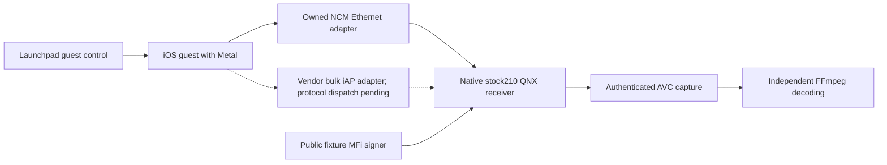
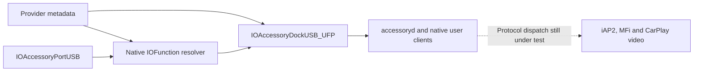

# vphone CarPlay laboratory

_Active guest platform · 2026-10-12 · Branch `feat/vphone-carplay-lab`._

[Wireless overview](README.md) · [Retained Inferno evidence](IOS_VM_LAB.md) · [Software MFi](TEST_SOFTWARE_MFI.md)

## 📋 Decision and measured state

The laboratory now targets **vphone** for the iOS guest and retains the native
stock-210 QNX receiver. The user requested this migration on a separate branch.
Inferno work is preserved in checkpoint `001fee47`; its captures are historical
evidence and are not acceptance evidence for vphone.

vphone uses Apple's Virtualization.framework/PCC platform and installs the
paravirtual Metal driver. Upstream measurements demonstrate GPU execution;
they do not demonstrate our CarPlay sender, encoder, MFi or AltScreen path.[^1]

| Component | Local state |
|---|---|
| Host | Apple M3 Max, macOS 26.5.1 |
| Launchpad | Notarized 2.9.2 installed; archive SHA-256 verified |
| Core Bundle | 2.9.2 installed; SHA-256, policy and host preflight passed |
| Research Guests | Enabled; verified after the owner's Recovery step |
| Developer Tools / helper | Access allowed; signed helper `ready (16)` |
| Dedicated guest | `mhi2-carplay` created from template `17d93ffd69ab`, first boot passed, native UI and Maps render |
| QNX receiver | Fresh build passed ABI checks; native `/info` verified in the new directory |
| Shared signer | Loopback runtime returned a bounded 711-byte MFi-SAP response; host crypto tests passed |
| USB trust | Native pairing accepted by the dedicated guest |
| Ethernet attachment | Original NCM primary interface exchanges IPv6 with QNX; native `/info` returns HTTP 200 / 210.81 |
| iAP2 attachment | Guest vendor bulk adapter enumerates and survives; report descriptor/control write verified; detect and authentication pending |

`scripts/carplay_lab.sh doctor` writes the actual host report to
`build/vphone-lab/doctor.json` and exits nonzero until its checks pass. Host Setup
now passes. At the user's explicit request, the agent used local sudo to enable
Developer Mode and install the exact signed helper; its client-signature and
administrator-authorization checks remain intact. No credential was saved in
files or Git. The installer does not change SIP, boot arguments or Research Guests.

## 📦 Reproducible guest profile

[The tracked profile](../../wireless/vphone_lab/profile.json) pins both firmware
sources instead of following the newest catalog entry. Upstream records the
iPhone17,3 iOS 26.6.2 / cloudOS 26.4 beta pairing as tested.[^2]

| Setting | Value |
|---|---|
| Machine / library | `mhi2-carplay` / `~/.vphone/machines` |
| Launchpad and Core Bundle | `2.9.2` |
| iPhone | `iPhone17,3`, iOS `26.6.2`, build `23G90` |
| PCC components | cloudOS `26.4` beta, build `23E5207q` |
| CPU / memory / virtual disk | 6 cores / 6144 MB / 64 GB |
| Initial network | `nat` |
| Native services | `--slim off`; keep applications and services |
| Creation disk guard | At least 90 GiB free on the home volume |

Creation uses Launchpad's official client and owns one machine in one library.
It refuses an existing target, concurrent machine activity and incomplete host
setup. Launchpad 2.9.2 leaves its verified first boot running; the standalone
CLI's stopped-at-return convention is different. The wrapper accepts a running
or stopped matching guest only after the creation report proves every step and
`firstBoot` passed. `recover-create` can finalize that saved report without
restoring again. First-boot verification checks vphoned, not CarPlay video.[^3]

The live guest reports iOS `26.6.2`, kernel `25.4.0`, six processors and about
6 GiB of memory. Its model is the research platform `iPhone99,11`; iPhone17,3
describes the source userland and board configuration. The frozen template
preserves all system apps and services (`slim off`), and the dedicated clone has
its own identity. Native Maps drew the globe and map tiles; this is phone UI
evidence, not a CarPlay screen stream.

The creation report and machine ledger live under `build/vphone-lab/`. Later
commands check the ledger, library, Core Bundle and recorded UDID before operating
the guest. They never select a physical phone or fall back to Inferno.

## 🔄 Target architecture and acceptance boundary



The initial NAT interface provides guest connectivity and diagnostics. It is
not a completed CarPlay transport. Upstream's `tunnel` mode drops IPv6, so it
cannot carry the existing IPv6 link-local recipe unchanged.[^4] The running
guest exposes USBMUX and two NCM pairs through `AppleVirtIOUSBDeviceController`.
Primary USB data interface 2 maps to guest `en2`; auxiliary data interface 4
carries the guest's `anpi0` management link. Host names (`en22` / `en21` in the
measured run) are discovered below the owned USB serial and registry entries,
never hardcoded. The retained ARM-only, fixed-UDID USB probe is not applied to
vphone and its identity guard is not relaxed.

The original primary NCM link reached QNX at
`fe80::4254:ff:fe12:3456%en2:5000`. Packet evidence includes neighbor discovery,
TCP establishment, the guest's `GET /info`, and QNX's 775-byte `HTTP/1.1 200 OK`
response. Independent parsing of the captured binary plist returned
`sourceVersion=210.81` and `model=AirPlayGeneric1,1`. This establishes bidirectional
Ethernet and native receiver discovery; it does not establish CarPlay or MFi.

## 🔌 Native USB adapter and discovery boundary

The original diagnostic, an AVP available-buffer log, was not the fatal cause.
Static arm64e analysis shows that handler logging and returning. Reordering the
guest's buffer posting and `DRIVER_OK` did not cure the stop and remains a failed
experiment, not the active adapter.

An attached debugger on the owned VZ service caught the actual crash: a
`Security Assertion Hit` in the configuration-descriptor validator. On this
macOS build, that validator accepts a specific set of USB interface classes and
bulk/control endpoints; native HID class 3 and interrupt endpoints are excluded.
The live buffer contained the new six-interface configuration descriptor. The
host executable, its checks and host security settings are unchanged.

The guest adapter retains the native `IOAccessoryPortUSB` protocol driver but
constructs its virtual wire interface as `FF/FF/FF` with a bulk input pipe. HID
report framing, native iAP handling and MFi checks are not replaced. This is a
virtual vendor bulk transport and does not establish physical USB HID behavior.

| Unslid research-kernel address | Original | Adapter |
|---|---|---|
| `0xfffffe000859148c` | Interface class 3 | Vendor class 255 |
| `0xfffffe0008591490` | Subclass 0 | Subclass 255 |
| `0xfffffe0008591494` | Protocol 0 | Protocol 255 |
| `0xfffffe000859151c` | Interrupt pipe type 3 | Bulk pipe type 2 |

The adapter verifies pristine kernel SHA-256
`86895a2eebeb7fcfb68bcd60f2d7e685687faea07ee31166fb58c872b38e0d92`,
the live PC against a unique reference-code location, ASLR and all original
instruction bytes. GDB access must belong to the VZ service holding this
machine's disk and listen only on `127.0.0.1:60321`. All guest CPUs are paused for
the small write; readback is checked before detaching. The patch is in guest RAM
and disappears at restart. Partially patched or changed code is rejected.

Measured enumeration has vendor interface 5, input endpoint `0x84`, bulk type 2,
64-byte packets. Its genuine 208-byte report descriptor was read and a 10-byte
control report was written. The VM stayed running; original USBMUX and both NCM
channels remained available. Native `/info` over NCM still returned HTTP 200.
These are USB and Ethernet results, not an iAP2 or MFi acceptance result.

A cold-start test of stock `DeviceModeCarplay2` also hit the descriptor validator.
It was reverted using the official disk/SEP/NVRAM snapshot
`usb-cold-before-20261012`; the guest's defaults file is original. The earlier
`DeviceDestroy` experiment partly tore down USB despite returning an error, so
it is not a working reset recipe.

### Native accessory manager checkpoint, 2026-10-13

The research platform initially published `IOAccessoryPortUSB` without an
accessory manager. The opt-in helper now starts the kernel's existing
`IOAccessoryDockUSB_UFP`, an `IOAccessoryManager` subclass, on the verified
`AppleVirtIOUSBDeviceController`. Its native `start()` requires the provider's
four-byte, little-endian `primary-port-id`. A scoped
`IOHIDProviderPropertyMerger` supplies port `2` before registering the manager;
placing `IOProviderMergeProperties` directly on the manager did not merge it.[^7]

Catalogue changes use a guest helper signed with
`com.apple.private.security.iocatalog-management`, with runtime entitlement and
service-ownership checks. An API return of zero alone is insufficient: XNU can
report success without applying a catalogue request when that entitlement is
absent.[^6] The helper verifies the actual manager class, category, parent
controller and primary port. Repeated application reuses the matching manager.
No Apple daemon job, authentication result or host security setting is changed.

The platform relationship is now established through the stock resolver. The
provider merger supplies these runtime values before starting the manager:

| Provider property | Data |
|---|---|
| `primary-port-id` | `02 00 00 00` |
| `AAPL,phandle` | `02 00 01 fe` (`0xFE010002`) |
| `function-dock_parent` | `02 00 01 fe 50 63 63 61` (phandle + `accP`) |

AppleARMPlatform registers the manager's empty-data marker
`IOFunctionParentFE010002` from `AAPL,phandle`. Its resolver creates an `IOFunction`
object for the eight-byte link. `IOAccessoryManager::callPlatformFunction()`
handles `accP` by returning the manager through its output argument. The helper
checks the actual marker, types and data before reporting a usable manager.
The reserved phandle is local to this guest's controller; no DeviceTree image,
Apple executable or authentication result is edited.

| Native observation after platform setup | Result |
|---|---|
| Manager class | `IOAccessoryDockUSB_UFP`, registered and active |
| Manager category / primary port | `MHI2ResearchAccessoryManager` / `2` |
| Native function-parent marker | Present, empty CFData |
| `IOAccessoryManagerGetUpstreamService()` on the USB port | Returns the native manager |
| Manager and USB port in `IOAccessory` plane | Both present |
| `accessoryd` clients | Genuine manager and USB-port user clients |
| Default `IOAccessoryPortGetStreamType()` | `0`; no stream metadata published |
| Native NCM `/info` | HTTP 200, 775 bytes after these changes |
| iAP2 SYN/ACK / MFi / primary AVC / AltScreen AVC | Not reached |

`iap-registry` uses matching, plane queries and child iteration. User clients
can be unregistered; matching only their class can miss an active client. The
RPC `device.ioreg` does not implement the attempted `class` filter. The helper
also reports the native stream-type getter and the platform-link data size.



The previous direct RAM write put a manager pointer into a field that actually
holds an `IOFunction` object. USB reconfiguration and RPC timed out; the VM
stopped during debugger recovery. This pointer shortcut is excluded. The stock
platform-function construction above replaces it and survived fresh starts.
Guest `Z0` software breakpoints were observed at native handlers; accepted `Z1`
requests did not yield the expected stop and were not used as negative evidence.

### Stream metadata and protocol experiments

The native port plugin selects its endpoint protocol using
`IOAccessoryPortStreamType`, not just `IOAccessoryTransportType`. The getter
returns zero when that property is absent. An explicit `port-prepare` experiment
uses a scoped native property merger on the already-owned USB port. It requires
an exact native upstream-manager match, refuses conflicting existing metadata,
and never assigns an authentication status. Choosing a type proves only that
metadata was published, not that iAP2 accepted it.

| Experimental stream type | Native endpoint protocol branch | Measured result |
|---|---|---|
| `1` | `10` | No detect echo; investigated legacy `iapd` separately |
| `4` | `15` | Genuine input report containing `01 30 23 ...`; not the expected iAP2 detect marker |
| `5` | `16` | Genuine input report `01 00 19 01 00 00`; not the expected iAP2 detect marker |

There is no default stream choice. Reboot between different values, recreate
the platform/USB setup, then use `port-prepare --stream-type 1|4|5 --experimental`.
The daemon caches this metadata when creating a port object; merely observing
an updated registry value is insufficient to prove it re-read the property.
A scoped `TERM` of the verified `accessoryd` process followed by native XPC
activation recreated its port objects during the experiments. `services.stop`
was refused by launchd with status 144; no system launchd plist was altered.

Vendor capability request `0x53` returned `01 00 00 00`. The matching `0x51`
role request returned a USB pipe error and is not part of a working recipe.
Both the original NCM link and the vendor bulk interface stayed usable.

Legacy `iapd` was tested through its own declared XPC service and exited with
`SIGABRT` on the Now Playing queue. A separate bounded diagnostic launch captured
`SQLITE_AUTH` (23) while Core Data accessed
`/var/mobile/Media/Radio/Radio.db`. Unlocking the guest and initializing the
native `RadioModel` as `mobile` did not repair that daemon. A diagnostic
`DYLD_INSERT_LIBRARIES` constructor was not observed in the signed program; its
job and guest dylib were removed. `iap-wake` therefore continues to activate
only `accessoryd` through `com.apple.iap2d.xpc` and does not repeatedly start a
crashing legacy service. This Radio database is Apple media state, not a
measurement of a Wi-Fi radio.

Next: identify the native protocol dispatch needed for iAP2 and resolve any
required daemon startup dependency, then validate detect, SYN/ACK and real MFi
acceptance before requesting video. No captured packet above is an authenticated
CarPlay frame.

For the RAM adapter, run the official debug launch in one terminal:

```sh
scripts/carplay_lab.sh stop
scripts/carplay_lab.sh debug-start
```

Then operate the owned guest from another terminal:

```sh
scripts/carplay_lab.sh unlock
scripts/carplay_lab.sh usb-kernel --apply
scripts/carplay_lab.sh usb manager-apply --experimental
scripts/carplay_lab.sh usb apply --experimental
scripts/carplay_lab.sh usb iap-wake
scripts/carplay_lab.sh usb iap-registry
scripts/carplay_lab.sh usb iap-inspect
# Inspect another class's metadata without invoking the transport:
scripts/carplay_lab.sh usb iap-inspect --inspect-class ACCTransportIOAccessorySharedManager
scripts/carplay_lab.sh usb iap-list
```

`debug-start` stays attached to its launch command. It is not a firmware restore.
The bounded guest helper verifies the recorded UDID, research product string,
controller and chosen chip `FE01`. Live USB changes remain opt-in; ordinary
startup never applies them. Reports, native descriptors, debugger evidence and
pristine reference extraction stay ignored under `build/vphone-lab/`.

The manager and its provider properties are runtime-only and disappear at VM
restart. `manager-remove --experimental` removes only the helper's inactive
catalogue descriptions; it refuses to imply removal of a live manager. Stop and
restart the VM to remove an active manager and reset provider properties. Native
code-dump and raw object-pointer experiments are not exposed by the tracked
helper. Its guest directory is recreated before backup upload after a restart.

The shared QNX image retains pairing, native MFi-SAP, media authentication and
the explicit QEMU-only paired AltScreen gate. Hardware decoder output still
comes from mock OMX: exported AVC must be independently decoded on the host to
establish real picture evidence.

| Acceptance step | Required evidence |
|---|---|
| Guest startup | vphoned response, correct iOS identity, visible native UI |
| Graphics | Metal device and actual Maps rendering in this guest |
| Authentication | Native iAP2 acceptance and valid/invalid MFi controls |
| Transport | Actual guest/QNX packets; an open socket is insufficient |
| Primary screen | Authenticated AVC and independent 800×480 decode |
| AltScreen | Native stream 111 AVC and independent cluster decode |
| Frame pacing | AVC arrival/decode intervals in a stated clock domain |

A VM display's 60/120 Hz setting does not establish CarPlay's encoded frame rate.
No physical 2.4 GHz radio behavior is measured by this virtual stand.

## 🚀 Host setup and guest lifecycle

The verified release archives are cached locally. `bootstrap` can reproduce
their verification and install Launchpad without replacing an unrelated existing
installation. Extraction is temporary so a second persistent app with the same
bundle ID cannot confuse LaunchServices or UI automation. Existing executables
must match the verified release even when their version strings match.

```sh
scripts/carplay_lab.sh bootstrap
scripts/carplay_lab.sh plan
scripts/carplay_lab.sh doctor
```

Host Setup has passed on this Mac; the steps below describe a new host. Its owner
authorizes the security and helper changes, as required by the upstream skill.[^5]
Enable Research Guests in Recovery before continuing:

```sh
# In macOS Recovery, Terminal:
csrutil allow-research-guests enable
```

On a new host, open `/Applications/vphone-launchpad.app` and complete
**Host Setup**: grant Developer Tools access and install its helper using the
administrator prompt. Then install the explicitly pinned Core Bundle through
the official client. The helper may request administrator authorization.[^5]

```sh
~/.local/bin/vphone-launchpad-cli bundle install-release 2.9.2
scripts/carplay_lab.sh doctor
scripts/carplay_lab.sh create
# Launchpad normally leaves the verified guest running. Use start only when stopped.
scripts/carplay_lab.sh status
scripts/carplay_lab.sh snapshot
scripts/carplay_lab.sh diagnose
scripts/carplay_lab.sh screenshot
scripts/carplay_lab.sh stop
```

`start` waits for vphoned. `diagnose` collects bounded native process and media
logs. A phone screenshot proves the phone UI only; it is not a CarPlay frame.
Creation stays owned by Launchpad if its waiting CLI is interrupted; inspect the
existing operation rather than starting another restore.[^5]

## 🧪 Shared receiver and evidence tools

Migration validation passed 47 guest/bootstrap/transport tests and the 88 retained
laboratory regression tests. A fresh QNX build, native `/info` and the shared
signer's loopback response were checked. These results establish the migrated
tools; they do not establish a vphone sender session.

```sh
scripts/carplay_lab.sh qnx-build
scripts/carplay_lab.sh qnx-start
scripts/carplay_lab.sh qnx-info
scripts/carplay_lab.sh mfi --seconds 300
scripts/carplay_lab.sh qnx-stop
```

The receiver uses `build/vphone-lab/qnx-network`, a local QEMU Ethernet socket
on port `32501`, and the bounded loopback MFi-SAP service on port `32502`.
`qnx-build` compiles the paired laboratory hook before building its image;
compile failure propagates instead of reporting a stale artifact as success.
The Ethernet adapter connects that socket to the original owned NCM interface.
It holds an exclusive capture lock, rejects malformed QEMU records, checks both
endpoints during the run and records PCAP timestamps in the host realtime domain.
Incomplete runs are explicitly marked in `ethernet.json`.

Run the bridge in one terminal, then probe from the guest in another:

```sh
scripts/carplay_lab.sh usb probe
scripts/carplay_lab.sh ethernet --inspect
scripts/carplay_lab.sh ethernet --seconds 30
```

```sh
scripts/carplay_lab.sh usb network
```

The bridge uses the host's existing NCM driver and libpcap; it preserves USBMUX
and the auxiliary management channel. It does not change USB configurations,
host routes or physical interfaces. The network probe is a bounded native
guest socket request, not a host request or a synthetic sender session.

After an actual native sender session supplies complete capture records:

```sh
scripts/carplay_lab.sh extract build/vphone-lab/qnx-network/serial.log \
  --output build/vphone-lab/main.h264
scripts/carplay_lab.sh extract --cluster build/vphone-lab/qnx-network/serial.log \
  --output build/vphone-lab/cluster.h264
scripts/carplay_lab.sh pacing build/vphone-lab/qnx-network/serial.log
```

The extractor rejects incomplete, reordered or malformed records. Main and
cluster captures remain separate. Timestamp domains are reported separately;
cross-guest clock subtraction is not a latency measurement.

## 🗂️ Source ownership and retained history

| Directory | Responsibility |
|---|---|
| `wireless/vphone_lab/` | Active guest profile, lifecycle, native USB diagnostics and owned NCM bridge |
| `wireless/lab_common/` | QNX receiver, checked MFi fixture, signer, AVC extraction and pacing |
| `wireless/ios_vm_lab/` | Retained Inferno implementation and compatible old entry points |
| `build/vphone-lab/` | Ignored private runtime reports and captured evidence |

Legacy entry points explicitly select the old artifact directory; they are not
automatic fallbacks for vphone. Historical iOS 14 address-pinned framebuffer and
codec helpers are not installed into the new guest.

[^1]: Lakr233/vphone-cli. (2026). "GPU acceleration in the guest." https://github.com/Lakr233/vphone-cli/blob/0da1bea0e58199a1888581135b94a69063d71779/Research/Guest/gpu_acceleration.md
[^2]: Lakr233/vphone-cli. (2026). "Firmware compatibility." https://github.com/Lakr233/vphone-cli/blob/0da1bea0e58199a1888581135b94a69063d71779/Documents/Guides/compatibility.md
[^3]: Lakr233/vphone-cli. (2026). "Create and run a VM." https://github.com/Lakr233/vphone-cli/blob/0da1bea0e58199a1888581135b94a69063d71779/Documents/Guides/create-and-run.md
[^4]: Lakr233/vphone-cli. (2026). "Networking." https://github.com/Lakr233/vphone-cli/blob/0da1bea0e58199a1888581135b94a69063d71779/Documents/Guides/networking.md
[^5]: Lakr233/vphone-cli. (2026). "vphone guest control skill." https://github.com/Lakr233/vphone-cli/blob/0da1bea0e58199a1888581135b94a69063d71779/Skills/vphone-guest-control/SKILL.md
[^6]: Apple. "XNU IOUserClient.cpp, is_io_catalog_send_data." https://github.com/apple-oss-distributions/xnu/blob/main/iokit/Kernel/IOUserClient.cpp
[^7]: Apple. "IOHIDProviderPropertyMerger.cpp." https://github.com/apple-oss-distributions/IOHIDFamily/blob/main/IOHIDFamily/IOHIDProviderPropertyMerger.cpp
