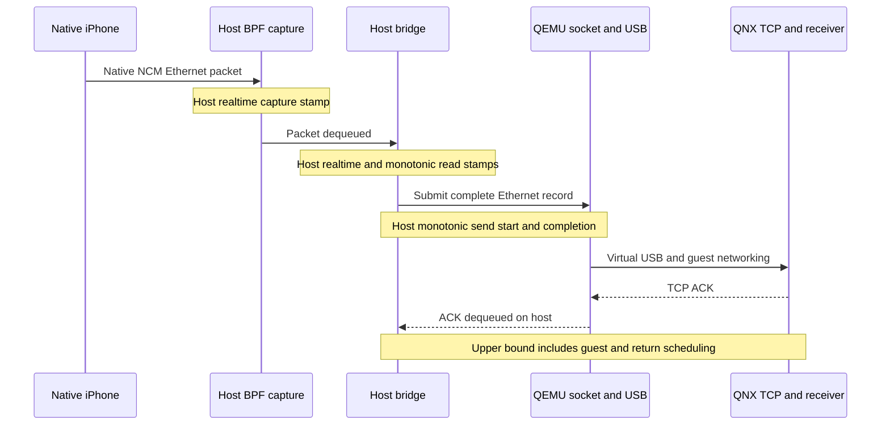
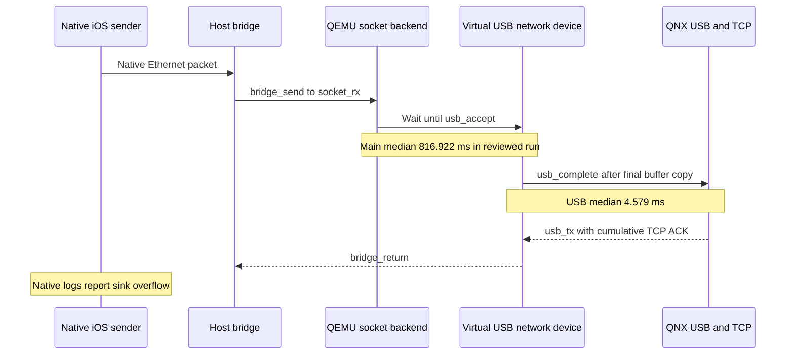

# vphone and QNX timing measurements

_2026-10-13 · `feat/vphone-carplay-lab` · Native iOS 26.6.2 Maps, Direct NCM, stock210 QNX._

[Laboratory recipe](VPHONE_LAB.md) · [Wireless overview](README.md)

## 📋 Result and acceptance boundary

The QNX bootstrap's generic-timer description is corrected. During an active
session its measured clock rate changed from **5.196 guest seconds per host
second** to approximately **1.0**. Immediate BPF capture removes a separate host
buffering delay: main-port capture-to-read median changed from about **28 ms to
0.036 ms**. Both authenticated screen streams still independently decode.

Follow-up instrumentation localizes most observed ACK delay to **QEMU's queue
before USB acceptance**: main-port median 816.922 ms, followed by 4.579 ms for
the virtual USB copy and 5.625 ms from copy completion to ACK production.
Native iOS logs concurrently report sender sink overflow. Increasing the stock
driver's receive/transmit URBs to 64 did not remove this queue.

These changes do not establish stable 30 fps or physical presentation. Long
sender-target/delivery differences remain, and the earlier 15.8-second main gap
was not reproduced in the follow-up runs.
Maps motion, encoder completion, virtual USB delivery and physical OMX output
are different measurements. The stand has no 2.4 GHz RF link.

## ⏱️ QNX timer correction

The pinned startup object is ARM32 little-endian ELF, load base `0x08000000`.
`init_qtime_virt` is at `0x080000bc`. It declared `cycles_per_sec=24000000`,
`timer_rate=83333333`, `timer_scale=-15`: the latter describes an 83.333 ns tick,
while the selected QEMU CPU counter runs at 62.5 MHz, or 16 ns per tick.

The [guarded correction](../../wireless/lab_common/qnx_clock.py) changes only the
copied bootstrap's rate and cycle-frequency constants. It preserves ELF
relocations, interrupt 27, CPU0 timer ownership and timer callouts. The QEMU
command explicitly pins `cortex-a15,cntfrq=62500000` for this profile.

| Item | Value |
|---|---|
| Original startup SHA-256 | `e7715060be5050ca584b57ec32abc9313a1edbb9028ec483c9884b1097c8d9d1` |
| Corrected startup SHA-256 | `cb544f99cd6d765571b54a8794afbfb7dd489252dcb9745f38660e71cb75f79d` |
| Rate instruction offsets | File `0xf4` / `0xf8`: ARM `movw` / `movt`, rate `16000000` |
| Frequency constant offset | File `0x138`: 64-bit `62500000` |
| Scope | Opt-in QNX laboratory image; original startup file and factory AirPlay library preserved |

`input clock` reads QNX monotonic/realtime time, ClockCycles, declared frequency,
rate, scale and tick increment. Each response is bracketed by host monotonic
request/response stamps. The estimate includes **rate bounds**: a delayed reply
can make its midpoint estimate unreliable. A wide bound sets
`rate_estimate_reliable=false`; it must not be interpreted as clock drift.
Clock rate agreement does not establish exact clock-offset synchronization.

## 🔬 Queue observations

The bridge now timestamps BPF dequeue, host socket send start/completion and
returning QNX TCP ACK observations. It uses `TCP_NODELAY`, buffered diagnostic
files and an optional bounded JSONL journal without packet payloads. Immediate
BPF mode is the default; `--buffered-capture` retains the former 50 ms buffering
for comparison. The [reporter](../../wireless/vphone_lab/bridge_queues.py) preserves
incomplete/truncated status instead of treating partial evidence as complete.



| Main flow, port 6030 | Clock rate | Capture-to-read median / p95 | Socket-send maximum | ACK observed median / maximum |
|---|---:|---:|---:|---:|
| Legacy clock, buffered | 5.196 | 28.718 / 51.219 ms | 0.106 ms | 1561.425 / 6919.603 ms |
| Corrected clock, buffered | 0.997 | 27.569 / 51.089 ms | 0.085 ms | 1561.943 / 1917.605 ms |
| Corrected clock, capture-only cluster, buffered | 1.007 | 27.820 / 51.250 ms | 0.887 ms | 1695.651 / 2093.752 ms |
| Corrected clock, capture-only cluster, immediate | 1.003 | 0.036 / 0.110 ms | 0.145 ms | 779.885 / 1801.325 ms |

These are sequential runs with different source workloads, not a statistically
controlled encoder benchmark. The legacy receiver terminated SIGSEGV during
fake-OMX cleanup; its queue observations describe that unhealthy run. Corrected
runs listed here have no SIGSEGV. The buffered capture-only motion coordinator
failed early and its later manual motion extended past capture end; its whole
bridge journal remains usable, but its motion FPS is not a full-run comparison.
The final immediate run waited for both GOPs before its 40-second motion window.

Final BPF statistics: 18,080 packets received, zero BPF drops and zero reported
interface drops. This does not establish RF loss or phone-to-Mac NCM latency.
Endpoint identity checks are also timed: they block this single bridge loop
while `ioreg` and `ps` run. Their legacy maximum was 100.925 ms.

Capture-to-read includes BPF buffering and host scheduling. Socket-send
completion proves acceptance by the host socket, not delivery inside QNX. ACK
observation is an **upper bound**, including guest processing and reverse bridge
scheduling. These bridge-only observations cannot isolate virtual USB delay
from guest TCP processing; the following instrumented run adds those stages.
The wire analyzer also reports raw receiver ACK windows and resets; RST packets
with window zero are not receive-buffer backpressure. Observed ordinary ACKs in
the final run contain no zero-window advertisement.

## 🔌 QEMU and virtual USB isolation

The [diagnostic builder](../../wireless/vphone_lab/qemu_trace_build.py) copies
`net/socket.c` and `hw/usb/dev-network.c`, recompiles those two objects using the
existing compilation database, and relinks into `build/vphone-lab/qemu-net-trace/`.
It refuses an active owned QNX guest and never edits the shared QEMU sources,
objects or executable in `Tools/`. Input/output hashes and build commands are
retained. Source anchors must match exactly; dependency paths follow installed
Homebrew `opt` links when the original compilation database predates an upgrade.

The [native probe](../../wireless/lab_common/qemu_net_trace.h) records only TCP
flow identifiers, sequence/ACK numbers, lengths and timestamps, with no payload.
One buffered process-wide journal avoids interleaving partial rows from separate
writers. It caps at 131,072 packet observations and writes a checked count/footer
on normal exit. IPv4 and direct-TCP IPv6 are supported; extension headers and
fragments are excluded. The first exploratory probe covered only IPv4 and used
separate buffered writers; its native file is not accepted evidence for the
IPv6 CarPlay flows. The reviewed probe supersedes it.



`queues-usb-reviewed` uses the corrected clock, capture-only AltScreen and
immediate BPF. Both GOPs were ready before 40 seconds of guest GPS motion.
All 97,463 native observations fit the cap; both journals have complete footers,
no truncation, no unmatched screen stages and no unacknowledged delivered screen
segments at the end. The [joiner](../../wireless/vphone_lab/qemu_usb_queues.py)
uses host monotonic clocks, exact packet keys and cumulative ACK arithmetic,
including sequence wrap. RST is not accepted as a delivery ACK.

| Stage | Main median / p95 / max, ms | Cluster median / p95 / max, ms |
|---|---:|---:|
| Bridge send start → QEMU record parsed | 0.088 / 5.105 / 31.449 | 1.223 / 5.182 / 16.289 |
| QEMU record parsed → USB accepts frame | **816.922 / 932.778 / 1064.830** | **551.451 / 923.394 / 1070.994** |
| USB accepts frame → final virtual copy | 4.579 / 5.455 / 16.485 | 4.698 / 5.417 / 25.478 |
| Final copy → QNX ACK exits USB | 5.625 / 28.063 / 225.326 | 5.509 / 17.565 / 202.320 |
| ACK exits USB → bridge reads it | 0.082 / 0.127 / 27.056 | 0.084 / 0.132 / 26.470 |

Stage medians are separate distributions and must not be summed as the median
of an entire path. Final USB copy is into the emulated USB packet; it precedes
QNX processing and does not prove application receipt, decode or presentation.
Diagnostic overhead is included. The large backlog is localized; the root
throughput limit in the QEMU/OHCI/QNX service path is still unresolved.

The native sender's bounded 25-second `airplayd` log is not truncated: 1,200
entries include 50 interleaved `fvdp_statsReport: stats/sec` rows and 48 sink
overflow notifications. Across those rows, `Submits` ranges 18–28, `Encodes`
1–9 and `SinkODrops` 14–27; `EncDrops` and `EncQDrops` are zero. These counters
describe two interleaved displays with private processor identities, not 50
independent samples of one stream or per-frame completion timestamps. Earlier
startup logs explicitly identify `ParavirtualizedVideoEncoder`, `avc1` and both
800×480 / 1440×542 instances. Configured maximum 30 fps is not delivered FPS.

### Driver pipeline experiment

Static inspection of the stock ARM32 little-endian `devnp-ecmplus.so` identifies
the actual `receive` and `transmit` options. Its SHA-256 is
`1a896848795aa2f82af0758f635e3cd586f7174a5bd948f638456f590f1c4695`,
from `Tools/qnx-gl-passthrough/build/vm_pull/root/mntapp/armle/lib/dll/`.
`ecm_parse_options` at ELF VA/file offset `0x439c`
stores them at control offsets `0x2ec` / `0x2f0`; `ecm_init_mem` at `0x5794`
passes those counts to `ecm_alloc_upkts`. An isolated image changes only the
mount options to `verbose,receive=64,transmit=64`. No driver bytes are patched.

| Observation | Reviewed default | Receive/transmit 64 |
|---|---:|---:|
| Native packet observations | 97,463 | 94,017 |
| Main queue median | 816.922 ms | 810.716 ms |
| Cluster queue median | 551.451 ms | 735.863 ms |
| Main USB-copy median | 4.579 ms | 3.972 ms |
| Motion AUs: main / cluster | 148 / 113 | 152 / 108 |
| Main maximum delivery gap | 629.893 ms | 505.245 ms |
| Cluster maximum delivery gap | 584.382 ms | 584.437 ms |
| Sender overflow notifications in 25 s | 48 | 48 |

The sequential runs do not establish an improvement from URB count. Backlog and
sender overflow persist. The standard image has been rebuilt without this
experimental override. Both runs retain authenticated main/cluster video,
clock rate near 1.0, bounded closure errors and usable clock RPCs after closure;
independent FFmpeg reads decode 1/1 and 2/1 main/cluster snapshot frames at their
advertised sizes. Neither run has a TCP sequence hole, periodic coordinated
recovery or receiver SIGSEGV. TCP retransmitted bytes are retained in the wire
reports and are not interpreted as proof of physical packet loss.

The earlier 15.842-second delivery gap did not recur: the reviewed motion run
has maximum main/cluster gaps 629.893 / 584.382 ms. This does not prove that the
long tail was fixed. Sender completion-to-BPF timing remains unmeasured; the
new evidence establishes sender sink pressure and a downstream QEMU backlog.

## 🔄 Renderer recovery and native frame intervals

There is no working hardware cluster renderer on this stand. The ordinary
forwarder therefore requests `forceKeyFrame` with reason `coordinated-recovery`.
The observed counts were 16 in the legacy run and 11 with corrected time.

`--capture-only-altscreen` is a separate, explicitly enabled QNX RAM-capture
profile. It validates/decrypts/converts native stream111 AUs and captures them
without enqueuing into the absent renderer. It retains explicit start/UI/invalid
AU keyframe requests. Both capture-only runs have **zero periodic coordinated
recovery requests**. The mode does not emit renderer presentation success or
change the production forwarding policy. It does not remove the roughly
second-scale ACK delay, so that delay cannot be attributed solely to the
cluster recovery loop.

Final motion-window observations:

| Stream | Delivered AUs | Delivery span | Sender-target span | Maximum delivery / target gap |
|---|---:|---:|---:|---:|
| Main | 10 | 38.733 s | 8.467 s | 15841.873 / 4300.000 ms |
| Cluster | 124 | 39.615 s | 38.500 s | 475.885 / 766.667 ms |

Main has a 15841.873 ms delivery gap with a 4300.000 ms sender-target gap.
This is an unresolved upstream target-to-arrival difference; it is much larger
than the measured BPF buffering and host send cost. Presentation targets do not
measure when rendering or encoding actually completed, so these data cannot
attribute that difference to the encoder, iOS scheduling or NCM before BPF.
Cluster's sparse map output also does not demonstrate steady 30 fps.
No frame rescheduling, duplication or synthetic source cadence is introduced.

## 🧪 Diagnostics and validation

A native keyframe control call can stall during teardown. Refresh now permits
only one detached native call, retains its session safely, and keeps the capture
mutex out of that call. The snapshot waits for a newer GOP with a monotonic
deadline and bounded polling. Failure preserves the previous host capture.
Clock/timing requests can remain usable while the native call is stalled; no
unbounded sequence of worker threads is created. In the final closure test, unavailable refresh returned in 2.350 host seconds
and the following clock query succeeded. Its short sampling brackets were wide;
that midpoint rate estimate is not clock-drift evidence. Normal captures stay bounded
at 2 MiB per screen and timing capture at 8192 picture buffers.

Validation includes Python transport/clock/queue tests, C ASan/UBSan with 10,000
seeded inputs, a blocked-control-worker test, and a host compile check rejecting
stack frames over 4096 bytes. AltScreen recovery, forwarder, async worker and
negotiation suites pass sanitizers. QNX release build passes with toolchain 8.5;
the initial generic `latest` build failed because that Docker image is absent.
Three fuzzers separately completed 13,040,827 inputs before that missing-image
failure; their results remain separate from the successful 8.5 build run.

The USB follow-up adds packet-stage joins, sequence-wrap/retransmission/stale-ACK
and reset controls, owned binary identity checks and sender counter parsing.
The native trace parser additionally completes 200,000 libFuzzer inputs under
ASan/UBSan using Homebrew LLVM 23. The system CLT compiler lacks the fuzzer runtime;
its failed link is separate from the successful LLVM run.

Independent FFmpeg decode of final immediate captures: two main frames at
800×480 and one cluster frame at 1440×542 show actual Maps tiles, traffic and the
location dot. These are decoded snapshots, not physical OMX presentation.

## 🛠️ Reproduce and retain evidence

```bash
scripts/carplay_lab.sh qnx-build --request-ui-maps --input-control \
  --capture-memory --pacing-only --clock-realtime --capture-only-altscreen
scripts/carplay_lab.sh qnx-start
# Wait for qnx-info readiness; use its current receiver public key for mfi-probe.
scripts/carplay_lab.sh qnx-info
# Start bridge and the existing signer before the owned API peer.
scripts/carplay_lab.sh ethernet --seconds 120 --trace-queues
# Run these in another terminal while the authenticated session is active:
scripts/carplay_lab.sh input clock --samples 6 --interval 1
scripts/carplay_lab.sh moving-route --seconds 40
scripts/carplay_lab.sh input timing primary
scripts/carplay_lab.sh input timing cluster
# Issue fresh-IDR requests after the measured motion window.
scripts/carplay_lab.sh input snapshot primary --fresh
scripts/carplay_lab.sh input snapshot cluster --fresh
# Wait until the bridge finishes before analyzing its journal.
scripts/carplay_lab.sh queue-report build/vphone-lab/bridge-queues.jsonl
scripts/carplay_lab.sh qnx-stop
```

To add the QEMU stages, build the diagnostic executable while QNX is stopped,
then use it in place of the ordinary `qnx-start`. Keep the same bridge/signer/peer
setup and capture both journals from the same session:

```bash
scripts/carplay_lab.sh qemu-trace-build
scripts/carplay_lab.sh qnx-start --trace-network
# After both streams are ready, collect the bounded native sender log:
scripts/carplay_lab.sh sender-log --seconds 25
# After the bridge finishes, stop QNX to flush the native journal footer:
scripts/carplay_lab.sh qnx-stop
scripts/carplay_lab.sh usb-queue-report \
  build/vphone-lab/qnx-network/network-trace.jsonl \
  build/vphone-lab/bridge-queues.jsonl
```

Ordinary `qnx-start` selects the original shared executable again. The trace
executable is hash-checked before start, runtime process identity stays exact,
and its journal is private to the owned build directory. Save the native journal,
bridge journal, PCAP, build records and reports under a unique run prefix before
another start overwrites the default artifacts.

The full signer/peer recipe and current-key rule are in [VPHONE_LAB.md](VPHONE_LAB.md).
For clock/recovery comparisons, omit `--clock-realtime` or
`--capture-only-altscreen` explicitly. For BPF comparisons keep the image fixed
and add `ethernet --buffered-capture`. No existing or physical device is selected
implicitly.

Ignored artifacts use prefixes `queues-legacy`, `queues-realtime`,
`queues-headless`, `queues-immediate`, `queues-closure*`, `queues-usb-reviewed`
and `queues-usb-urbs64` under
`build/vphone-lab/`. Each measured bridge has an Ethernet PCAP, bounded queue
journal and JSON summary; successful motion runs also retain clock probes,
input timings, native GOPs and independent decoded PNGs. The retained
`moving-fixed-*` captures are earlier evidence with the legacy clock.

Next useful isolation: measure QEMU socket read/backpressure and OHCI transfer
service alongside QNX USB completions. Improve service throughput before merely
moving the same backlog into the host socket. Per-frame sender render/encoder
completion is still needed to explain any recurrence of the multi-second tail.
