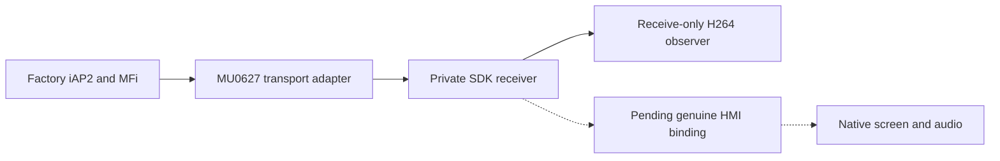

# WCP0627 developer source review

_Local source inspection and host checks — 2026-10-18._

[Wireless overview](README.md) · [Our HU test status](STOCK210_HU_TEST.md)

## 📋 Scope and evidence

The user supplied `WCP0627_Developer_20260818` from their Downloads directory.
It targets VW MHI2 CN G11 / MU0627, QNX 6.5 ARMv7 with J9 and an 800×480
display. Our candidate targets Audi MHI2Q MU1316 / P5087. This is a source
handoff, not an installable wireless CarPlay release. The archive label is
explicitly normalized; it does not date the reported experiments.[^manifest]

All **188 entries** in `SHA256SUMS.txt` matched their local files. This proves
agreement with the supplied manifest, not independent provenance or hardware
success. The manifest describes 184 source files and explicitly records no raw
device logs, proprietary SDK, credentials, successful live HMI load or wireless
playback.[^manifest]

| Package statement | Evidence available here | Interpretation |
|---|---|---|
| Real iPhone accepted wireless advertisement and same-unit MFi; vehicle record appeared | Author's written summary | Claimed hardware progress, not independently reproduced |
| Pairing, Verify, BT/network identity association, network SETUP and RECORD succeeded | Author's written summary | Useful protocol milestone |
| Two type-110 H.264 runs: 50 callbacks / 906398 bytes and 51 / 847204 bytes | Written counts; receive-only source | Reception claimed; no decoded/displayed output established |
| 305 development-tree Python checks, 298 pass / 7 skip | Summary only | Not a test result reproduced from this package |
| RAM HMI entry plus TERM/relaunch failed; later MMX boot observed | Explicit failure record | Reset source unresolved; no supported HMI deployment recipe |

These statements come from `VERIFIED_METHODS_CN.txt`. Its explicit caveats
must accompany the positive counts.[^methods]

## ⚙️ What the implementation does

`integration/wcp_oem_network_transport.c` adapts a byte transport to the
factory mm-ipod/iAP2 engine. Its parent/module layouts and transport enum are
pinned to MU0627 binaries. A receive worker fills a bounded 64 KiB ring and
sends fresh dispatch pulses; it deliberately avoids waiting for the previous
OEM input callback, which could itself be waiting for an ACK. Authentication
and identification remain in the factory engine.

`integration/wcp_phone_core.c` starts a private-SDK receiver and serializes
discovery processing on its SDK queue. `wcp_admission.h` binds a bounded BT
bootstrap to the expected local/peer addresses, cryptographic Verify, phone
Bluetooth identity and associated connection. These are diagnostic time and
request budgets, not production reconnect policy.

The limitation is visible in executable source, not just documentation:
`wcp_media_platform.c` returns `kNotPreparedErr` from the normal screen/audio
start paths. Its explicit receive-only mode validates/counts H.264 and invokes
synchronous completion without retaining or rendering frames.

The separate native adapters demonstrate intended ABI handling:

| Source | Useful boundary | Porting requirement |
|---|---|---|
| `wcp_oem_screen.c` | AVCC before start; visible-window confirmation before frames; preserve incoming ticks | Revalidate our stock ScreenStream ABI and actual window callbacks |
| `wcp_oem_audio.c` | 36-byte non-Darwin PCM ASBD; stream type 100 and real audio ACK callbacks | Check MU1316 ABI; mock adapter checks do not grant audio focus |
| `src/wcp/hmi/ResourceMap.java` | Explicit screen/audio and controller/accessory enum conversion | Verify MU1316 DSI constants; do not forward raw AirPlay integers |
| `src/wcp/hmi/WirelessSiLifecycle.java` | Session proofs, provider registration and actual asynchronous SI receipts; STARTED is only session status | Bind to the same real HMI/ASL session; no timer-generated ACK |
| `phone/wcp_mdns_guard.c` | Bounded ownership of a fresh foreground responder | Different factory hash/size and readiness model; our runtime probes functional DNS-SD IPC |
| `phone/wcp_pf_session_lease.c` | Peer/port-specific temporary PF rules with watchdog removal | Revalidate PF ABI and baseline; our production profiles have a separate recipe |

## 🧪 Checks reproduced locally

Seven autonomous C suites compiled with host Clang, `-Wall -Wextra -Werror`
and ASan/UBSan, then exited 0 with a 15-second per-test bound:

| Suite | Reported result | Boundary |
|---|---|---|
| `wcp_chain` | 33 checks | Mock backends |
| `wcp_ui` | 27 checks | Local mock event source |
| `wcp_oem_audio` | 35 cases | Mock native API; 36-byte format |
| `wcp_oem_screen` | 35 cases | Mock native API |
| `wcp_video_probe` | Malformed/bounds checks pass | Metadata only, no decoder/frame storage |
| `wcp_admission` | Bootstrap/Verify/identity/connection/deadline checks pass | Pure admission state |
| `wcp_stream_cancel` | Partial read wakes, unrelated descriptor stays open, attach after cancel denied | Local sockets |

Each suite uses `integration/wcp_<name>_test.c`, linked with its matching
implementation when present (`admission` is header-only). Flags were
`-std=gnu99 -O1 -g -Wall -Wextra -Werror -fsanitize=address,undefined
-fno-sanitize-recover=all`. Local output is
build/wcp0627-host-review.log (`build/wcp0627-host-review.log`; local generated artifact).
No package deployment/build scripts were executed and no HU was contacted.

## 📍 Application to our candidate

Our current design keeps the factory AirPlay 210.81 receiver and DIO, with a
Rust iAP2/bootstrap daemon and a C hook. Adopting the package's private receiver
and Java HMI provider would be a different architecture; this review does not
establish a reason to replace our receiver. See
[our architecture](STOCK210_ARCHITECTURE.md).

Use the package as a checklist for physical acceptance: same-unit MFi,
consistent Bluetooth/network identities, genuine RECORD and frame arrival,
then native window and audio ownership receipts. The OEM engine adapter is a
possible fallback to investigate if real-phone bootstrap fails in our Rust
path. Its offsets, symbols and layouts require MU1316-specific recovery first.

There is no reproduced Wi-Fi throughput or frame-pacing improvement in this
handoff. The screen adapter passes incoming timestamps; the receive-only
observer does not measure presentation intervals. Our
[radio measurements](../stock-patches/README.md) remain separate evidence.

Keep the source package external while licensing/provenance is unresolved;
this note records paths and observations without vendoring its code. Its
dependency instructions require the matching proprietary SDK/firmware inputs
and prohibit copying private MFi/pairing/EEPROM material between units.[^deps]

[^manifest]: Supplied local package: `PACKAGE.json`, `README_CN.txt`, `SHA256SUMS.txt` in `WCP0627_Developer_20260818`; inspected 2026-10-18. No public source URL supplied.
[^methods]: Supplied local package: `VERIFIED_METHODS_CN.txt`, including the receive-only limitation, missing raw logs and failed HMI reload.
[^deps]: Supplied local package: `DEPENDENCIES_CN.txt`; its CoreFoundation bindings are pinned to libairplay SHA-256 `bf10416e7e97dc5ba1a60e226893d1082d3aae67d0e8864a946562b805ee7a85`, not our receiver.
