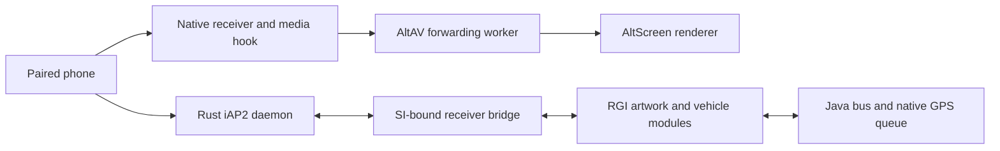

# Wireless AltScreen, iAP2 and ASI ownership

_2026-10-21 · MHI2Q MU1316/P5087 · physical screen/input acceptance; audio and automatic reconnect open._

[Wireless overview](README.md) · [Native SI evidence](SI_STAGE2_OFFLINE.md) · [Receiver protocol](RECEIVER_BRIDGE.md)

The [October 22 local media/HMI investigation](../carplay-lab/WIRELESS_MEDIA_VALIDATION.md)
adds an opt-in compressed wireless audio path and confirms real SI/J9 startup
and queue execution. vphone AAC reaches native PCM with an explicit test
HMI/QSA/RTCP model; production RTCP, HMI audio focus and the owner's fast-zoom
corruption remain unaccepted. The
historical matched kit below does not cover these new sources.

## 🚗 HU acceptance and return to wired operation

The matched kit below was installed and read back on the physical HU. After the owner's restart, SI PID `1015898` passed the immutable image guard and a fresh native NOOP with deleting-destructor confirmation. All seven updated files matched their installation receipt. Bluetooth initially connected without an iAP2 channel; reconnecting Bluetooth reached MFi authentication but the iPhone rejected Identify with `4040000a1d0300040006` (parameter 6, outgoing capabilities).

The failed list advertised `StartNowPlayingUpdates` (`5000`) without `StopNowPlayingUpdates` (`5002`). Adding `5002` and restarting only the supervised Rust daemon allowed the same paired iPhone to start CarPlay. The change also reports rejected field IDs. A host regression covers the captured rejection and complete capability pair; the independent lab phone now rejects an incomplete pair instead of accepting it. This daemon hotfix is newer than the archived native matrix below.

| Physical result | Observation |
| --- | --- |
| Main screen and input | Owner confirms working main display and rotary/button input; native decoder/window are 1024×480 |
| AltScreen | Owner confirms working cockpit display; renderer logs 1440×542 decoded-video takeover and `VISIBLE PATH OK` |
| Audio | Failed: iPhone lists only its own audio output, and the owner hears no car audio. Native modes reach `mainAudio controller`, but sampled DIO has no active audio stream threads |
| Initial Bluetooth reconnect | Failed automatic activation after the initial boot; recovery after the Identify fix required a Bluetooth reconnect. Boot auto-reconnect has not been revalidated |
| Semantic channels | Early BEGIN reports no admission and metadata operation 8 reports not-ready; later vehicle logs show repeated `PASCD not queued`. Sustained metadata/GPS/speed delivery is not accepted |
| Siri/microphone | Native speech mode changes are logged, but real recognition and car playback remain unverified |

At the owner's request, further live audio investigation stopped. The SI entry point has been restored to the original USB re-arm binary (`606236a8…`), `btstack` to the pinned stock binary (`154c1782…`), and the wireless respawn removed from `rc.local`. Wired hooks, Java, cabin centre-channel calibration, Tailscale and WLAN watchdog are preserved. Files were read back and `/mnt/app` returned read-only. After the owner's reboot, SI PID `983130` and stock Bluetooth PID `1130590` match the expected code in memory; the SI adapter, wireless daemon and runtime are absent. Actual USB playback after restoration still awaits the owner's check. No automatic rollback timer was used.

Private evidence and restoration receipts: `build/si-wireless-stage2/hu-acceptance-20261022-013557/`. The date in that directory is UTC; this was the October 21 local vehicle session. It contains pre/post-boot and active-session logs, exact configurations, native memory snapshots, the complete loopback bootstrap pcap, hotfix source/binary receipts and wired restoration backups. Continue locally with audio capability/transport negotiation, startup reconnect, and sustained semantic delivery. Do not reinstall the old review archive without integrating this physical Identify fix and regenerating matched evidence.

## ✅ Matched review result

The final local kit passes **256 checks in nine native profiles and 26 cycles**. The independent audit verifies every archived file/mode, source snapshot, production export and delivered SI/adapter/hook/daemon hash against each receipt. Rust workspace: 300 tests, daemon library: 61; host ASan/UBSan/fuzz and Java transport checks pass.

Artifact: `build/si-wireless-stage2/mhi2q-si-owned-review.tar`, SHA-256 `88ff2f0c0fc00dbdbdaf59bb16b6ef691bb9e186d23773e1305f6270c2e611af`. Audit: `build/si-wireless-stage2/final-review-audit.json`. The archive includes both Java variants and contains production binaries only. These are the pre-HU source and binary results: the Identify hotfix above changes current source, so rerunning `audit_current_review.py` against this checkout must report source drift until the kit and native evidence are rebuilt.

## 📋 Scope and acceptance

The production path now includes paired AltScreen, route guidance including lanes, artwork file transfer, vehicle status, speed and native GPS delivery. Wireless DIO control notifications carry their immutable SI birth context. The implementation uses the existing native controller, media and wired feature consumers; QEMU peripherals are separate test inputs.

The physical session above accepts main video, input and AltScreen after the Identify hotfix. Audio, sustained semantic delivery, startup reconnect, Siri recognition and amplifier routing remain open.

| Channel | Production implementation | Local acceptance boundary |
|---|---|---|
| AltScreen 111 | Paired AEAD, independent connection key, real AltAV forwarding worker | Native SI/DIO to renderer TCP protocol peer; extracted H.264 independently decoded at 1440×542 |
| Route and manoeuvres | Authenticated 5201/5202 to existing RGI module | Real parser and Java bus protocol peer |
| Lanes | Authenticated 5204 to existing lane parser | Native RGI bus publication with lane count and description |
| Artwork | Negotiated iAP2 file session, bounded transfer ledger, existing JPEG/PNG worker | Start/Data/Success, decoded 256×256 PNG, bus path; clear regression in C and Java |
| Vehicle status | A100 subscription, A101 from existing vehicle module | Range, temperature and warning from simulated HMI telemetry |
| Wheel speed | Requested location data to existing PASCD generator | Checksummed FFFB received by independent phone peer |
| GPS | Existing native CNMEAProvider and GPS job queue to FFFB | Synthetic GGA/RMC supplied through the actual native queue |
| ASI ownership | Bound state/watchdog/flush/teardown/restart, native controller execution | Delayed old-child callbacks rejected in the live native fixture; host replay/queue race cases |

The current feature receipt is `build/si-wireless-stage2/integrated-features/integrated-receipt.json`. Require `status=PASS`, every check true, matching log/source hashes and matching delivered binaries. Earlier receipts are historical evidence and must not be used to approve a newer build.

The earlier standalone feature profile passed 38 checks across two cycles; the final profile additionally checks clean terminal ASI delivery. Both independently decoded AltScreen extracts have SHA-256 `1f856206bf01ac9df241524e218ceddb8326d98773f177f247a6f7ed06140ad0`. The host workspace passes 300 tests, including 61 daemon-library tests. Require the final matched matrix before using an earlier native receipt for delivery. Logs are under `build/si-wireless-offline-re/current-{features,workspace-tests,host-tests,java-tests}.log`.

## 🖥️ Paired AltScreen



`HOOK_WIRELESS=1` builds `MHI2Q_WIRELESS_ALT=1`. Runtime enablement is `MHI2Q_CP_WIRELESS_ALT=1` on an admitted wireless child. The former `_ALT_QEMU` path remains only for capture-specific test instrumentation; it is not required for production forwarding.

Stream 111 uses its own connection ID, HKDF key and nonce state. A key claim is single-use, authentication failures do not fall back to another cipher, and nonce exhaustion fails closed. Existing receiver retirement and AltAV queue/recovery rules apply. The phone's frame cadence is preserved; this change does not synthesize or interpolate frames.

## 📡 Authenticated iAP2 feature transport

Rust advertises the RGI component ID 16, vehicle information/status and location capabilities. It retains actual negotiated file-transfer-session payloads, rather than inventing a USB transport wrapper. Pre-authentication payloads are discarded. The bounded worker keeps receiver IPC away from the iAP2 link timer.

| CPRX v3 operation | Body after the 32-byte SI-bound header | Delivery rule |
|---|---|---|
| 8, Now Playing | u16 LE length, CSM | Existing bounded native event publication |
| 9, semantic input | u16 LE length, kind u8, sequence u32 LE, payload | Kind 0 Identify/BEGIN, 1 CSM, 2 file transfer; exact last retry returns cached result |
| 10, semantic output | Last acknowledged sequence u32 LE | Reply after CPRA: sequence u32 LE, length u16 LE, CSM; retained until acknowledgement |

Operation 9 permits a sequence jump only for an explicit BEGIN resynchronization. Ordinary packets cannot skip unknown artwork data. A new child resets the sequence space; re-binding the same child does not. Operation 10 never removes a pending output merely because its TCP reply was lost. Worker delivery epochs discard queued output from an earlier receiver even when the RFCOMM generation is reused. Failed BEGIN retries are limited to one per 250 ms.

Now Playing retries a temporary not-ready/busy result or a lost TCP acknowledgement at most three times with the same bound frame. These are idempotent state assignments, unlike file chunks. Re-BEGIN wraps the stock metadata-subscription TLVs in a complete 5000 CSM; treating the payload-only builder as a full frame silently prevented resubscription. Host regressions cover that 150-byte CSM and exact TCP retry bytes.

**RFCOMM reattachment has a separate feature link.** Native IP media and its SI birth tuple can survive a lost BT bootstrap. A fresh authenticated Identify from the same SDK peer reattaches the feature worker to that existing admission, with a new transport generation. SI epoch/session/child and the original native link stay immutable; CPRX still uses the native link, while iAP2 input/output and Now Playing use the newly authenticated transport link. No media lease is fabricated. Old transport packets, another peer, a changed child and a draining admission are rejected. Re-BEGIN resubscribes RGI and metadata and invalidates partial artwork. The expanded `rfcomm-gap` profile requires a new road update to reach the native RGI parser and bus before the retained IP session is allowed to close.

The file ledger tracks at most four transfers and 800,000 bytes per file without duplicating image storage in Rust. It sends Start, Success or Cancel on the actual negotiated file session. Typed zero-length artwork invalidates pending decode work, asynchronously removes the canonical PNG and publishes an explicit clear to Java. Repeated clear is idempotent.

Production GPS values come from the existing native provider. `si_location.c` redirects only the two GPS-delivery vtable entries of an admitted wireless DIO. It validates bounded native strings and requested GGA/RMC sentences. No synthetic position is compiled into the production bridge. The QEMU GPS input is deliberately synthetic.

## 🔒 ASI source ownership

Stock SI's service-state events do not retain a DIO generation. Wireless DIO therefore replaces its ASI client object's six interface methods with a private publisher; destructors and the object identity remain native. Wired DIO keeps its original ASI path.

The private 192-byte `SIA3` envelope is **version 2**. It includes SI epoch, DIO PID, session, link, sequence, event kind, value and watchdog cookie. Old version 1 and reserved bytes are rejected. State, watchdog, flush, teardown and restart enter the existing SI adapter job queue. Generic USB-volume metadata is suppressed for wireless: SI already owns the authenticated phone identity.

SI checks the complete source tuple both before queueing and immediately before delivery. On the native controller thread it constructs and executes the original event and then invokes its original deleting destructor. There is no second unbound native queue between validation and execution. ACK replay cannot execute the event twice. A source mismatch, changed child or concurrent wired handoff rejects delivery. Persistent publisher failure terminates only its own wireless child.

Final DEINITIALIZED/error-shutdown notifications have a terminal acknowledgement barrier with a seven-second monotonic deadline, outside the queue lock. Stress testing exposed why this is necessary: after six ordinary reconnects, DIO once exited before its asynchronous DEINITIALIZED reached SI; the native child-death handler interpreted that as ERROR_RUNTIME and spawned an unwanted replacement. Ordinary notifications remain asynchronous. The actual publisher worker is also tested against a Unix peer with delayed ACK, ordered retry and rejected ACK; the negative control terminates only the test's own child.

The DIO vtable and native constructors are pinned to the MU1316 binary. The SI ELF remains the existing ABI-2 five-hook candidate; these channel additions do not introduce another trampoline.

| Native SI event constructor | SIA3 kind | Native payload |
|---|---|---|
| `0x1274B0` | 0, state | Enum converted by the original SI mapping |
| `0x127440` | 1, watchdog | u16 cookie and watchdog state |
| `0x1273CC` | 2, flush | u8 result |
| `0x12735C` | 3, teardown | No extra payload |
| `0x1272F4` | 4, restart | No extra payload |

The SI input with the retained USB re-arm patch has SHA-256 `606236a81c7c4dafda6fdd08fe6eb27c43252796784da25d9760a7d552ee2af3`; DIO is `e9862680d76ca2e6bb2eed067658f2ca8fa9b71b5446322384b76c9735c0e794`. The private envelope rejects state values outside 0–6, watchdog states outside 0–3, oversized cookies and nonzero reserved bytes. Tests inject an old child's valid context during the next native session for all five kinds, without replacing the production daemon or mutating its SI registration.

## 🧪 Reproduction and vehicle gate

Run from the repository root:

```sh
python3 wireless/si/test_si_stage2.py
bash scripts/run_tests.sh
bash scripts/test_java_transports.sh
python3 wireless/si/qemu_full_cycle.py --fault features --cycles 2 \
  --timeout 280 --workdir build/si-wireless-stage2/integrated-features
python3 wireless/si/build_si_review.py --full-cycle
```

The review builder includes production C/Rust and both firmware-family Java JARs, native fault receipts, feature video extracts and source snapshots. Test HMI/QSA/OMX bridge implementations are excluded. The archive is not an automatic installer and provides no automatic rollback.

The standalone full-cycle runner rebuilds the production wireless hook before creating the guest and verifies that sources did not change during the build. A current source snapshot alone cannot validate an older prebuilt `.so`.

### Startup authority and TCG budgets

Rust previously abandoned startup after eight seconds, before native SI's ten-second startup budget; in TCG, SI was already explicitly allowed thirty seconds. Stress testing showed cancellation arriving while DIO was still initializing. Rust now waits twelve seconds by default and still checks the authoritative native context on every poll. `MHI2Q_CP_SI_STARTUP_WAIT_MS` is strictly bounded to 1000–60000 ms; the disposable fixture sets 40000. An admission error, changed device/child or failed IPC still aborts the attempt.

| Budget | Production default | Disposable TCG fixture |
|---|---|---|
| SI child startup | 10 s | 30 s |
| SI child stop | 3 s | 30 s |
| Rust startup wait | 12 s | 40 s |
| Publisher terminal ACK | 7 s, monotonic | Same production code and limit |

The VM's shutdown allowance prevents slow emulated teardown from being misclassified by the stock three-second timer. It does not relax the publisher barrier. The integrated acceptance additionally rejects terminal publisher failures and native TIMEOUT_SHUTDOWN; SI-loss intentionally allows its old child to terminate after its parent disappears. These fixture results are functional acceptance, not HU boot/disconnect timing measurements.

The separate twenty-second pre-media grace starts only after successful receiver READY. Starting it at SI admission incorrectly included native DIO startup and could stop the accepted receiver during pairing. A TCP regression delays READY and checks the actual retained binding timestamp against the acknowledgement boundary.

Before production release, verify on the actual HU after a real SI restart: wired connect/disconnect/reconnect; wireless main/AltScreen and controls; audio/focus/phone calls/Siri microphone; manoeuvres/lanes/artwork; vehicle GPS and speed; Wi-Fi loss/recovery with Bluetooth retained; and reboot with stored pairing. Record hashes and timed lifecycle transitions. No physical acceptance is inferred from compilation or the modeled peripherals.
