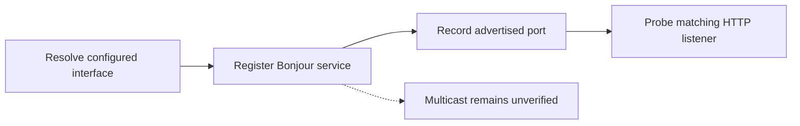

# Stock AirPlay interface and Bonjour gate (MU1316, offline)

_MHI2Q wireless CarPlay — historical investigation, integrated 2026-09-29._

---

[Wireless overview](../README.md) · [Current stock210 lifecycle](../STOCK210_RECEIVER_LIFECYCLE.md)

Historical investigation; earlier limitations and commands describe that experiment. The current implementation and validation boundary are in the section overview.

Implementation and local diagnostic paths in this record refer to the [original source directory](../../../wireless/receiver_bridge/). Run `wireless/...` commands from the repository root; moving this note does not move binaries or logs.

## 📊 Experiment overview



## 📋 Implementation and evidence

This is static analysis plus a QEMU A/B test of the exact MU1316
`dio_manager` and `libairplay.so`. It does not establish a wireless phone
session or authorize an on-unit change.

`CAirPlayMainThread::run` installs the AirPlay receiver's `interfaceName`
property through `CFObjectSetPropertyCString` at `dio_manager:0x15C57C`
(return address `0x15C580`). The property key is the `CFLString` at
`0x195EF8`, with `interfaceName` bytes at `0x195F00`; the supplied value is
the literal `carplay0` at `0x19785C`. This happens after
`AirPlayReceiverServerCreate` (`0x15C518`) and before its start control call.

In `libairplay.so`, `_UpdateBonjourAirPlay` at `0x20FB8` reads that name
from receiver object `+0x16C`. At `0x21504`, a nonempty name is passed to
`if_nametoindex`; if it returns zero, `0x2150C` selects `kNotFoundErr`
(`-6727`) **before** `DNSServiceRegister` at `0x21334`. The service port is
obtained from `AirTunesServer_GetListenPort` at `0x212AC`. The stock QEMU
listener is TCP 5000, and the service type is `_airplay._tcp.`.

The QEMU mesh has only `lo0`. Its real `GetPrimaryMACAddress` returns
`-6727`; `if_nametoindex("carplay0")` returns zero. The A/B harness can supply
a locally administered synthetic MAC and, separately, substitute `lo0` for
`carplay0` **at the original property setter**. With the latter substitution,
`if_nametoindex("lo0")` returns 1, `DNSServiceRegister` connects to the
factory `mdnsd` Unix socket and returns 0, and the stock library logs
registration of `_airplay._tcp.` on port 5000. The patched `/info` response
on that port includes feature bit 37. This proves the app-layer registration
path; multicast publication is not proved. QEMU's loopback-only interface
causes `mdnsd` to report `Can't assign requested address` when sending to
224.0.0.251.

Reproduce the complete QEMU-only A/B path with:

```sh
python3 tests/carplay_lab/qnx/qemu_capture.py --mesh \
  --start-experiment --seed-display --skip-hid-qemu --feature37 \
  --mdnsd --mock-mac-qemu --interface-lo0-qemu
```

The harness stages the exact factory `mdnsd` bytes inside its temporary
preload, uses SDK `io-pkt-v6-hc`, and applies a QEMU-only `IP_PKTINFO` shim.
The synthetic MAC, `lo0` substitution, screen dimensions and HID bypass
are emulator devices, not production settings.

On the observed head unit, the AP interface is `uap0`, not `carplay0`.
The optional `MHI2Q_CAPTURE_INTERFACE_NAME` build flag gives the capture
preload an exact-image, callsite-guarded setter interposer. A QNX ARM build
with `MHI2Q_CAPTURE_INTERFACE_NAME=\"uap0\"` succeeds offline; it has not
been run on the head unit and is **not** a complete receiver bridge. The
bridge must preserve the stock property's setter and validate the actual
AirPlay listener, advertised service and stop/restart lifecycle before it
acknowledges START. The wireless daemon's `MHI2Q_CP_AIRPLAY_PORT` must match
the verified stock listener; current QEMU evidence is port 5000, not 7000.
