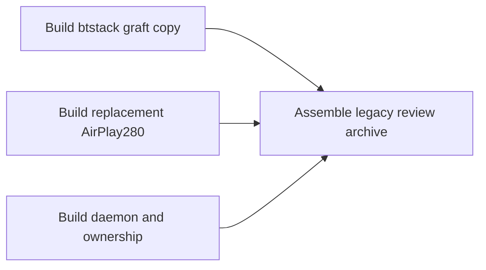

# MU1316 wireless CarPlay offline bundle

_MHI2Q wireless CarPlay — historical investigation, integrated 2026-09-29._

---

[Wireless overview](../README.md) · [Current stock210 lifecycle](../STOCK210_RECEIVER_LIFECYCLE.md)

Historical investigation; earlier limitations and commands describe that experiment. The current implementation and validation boundary are in the section overview.

Implementation and local diagnostic paths in this record refer to the [original source directory](../../../wireless/). Run `wireless/...` commands from the repository root; moving this note does not move binaries or logs.

## 📊 Experiment overview

## 📋 Implementation and evidence

**Historical experimental280 replacement bundle.** Current work preserves
stock210 and uses the separate [stock210 review builder](../README.md#build-and-reproduce).
The replacement installer described here does not apply to that candidate.

Run `python3 wireless/build_offline_bundle.py` from the repository root. It
checks the pinned btstack and receiver capture point, then builds the
AirPlay 280.33.8 receiver candidate from local source;
builds the C graft, Rust QNX daemon, dio preload, owner handoff candidate,
PF profiles, and a pinned `rc.local` launch candidate; then writes
`wireless/out/mhi2q-wireless-offline-review.tar`. The archive has a manifest
with SHA-256 for each of its twenty-five artifacts. The builder reopens the archive
and verifies every entry. It reads the firmware images and never contacts the
head unit.
`python3 wireless/build_offline_bundle.py --property-handoff-review` instead
creates a **separate** `wireless/out/mhi2q-wireless-handoff-review.tar`. It uses
the guarded seven-slot AirPlay copy-property handoff preload and includes
`reference/info_cfdiag.md` so the manager-shutdown findings travel
with the package. The ordinary archive is not overwritten. The handoff
variant passed the host sandbox install/rollback test and the QNX 6.5 QEMU
installer lifecycle with the real QNX daemon config check
(`integration/out/qemu_install_wireless_handoff.log`). These verify file
staging and rollback, not runtime safety on the head unit.
The handoff review variant now also includes the Rust daemon's STOP-`BUSY`
retry: it preserves the accepted receiver generation until STOP succeeds and
refuses a new generation while the old one is still active. QEMU showed why
the acknowledgement matters: with an active `/info` callback, STOP returned
`BUSY`; deliberately forcing manager teardown before retry reproduced a
`dio_manager` crash in `AirPlayCopyServerInfo`. Stopping new requests,
retrying STOP to `OK`, and only then tearing down passed the same stress
fixture. The bridge now has terminal `QUIESCE`: it drains the property callback,
closes AirPlay, and rejects later START requests. A QEMU overlap test received
`QUIESCE=OK` before manager teardown without a crash. The guarded archive's
owner helper and native supervisor compile in the required acknowledgement;
the wrapper and environment template also set it. Host tests confirmed that
`BUSY` leaves the owner running and `OK` precedes SIGTERM. A QNX/QEMU fixture
verified BUSY/OK retry and signal ordering for both wired takeover and
supervisor shutdown without the runtime flag. See
[Info Serialization](INFO_SERIALIZATION.md). Real hardware and QNX6 persist-FS behavior
remain unverified.

A later QEMU fixture forced `QUIESCE` while an independently paired client
was sending encrypted screen and audio. Two of three ordinary receiver runs
reported two `CFLRelease`/`CFLValidObject` assertions during active session
teardown even though `QUIESCE` returned OK and the manager released. See
[Info Serialization](INFO_SERIALIZATION.md) and [Bootstrap Comparison](../BOOTSTRAP_COMPARISON.md).
The current source now makes idle-only stop and new-SETUP admission atomic on
the AirPlay receiver's HTTP queue. Three QEMU runs confirmed BUSY while media
was active, client TEARDOWN 200, then QUIESCE OK without the earlier CF
assertion. The bridge also now parses AirPlay 280's extended-count `/info`
plist; full START→STOP→START→STOP and overlapping-callback QUIESCE QEMU
fixtures passed. Three QEMU runs of an unexpected control-socket RST during
active media also passed. A combined BUSY→RST→QUIESCE stress run exposed a
timing UDP error loop in the AirPlay receiver; the staged source now backs off
on `ECONNREFUSED`, and three repeats plus a delayed-RST run passed. Physical
phone/MFi/radio operation remains untested. The guarded wired owner now reacts
to active-media `QUIESCE=BUSY` with one `WIRED_DRAIN` request per owner. The
bridge uses AirPlay 280's `sessionDied` command to close media connections,
then the owner retries QUIESCE and signals the wireless process only after
OK. An independent QEMU client sent encrypted screen video and 80 PCM packets
before BUSY → DRAIN OK → QUIESCE OK; stock `dio_manager` released without a
captured crash (`receiver_bridge/out/qemu_active_wired_drain.log`). Host tests
checked request order and no early TERM; guarded QNX supervisor lifecycle
passed. A newer combined QEMU fixture runs the exact guarded owner helper,
generated wrapper, stock `dio_manager` and independent encrypted video/PCM
client in one instance. An unowned DRAIN was denied; the priority-lock holder
then completed BUSY → DRAIN → QUIESCE and reached its wired child while the
manager exited with status 0. Three earlier repeats passed before the lock
gate was added; all four printed a DispatchLite `EINTR` assertion during
manager exit, without a captured manager crash or `CFLRelease` invalidation.
The AirPlay 280 staging now retries the interrupted `select()` without an
assertion; the integrated active-media takeover and restart passed with this
change. See [Info Serialization](INFO_SERIALIZATION.md).
This does not yet prove a real iPhone/USB transition. The guarded
review archive was rebuilt from this source (SHA-256
`9949ce9a78329c4e636c53ac26cbe1edfe62d1de8897c16ecd2fd32aef9c24ce`).
Its host install/rollback and disposable QNX installer lifecycle passed;
the archive remains review-only and has not been promoted to on-unit use.
The current archive also carries the rebuilt on-unit AirPlay library
(`1ad8a4f641646754f185e808e48837c2f845af5452f047d62affca4fe85c9050`)
with the QSA nonblocking I/O stop fix. Its PCM behavior remains untested on
the head unit. Its grafted
`btstack` SHA-256 is
`81484f286ae6b61a54b621c974177ccca59536162defb161e1b99360af184916`.
This graft also queues a Blue SDK EIR refresh after it publishes
`discovery_ready`, using the same target function that successful SDP insertion
calls. The donor/target match is recorded in [Bluetooth Discovery](../BLUETOOTH_DISCOVERY.md).
The installer now probes process-lock exclusion on temporary files beside both
`/mnt/persist` owner locks before any backup or replacement. It rejects install
if the directory is absent or either probe fails. This protects the wired
launch path if the unit's QNX6 filesystem lacks the required lock behavior;
actual behavior on that filesystem remains unverified until an on-unit check.
An integrated QEMU extension held the wired owner for three seconds, then
released it. The native supervisor started a second stock `dio_manager` with
a different PID only after that release; the new receiver mapped the staged
AirPlay library and returned `START=0`. Both generations stopped with IE
cleanup. A stale first-generation listener initially caused false readiness;
the production supervisor now requires the new PID to hold the owner lock
as well as open the bridge port. The production bridge now marks its listener
and accepted sockets close-on-exec, preventing spawned children from keeping
the old port bound. See `receiver_bridge/out/qemu_active_owner_supervisor.log`.
The QEMU wired child and receiver restart request are synthetic, so physical
USB and iPhone transport switching remain unverified.
Before packaging, it also compiles the QNX I²C shim ABI check against the
local BSP `hw/i2c.h`; the manifest records the checked header and source
hashes. A direct stock MU1316 MFi QEMU probe exposed a previous read-path
mismatch: the binary uses combined `DCMD_I2C_SENDRECV` (`0xC0140507`), whereas
our shim had split SEND and RECV. The corrected shim passed the stock-export,
synthetic phone and combined receiver QEMU checks. This confirms command
values and header layout against the binary and BSP, not a live MFi
transaction.

The archive is a review input. It includes a guarded wireless-only installer
candidate, exact baselines and rollback procedure; see
[[Experimental280 Installer](EXPERIMENTAL280_INSTALLER.md)](EXPERIMENTAL280_INSTALLER.md). The QEMU runs separately
prove the btstack-to-daemon iAP2 marker/SYN exchange, the historical
daemon-to-stock-receiver CarPlay Control path, and an AirPlay 280 receiver
START/STOP and same-SDK pairing path. They do not yet prove a
real phone, MFi coprocessor, Wi-Fi multicast, or PF rules on `uap0`.
The AirPlay 280 QEMU image also passed the synthetic phone-to-Rust-daemon
availability and `CarPlayStartSession` path on port 7000
(`receiver_bridge/out/qemu_bridge_airplay280.log`).
An additional QEMU-only client independently verified the receiver's
SRP proofs, identity exchange through M6, pair-verify through M4 and
encrypted `/info`
([Independent Pairing Probe](INDEPENDENT_PAIRING_PROBE.md)).
An optional follow-up QEMU probe sent an authenticated control-only
`SETUP /stream`; the receiver returned RTSP 200 and `dio_manager` created a
session. Closing that test connection then shut down the stock manager. Later
independent QEMU probes exercised screen and audio media as described below.
An optional screen-110 SETUP probe reached timing sync and received a
`dataPort` in the encrypted response. A legacy ScreenRegisterDelegates shim
then corrupted memory because the 280 SDK's ScreenPrivate was smaller;
after removing that write, 25 repeat QEMU runs completed TEARDOWN and stock
manager shutdown without the former SIGSEGV. An independent QEMU client then
completed RECORD, sent an authenticated AVCC frame, and the fake OMX accepted
codec config and frame data in three repeat runs. The fake OMX does not decode; real display,
phone interoperability and on-unit behavior remain untested. See
[Independent Pairing Probe](INDEPENDENT_PAIRING_PROBE.md).
The independent QEMU client also negotiated a simultaneous MainAudio PCM
stream. It sent 80 authenticated RTP packets to the returned UDP port; all
passed into the receiver's jitter buffer and the QEMU null backend's output
callback received nonzero PCM. The guest-paced stream rebuffered 17 times,
and real QSA playback and audio routing remain unverified. Two strict runs
passed; another run exposed intermittent HTTP 500 from the SDK client's
encrypted `/info` before media setup, traced to an invalid CFLite object
in response serialization. The independent client's `/info` succeeded in
that same run; the cause is still open. An optional QEMU-only CF-type walk
passed six pairing-only and four media repeat runs without reproducing it;
see [Info Serialization](INFO_SERIALIZATION.md). A second QEMU-only image checks the
plist **only if** `/info` serialization fails; four strict media runs with
that verified image also passed without reproducing the failure. The normal
QEMU and on-unit builds exclude both diagnostics.

Startup ownership remains the main integration risk. The factory
`smartphone_integrator.json` lists `dio_manager` as its `children.carplay`
process. This repository's deployed wired-CarPlay child replaces that entry
with `carplay_startup.sh`, which loads `libcarplay_hook.so` and then `exec`s
`dio_manager` under Smartphone Integrator's PID/watchdog ownership. The
factory `runMMX.sh` starts the framework broker and service manager; it does
not start the wireless daemon or an independent persistent dio. The QEMU
receiver fixtures start stock dio explicitly. SI's `connectDevice` and
`FakeConnectDevice` paths were traced to an existing-device gate and USB
MediaConnector, so they cannot bootstrap an unknown wireless phone. The
exact owner boundary and request paths are mapped in
[[Dio Ownership](../DIO_OWNERSHIP.md)](../DIO_OWNERSHIP.md).

The offline handoff candidate adds `bin/dio_owner_exec`, a replacement
`integration/carplay_startup.sh`, `bin/wireless_dio_supervisor_bin`, and
`integration/wireless_dio_supervisor.sh`. The owner helper takes process
locks **before** the wrapper publishes its generation or starts its monitor,
and keeps them across both `exec`s into stock dio. The SI child takes a
wired-priority lock, stops the wireless lock holder identified by `F_GETLK`,
and waits at most seven seconds for ownership before its ten-second SI
startup deadline. A QNX 6.5 QEMU test passed wireless-to-wired handoff and
suppression of a second wireless start on a writable QNX4 filesystem; host
process tests also cover a TERM-ignoring child and the generated wrapper.
A second QEMU test launched stock `dio_manager` through the owner helper and
verified that its reported PID still held the owner lock after `exec` (see
`receiver_bridge/out/qemu_capture_mesh_owner_exec.log`). That test used a
minimal C stand-in for the wrapper's final `exec`.
QNX's `/dev/shmem` returns `ENOSYS` for `F_SETLK`; `/mnt/app` is normally
read-only. The candidate therefore defaults to lock files in the writable
QNX6 `/mnt/persist` partition. Equivalent locking on that filesystem and the
`rc.local`/SI installation change remain unverified.

`integration/build_launch_candidate.py` reads the SHA-pinned local
`../wifi_fix/rc.local` and adds one supervised wireless launch line before
its completion marker. The archive includes that candidate and
`integration/wireless_carplay.env.example`. The shell launcher requires a
separate `wireless_carplay.env` with actual per-unit identity, AP and Wi-Fi
IE slot values; an absent file exits before starting the native supervisor.
The empty example is not a deployable configuration. The daemon also rejects
empty identity fields, invalid US Wi-Fi channels, malformed IPv4/port and
invalid WPA2 SSID/passphrase lengths. The bundled AirPlay receiver reports
source version `280.33.8` on port `7000`; per-unit configuration must set
`MHI2Q_CP_AIRPLAY_PORT=7000`. The optional public key is omitted when the
receiver does not advertise one. `MHI2Q_CP_DEVICE_ID` must match the receiver's Bonjour
and `/info` identity; it is used in the Device IE, iAP2, and CarPlay Control.
The candidate's pairing and encrypted `/info` path also passed an independent
QNX client in QEMU; iPhone interoperability remains unverified
([Receiver Identity](RECEIVER_IDENTITY.md)).
`integration/test_launch_candidate.py`
checks the exact insertion, missing-file failure, and environment handoff.

The native supervisor waits for the bridge listener before starting the Rust
daemon, watches both child processes, and terminates the peer when one exits.
The daemon now publishes the Wi-Fi Device IE only while a btstack-graft socket
connection is active. After bridge EOF it stops the IE monitor and clears its
owned slot before waiting for a replacement connection; a QNX fake-`uaputl`
probe checks that the IE is absent before connection and after disconnect.
The combined supervisor/stock-dio/synthetic-phone QEMU run still completes
the full control path with this ordering and reports `sets=1 clears=1
present=0`. That fixture disables the fake AP reset so it measures explicit
cleanup; the separate delayed-AP fixture checks reset restoration.
After the daemon stops, it calls the daemon's `--clear-ie` mode, which queries
the configured custom-IE slot, clears it only when its bytes match our Device
IE, and verifies the empty readback. A host process test passed wired takeover,
daemon stop, IE cleanup, and wireless restart. A QNX/ARM QEMU fake-`uaputl`
test passed IE installation, AP-reset restoration, and removal. A separate
delayed-AP QNX run rejected the first three `uaputl` queries before
installing the IE, then restored it after an AP reset and removed it at stop
(`daemon/out/qemu_wifi_ie_delayed_ap.log`). A combined
QNX 6.5 QEMU run now launches the exact generated wrapper, stock dio, and
ordinary daemon under the native supervisor. A synthetic phone completed
iAP2, mock MFi, CarPlay Control, stock receiver START/STOP, and IE cleanup
on supervisor shutdown (`receiver_bridge/out/qemu_owner_supervisor.log`).
That run uses a QEMU-only bridge variant for synthetic `lo0`/MAC and a QNX4
RAM disk for owner locks; the separate wrapper test above uses the production
bridge binary.
The native supervisor itself also passed a QNX 6.5 QEMU process test with
disposable receiver, renderer-monitor, and daemon peers: it started all three,
handed ownership to a wired child, cleared the IE, restarted wireless after
release, and cleaned up on supervisor termination
(`integration/out/qemu_wireless_supervisor.log`).

The existing wired hook and the new receiver bridge have **no overlapping
defined dynamic symbols** in the unprotected build or any of the nine
currently built protected hook variants. A disposable QEMU image
preloaded both libraries, confirmed via `dladdr` that
`AirPlayCopyServerInfo` was owned by the existing hook, and completed two
stock receiver START/STOP generations. A second run with the ordinary QNX
daemon and synthetic phone also completed Identification, mock MFi,
`CarPlayStartSession`, CarPlay Control HTTP, and stock receiver STOP. Logs:
`receiver_bridge/out/qemu_bridge_first_start_existing_hook.log` and
`receiver_bridge/out/qemu_daemon_stock_receiver_control_existing_hook.log`.
The QEMU image uses the pinned `build/unprotected/libcarplay_hook.so`; it does
not prove every protected or live on-unit hook build.
`python3 wireless/integration/build_wrapper_candidate.py` produces
`integration/out/carplay_startup.wireless.offline.sh` from the SHA-pinned wired
wrapper. It adds the owner trampoline before any generation side effect,
a receiver-bridge file guard, and the bridge after the existing hook in
`LD_PRELOAD`; shell syntax is checked. The QEMU preload order matches this
candidate. The generated wrapper was exercised with a fake local dio on
the host and with stock dio in QNX 6.5 QEMU
(`receiver_bridge/out/qemu_owner_wrapper.log`). The QEMU run verified one
PID across the owner lock, the wrapper's generation publication, and stock
`DIOManagerApp`, plus the production bridge's listening port. It uses a
disposable QNX4 lock disk and an inert monitor executable. The combined
supervisor run above includes the ordinary wireless daemon with mocked phone,
MFi and Wi-Fi interfaces; neither run tests the actual renderers. The wireless
wrapper now skips USB/NCM generation handling, while the native supervisor
starts its renderer monitor after the receiver bridge is ready.

A deployable integration still needs to verify the owner protocol on the
writable QNX6 persist filesystem, confirm the patched `libairplay.so` is
selected on the unit, and start the daemon after the AP and MFi interfaces
are available. The bundle includes the owner helper and supervisor. The
generated wrapper explicitly prepends `/mnt/app/eso/lib` to
`LD_LIBRARY_PATH` before executing `dio_manager`; the installer replaces
the library at that path. The pinned stock `dio_manager` has a direct
`DT_NEEDED` dependency on `libairplay.so`. A QNX 6.5/QEMU probe mapped the
stock receiver from `/mnt/app/eso/lib` despite a second stock copy in
`/proc/boot`. A second combined QEMU run selected the same path with the
feature37 receiver and completed synthetic iAP2, mock MFi, CarPlay Control,
stock receiver STOP and Wi-Fi IE cleanup. Actual on-unit loader selection
remains unverified.

The daemon also requires the unit's real `MHI2Q_CP_*` identity and AP values;
the QEMU values must not be copied to a head unit. The factory MU1316
`pfctl -n -f` in QNX/QEMU parsed the exact candidate `pf.conf`; the other
three candidate profiles produced exactly the same parser diagnostics as
their wired baselines when the VM's single `lo0` stood in for the car's
multiple interfaces. See [Firewall](../FIREWALL.md) and
`firewall/out/qemu_pfctl.log`. Actual interface handling and the active
ruleset remain unverified. The included rollback candidate restores
the original `btstack`, `libairplay.so`, wired wrapper, `rc.local`, and PF
profiles in both a host sandbox and a disposable QNX 6.5 QEMU QNX4 filesystem
run (`integration/out/qemu_install_wireless.log`). Writable QNX6 and
real-unit behavior remain unverified.
