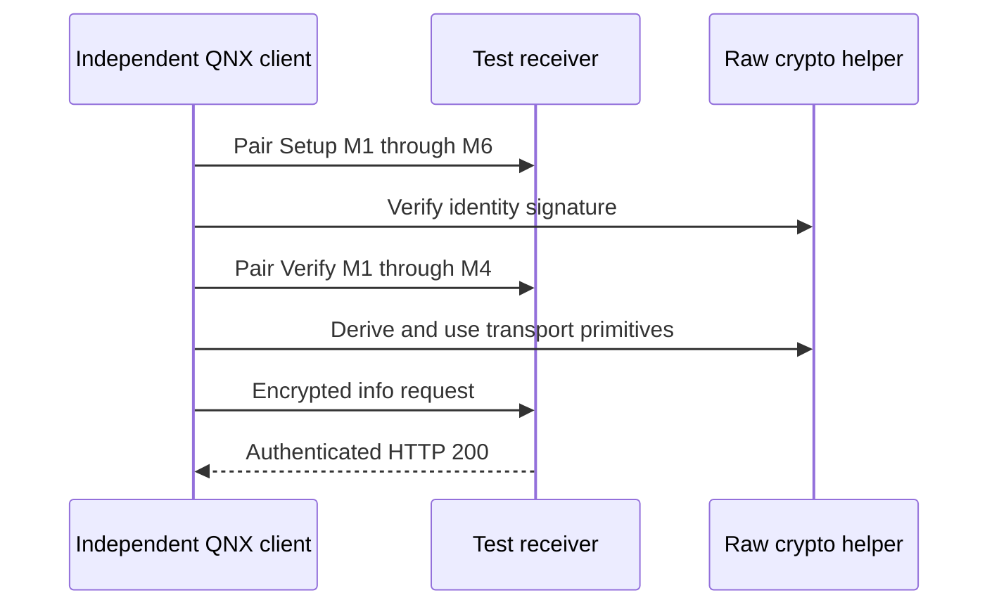

# Independent AirPlay pairing probe (offline QNX/QEMU)

_MHI2Q wireless CarPlay — historical investigation, integrated 2026-09-29._

---

[Wireless overview](../README.md) · [Current stock210 lifecycle](../STOCK210_RECEIVER_LIFECYCLE.md)

Historical investigation; earlier limitations and commands describe that experiment. The current implementation and validation boundary are in the section overview.

Implementation and local diagnostic paths in this record refer to the [original source directory](../../../wireless/receiver_bridge/). Run `wireless/...` commands from the repository root; moving this note does not move binaries or logs.

## 📊 Experiment overview



## 📋 Implementation and evidence

The QEMU-only `independent_srp_qemu.c` client implements SRP-6a and the
HTTP/TLV8 pair-setup and pair-verify state machines without `PairingSession`. It uses QNX
OpenSSL 0.9.8 for BIGNUM, SHA-512 and HKDF. For the M5/M6 identity exchange
it loads only raw Ed25519 and ChaCha20-Poly1305 primitives from the receiver
library; it does not call its pairing state machine. Its ephemeral private
value is fixed for repeatable emulator diagnostics. The program is excluded
from the review bundle and must never run on the head.

Run the local AirPlay 280 receiver image with:

```sh
python3 wireless/receiver_bridge/qemu_capture.py --mesh \
  --start-experiment --seed-display --skip-hid-qemu --mdnsd \
  --mock-mac-qemu --interface-lo0-qemu --airplay280-qemu \
  --airplay280-image wireless/receiver_bridge/out/airplay280_qemu/libairplay.qemu.so \
  --independent-srp-qemu
```

The independent process posts M1 to `/pair-setup`, parses the 16-byte salt
and 384-byte server key in M2, calculates the 3072-bit SRP-6a secret and
client proof, posts M3, then compares the server's M4 proof against its own
SHA-512 calculation. It derives the M5 encryption and signing keys, sends
its controller identity and public key, decrypts M6, and verifies the
accessory's Ed25519 signature. On a fresh connection it generates a Curve25519
ephemeral key, checks the accessory identifier and M2 signature against that
verified identity, signs its M3 response with the same controller key, and
checks the M4 result. It loads the raw Curve25519 primitive from the receiver
library as well. After M4 it independently derives the control read/write
keys from the Curve25519 shared secret, sends an authenticated encrypted
`GET /info` frame and decrypts the response, checking HTTP 200 and the
declared complete body. The QEMU harness requires all four markers:
`[independent-srp-qemu] M1-M4 proof verified` and
`[independent-srp-qemu] M1-M6 identity verified` and
`[independent-srp-qemu] pair-verify M1-M4 verified` and
`[independent-srp-qemu] encrypted /info HTTP 200` in
`out/qemu_independent_srp_airplay280.log`. The same run also verifies the
SDK client's full M1–M6 setup, pair-verify, encrypted `/info`, and a nonempty
keychain with mode `0600`.
The independent client waits for the capture probe's completion marker so
its HTTP traffic cannot race the existing `/info` diagnostic.

Use the separate `--dump-txt-qemu` baseline in [Receiver Identity](RECEIVER_IDENTITY.md) to
compare Bonjour and `/info` identity. Long serial hex dumps can interleave
with other QNX process output in the combined image.

This establishes independent **pair-setup through M6, pair-verify through M4,
and encrypted `/info`**,
while using the receiver library's low-level Curve25519, Ed25519 and ChaCha
primitives. Further encrypted control commands, media and iPhone
interoperability remain untested.
The SDK client's complete flow is documented in [Receiver Identity](RECEIVER_IDENTITY.md).

An optional control-session diagnostic adds `--independent-setup-qemu` to the
command above. It sends an authenticated `SETUP /stream` containing an empty
binary plist (no media `streams` entry) on the same verified connection, after
`/info`. The receiver returned RTSP 200 and the real `dio_manager` emitted
`cb.sessionCreated` (`out/qemu_independent_control_setup_airplay280.log`).
Closing the client connection then caused `AirPlayReceiverSessionTearDown`,
AirPlay server stop, and `dio_manager` shutdown. The ordinary pairing run
omits this diagnostic so its independent manager-liveness check stays valid.
This does not exercise screen or audio stream setup; those are the next
AirPlay receiver paths to validate offline.

`--independent-screen-setup-qemu` (with both independent flags above) changes
that plist to `{streams:[{type:110,streamConnectionID:1}]}` and binds a
QEMU-only UDP timing responder on loopback port 6002. The initial run found
that QNX 6.5 libc lacks `random`, which the 280 SDK's timing thread calls.
`airplay_random_qnx.c` now supplies the 31-bit function via the SDK's
`/dev/urandom`-backed `RandomBytes` in both QEMU and on-unit candidates.
With that fix, timing negotiated three responses, encrypted screen SETUP
returned RTSP 200 and the decrypted plist contained
`{streams:[{type:110,dataPort:65528}],eventPort:65529,timingPort:65530}`.
The encrypted TEARDOWN also returned 200. Before the ScreenRegisterDelegates
fix, a subsequent `dio_manager` shutdown intermittently SIGSEGVed; preserved
failing runs are in
`out/qemu_independent_screen_setup_crash_airplay280.log` and
`out/qemu_screen_sigsegv_regs_airplay280.log`. In the latter, the fault is a
read from address `0x4` at `libutil.so` offset `0x3f004`, inside the unnamed
shared helper at `0x3ef48` called by `UnicodeString8`/`UnicodeString16`
destructors. QNX's nearest-symbol report names `beginsWith` incorrectly
(that symbol ends at `0x3ef48`). The helper reads its object's `+0x0c`
pointer into `r8`, then dereferences `r8+4`; `r8=0` at the fault while the
object's ownership flag at `+0x06` selected that branch. The object address
was `0x1af698`, beyond `dio_manager`'s `.bss` end (`0x1a9c84`). The deeper
`out/qemu_screen_fault_symbolized_02.log` captured the deletion chain:
`libutil` shared-pointer release -> `libcomm` virtual deleter -> its local
`CIString` deleting destructor at `0x6f1f0` -> `UnicodeString8 D2` -> the
fault. The purported string object contained `dio_manager`'s
`s_screenBadFramesCallback` at `+0x08` and `s_screenErrorCallback` at `+0x14`,
evidence of memory aliasing/corruption rather than a normally constructed
string. The QEMU-only `--trace-sigsegv-qemu` probe records the object, stack,
and owning libraries if the fault returns.

The harness now requires both `manager released` and `Shutdown signaled: 1`
after screen TEARDOWN, so an early encrypted `/info` result cannot hide a
shutdown crash. Ten strict repeat runs passed before the fix (five with the
signal trace, five without), illustrating why one successful run did not
clear the bug. With repeated execution of one old diagnostic IFS, the same
fault recurred; after the fix, 25 executions of one new diagnostic IFS each
reached `manager released` and `Shutdown signaled: 1` without SIGSEGV.

The source defect was in the local `hid_2q.c` compatibility shim. Its
`ScreenRegisterDelegates` copied five 32-bit words to `screen+60`, matching
the stock object layout, but the 280 SDK's `ScreenPrivate` is only 48 bytes
on ARM (`CFLObject` 8 bytes plus ten 32-bit fields). That write crossed the
allocation boundary. The staged QEMU and on-unit builds now return from
this legacy registration without writing into the 280 screen object; the
280 receiver's own `ScreenStream` path handles screen events. A compile-time
size assertion in the staged SDK prevents silent layout drift. This fixes
the identified out-of-bounds write and the observed QEMU lifecycle fault;
actual screen media packets, iPhone interop and on-unit behavior remain
unverified.

An additional **QEMU-only** `--screen-data-qemu --screen-frame-qemu` run now
tests the first screen packets. The independent client parses `eventPort` and
`dataPort` from the binary-plist SETUP response, connects the event socket,
sends authenticated `RECORD /stream` (RTSP 200), then connects the screen TCP
socket. It sends a 128-byte KeepAlive header, a VideoConfig header with the
SDK's sample `avcC` SPS/PPS, and one tiny AVCC frame encrypted with the
pair-verify stream key derived from `DataStream-Salt1` and
`DataStream-Output-Encryption-Key`. The receiver accepted all three: the
QEMU fake OMX logged `EmptyThisBuffer` with 30 bytes of Annex-B codec config
and then 8 bytes of frame data. `ProcessFrames` returned 0, encrypted
TEARDOWN returned 200, and stock `dio_manager` released. Three strict repeat
runs passed (`out/qemu_screen_encrypted_frame_{1,2,3}.log`).

The virtual BSP has no pipe resource manager, so this diagnostic supplies a
selectable loopback pair for the SDK's `NetSocket` cancellation pipe. It also
sets `FAKEOMX_ASYNC_FILL=1`; the QEMU fake decoder otherwise calls
`FillBufferDone` synchronously and recurses into `FillThisBuffer`, unlike the
real Qualcomm decoder. These changes are confined to the QEMU capture image.
The fake OMX **does not decode or display video**, and the sample frame is
only a transport/crypto/backend-feed probe; real decoding and screen output
remain unverified until hardware is available.

Add `--independent-setup-qemu --independent-screen-setup-qemu`
`--screen-data-qemu --screen-frame-qemu --screen-audio-qemu` to the base
command above to reproduce the combined media probe. The last flag adds a
second stream to the same `SETUP`: MainAudio type 100,
`streamConnectionID=2`, PCM/44100/16/2.
The encrypted response returned a separate UDP `dataPort`. After `RECORD`,
the client sent 80 RTP packets, each with 352 stereo PCM frames and
ChaCha20-Poly1305 authentication using the `DataStream-Salt2` output key.
All 80 calls to the receiver's `RTPJitterBufferPutBusyNode` returned 0;
the QEMU null audio backend's output callback received nonzero PCM samples.
Encrypted TEARDOWN returned 200 and stock `dio_manager` shut down normally
(`out/qemu_screen_audio_pcm_stream_1.log`). This follows the encrypted audio
path through authentication, endian conversion, the jitter buffer and the
playback callback. The guest-paced stream had 17 rebuffer events, so it is
not evidence of glitch-free audio. The QEMU backend drops the PCM; real QSA
playback, audio routing and microphone capture remain unverified.
Two strict runs completed this 80-packet path
(`out/qemu_screen_audio_pcm_stream_{1,2}.log`). A third run exposed an
intermittent, earlier failure in the SDK pairing client's encrypted `/info`:
the receiver returned HTTP 500 while serializing an invalid CFLite object
after querying `rightHandDrive`
(`out/qemu_screen_audio_pcm_stream_pairinfo500.log`). The independent client
subsequently completed `/info` and the media session in that same image.
The strict harness correctly rejected the run. The invalid object's origin
is not yet identified; this prevents claiming stable pairing across repeats.
Ten subsequent QEMU runs with an optional `/info` CF-type diagnostic passed,
but its logging can change timing; see [Info Serialization](INFO_SERIALIZATION.md).

The optional `--screen-linger-qemu` diagnostic keeps the verified client's
TCP socket open for two seconds after the encrypted TEARDOWN response. The
strict harness checks the observed ordering: `screen linger before close`,
`manager released`, then `screen linger complete`. It passed both with and
without the SIGSEGV trace. Therefore the stock manager's shutdown completes
while the client socket remains open; closing that socket is not required to
start shutdown. This experiment preceded the shim fix and helped exclude
client-close timing as the only shutdown trigger.

An exploratory QEMU PCI/e1000 host-forwarding image did not expose a guest
NIC: the QNX 6.5 virtual BSP's `pci-server` exited with
`Can't locate PCI server: Bad file descriptor`, followed by missing `/dev/pci`
(`out/qemu_host_net_probe.log`). This is why the independent probe runs inside
QNX instead of connecting from the macOS host. No head-unit action occurred.
