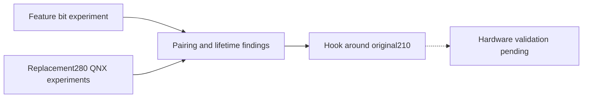

# Wireless CarPlay investigation history

_Earlier bootstrap and AirPlay280 experiments, retained as evidence — integrated 2026-09-29._

---

[Wireless overview](../README.md) · [Current stock210 lifecycle](../STOCK210_RECEIVER_LIFECYCLE.md)

## 📋 How to read these records

These notes describe the stage at which each experiment ran. Their claims about
missing functionality, unresolved failures and proposed installation are local
to that stage. Current implementation status belongs to the stock210 overview.
No historical handoff instruction below authorizes hardware actions.

## 📚 Archived notes

| Record | What it preserves |
|---|---|
| [Original handoff](CODEX_HANDOFF.md) | Initial RFCOMM task, corrected assumptions and donor addresses |
| [Feature-bit experiment](FEATURE_BIT_EXPERIMENT.md) | Capability arithmetic without a pairing implementation |
| [Bonjour readiness](BONJOUR_READINESS.md) | Interface gate and local registration versus multicast proof |
| [Receiver identity](RECEIVER_IDENTITY.md) | Device ID, pi, public key and replacement280 pairing investigation |
| [Independent pairing probe](INDEPENDENT_PAIRING_PROBE.md) | SRP/Verify/media probe development and negative results |
| [Info serialization](INFO_SERIALIZATION.md) | Delegate/CF ownership failures and quiesce experiments |
| [Experimental280 bundle](EXPERIMENTAL280_BUNDLE.md) | Replacement-receiver archive and its build evidence |
| [Experimental280 installer](EXPERIMENTAL280_INSTALLER.md) | Historical staging/rollback checks; incompatible with stock210 review |

## 🔗 Current successors

- [Pairing source recipe](../AIRPLAY280_PAIRING_RECIPE.md) and [stock210 HTTP ABI](../STOCK210_HTTP_PAIRING_ABI.md)
- [Stock210 media ABI](../STOCK210_MEDIA_CRYPTO_ABI.md) and [validation ledger](../STOCK210_VALIDATION.md)
- [DIO ownership](../DIO_OWNERSHIP.md) and [combined receiver lifecycle](../STOCK210_RECEIVER_LIFECYCLE.md)
